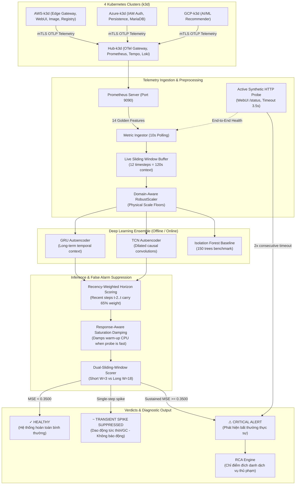

# Multi-Cloud Observability AI Engine: Anomaly Detection & RCA

Module AI thông minh phục vụ giám sát độ tin cậy hệ thống đa đám mây (Multi-Cloud Reliability & Observability), phát hiện bất thường chuỗi thời gian đa biến (Multivariate Time-Series Anomaly Detection) và tự động khoanh vùng nguyên nhân gốc rễ (Root Cause Analysis - RCA) trên hệ thống phân tán microservices TeaStore trải rộng trên 4 cụm Kubernetes (`hub-k3d`, `aws-k3d`, `azure-k3d`, `gcp-k3d`).

---

## 1. Kiến trúc Tổng thể (System Architecture)



---

## 2. Danh mục 14 Đặc trưng Cốt lõi (14 Golden Features)

AI liên tục theo dõi và đồng hóa 14 chỉ số vi mô theo chu kỳ 10 giây:

| STT | Tên đặc trưng (`feature`) | Nguồn dữ liệu & PromQL Expression | Ý nghĩa giám sát |
| :-: | :--- | :--- | :--- |
| **1** | `throughput_qps` | `sum(rate(http_server_request_duration_seconds_count[1m]))` | Tổng lưu lượng request toàn cụm (RED Metrics) |
| **2** | `latency_p95` | `histogram_quantile(0.95, sum by (le) (rate(...[1m])))` | Độ trễ 95th Percentile phản hồi người dùng |
| **3** | `app_cpu_pct` | `avg(jvm_cpu_recent_utilization_ratio * jvm_cpu_count) * 100` | Mức sử dụng CPU trung bình 7 microservices |
| **4** | `max_pod_cpu_pct` | `max(jvm_cpu_recent_utilization_ratio * jvm_cpu_count) * 100` | Tải CPU của pod chạy nặng nhất (phát hiện Hotspot) |
| **5** | `app_ram_pct` | `avg(sum(jvm_memory_used_bytes) / sum(jvm_memory_limit_bytes))` | Tỷ lệ chiếm dụng RAM JVM Heap trung bình |
| **6** | `max_pod_ram_pct` | `max(sum(jvm_memory_used_bytes) / sum(jvm_memory_limit_bytes))` | Đỉnh RAM JVM Heap cao nhất (phát hiện rò rỉ bộ nhớ) |
| **7** | `jvm_threads_live` | `avg(jvm_thread_count)` | Số luồng xử lý đồng thời trong máy ảo Java |
| **8** | `jvm_gc_pause_rate` | `sum(rate(jvm_gc_duration_seconds_sum[1m]))` | Thời gian dừng máy ảo để dọn rác (GC Pauses) |
| **9** | `webui_cpu_pct` | `avg(jvm_cpu_recent_utilization_ratio{service="teastore-webui"})` | Tải CPU riêng của tầng Web Gateway trên AWS |
| **10**| `webui_ram_pct` | `sum(jvm_memory_used_bytes{service="teastore-webui"})` | Tải RAM riêng của tầng Web Gateway trên AWS |
| **11**| `persistence_cpu_pct`| `avg(jvm_cpu_recent_utilization_ratio{service="persistence"})` | Tải CPU riêng của tầng Database Persistence trên Azure |
| **12**| `persistence_ram_pct`| `sum(jvm_memory_used_bytes{service="persistence"})` | Tải RAM riêng của tầng Database Persistence trên Azure |
| **13**| `image_cpu_pct` | `avg(jvm_cpu_recent_utilization_ratio{service="image"})` | Tải CPU của tầng sinh ảnh sản phẩm trên AWS |
| **14**| `wan_network_io_kbs` | `sum(rate(system_network_io_bytes_total[1m])) / 1024` | Băng thông mạng truyền qua hầm liên mây (WAN I/O) |

---

## 3. Các Thành phần Mô hình & Thuật toán

### 3.1. Deep Learning Ensemble
* **GRU Autoencoder** ([`models/gru_autoencoder.py`](models/gru_autoencoder.py)): 2 tầng Gated Recurrent Unit (hidden dimension 64, bottleneck latent dimension 16), nắm bắt phụ thuộc ngữ cảnh chuỗi dài hạn 120s.
* **TCN Autoencoder** ([`models/tcn_autoencoder.py`](models/tcn_autoencoder.py)): Temporal Convolutional Network với Dilated Causal Convolutions (dilation factors: 1, 2, 4; kernel size: 3), bắt trọn các dao động răng cưa ngắn hạn của JVM Garbage Collection.
* **Isolation Forest Baseline** ([`training/train.py`](training/train.py)): 150 cây quyết định độc lập trên không gian phẳng $12 \times 14 = 168$ chiều, đối chứng độ dị biệt phân phối dữ liệu.

### 3.2. Cơ chế Khắc phục Báo động giả (False Alarm Suppression)
1. **Sàn vật lý thích ứng (Domain-Aware Scale Floors)**:
   Các đặc trưng có khoảng biến thiên hẹp lúc bình thường (như `latency_p95` khoảng 45ms, hoặc `jvm_threads_live` khoảng 26) được đặt sàn IQR tối thiểu trong [`data/preprocess.py`](data/preprocess.py) để trạng thái nhàn rỗi hoặc chạy nhanh không bị thổi phồng sai số lên hàng trăm lần.
2. **Trọng số Thời gian gần (Recency-Weighted Horizon Scoring)**:
   Hàm mũ $e^{0.45 \cdot (t - 11)}$ phân bổ trọng số: các mẫu vừa diễn ra `[t-2, t-1, t]` chiếm 65% trọng số đánh giá. Nhờ đó khi sự cố vừa được khắc phục, điểm MSE lập tức hạ xuống, triệt tiêu hoàn toàn hiện tượng "nhớ dai báo còi nhầm" trong suốt 2 phút tiếp theo.
3. **Giảm chấn theo Sức khỏe phản hồi (Response-Aware Saturation Damping)**:
   Khi đầu cuối thực tế vẫn trả về `HTTP 200`, độ trễ `< 250ms`, việc CPU tăng lên 25%–45% do Tomcat biên dịch JSP/JIT hoặc đón đợt Flash-Crowd được xem là tải có ích và giảm chấn trọng số về $0.18$, ngăn báo động giả lúc khởi động.
4. **Bộ lọc Cửa sổ kép (Dual-Sliding-Window Scorer)**:
   So sánh cửa sổ ngắn ($W_{\text{short}} = 3$ mẫu / 30s) và cửa sổ dài ($W_{\text{long}} = 18$ mẫu / 180s). Các xung đột biến đơn lẻ (transient spike) do GC pause sẽ được tự động lọc bỏ.

### 3.3. Active Synthetic HTTP Health Probe
Script chạy ngầm gửi probe HTTP định kỳ mỗi 10 giây đến `http://localhost:8080/tools.descartes.teastore.webui/status` (timeout 3.5s). Nếu phát hiện WebUI bị treo/đơ kết nối liên tiếp 2 chu kỳ, AI lập tức phát chuông báo động ngay cả khi Prometheus chưa ghi nhận lỗi HTTP 5xx.

---

## 4. Cơ chế Chỉ điểm Nguyên nhân Gốc rễ (Root Cause Analysis - RCA)

Khi xuất hiện cảnh báo `[⚠ ALERT]`, AI tính tỷ số sai lệch tái tạo của từng đặc trưng độc lập:
$$\text{Tỷ lệ lệch (Ratio)} = \frac{\text{Sai số tái tạo thực tế của đặc trưng } i}{\text{Ngưỡng kích hoạt RCA chuẩn của đặc trưng } i}$$

Bảng ngưỡng kích hoạt chuẩn (tính từ phân phối dữ liệu sạch tại [`models/saved/threshold_config.json`](models/saved/threshold_config.json)):
* Các chỉ số CPU, Độ trễ, Mạng WAN: Ngưỡng kích hoạt sàn = **`0.250`**
* Chỉ số RAM Tomcat WebUI: Ngưỡng kích hoạt = **`0.419`** (tự động nới lỏng để thích nghi với chu kỳ cấp phát RAM tự nhiên của Java)
* Chỉ số RAM Persistence Azure: Ngưỡng kích hoạt = **`0.313`**

👉 AI tự động xếp hạng các đặc trưng có tỷ lệ lệch cao nhất và in ra khuyến nghị chuẩn đoán cụ thể.

---

## 5. Hướng dẫn Thực thi & Vận hành (Runbook)

### 5.1. Yêu cầu môi trường
* Hệ điều hành: Linux (Ubuntu 22.04+)
* Python: `/usr/bin/python3.12`
* Thư viện: `torch`, `scikit-learn`, `pandas`, `scipy`, `numpy`, `matplotlib`, `pyyaml`, `joblib`

### 5.2. Các câu lệnh thực thi

#### Bước 1: Huấn luyện lại mô hình (Preprocess + Train)
```bash
python3.12 ai-engine/training/train.py
```
*Tự động tiền xử lý 3,327 cửa sổ, huấn luyện GRU + TCN + Isolation Forest, hiệu chuẩn ngưỡng cảnh báo và xuất biểu đồ tại `ai-engine/data/processed/training_loss.png`.*

#### Bước 2: Khởi chạy Giám sát & Phát hiện Bất thường Thời gian thực
```bash
python3.12 ai-engine/inference/detector.py --interval 10
```
*Tự động mở port-forward Prometheus (9090), thăm dò WebUI probe, in kết quả sức khỏe hệ thống mỗi 10 giây.*

#### Bước 3: Giả lập Tải Người dùng Thất thường (Live Traffic Benchmark)
```bash
python3.12 tests/locust/traffic_generator.py --erratic --min-users 6 --max-users 42 --duration 300
```
*Tự động đổi trạng thái mỗi 25s: Flash-Crowd, Sudden-Drop, Rollercoaster, Burst-Spike.*

#### Bước 4: Chạy Bộ thẩm định Ground-Truth & Tiêm sự cố thử nghiệm
```bash
python3.12 ai-engine/inference/evaluate_test.py --benchmark
```
*Tự động kiểm chứng 5 kịch bản (Flash-Crowd, Warm-up, Nghẽn Database, Tràn RAM Azure, Nghẽn WAN).*

---

## 6. Cấu trúc Thư mục Module AI

```
ai-engine/
├── configs/
│   └── model_config.yaml           # Cấu hình siêu tham số, window size, danh sách features
├── data/
│   ├── raw/
│   │   ├── normal_baseline_4h.csv  # Tập dữ liệu đo lường vi mô 4 giờ chuẩn (1,440 mẫu)
│   │   └── .gitkeep
│   ├── processed/
│   │   ├── train_windows.npy       # 3,327 tensor cửa sổ huấn luyện đã tăng cường
│   │   ├── val_windows.npy         # 288 tensor cửa sổ kiểm định độc lập
│   │   ├── feature_names.json      # Metadata 14 Golden Features
│   │   └── training_loss.png       # Biểu đồ đường cong học tập (Convergence curves)
│   ├── collector.py                # Script thu thập dữ liệu tự động từ Prometheus API
│   ├── analyze_data.py             # Script phân tích khám phá dữ liệu (EDA)
│   └── preprocess.py               # Module tiền xử lý, Scale Floors & Tăng cường kịch bản tải
├── models/
│   ├── gru_autoencoder.py          # PyTorch GRU Autoencoder
│   ├── tcn_autoencoder.py          # PyTorch Temporal Convolutional Network Autoencoder
│   └── saved/
│       ├── gru_autoencoder.pt      # Trọng số tối ưu GRU (Val MSE = 0.05915)
│       ├── tcn_autoencoder.pt      # Trọng số tối ưu TCN (Val MSE = 0.000088)
│       ├── isolation_forest.joblib # Mô hình Isolation Forest đã fit (100% Normal Acc)
│       ├── robust_scaler.joblib    # Bộ chuẩn hóa Domain-Aware RobustScaler
│       └── threshold_config.json   # Ngưỡng cảnh báo P99 (0.3500) và RCA Trigger Baselines
├── inference/
│   ├── detector.py                 # Engine giám sát online thời gian thực & RCA
│   └── evaluate_test.py            # Công cụ đối chiếu Ground-Truth & Tiêm lỗi benchmark
└── training/
    ├── train.py                    # Pipeline tự động huấn luyện & hiệu chuẩn ngưỡng
    └── training_report.md          # Báo cáo kỹ thuật chi tiết kết quả huấn luyện
```

