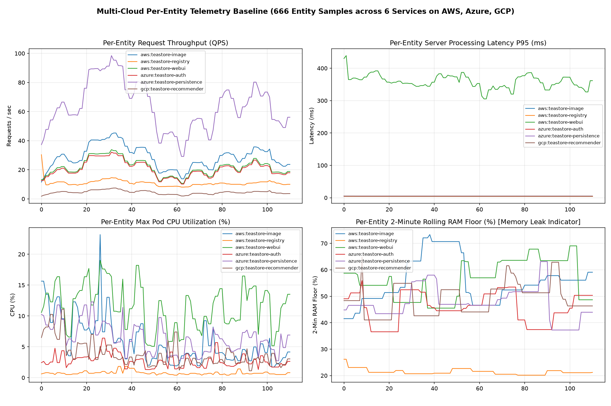

# Multi-Cloud Per-Entity Telemetry EDA Report (V3)

- **Dataset File**: `ai-engine/data/raw/multicloud_entity_baseline.csv`
- **Total Sampling Cycles**: `111`
- **Total Entity Rows**: `666`
- **Discovered Multi-Cloud Entities (6)**: `aws:teastore-image`, `aws:teastore-registry`, `aws:teastore-webui`, `azure:teastore-auth`, `azure:teastore-persistence`, `gcp:teastore-recommender`

## Per-Entity Baseline Statistics (Median / IQR / P95 / P99)

| Entity (`cloud:service`) | QPS Med (P95) | Server Lat P95 Med (P99) | Client Lat P95 Med (P99) | CPU% Med (P95) | RAM% Med (P95) | 2-Min RAM Floor P99 |
| :--- | :---: | :---: | :---: | :---: | :---: | :---: |
| `aws:teastore-image` | 27.8 (41.9) | 4.8ms (4.9ms) | 4.8ms (4.9ms) | 4.6% (13.1%) | 70.6% (83.3%) | 72.1% |
| `aws:teastore-registry` | 10.6 (13.9) | 4.8ms (4.8ms) | 0.0ms (0.0ms) | 0.7% (1.5%) | 27.9% (35.7%) | 25.9% |
| `aws:teastore-webui` | 21.0 (31.2) | 357.0ms (426.2ms) | 4.8ms (4.8ms) | 11.8% (17.2%) | 69.7% (91.3%) | 69.1% |
| `azure:teastore-auth` | 20.1 (29.7) | 4.8ms (4.8ms) | 24.6ms (25.0ms) | 2.5% (4.8%) | 54.6% (70.6%) | 53.5% |
| `azure:teastore-persistence` | 62.1 (91.2) | 4.8ms (4.8ms) | 24.2ms (25.0ms) | 6.3% (11.6%) | 56.8% (73.9%) | 63.1% |
| `gcp:teastore-recommender` | 4.4 (6.8) | 4.8ms (4.9ms) | 24.5ms (24.9ms) | 3.3% (8.0%) | 65.5% (86.4%) | 62.9% |

## Visual Summary

