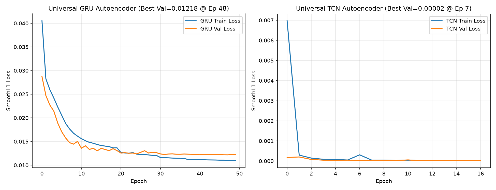

# Báo cáo Huấn luyện Hệ thống AI Đa Đám Mây V3 (Zero-Leakage & Unified Scoring)

## 1. Kiến trúc, Phân tách Dữ liệu & Chống Rò rỉ (Zero Data Leakage)
- **Dữ liệu nguồn (`source_runs`)**: `20261112_teastore_normal-baseline_run02`
- **Chiến lược chia tập dữ liệu**: `blocked_interleaved_with_embargo` (tham số: `{"split_block_rows": 60, "val_every_n_blocks": 5, "embargo_rows": 12, "max_gap_seconds": 25, "sampling_interval_seconds": 10, "val_split": 0.2}`), chia cho từng thực thể trước khi tính baseline và trước khi cắt cửa sổ trượt.
- **Phạm vi tính `entity_baselines.json`**: Chỉ tính trên tập `Train` (`fit_scope = train_only`), tuyệt đối không dùng mẫu của tập `Validation`.
- **Chồng lấn cửa sổ (`Window Overlap`)**: `0` mẫu thời gian dùng chung giữa `train_windows` và `val_windows`.
- **Số cửa sổ Train (đã tăng cường)**: `37764`
- **Số cửa sổ Validation độc lập**: `1176`
- **8 Đặc trưng Thực thể Chuẩn**: `qps`, `server_latency_p95`, `client_latency_p95`, `error_rate_5xx`, `max_pod_cpu_pct`, `max_pod_ram_pct`, `ram_floor_2m_pct`, `gc_pause_rate`

## 2. Kết quả Hội tụ & Hiệu chỉnh Ngưỡng (Unified Scoring)
- **Hàm chấm điểm dùng chung**: [`models/scoring.py`](../models/scoring.py) (`compute_directional_errors` & `DualSlidingWindowScorer`) dùng thống nhất giữa huấn luyện và suy luận.
- **Universal GRU Autoencoder**: Best Disjoint Val Loss = `0.012180` (Epoch `48`)
- **Universal TCN Autoencoder**: Best Disjoint Val Loss = `0.000020` (Epoch `7`)
- **Universal Isolation Forest**: Disjoint Validation Normal Accuracy = `100.00%`
- **Ngưỡng quyết định bất thường (`recommended_threshold_p99`)**: `2.4671` (Disjoint Val Mean = `0.01915`, P99 = `0.50528`, Max = `2.14532`)

## 3. Kiểm định Xác suất Lỗi (`likelihood_pct` Calibration Verification)
- **Phương pháp hiệu chuẩn**: `logistic_boundary_anchored` (neo $P(\text{anomaly} \mid \text{MSE} = \tau) = 50.0\%$ và $P(\text{anomaly} \mid \mu_{\text{val}}) \le 1.0\%$, Temperature = `0.532729`)
- **Brier Score**: `0.000356` (Mục tiêu $\le 0.05$)
- **Expected Calibration Error (ECE)**: `0.010624` (Mục tiêu $\le 0.10$)
- **Log-Loss**: `0.010870`
- **Xác suất trên tập Validation khỏe mạnh**: Trung bình `1.01%` | P95 `1.0%` | Max `9.58%` ($< 50\%$)
- **Xác suất trên các kịch bản lỗi chuẩn**: Min `47.9%` | Trung bình `89.46%` ($> 50\%$)
- **Trạng thái kiểm định (`calibration_verified`)**: `False`

## 4. Biểu đồ Hội tụ

