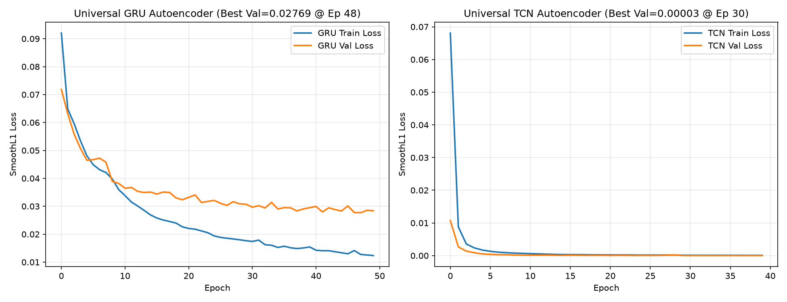

# Báo cáo Huấn luyện Hệ thống AI Đa Đám Mây V3 (Universal Per-Entity Autoencoder)

## 1. Kiến trúc & Dữ liệu Huấn luyện
- **Mô hình**: Universal Per-Entity `GRUAutoencoder` + `TCNAutoencoder` + `IsolationForest`
- **Cửa sổ Đầu vào**: `(12 bước × 8 đặc trưng chuẩn hóa Z-Score theo từng thực thể)`
- **Số cửa sổ Train (đã tăng cường)**: `2880`
- **Số cửa sổ Validation**: `120`
- **8 Đặc trưng Thực thể Chuẩn**: `qps`, `server_latency_p95`, `client_latency_p95`, `error_rate_5xx`, `max_pod_cpu_pct`, `max_pod_ram_pct`, `ram_floor_2m_pct`, `gc_pause_rate`

## 2. Kết quả Hội tụ Mô hình
- **Universal GRU Autoencoder**: Best Val Loss = `0.027690` (Epoch `48`)
- **Universal TCN Autoencoder**: Best Val Loss = `0.000029` (Epoch `30`)
- **Universal Isolation Forest**: Validation Normal Accuracy = `100.00%`
- **Ngưỡng quyết định bất thường (`recommended_threshold_p99`)**: `0.3500` (Validation P99 = `0.03835`)

## 3. Biểu đồ Hội tụ

