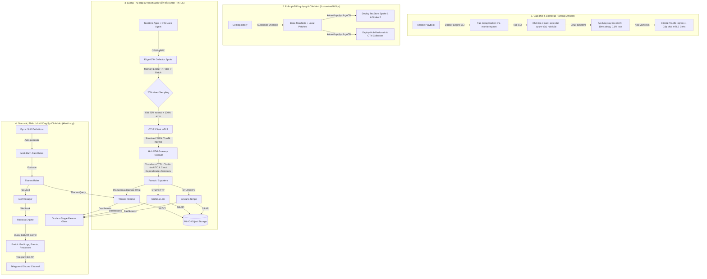

# Quyết Định Tech Stack Giám Sát Đa Đám Mây (Multi-Cloud Observability Tech Stack Decision)

> **Tài liệu:** `docs/architecture/00_TechStack.md`  
> **Phiên bản:** 1.0 (Phase 0 — Baseline Architecture)  
> **Trạng thái:** Quyết định phê duyệt (Approved Architecture Decision)  
> **Chiến lược cốt lõi:** Áp dụng **Phương án A** (Edge-Filtered Ingestion with Centralized Processing & Batch Ingestion). Tạm thời chưa tích hợp streaming AI inference ở phase này (dành cho phase sau). Tỷ lệ lấy mẫu vết (trace sampling) khởi điểm là **20%** và sẽ giảm dần theo lộ trình tối ưu hóa.

---

## 1. Tổng Quan & Bối Cảnh Kỹ Thuật (Context & Mission)

Mục tiêu của dự án là xây dựng và đánh giá thực nghiệm một nền tảng giám sát đa đám mây (Multi-Cloud Observability Platform) có khả năng tái lập (reproducible), hiệu năng cao và tối ưu chi phí dựa trên mô hình trung tâm - vệ tinh (**Hub-Spoke architecture**). 

Hệ thống được thiết kế theo 2 giai đoạn môi trường rõ rệt:
1. **Môi trường giả lập cục bộ (Local Lab Simulation):** Gồm 3 cụm Kubernetes k3d chạy trên Docker Engine:
   - `aws-k3d` (**Spoke 1** - Nhãn mô phỏng AWS): Chạy các vi dịch vụ tính toán (compute services) và bộ tạo tải (load generator) của ứng dụng chuẩn TeaStore.
   - `azure-k3d` (**Spoke 2** - Nhãn mô phỏng Azure): Chạy các vi dịch vụ dữ liệu/lưu trữ (persistence/data services) và cơ sở dữ liệu MySQL của TeaStore.
   - `hub-k3d` (**Central Hub**): Cụm tập trung thu thập toàn bộ dữ liệu viễn trắc (telemetry), lưu trữ, phân tích, thiết lập cảnh báo và trực quan hóa.
   - *Lưu ý quan trọng:* Tên `aws-k3d` và `azure-k3d` thuần túy là nhãn mô phỏng cục bộ (simulation labels), không đại diện cho tài nguyên thực tế của nhà cung cấp điện toán đám mây.
2. **Môi trường đám mây thực tế (Real Cloud Transition - Phase sau):** Mở rộng kiến trúc sang các nhà cung cấp đám mây thực (AWS EKS, Azure AKS, GCP GKE) bằng Terraform mà không phải thay đổi cấu trúc schema và luồng viễn trắc cốt lõi.

---

## 2. Bảng Danh Mục Phân Loại Tech Stack (Categorized Tech Stack Matrix)

| Lớp kiến trúc (Layer) | Công nghệ / Công cụ | Vai trò & Mục đích sử dụng | Phạm vi áp dụng |
|---|---|---|---|
| **Container & Runtime** | Docker Engine, containerd, runc | Nền tảng đóng gói container, quản lý cgroups, namespace, volume và mạng cầu nối cục bộ. | Toàn bộ Host & Lab nodes |
| **Cluster Orchestration** | Kubernetes (k3d / k3s) | Điều phối container siêu nhẹ (lightweight K8s), tạo lập 3 cụm biệt lập `aws-k3d`, `azure-k3d`, `hub-k3d` trên một Docker daemon. | Local Lab Infrastructure |
| **Infrastructure as Code (IaC)** | Ansible | Tự động hóa khởi tạo cụm k3d, cấu hình mạng WAN mô phỏng (`tc/netem`), gán nhãn node và chuẩn bị môi trường. | Local Lab Provisioning |
| **Cloud IaC (Phase sau)** | Terraform | Định nghĩa và cấp phát hạ tầng đám mây thực tế (AWS, Azure, GCP) có quản lý state độc lập. | Real Cloud Phase |
| **GitOps & Manifests** | Kustomize | Quản lý cấu hình Kubernetes khai báo (declarative configuration) không dùng template, phân tách base và overlays. | Quản lý Manifests K8s |
| **GitOps Delivery (Tùy chọn)** | ArgoCD | Tự động đồng bộ khai báo từ Git sang các cụm K8s (sử dụng khi cần tự động hóa Continuous Delivery). | GitOps Pipeline |
| **Telemetry Ingestion & Pipeline** | OpenTelemetry (OTel Agent, Collector Contrib, Gateway) | Thu thập, làm giàu (enrich), chuyển đổi (OTTL), lọc tại biên (edge-filter), lấy mẫu (20% trace sampling), và chuyển tiếp OTLP qua mTLS. | Spoke 1, Spoke 2 & Hub |
| **Metrics Storage & TSDB** | Prometheus + Thanos (Receive, Query, Store, Compact) | Thu thập metric ngắn hạn (Prometheus) và tổng hợp, lưu trữ metric dài hạn không giới hạn (Thanos). | Hub Cluster |
| **Logs Storage** | Grafana Loki | Lưu trữ nhật ký hệ thống (logs) theo kiến trúc chunk-based tối ưu chi phí, lập chỉ mục theo labels. | Hub Cluster |
| **Distributed Tracing** | Grafana Tempo | Lưu trữ và truy vấn phân tán dấu vết thực thi (distributed traces) quy mô lớn với chi phí thấp (Object Storage). | Hub Cluster |
| **Object Storage (S3-compatible)** | MinIO | Lưu trữ đối tượng tương thích S3 tại local lab cho 3 bucket riêng biệt (`thanos-bucket`, `loki-bucket`, `tempo-bucket`). | Hub Cluster |
| **Trực quan hóa (Visualization)** | Grafana | Giao diện quản trị tập trung (Single Pane of Glass) kết nối tương quan chéo giữa Metrics, Logs và Traces. | Hub Cluster |
| **SLO Management** | Pyrra | Quản lý Mục tiêu Mức độ Dịch vụ dưới dạng mã (SLO-as-code), tự động sinh PromQL Multi-Burn-Rate alerting rules. | Hub Cluster |
| **Alert Routing & Automation** | Thanos Ruler + Alertmanager + Robusta | Đánh giá rule PromQL (Thanos Ruler), khử trùng lặp/định tuyến (Alertmanager), làm giàu ngữ cảnh lỗi K8s (Robusta Engine). | Hub Cluster |
| **Kênh thông báo (Notification Sinks)** | Telegram / Discord | Tiếp nhận thông báo sự cố tức thời kèm theo snapshot log, event pod từ Robusta. | Kênh bên ngoài |
| **Benchmark Application** | TeaStore | Ứng dụng mẫu microservices thương mại điện tử chuẩn SPEC RG để sinh tải và đánh giá viễn trắc. | Spoke 1 & Spoke 2 |

---

## 3. Mục Đích Sử Dụng & Phân Tích Chuyên Sâu Từng Thành Phần

### 3.1. Docker & Docker Engine (Local Runtime)
- **Mục đích:** Cung cấp môi trường thực thi container cô lập dựa trên Linux namespaces (PID, NET, MNT, IPC, UTS) và cgroups (kiểm soát CPU/RAM quota). Nền tảng thực thi trên máy trạm sử dụng **Ubuntu 26.04** kết hợp **Docker Engine 29.8.2** (Docker Desktop **v4.95.0**).
- **Nguyên lý ứng dụng:** Tuân thủ các nguyên tắc từ tài liệu tham khảo kỹ thuật container (`[Reading1]-Docker.pdf` & `[Reading2]-Docker.pdf`):
  - Ứng dụng mô hình **Multi-stage build** để tối ưu dung lượng image cho các dịch vụ tùy biến và OTel Collector, loại bỏ toàn bộ công cụ build khỏi image sản phẩm cuối nhằm giảm thiểu bề mặt tấn công (attack surface).
  - Sử dụng **Named Volumes** để đảm bảo tính bền bỉ của dữ liệu MinIO cục bộ và phân tách dữ liệu thô (raw telemetry data) không bị mất khi container khởi động lại.
  - Sử dụng mạng cầu nối Docker (**User-defined Bridge Network**) đặt tên `mc-monitoring-net` để kết nối 3 cụm k3d, cho phép giao tiếp DNS nội bộ giữa các cụm.

### 3.2. Kubernetes (k3d / k3s)
- **Mục đích:** Tạo lập môi trường đa cụm (multi-cluster) cục bộ với tài nguyên tối thiểu.
- **Lý do lựa chọn:** k3d đóng gói k3s chạy hoàn toàn bên trong Docker container. Mỗi cụm k3d chỉ tiêu tốn ~512MB RAM, cho phép máy trạm cục bộ vận hành đồng thời cả 3 cụm (`aws-k3d`, `azure-k3d`, `hub-k3d`) mà không gây quá tải tài nguyên hệ thống.
- **Phân bổ vai trò:**
  - `aws-k3d`: 1 server node, chạy 4 microservices tính toán của TeaStore + OTel Edge Collector + Load Generator.
  - `azure-k3d`: 1 server node, chạy microservice lưu trữ Persistence + MySQL Database + OTel Edge Collector.
  - `hub-k3d`: 1 server node, chạy toàn bộ cụm backend giám sát (OTel Gateway, Thanos, Loki, Tempo, MinIO, Grafana, Robusta).

### 3.3. Kustomize & ArgoCD (Quản Lý Cấu Hình & Phân Phối GitOps)
- **Kustomize:** Được tích hợp sẵn trong `kubectl`. Kustomize cho phép duy trì một thư mục manifest gốc (`base/`) và ghi đè các tham số đặc thù của từng môi trường (`overlays/local-k3d/`, `overlays/cloud-production/`) thông qua các patch file mà không cần sửa đổi mã nguồn manifest gốc.
- **ArgoCD:** Triển khai tại cụm `hub-k3d` (ở phase hoàn thiện GitOps). ArgoCD định kỳ quét kho lưu trữ Git và đồng bộ trạng thái mong muốn (desired state) xuống 3 cụm thông qua cơ chế Multi-cluster Kubernetes ServiceAccount.

### 3.4. Ansible & Terraform (Tự Động Hóa Hạ Tầng Hai Giai Đoạn)
- **Ansible (Dành cho Local Lab Phase):**
  - Tự động hóa kịch bản chạy lệnh CLI để tạo cụm k3d, cấu hình `kubeconfig`, gán nhãn cluster metadata.
  - Tự động thiết lập cấu hình suy hao mạng WAN (WAN emulation) qua công cụ Linux `tc` (Traffic Control) và `netem` trên Docker interface (mô phỏng RTT 10ms, jitter 2ms, packet loss 0.1%).
- **Terraform (Dành cho Real Cloud Phase):**
  - Quản lý hạ tầng đám mây thực tế dạng mã (Infrastructure as Code) với các module tách biệt (`modules/eks`, `modules/aks`, `modules/gke`).
  - Đảm bảo tính độc lập về state file, tuân thủ nguyên tắc không tạo chi phí khi chưa được phê duyệt.

### 3.5. OpenTelemetry Ecosystem (Thu Thập & Xử Lý Viễn Trắc)
Hệ thống sử dụng OpenTelemetry làm chuẩn thống nhất cho cả 3 trụ cột (Metrics, Logs, Traces):
- **OTel Java Auto-Instrumentation Agent:** Gắn vào các tiến trình Java của TeaStore (WebUI, Auth, Persistence,...). Tự động tiêm W3C TraceContext (`traceparent`, `tracestate`) vào HTTP headers và JDBC database calls để theo dõi xuyên suốt hành trình request.
- **OTel Collector Contrib (Edge Collector tại Spoke 1 & Spoke 2):**
  - *Receivers:* `otlp` (nhận trace/metric/log từ agent), `kubeletstats` (thu thập tài nguyên pod/node), `mysql` (thu thập chỉ số database).
  - *Processors:* Bắt buộc tuân thủ thứ tự chuẩn:
    $$\text{Memory Limiter} \longrightarrow \text{Filter} \longrightarrow \text{Transform (OTTL)} \longrightarrow \text{Batch}$$
  - *Trace Sampling Policy:* Áp dụng **20% Head-based probabilistic sampling** tại Spoke collector. 80% trace bình thường được loại bỏ ngay tại biên để tiết kiệm băng thông WAN, nhưng giữ lại 100% trace lỗi (Error traces) và trace có độ trễ cao (High latency traces).
  - *Exporters:* `otlp` gRPC/HTTP xuất dữ liệu về Hub qua kênh mã hóa mTLS.
- **OTel Collector Gateway (tại Central Hub):**
  - Tiếp nhận luồng OTLP từ các Spoke qua Traefik Ingress Controller có mTLS.
  - Chuẩn hóa timestamp về UTC ISO 8601 (`telemetry.received_time`, `telemetry.observed_time`).
  - **Đóng vai trò Semantic Normalization Gateway:** Thống nhất toàn bộ các thuộc tính phụ thuộc đám mây (Cloud Dependencies) và tài nguyên hạ tầng từ các provider khác nhau (AWS, Azure, GCP, k3d) về chuẩn chung **OpenTelemetry Semantic Conventions** thông qua `transformprocessor` (OTTL).
  - Định tuyến (Routing/Fanout): Đẩy metrics sang Thanos Receive (OTLP Remote Write), logs sang Loki, và traces sang Tempo.

### 3.5.1. Cơ Chế Chuẩn Hóa Cloud Dependencies Tại Hub Theo OTel Semantic Conventions
Một thách thức lớn nhất trong giám sát đa đám mây là **tính không đồng nhất của siêu dữ liệu đám mây (Cloud Metadata Heterogeneity)**. Mỗi nhà cung cấp dịch vụ đám mây (hoặc môi trường mô phỏng cục bộ) sử dụng các định dạng và khóa thuộc tính khác nhau để mô tả tài nguyên:
- **AWS:** Sử dụng `aws.region`, `aws.ec2.instance_id`, ARN (`arn:aws:ec2:...`), VPC ID.
- **Azure:** Sử dụng `azure.vm.id`, Subscription ID, Resource Group, ARM URI (`/subscriptions/...`).
- **GCP:** Sử dụng `gcp.project_id`, `gcp.zone`, Compute Engine Instance Name.
- **Local k3d Lab:** Sử dụng nhãn cụm `aws-k3d`, `azure-k3d`, hostname container Docker.

Nếu không chuẩn hóa tại Hub, các truy vấn PromQL, LogQL, TraceQL và biểu đồ Grafana sẽ bị phân mảnh, buộc người vận hành phải viết các câu lệnh điều kiện phức tạp `IF provider == 'aws' THEN ... ELSE IF ...`.

Hub OTel Gateway giải quyết triệt để vấn đề này bằng cách áp dụng **OpenTelemetry Semantic Conventions (v1.26+)** làm ngôn ngữ chung:

#### 1. Bảng Ánh Xạ Thuộc Tính Phụ Thuộc Đám Mây (Semantic Mapping Table)

| Khái niệm nghiệp vụ | AWS / Spoke 1 (Mô phỏng/Thực tế) | Azure / Spoke 2 (Mô phỏng/Thực tế) | Chuẩn OTel Semantic Convention Chính Tắc (Canonical) | Cấp độ thuộc tính (Placement Level) |
|---|---|---|---|---|
| **Cloud Provider** | `aws` / `amazon` / `aws-k3d` | `azure` / `microsoft` / `azure-k3d` | `cloud.provider` (`"aws"`, `"azure"`, `"gcp"`) | Resource Attribute |
| **Khu vực địa lý** | `aws.region` (vd: `us-east-1`) | `azure.location` (vd: `westeurope`) | `cloud.region` | Resource Attribute |
| **Availability Zone** | `aws.zone` (vd: `us-east-1a`) | `azure.zone` (vd: `1`) | `cloud.availability_zone` | Resource Attribute |
| **Tài khoản / Đơn vị quản lý** | `aws.account_id` (12 số) | `azure.subscription_id` (UUID) | `cloud.account.id` | Resource Attribute |
| **Nền tảng thực thi** | `aws_eks` / `aws_ec2` | `azure_aks` / `azure_vm` | `cloud.platform` (`"aws_eks"`, `"azure_aks"`) | Resource Attribute |
| **Định danh máy chủ** | `aws.ec2.instance_id` (`i-0a1b2c3d`) | `azure.vm.id` (UUID) | `host.id` | Resource Attribute |
| **Loại máy chủ (Type/Size)** | `aws.ec2.instance_type` (`t3.medium`) | `azure.vm.size` (`Standard_D2s_v3`) | `host.type` | Resource Attribute |
| **Cụm Kubernetes** | `aws-k3d` / EKS Cluster Name | `azure-k3d` / AKS Cluster Name | `k8s.cluster.name` | Resource Attribute |
| **Phân cấp K8s** | `k8s.namespace`, `k8s.pod` | `k8s.namespace`, `k8s.pod` | `k8s.namespace.name`, `k8s.pod.name`, `k8s.pod.uid` | Resource Attribute |
| **Cơ sở dữ liệu phụ thuộc** | `aws.rds.endpoint` / JDBC URL | `azure.database.endpoint` / URL | `db.system` (`"mysql"`), `net.peer.name`, `net.peer.port` | Span Attribute |

#### 2. Hiện Thực Hóa Bằng OTTL (OpenTelemetry Transformation Language) Tại Hub
OTel Gateway tại Hub sử dụng `transformprocessor` với chế độ thực thi OTTL để chuẩn hóa tự động trước khi xuất ra backend lưu trữ:

```yaml
processors:
  transform/normalize_cloud_dependencies:
    error_mode: ignore
    log_statements:
      - context: resource
        statements:
          # 1. Chuẩn hóa cloud.provider từ nhãn cụm hoặc thuộc tính nguồn
          - set(attributes["cloud.provider"], "aws") where attributes["k8s.cluster.name"] == "aws-k3d" or attributes["cloud.provider"] == "amazon"
          - set(attributes["cloud.provider"], "azure") where attributes["k8s.cluster.name"] == "azure-k3d" or attributes["cloud.provider"] == "microsoft"
          
          # 2. Chuẩn hóa cloud.platform theo ngữ cảnh đa đám mây
          - set(attributes["cloud.platform"], "aws_eks") where attributes["cloud.provider"] == "aws" and attributes["k8s.cluster.name"] != nil
          - set(attributes["cloud.platform"], "azure_aks") where attributes["cloud.provider"] == "azure" and attributes["k8s.cluster.name"] != nil
          
          # 3. Chuẩn hóa định danh máy chủ (host.id) từ các khóa đặc thù nhà cung cấp
          - set(attributes["host.id"], attributes["aws.ec2.instance_id"]) where attributes["aws.ec2.instance_id"] != nil
          - set(attributes["host.id"], attributes["azure.vm.id"]) where attributes["azure.vm.id"] != nil
          
          # 4. Gán nhãn môi trường và nguồn gốc dữ liệu thống nhất
          - set(attributes["deployment.environment.name"], "production") where attributes["deployment.environment.name"] == nil
          - set(attributes["telemetry.hub.ingest_timestamp"], Now())
    
    metric_statements:
      - context: datapoint
        statements:
          # Đảm bảo các nhãn metric đồng nhất tên gọi chính tắc
          - set(attributes["cloud_provider"], attributes["cloud.provider"])
          - set(attributes["cluster_id"], attributes["k8s.cluster.name"])
```

Nhờ cơ chế này, toàn bộ dữ liệu đi vào Thanos, Loki, Tempo đều có **cùng một schema chính tắc**, giúp Grafana dễ dàng tổng hợp biểu đồ so sánh chéo giữa AWS và Azure mà không cần bất kỳ bộ chuyển đổi riêng lẻ nào.

### 3.5.2. Tối Ưu Topology Network: Tự Động Sinh Chỉ Số Service Graph (Service Graph Pre-Aggregation)

Để việc vẽ sơ đồ mạng vi dịch vụ liên cụm (**Cross-Cluster Topology: AWS Spoke $\longleftrightarrow$ Azure Spoke**) đạt hiệu năng cao nhất và trở thành điểm sáng kỹ thuật trong báo cáo, hệ thống không sử dụng phương pháp quét thô vết (ad-hoc trace scanning) mà áp dụng cơ chế **tiền tính toán chỉ số Service Graph (Pre-aggregated Service Graph Metrics)** ngay tại Hub Ingestion.

#### 1. So Sánh Đánh Giá Tính Tối Ưu: Quét Thô Vết vs Tiền Tính Toán Chỉ Số

| Tiêu chí kỹ thuật | Phương pháp 1: Grafana Quét Thô Vết (Ad-hoc Scan via TraceQL) | Phương pháp 2: Tiền Tính Toán Chỉ Số (Service Graph Metrics Generator) | Đánh giá & Kết luận |
|---|---|---|---|
| **Cơ chế hoạt động** | Mỗi lần mở dashboard, Grafana gửi truy vấn TraceQL quét hàng triệu span trong Tempo Object Storage để ghép quan hệ cha-con. | OTel Collector Gateway (`servicegraphconnector`) hoặc Tempo `metrics-generator` tự động ghép cặp span lúc nạp và xuất thành metrics. | **Phương pháp 2 tối ưu vượt trội.** |
| **Độ trễ truy vấn (Query Latency)** | Rất lớn: $10 - 30\text{ giây}$ (thường xuyên bị timeout khi lượng trace lớn). | Siêu nhanh: $< 50\text{ milliseconds}$ qua câu truy vấn PromQL đơn giản trên Thanos Query. | Nhanh hơn gấp **200 - 600 lần**. |
| **Tài nguyên tiêu hao (CPU/RAM)** | Đột biến cực lớn trên Grafana Server và Tempo Querier; tải nặng lên MinIO do phải đọc & giải nén Parquet block. | Rất thấp: Phân bổ đều vào luồng stream processing $O(N)$ trong bộ nhớ của OTel Collector Hub / Tempo WAL. | Tránh quá tải cho MinIO và máy trạm cục bộ. |
| **Lưu trữ xu hướng lịch sử** | Phụ thuộc vào thời gian retention của Trace (chỉ giữ 7 ngày do giới hạn dung lượng). | Được lưu thành chuỗi thời gian (time-series) trong Thanos với retention dài ngày (30 ngày đến 1 năm nhờ downsampling). | Cho phép phân tích biến động topology mạng theo thời gian dài. |
| **Khả năng cảnh báo (Alerting)** | Rất khó thiết lập cảnh báo thời gian thực trên đồ thị TraceQL. | Cực kỳ dễ dàng: Thanos Ruler có thể kích hoạt alert ngay khi `rate(traces_service_graph_request_failed_total[5m]) > 0.05`. | Chủ động phát hiện đứt gãy kết nối mạng giữa AWS và Azure. |

#### 2. Cấu Hình Hiện Thực Hóa Tại Hub OTel Collector Gateway
Tại cụm `hub-k3d`, OTel Collector Gateway Contrib được cấu hình kích hoạt `servicegraphconnector` để nối trực tiếp luồng traces sang luồng metrics:

```yaml
connectors:
  servicegraph:
    latency_histogram_buckets: [10ms, 25ms, 50ms, 100ms, 250ms, 500ms, 1s, 2.5s, 5s]
    dimensions:
      - cloud.provider
      - k8s.cluster.name
    store:
      ttl: 2s
      max_items: 5000

pipelines:
  traces:
    receivers: [otlp]
    processors: [memory_limiter, filter, transform/normalize_cloud_dependencies, batch]
    exporters: [otlp/tempo, servicegraph]

  metrics/servicegraph:
    receivers: [servicegraph]
    processors: [batch]
    exporters: [prometheusremotewrite/thanos]
```

Bộ chỉ số được tự động sinh ra và đẩy vào Thanos gồm:
- `traces_service_graph_request_total`: Tổng số request giữa Client và Server (kèm nhãn `client`, `server`, `client_cloud`, `server_cloud`).
- `traces_service_graph_request_failed_total`: Số request thất bại giữa 2 vi dịch vụ.
- `traces_service_graph_request_server_seconds_bucket`: Phân phối độ trễ cuộc gọi liên cụm qua mạng WAN.

Nhờ đó, Grafana vẽ được sơ đồ Topology trực quan, mượt mà và hiển thị tốc độ truyền tải (throughput), độ trễ (latency) và tỷ lệ lỗi (error rate) trực tiếp trên từng cung liên kết giữa AWS và Azure.

### 3.6. Prometheus + Thanos (Lưu Trữ & Phân Tích Metrics)
- **Thanos Receive:** Tiếp nhận dữ liệu metrics từ Hub OTel Collector qua chuẩn Prometheus Remote Write, ghi nhận vào bộ đệm TSDB cục bộ và đẩy các block dữ liệu 2 giờ lên MinIO Object Storage.
- **Thanos Store Gateway:** Đọc và giải nén các block metrics lịch sử được lưu trữ dài hạn trên MinIO.
- **Thanos Query:** Cung cấp điểm cuối PromQL thống nhất, tự động truy vấn cả dữ liệu thời gian thực từ Thanos Receive và dữ liệu lịch sử từ Thanos Store Gateway, loại bỏ dữ liệu trùng lặp (deduplication).
- **Thanos Compact:** Định kỳ gom cụm (compaction) và giảm độ phân giải dữ liệu (downsampling xuống khoảng thời gian 5 phút và 1 giờ) trên MinIO để tăng tốc độ truy vấn biểu đồ dài ngày.

### 3.7. Grafana Loki (Lưu Trữ Logs Tối Ưu Chi Phí)
- Không lập chỉ mục toàn bộ văn bản (full-text index) như Elasticsearch; Loki chỉ lập chỉ mục cho metadata/labels (ví dụ: `cluster`, `namespace`, `service.name`, `level`).
- Nội dung raw log được nén thành các chunk và lưu trữ trực tiếp vào `loki-bucket` trên MinIO. Nhờ đó, chi phí lưu trữ log giảm hơn 70% và triệt tiêu rủi ro bùng nổ cardinality.

### 3.8. Grafana Tempo (Phân Tích Dấu Vết Phân Tán - Traces)
- Lưu trữ distributed traces dưới dạng các block đối tượng nén trong `tempo-bucket` trên MinIO mà không cần cơ sở dữ liệu Elasticsearch hay Cassandra cồng kềnh.
- Hỗ trợ ngôn ngữ truy vấn TraceQL, cho phép tìm kiếm trace dựa trên spans, attributes và mã lỗi HTTP với tốc độ cao.

### 3.9. MinIO (Hệ Thống Lưu Trữ Đối Tượng Cục Bộ Chuẩn S3)
- Cung cấp giao diện tương thích hoàn toàn với AWS S3 API trong môi trường Lab. Hệ thống ghim cứng phiên bản **`RELEASE.2025-10-15T17-29-55Z`** (các phiên bản cũ hơn không còn được cộng đồng MinIO hỗ trợ).
- Phân tách thành 3 bucket độc lập:
  - `thanos-bucket`: Chứa các block TSDB metrics và metadata downsampling.
  - `loki-bucket`: Chứa các log chunk và chỉ mục nhỏ gọn.
  - `tempo-bucket`: Chứa các block distributed trace.
- Đảm bảo tính bất biến (immutability) cho dữ liệu telemetry thô của các đợt chạy benchmark.

### 3.10. Grafana (Giao Diện Trực Quan Hóa Hợp Nhất)
- Đóng vai trò "Single Pane of Glass" kết nối 3 data source: Thanos (PromQL), Loki (LogQL), Tempo (TraceQL).
- Thiết lập tính năng **Trace-to-Logs** và **Metrics-to-Traces correlation**: Khi người dùng nhấn vào một điểm đột biến trên đồ thị latency của Prometheus, Grafana tự động mở các trace tương ứng trong Tempo, và từ Trace ID có thể nhảy trực tiếp sang dòng Log liên quan trong Loki.

### 3.11. Pyrra, Thanos Ruler, Alertmanager & Robusta (Chuỗi Cảnh Báo Thông Minh)
- **Pyrra (SLO-as-code):** Định nghĩa SLO theo chuẩn Google SRE (ví dụ: 99% request của TeaStore WebUI có latency < 500ms trong 30 ngày). Pyrra tự động sinh các PromQL Alerting Rules dạng Multi-Window Multi-Burn-Rate (đo lường tốc độ tiêu thụ ngân sách lỗi - Error Budget Burn Rate).
- **Thanos Ruler:** Đánh giá các biểu thức PromQL rule định kỳ dựa trên endpoint Thanos Query tập trung.
- **Alertmanager:** Tiếp nhận alert từ Thanos Ruler, thực hiện gom nhóm (grouping), ức chế (inhibition), khử trùng lặp và định tuyến alert sang Robusta qua Webhook.
- **Robusta Engine:** Động cơ tự động hóa sự cố K8s. Khi nhận webhook cảnh báo, Robusta tự động kết nối với API Server của k3d để lấy snapshot: `kubectl get pods`, mô tả nguyên nhân lỗi, 100 dòng log gần nhất của container bị CrashLoopBackOff, đóng gói thành báo cáo giàu ngữ cảnh (enriched alert card).
- **Telegram / Discord Sinks:** Nhận trực tiếp báo cáo sự cố từ Robusta qua Bot API để kỹ sư có đầy đủ bằng chứng khắc phục sự cố ngay lập tức.

---

## 4. Luồng Triển Khai Kỹ Thuật Tổng Thể (End-to-End Implementation Flows)



---

## 5. Tóm Tắt & Kết Luận Kỹ Thuật

Việc lựa chọn tech stack trên đáp ứng trọn vẹn các tiêu chí kỹ thuật:
1. **Tính độc lập nhà cung cấp (Vendor-neutrality):** 100% dựa trên các dự án mã nguồn mở chuẩn Cloud Native Computing Foundation (CNCF) như OpenTelemetry, Kubernetes, Thanos, Loki, Tempo.
2. **Tiết kiệm tài nguyên:** Thay vì sử dụng các hệ thống cồng kềnh như Elasticsearch hay Cassandra, giải pháp sử dụng **MinIO Object Storage** làm backend lưu trữ tập trung cho cả metrics (Thanos), logs (Loki) và traces (Tempo), giúp giảm tải bộ nhớ RAM máy trạm cục bộ dưới 8GB cho toàn bộ hệ thống.
3. **Bảo mật kênh truyền viễn trắc:** Mọi dữ liệu viễn trắc băng qua WAN giả lập giữa Spoke và Hub đều được mã hóa bằng **Mutual TLS (mTLS 1.3)** với chứng chỉ x509 được xác thực hai chiều.
4. **Sẵn sàng chuyển đổi (Cloud-ready):** Kustomize overlays và kiến trúc Hub-Spoke cho phép di chuyển từng Spoke lên đám mây thực tế (AWS/Azure/GCP) bằng Terraform trong các phase tiếp theo mà không gây gián đoạn hay sửa đổi kiến trúc thu thập dữ liệu trung tâm.

