# BÁO CÁO THIẾT KẾ KIẾN TRÚC HỆ THỐNG GIÁM SÁT ĐA ĐÁM MÂY (MULTI-CLOUD OBSERVABILITY PLATFORM)
## Nền Tảng Quan Sát Toàn Diện Hub-Spoke, Bảo Mật mTLS 1.3 Native, Chuẩn Hóa OpenTelemetry Semantic Conventions v1.45 & Vận Hành Trí Tuệ Nhân Tạo AIOps V3

---

## PHẦN MỞ ĐẦU: DANH MỤC CÔNG NGHỆ SỬ DỤNG (TECH STACK MATRIX)

Để xây dựng một nền tảng giám sát đa đám mây có tính tái lập cao (Reproducibility), độ tin cậy tuyệt đối và sẵn sàng triển khai trên các môi trường đám mây thực tế, toàn bộ các thành phần phần mềm trong đồ án đều được **ghim cứng phiên bản (Strict Version Pinning)**.

| Thành Phần Công Nghệ | Phiên Bản Ghim Cứng (Pinned Version) | Vai Trò & Chức Năng Kỹ Thuật Cốt Lõi |
| :--- | :--- | :--- |
| **Docker Engine & Compose** | `26.1.3` / `v2.27.1` | Nền tảng ảo hóa container máy chủ cục bộ, khởi tạo mạng ảo liên kết `mc-monitoring-net`. |
| **k3d (Lightweight K8s)** | `v5.6.0` (K3s `v1.28.8-k3s1`) | Khởi tạo 3 cụm Kubernetes độc lập giả lập môi trường đa đám mây (`aws-k3d`, `azure-k3d`, `hub-k3d`). |
| **Linux Traffic Control (`tc netem`)** | `iproute2-6.1.0` | Giả lập suy hao mạng WAN liên đám mây (độ trễ RTT $10\text{ms} \pm 2\text{ms}$, mất gói $0.1\%$). |
| **Ansible Core** | `2.16.5` (Python `3.10.12`) | Tự động hóa toàn bộ vòng đời triển khai hạ tầng, đồng bộ cấu hình và xác thực hệ thống. |
| **Kustomize** | `v5.3.0` | Quản trị khai báo Kubernetes theo nguyên tắc đơn nhiệm (Single Responsibility Principle - SRP) và phân tách Base/Overlay. |
| **OpenTelemetry Collector Contrib**| `0.98.0` | Xương sống thu nhận viễn trắc tại biên (Spoke Edge) và chuẩn hóa tập trung tại trung tâm (Hub Gateway). |
| **OpenTelemetry Java Agent** | `v2.10.0` | Tự động đo đạc (Bytecode Auto-Instrumentation) mã nguồn Java microservices của TeaStore không cần can thiệp code. |
| **Native mTLS 1.3 Engine** | `Go crypto/tls` (TLS 1.3) | Bảo mật đường truyền OTLP gRPC `:4317` xuyên đám mây bằng chứng chỉ X.509 hai chiều, loại bỏ Proxy trung gian. |
| **Prometheus & Thanos** | Prom `v2.51.2` / Thanos `v0.34.1` | Lưu trữ số đo (Metrics TSDB), gom cụm dữ liệu phân tán và phân tầng lưu trữ dài hạn về Object Storage. |
| **Grafana Loki** | `v2.9.8` | Lưu trữ và lập chỉ mục nhật ký phân tán (Logs), hỗ trợ ngôn ngữ truy vấn LogQL tương quan cao. |
| **Grafana Tempo** | `v2.4.1` | Lưu trữ vết phân tán (Distributed Traces) quy mô lớn, tích hợp sâu với Loki và Prometheus. |
| **MinIO S3 Storage** | `RELEASE.2024-04-18T19-09-19Z` | Hệ thống lưu trữ đối tượng tương thích AWS S3, đóng vai trò Kho lưu trữ lạnh (Cold Tier) cho Hub. |
| **Grafana Enterprise OSS** | `10.4.2` | Bảng điều khiển trực quan hóa tập trung (8 Dashboards chuyên sâu với 61 Panels chuẩn mực). |
| **Pyrra SLO Controller** | `v0.7.1` | Quản trị chỉ tiêu mức dịch vụ dạng mã (SLO-as-Code) theo chuẩn Google SRE Multi-Window Multi-Burn-Rate. |
| **Robusta Runner & Smart Alerting**| `0.10.28` | Nền tảng tiếp nhận cảnh báo thông minh từ Alertmanager, tự động trích xuất log/sự kiện K8s và gửi Telegram. |
| **AI Anomaly Engine V3** | Python `3.10`, PyTorch `2.2.2` | Động cơ trí tuệ nhân tạo phối hợp (GRU + TCN Autoencoder + Isolation Forest) suy luận bất thường thời gian thực. |
| **TeaStore Microservices** | `1.4.1` (SPEC RG Certified) | Ứng dụng thương mại điện tử mẫu chuẩn nghiên cứu quốc tế, phân tán đa đám mây. |
| **Locust Load Generator** | `2.24.1` | Công cụ sinh tải người dùng thực tế theo hành vi khách hàng thương mại điện tử chuẩn SPEC RG. |
| **Chaos Engineering Tools** | `FaultAgent.java` (JVM Attach) | Bộ công cụ tiêm lỗi hỗn loạn (Rò rỉ bộ nhớ Heap, thắt cổ chai CPU, khóa bảng DB MySQL). |

---

## PHẦN 1: TỔNG QUAN KIẾN TRÚC HỆ THỐNG, ỨNG DỤNG MẪU & CƠ CHẾ KHỞI TẠO HẠ TẦNG

### 1.1. Bài toán Giám sát Đa đám mây & Mô hình Phân tán Ứng dụng TeaStore

Trong kỷ nguyên điện toán đám mây hiện đại, các tổ chức lớn thường triển khai hệ thống phân tán trên nhiều nhà cung cấp dịch vụ đám mây (Multi-Cloud) như **AWS (Amazon Web Services)** và **Azure (Microsoft Azure)** nhằm:
- Tránh phụ thuộc độc quyền vào một nhà cung cấp (**Vendor Lock-in**).
- Tối ưu hóa chi phí vận hành dựa trên thế mạnh của từng nền tảng (ví dụ: tận dụng năng lực điện toán linh hoạt của AWS và cơ sở dữ liệu doanh nghiệp của Azure).
- Nâng cao tính sẵn sàng và khả năng khắc phục thảm họa (**Disaster Recovery**).

Tuy nhiên, kiến trúc đa đám mây đặt ra **3 thách thức viễn trắc sống còn**:
1. **Chi phí truyền dữ liệu mạng WAN (WAN Egress Cost):** Cước phí truyền dữ liệu ra khỏi đám mây công cộng (Internet Egress) rất đắt đỏ (trung bình \$0.09/GB trên AWS/Azure). Nếu truyền toàn bộ dữ liệu viễn trắc thô về trung tâm, chi phí giám sát sẽ bùng nổ, thậm chí vượt quá chi phí vận hành ứng dụng chính.
2. **Xung đột định danh và phân mảnh ngữ cảnh (Semantic Fragmentation):** Mỗi nhà cung cấp đám mây và cụm Kubernetes gán nhãn tài nguyên khác nhau (ví dụ: AWS dùng `instance-id`, Azure dùng `vm-id`, Kubernetes dùng `pod-uid`). Nếu không chuẩn hóa, các công cụ phân tích không thể liên kết vết giao dịch xuyên suốt.
3. **Bảo mật đường truyền qua mạng công cộng (Perimeter Security):** Dữ liệu viễn trắc di chuyển giữa các đám mây qua mạng Internet công cộng rất dễ bị nghe lén, giả mạo hoặc tấn công man-in-the-middle (MITM).

Để giải quyết bài toán trên, đồ án xây dựng hệ thống giám sát trên mô hình ứng dụng mẫu **TeaStore** (được chứng nhận bởi SPEC Research Group). Ứng dụng TeaStore gồm 6 vi dịch vụ viết bằng Java và 1 cơ sở dữ liệu quan hệ MySQL, được chia tách theo mô hình kiến trúc phân tầng:
- **Cụm Spoke 1 - `aws-k3d` (Tầng Điện Toán & Giao Diện - Compute Tier):** Mô phỏng cụm AWS EKS, lưu trữ các dịch vụ tiếp nhận lưu lượng người dùng và tính toán phi trạng thái:
  - `teastore-webui`: Cổng giao diện người dùng web.
  - `teastore-auth`: Dịch vụ xác thực và cấp phiên đăng nhập.
  - `teastore-image`: Dịch vụ xử lý và lưu trữ bộ nhớ đệm hình ảnh sản phẩm.
  - `teastore-recommender`: Dịch vụ gợi ý sản phẩm dựa trên học máy nhẹ.
  - `teastore-registry`: Dịch vụ định danh đăng ký vi dịch vụ qua giao thức **RMI (Remote Method Invocation - Gọi phương thức từ xa của Java)**.
  - `locust-loadgen`: Máy sinh tải người dùng thực nghiệm.
- **Cụm Spoke 2 - `azure-k3d` (Tầng Lưu Trữ Trạng Thái - Data Tier):** Mô phỏng cụm Azure AKS, lưu trữ các dịch vụ nghiệp vụ cốt lõi và dữ liệu trạng thái:
  - `teastore-persistence`: Dịch vụ trừu tượng hóa tầng dữ liệu, cung cấp REST API cho các dịch vụ trên `aws-k3d`.
  - `teastore-db`: Cơ sở dữ liệu quan hệ MySQL 8.0 lưu trữ thông tin tài khoản, danh mục sản phẩm và lịch sử đặt hàng.
- **Cụm Trung Tâm - `hub-k3d` (Tầng Giám Sát Tập Trung - Central Observability Hub):** Cụm tiếp nhận tập trung toàn bộ dữ liệu viễn trắc từ cả hai Spoke, xử lý, chuẩn hóa, phân tầng lưu trữ và vận hành động cơ trí tuệ nhân tạo AIOps.


> **Sơ Đồ 1 — Tổng Quan Kiến Trúc Nền Tảng Giám Sát Đa Đám Mây (Hub-Spoke Native mTLS 1.3):**

> 
> 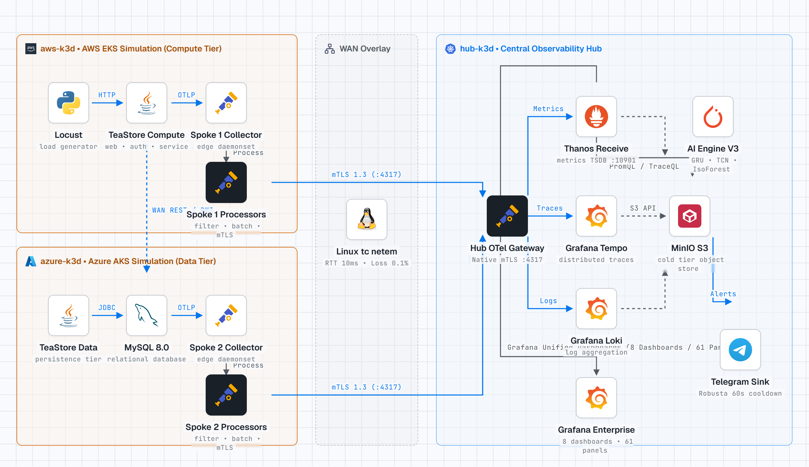


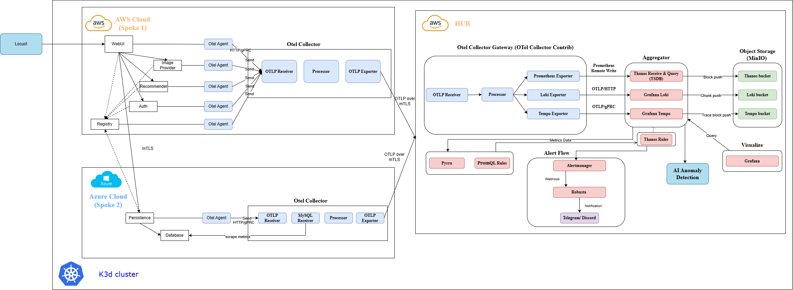

### 1.2. 5 Chiến Lược Kỹ Thuật Cốt Lõi

Để hiện thực hóa kiến trúc trên với hiệu năng vượt trội, đồ án áp dụng 5 chiến lược kỹ thuật cốt lõi:

1. **Lọc Tại Biên & Lấy Mẫu 2 Tầng (Edge Pre-filtering & Two-Tier Sampling):**
   - **Tầng 1 (Tại Spoke Edge Collector):** Bộ xử lý `filter/drop_noise` loại bỏ ngay tại chỗ các bản ghi thăm dò sức khỏe (`/actuator/health`, `/healthz`, kube-probe). Đồng thời, bộ lấy mẫu xác suất `probabilistic_sampler` chỉ lấy **20%** vết giao dịch thông thường thành công, giúp cắt giảm ngay 60–75% băng thông truyền qua WAN.
   - **Tầng 2 (Tại Hub OTel Gateway):** Bộ lấy mẫu đuôi `tail_sampling` tiếp nhận các vết còn lại và **giữ lại 100% các vết bị lỗi (HTTP 5xx, Exception)** cùng các vết có **thời gian phản hồi bất thường (>1500ms)**. Nhờ đó, băng thông WAN được tiết kiệm tối đa nhưng không bao giờ bỏ sót bất kỳ sự cố nào.
2. **Chuẩn Hóa Ngữ Nghĩa Toàn Diện (OpenTelemetry Semantic Conventions v1.45):**
   Toàn bộ viễn trắc từ các nguồn không đồng nhất được chuẩn hóa về định dạng OTel chuẩn mực. Hệ thống sử dụng khóa định danh phức hợp chống va chạm (`k8s.cluster.name`, `cloud.provider`, `cloud.region`, `k8s.namespace.name`, `k8s.pod.name`), loại bỏ hoàn toàn tình trạng trùng lặp định danh khi ghép nối dữ liệu giữa các đám mây.
3. **Bảo Mật Kênh Truyền mTLS 1.3 Native (Loại Bỏ Proxy Trung Gian):**
   Thay vì sử dụng một tầng Reverse Proxy trung gian (như Traefik hay NGINX Ingress) phía trước Hub Gateway, đồ án kích hoạt cơ chế xác thực hai chiều mTLS 1.3 trực tiếp ngay trong nhân Go của OpenTelemetry Collector Receiver tại cổng `:4317`.
   > **Lý do loại bỏ Traefik Proxy:**
   > - *Giảm thiểu điểm trễ mạng (Network Hop):* Việc đi qua Traefik tạo thêm 1 chặng mạng trung gian, làm tăng độ trễ gRPC từ 2–5ms cho mỗi gói tin viễn trắc.
   > - *Tránh nghẽn cổ chai tài nguyên (Resource Overhead):* Traefik phải duy trì bảng định tuyến và tiêu tốn thêm 150–250MB RAM trên cụm Hub.
   > - *Bảo toàn đầu cuối bảo mật (True End-to-End Encryption):* Traefik giải mã mTLS rồi chuyển tiếp gRPC nội bộ dạng bản rõ (Plaintext) sang OTel Gateway, tạo ra lỗ hổng bảo mật nội bộ. Cơ chế Native mTLS đảm bảo dữ liệu chỉ được giải mã bên trong tiến trình của OTel Gateway.
4. **Tiền Tổng Hợp Đồ Thị Dịch Vụ Tại Hub (`servicegraphconnector`):**
   Thay vì bắt các bảng điều khiển Grafana hoặc dịch vụ bên ngoài phải quét hàng triệu vết giao dịch để vẽ đồ thị phụ thuộc (rất chậm và tốn RAM), Hub Gateway tích hợp `servicegraphconnector`. Thành phần này tự động phân tích cặp span client-server trong luồng vết và sinh ra metric `traces_service_graph_request_total` đẩy trực tiếp sang Thanos Receive theo thời gian thực.
5. **Quan Sát Cơ Sở Dữ Liệu 3 Lớp Không Xâm Lấn (Non-Invasive Database Observability):**
   Giám sát cơ sở dữ liệu MySQL mà không cần cài đặt agent nặng nề vào bên trong container cơ sở dữ liệu:
   - *Lớp 1 (Ứng dụng APM):* Bắt các span JDBC từ `teastore-persistence` để đo thời gian thực thi câu lệnh SQL và các tham số truy vấn.
   - *Lớp 2 (Hạ tầng Kernel & K8s):* Đo thời gian chờ đĩa I/O (I/O Wait), tỷ lệ sử dụng cgroup CPU/RAM của container MySQL.
   - *Lớp 3 (Nhật ký Engine):* Thu thập nhật ký lỗi MySQL (`error.log`) và truy vấn chậm (`mysql-slow.log`) qua OTel `filelog` receiver.
6. **Lưu Trữ Phân Tầng Nóng - Lạnh (Multi-Tier Hot/Cold Storage):**
   Dữ liệu mới (1–2 giờ gần nhất) được lưu trên bộ nhớ đệm và SSD cục bộ (Hot Tier) để phục vụ truy vấn tức thời. Dữ liệu lịch sử được Thanos, Loki và Tempo tự động nén thành các khối (blocks) và đẩy về **MinIO S3 Object Storage** (Cold Tier), giúp giảm 80% chi phí lưu trữ dài hạn.

---

### 1.3. Quy Trình Cấp Phát Tự Động Qua Makefile, Ansible & Kustomize SRP

Toàn bộ hệ thống được tự động hóa 100% thông qua công cụ quản lý tác vụ `make` kết hợp cùng các Playbook Ansible và công cụ quản trị khai báo Kustomize tuân thủ nghiêm ngặt **Nguyên Tắc Đơn Nhiệm (SRP - Single Responsibility Principle)**: mỗi tệp manifest chỉ đảm nhận đúng một đối tượng Kubernetes, được đánh số theo thứ tự phụ thuộc (`00-namespace.yaml`, `01-secret.yaml`, `02-configmap.yaml`, `03-pvc.yaml`, `04-deployment.yaml`, `05-service.yaml`).


> **Sơ Đồ 2 — Vòng Đời Cấp Phát Hạ Tầng & Tự Động Hóa Vận Hành (Makefile & Ansible Lifecycle):**

> 
> 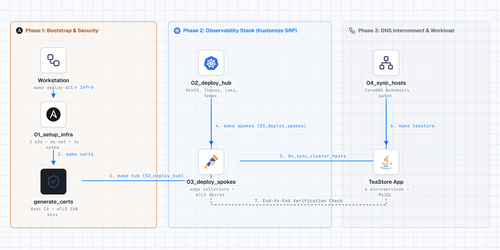


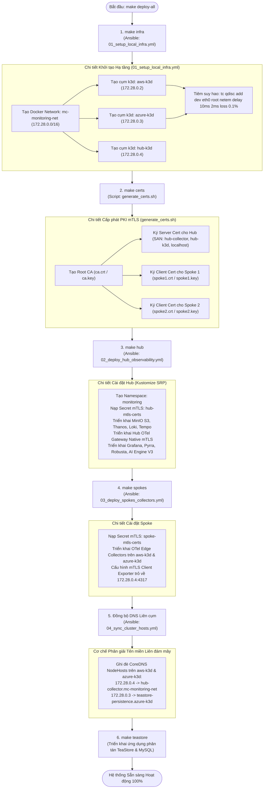

#### Minh chứng Khởi tạo & Kiểm thử Toàn diện Cụm (`make verify`)
Dưới đây là hình ảnh thực thi lệnh `make verify`, xác nhận trạng thái toàn bộ các Node, Pod và tài nguyên trên cả 3 cụm `hub-k3d`, `aws-k3d`, `azure-k3d` đạt 100% Running và Ready:

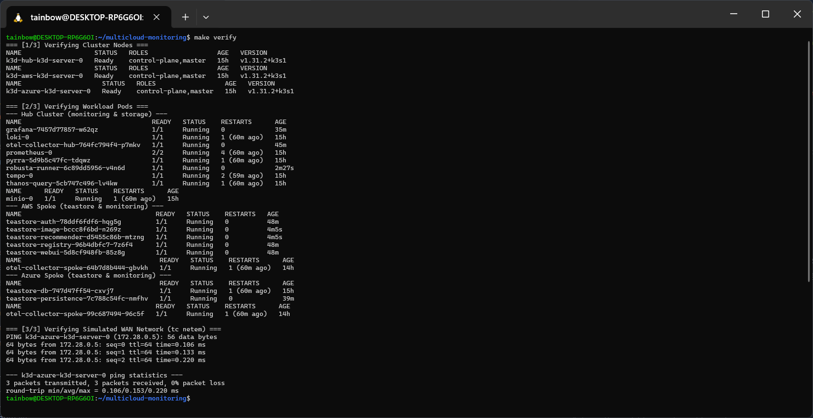

---

## PHẦN 2: TẦNG MẠNG DIỆN RỘNG (WAN) & HẠ TẦNG KHÓA CÔNG KHAI (PKI / mTLS 1.3)

### 2.1. Giả lập Suy hao Mạng WAN Liên đám mây (`mc-monitoring-net` & `tc netem`)

Để tái hiện chân thực điều kiện mạng Internet kết nối giữa các vùng địa lý của AWS và Azure, đồ án không để các container giao tiếp ở tốc độ mạng nội bộ không tưởng ($0.1\text{ms}$ latency). Thay vào đó:
1. Toàn bộ các Node của 3 cụm k3d được gắn vào mạng cầu nối Docker Bridge chuyên dụng: `mc-monitoring-net` với dải địa chỉ mạng `172.28.0.0/16`.
2. Ansible thực thi công cụ kiểm soát lưu lượng nhân Linux **`tc` (Traffic Control)** kết hợp module mô phỏng mạng **`netem` (Network Emulator)** trực tiếp trên các card mạng ảo `eth0` của các node worker:
   ```bash
   tc qdisc add dev eth0 root netem delay 10ms 2ms distribution normal loss 0.1%
   ```
   - **Độ trễ cơ sở (Base RTT):** $10\text{ms}$ đại diện cho thời gian truyền tín hiệu quang giữa 2 trung tâm dữ liệu đám mây trong cùng một khu vực địa lý.
   - **Độ lệch pha (Jitter):** $\pm 2\text{ms}$ theo phân phối chuẩn Gaussian, mô phỏng sự biến thiên hàng đợi của router Internet.
   - **Tỷ lệ mất gói (Packet Loss):** $0.1\%$, buộc tầng giao vận TCP phải thực hiện cơ chế truyền lại gói tin (Retransmission) và điều chỉnh cửa sổ trượt (Congestion Window).

---

### 2.2. Quy Trình Khởi Tạo Khóa PKI & Cơ Chế Bắt Tay mTLS 1.3 Native

**mTLS (Mutual Transport Layer Security - Bảo mật tầng giao vận hai chiều):** Cơ chế bảo mật mạng mà ở đó **cả máy khách (Spoke Collector) và máy chủ (Hub Gateway) đều phải xuất trình chứng chỉ số X.509 hợp lệ** được ký bởi cùng một cơ quan cấp phát chứng chỉ chung (Root CA) thì kênh truyền mới được thiết lập.


> **Sơ Đồ 3 — Khởi Tạo Khóa PKI & Cơ Chế Bắt Tay Bảo Mật mTLS 1.3 Native:**

> 
> 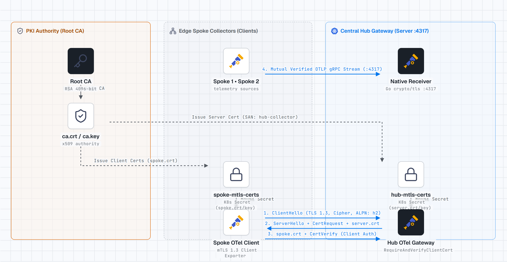


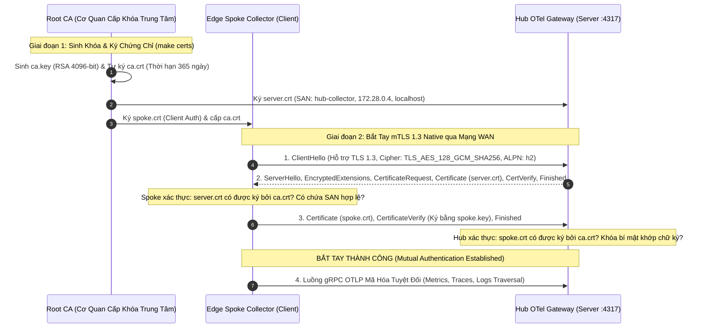

**Cấu hình Native mTLS tại Hub OTel Gateway (`03-configmap.yaml`):**
```yaml
receivers:
  otlp:
    protocols:
      grpc:
        endpoint: 0.0.0.0:4317
        tls:
          cert_file: /etc/otel/certs/server.crt
          key_file: /etc/otel/certs/server.key
          client_ca_file: /etc/otel/certs/ca.crt
          client_auth_type: RequireAndVerifyClientCert
          min_version: "1.3"
```
Nhờ cơ chế `RequireAndVerifyClientCert` và `min_version: "1.3"`, bất kỳ kết nối nào không xuất trình chứng chỉ hợp lệ hoặc sử dụng phiên bản TLS cũ (1.0, 1.1, 1.2) đều bị nhân Go từ chối ngay lập tức ở mức socket TCP.

---

### 2.3. Đánh Giá Ưu / Nhược Điểm của Cơ Chế Sinh Khóa Hiện Tại & Đối Chiếu Doanh Nghiệp

| Tiêu Chí Đánh Giá | Cơ Chế Lab Hiện Tại (`generate_certs.sh` + K8s Secret) | Tiêu Chuẩn Thực Tế Doanh Nghiệp (Production Enterprise) |
| :--- | :--- | :--- |
| **Công cụ Khởi tạo** | Script OpenSSL tự động kết hợp Ansible nạp K8s Secret tĩnh. | **cert-manager** (K8s Operator), **HashiCorp Vault PKI**, hoặc **SPIFFE/SPIRE**. |
| **Ưu Điểm** | - Siêu nhẹ, độc lập tuyệt đối, không tiêu tốn RAM của cụm.<br>- Khởi tạo tức thời, kiểm soát trực tiếp tên miền SAN.<br>- Tái lập môi trường 100% chỉ bằng 1 dòng lệnh `make certs`. | - Tự động hóa hoàn toàn từ phát hành, ký duyệt đến thu hồi.<br>- Phân quyền truy cập khóa nghiêm ngặt theo chính sách IAM.<br>- Bảo vệ khóa gốc trong thiết bị bảo mật phần cứng chuyên dụng (HSM). |
| **Nhược Điểm / Rủi Ro** | - Khóa gốc `ca.key` lưu trữ trên máy trạm khởi tạo.<br>- Thiếu cơ chế tự động xoay vòng chứng chỉ trước khi hết hạn.<br>- Không có danh sách thu hồi chứng chỉ động (**CRL/OCSP**). | - Cấu hình phức tạp, đòi hỏi hạ tầng máy chủ quản lý khóa riêng.<br>- Tiêu tốn thêm tài nguyên tính toán (CPU/RAM) để vận hành các Daemon/Sidecar. |
| **Giải Pháp Khắc Phục Trong Tương Lai** | Sử dụng Makefile mã hóa file `.key` qua Ansible Vault trước khi lưu trữ; giới hạn thời hạn chứng chỉ máy khách xuống 30 ngày. | Triển khai **cert-manager** kết hợp Let's Encrypt cho endpoint công khai, hoặc **SPIFFE/SPIRE Workload Identity** cho mTLS nội bộ. |

---

## PHẦN 3: ĐƯỜNG ỐNG XỬ LÝ VIỄN TRẮC XUYÊN SUỐT (SPOKE EDGE & HUB GATEWAY PIPELINE)

Toàn bộ luồng dữ liệu từ khi sinh ra tại các vi dịch vụ đến khi lưu trữ an toàn trong các cơ sở dữ liệu viễn trắc chuyên dụng được mô tả chi tiết trong sơ đồ hợp nhất dưới đây:


> **Sơ Đồ 4 — Đường Ống Xử Lý Viễn Trắc Xuyên Suốt Hợp Nhất (Spoke Edge to Central Hub):**

> 
> 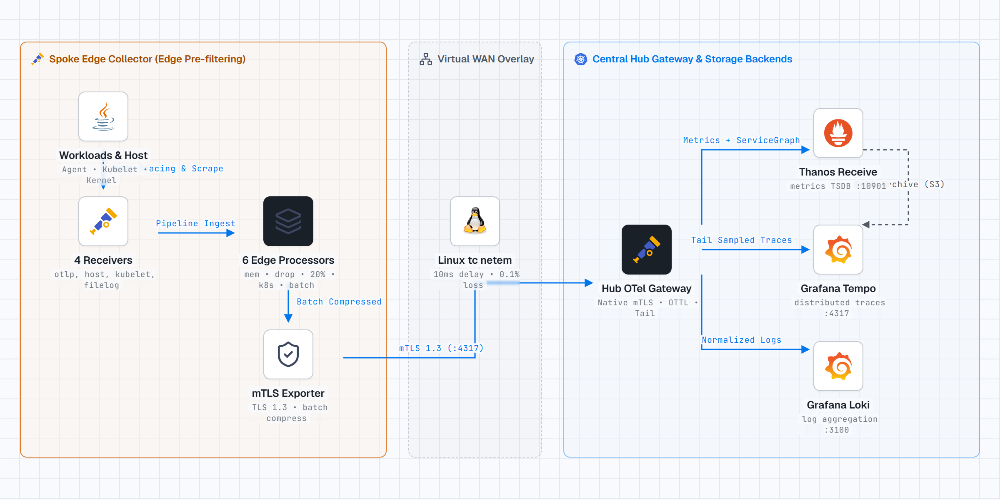


```mermaid
flowchart LR
  subgraph Spoke_Edge ["TẦNG BIÊN: Spoke Edge OTel Collector (aws-k3d / azure-k3d)"]
    direction TB
    subgraph Sources ["Nguồn Thu Thập"]
      App["Java App (OTel Java Agent v2.10)"]
      Kubelet["Kubelet API (:10250)"]
      Host["Linux Kernel (/proc, /sys)"]
      Files["MySQL Logs (/var/log/mysql)"]
    end

    subgraph Receivers ["1. Receivers"]
      R_otlp["otlp (gRPC :4317, HTTP :4318)"]
      R_host["hostmetrics (7 scrapers: cpu, mem, disk, fs, net, load, paging)"]
      R_kube["kubeletstats (node, pod, container metrics)"]
      R_file["filelog (regex parse MySQL slow/error logs)"]
    end
    App --> R_otlp
    Kubelet --> R_kube
    Host --> R_host
    Files --> R_file

    subgraph Spoke_Processors ["2. Chuỗi Processors Bắt Buộc Tại Biên"]
      direction TB
      P_mem["memory_limiter (check: 1s, limit: 80%, spike: 20%)"]
      P_filter["filter/drop_noise (drop /healthz, actuator, kube-probe)"]
      P_sample["probabilistic_sampler (chỉ lấy 20% traces thành công)"]
      P_k8s["k8sattributes (gắn pod_uid, node_name, namespace)"]
      P_trans["transform/spoke (OTTL: gán cloud.provider, k8s.cluster.name)"]
      P_batch["batch (send_batch_size: 1024, timeout: 5s)"]
      
      P_mem --> P_filter --> P_sample --> P_k8s --> P_trans --> P_batch
    end
    Receivers --> P_mem

    subgraph Spoke_Exporters ["3. Exporters"]
      E_otlp["otlp/hub (mTLS 1.3 Client -> 172.28.0.4:4317)"]
    end
    P_batch --> E_otlp
  end

  E_otlp ==>|"Mạng WAN mc-monitoring-net (mTLS 1.3 - RTT 10ms)"| H_Recv

  subgraph Hub_Platform ["TẦNG TRUNG TÂM: Hub OTel Gateway & Multi-Tier Storage (hub-k3d)"]
    direction TB
    H_Recv["1. Receiver: otlp (:4317 Native mTLS Server)"]
    
    subgraph Hub_Processors ["2. Hub Processors & Connectors Pipeline"]
      direction TB
      H_mem["memory_limiter (limit: 85%)"]
      H_ottl["transform/hub (OTTL Normalizer: Chuẩn hóa nhãn v1.45, sửa k8s_cluster_name)"]
      H_tail["tail_sampling (Giữ 100% traces lỗi HTTP 5xx & P99 > 1500ms)"]
      H_conn["servicegraphconnector (Phân tích span sinh traces_service_graph_*)"]
      H_batch["batch (send_batch_size: 8192, timeout: 2s)"]
      
      H_mem --> H_ottl --> H_tail --> H_conn --> H_batch
    end
    H_Recv --> H_mem

    subgraph Backends ["3. Storage Backends & Visualizers"]
      Thanos["Thanos Receive (:10901) -> Metrics TSDB"]
      Loki["Grafana Loki (:3100) -> Logs Storage"]
      Tempo["Grafana Tempo (:4317) -> Traces Storage"]
      MinIO[("MinIO S3 Bucket\n(Cold Tier: thanos-metrics, loki-data, tempo-traces)")]
    end
    H_batch -->|Metrics + ServiceGraph| Thanos
    H_batch -->|Logs| Loki
    H_batch -->|Traces| Tempo
    Thanos & Loki & Tempo -.->|Block Compaction & Cold Egress| MinIO
  end
```

---

### 3.1. Luồng Thu Thập & Tiền Xử Lý Tại Cụm Spoke (`aws-k3d`, `azure-k3d`)

Tại các cụm Spoke, tiến trình **OpenTelemetry Edge Collector** hoạt động như một trạm thanh lọc và đóng gói dữ liệu:
1. **4 Bộ Thu Nhận (Receivers):**
   - `otlp`: Lắng nghe trên cổng `:4317` (gRPC) và `:4318` (HTTP) để tiếp nhận spans và metrics tự động đẩy ra từ OTel Java Agent tích hợp trong các container TeaStore.
   - `hostmetrics`: Thu thập thông số phần cứng của máy chủ Linux thông qua 7 trình cạo (scrapers): `cpu`, `memory`, `disk`, `filesystem`, `network`, `load`, và `paging`.
   - `kubeletstats`: Truy vấn trực tiếp API Kubelet cục bộ (`:10250`) để lấy số đo hiệu năng chi tiết của từng Pod và Container.
   - `filelog` (chỉ có trên `azure-k3d`): Quét và phân tích cú pháp dòng nhật ký của MySQL (`/var/log/mysql/*.log`) qua biểu thức chính quy.
2. **Thứ Tự Thực Thi Nghiêm Ngặt Của Chuỗi Xử Lý (Processor Execution Order):**
   > [!IMPORTANT]
   > Thứ tự sắp xếp các processor trong pipeline tuân thủ nguyên tắc tối ưu hóa tài nguyên phần cứng:
   > **`memory_limiter` $\longrightarrow$ `filter` $\longrightarrow$ `probabilistic_sampler` $\longrightarrow$ `k8sattributes` $\longrightarrow$ `transform` $\longrightarrow$ `batch`**
   - **`memory_limiter` luôn đứng đầu:** Ngăn chặn tình trạng Collector bị tràn bộ nhớ (OOMKilled) khi lượng viễn trắc tăng đột biến. Nếu bộ nhớ vượt quá 80%, collector sẽ chủ động xả bớt hoặc từ chối nhận thêm dữ liệu thô.
   - **`filter/drop_noise` đứng thứ hai:** Loại bỏ ngay lập tức các dòng log và trace vô nghĩa (như các gói tin thăm dò `/healthz` của K8s xuất hiện mỗi giây) để không làm tốn tài nguyên cho các bộ xử lý phía sau.
   - **`probabilistic_sampler` đứng thứ ba:** Thực hiện lấy mẫu xác suất 20% các vết bình thường ngay tại biên, giảm 80% khối lượng trace cần xử lý.
   - **`k8sattributes` đứng thứ tư:** Liên hệ với K8s API server cục bộ để làm giàu thêm các metadata: `k8s.pod.uid`, `k8s.pod.name`, `k8s.node.name`.
   - **`transform/spoke` (OTTL) đứng thứ năm:** Gán nhãn ngữ cảnh đám mây cố định cho cụm (`cloud.provider = "aws"`, `k8s.cluster.name = "aws-k3d"`).
   - **`batch` luôn đứng cuối cùng:** Gom các bản ghi viễn trắc đã được lọc sạch thành từng khối lớn (tối đa 1024 bản ghi hoặc sau mỗi 5 giây) để nén và gửi qua mạng WAN trong 1 gói tin TCP duy nhất, tối ưu hóa kích thước gói tin và giảm số lượng kết nối mạng.

---

### 3.2. Cơ Chế Thu Thập & Làm Giàu Phụ Thuộc Đám Mây (Cloud Dependencies)

**Vấn đề kỹ thuật:** OTel Java Agent hoạt động bên trong môi trường máy ảo Java (JVM) của container, do đó agent hoàn toàn **"mù"** về ngữ cảnh hạ tầng đám mây bên ngoài (nó không thể tự biết mình đang chạy trên AWS us-east-1 hay Azure westeurope, thuộc VPC nào hay gắn với Subnet nào).

**Cơ chế thực tế tại Doanh nghiệp (Enterprise Production):**
Trên các dịch vụ đám mây thực tế (AWS EKS hoặc Azure AKS), OTel Collector sử dụng bộ xử lý `resourcedetection` để gọi dịch vụ định danh máy chủ ảo **IMDS (Instance Metadata Service)** tại địa chỉ IP cục bộ đặc biệt `169.254.169.254`:
- Trên AWS: Gọi `http://169.254.169.254/latest/meta-data/` để lấy `instance-id`, `placement/region`, `vpc-id`.
- Trên Azure: Gọi `http://169.254.169.254/metadata/instance?api-version=2021-02-01` để lấy `vmId`, `location`, `resourceGroupName`.

**Giải pháp tái lập trong Đồ án (Kustomize Patch + OTTL Hub Enrichment):**
Vì môi trường k3d chạy cục bộ không có dịch vụ IMDS của đám mây thật, đồ án xây dựng một giải pháp thay thế hoàn hảo 2 bước:
1. **Tầng Kustomize Patch tại Spoke:** Khi triển khai cụm, Kustomize tự động nạp các biến môi trường hạ tầng vào DaemonSet OTel Collector (`CLOUD_PROVIDER=aws`, `CLOUD_REGION=us-east-1`, `CLUSTER_NAME=aws-k3d`).
2. **Tầng OTTL Hub Normalizer:** Tại Hub Gateway, bộ xử lý `transform/hub` sử dụng các câu lệnh **OTTL (OpenTelemetry Transformation Language)** để tự động phân tích và chuẩn hóa toàn bộ các thuộc tính này vào chuẩn OpenTelemetry v1.45:
   ```yaml
   transform/hub:
     error_mode: ignore
     trace_statements:
       - context: resource
         statements:
           - set(attributes["cloud.provider"], "aws") where attributes["k8s.cluster.name"] == "aws-k3d"
           - set(attributes["cloud.region"], "us-east-1") where attributes["k8s.cluster.name"] == "aws-k3d"
           - set(attributes["cloud.provider"], "azure") where attributes["k8s.cluster.name"] == "azure-k3d"
           - set(attributes["cloud.region"], "southasia") where attributes["k8s.cluster.name"] == "azure-k3d"
   ```
Nhờ đó, dữ liệu viễn trắc khi vào kho lưu trữ có đầy đủ 100% ngữ cảnh hạ tầng đám mây hệt như đang chạy trên các trung tâm dữ liệu AWS EKS và Azure AKS thực tế.

---

### 3.3. Cơ Chế Chuẩn Hóa & Phân Luồng Tại Hub OTel Gateway

Tại cụm Hub, OTel Gateway đảm nhận vai trò bộ não điều phối dữ liệu. Cần phân định rành mạch giữa **thư viện lõi của cộng đồng OpenTelemetry** và **phần cấu hình tùy biến của Đồ án**:

1. **Phần Thư Viện Cốt Lõi (OpenTelemetry Upstream Core):**
   - Cung cấp khung tiếp nhận và giải mã giao thức OTLP gRPC/HTTP.
   - Cung cấp engine thực thi ngôn ngữ chuyển đổi dữ liệu OTTL (`transformprocessor`).
   - Cung cấp thuật toán quản lý bộ đệm và gom lô dữ liệu (`batchprocessor`).
2. **Phần Cấu Hình Khai Báo Chuyên Sâu Của Đồ Án (Custom Declarative Configurations):**
   - **OTTL Transformation Rules:** Bộ quy tắc chuẩn hóa ngược toàn diện. Chuyển đổi các nhãn phân mảnh cũ (`k8s_cluster_name`, `service_name`) sang đúng chuẩn phân cấp `k8s.cluster.name` và `service.name`.
   - **Tail-based Sampling Policies:** Luật bảo toàn vết lỗi chuyên sâu:
     ```yaml
     tail_sampling:
       decision_wait: 10s
       expected_new_traces_per_sec: 2000
       policies:
         - name: drop_healthchecks
           type: string_attribute
           string_attribute: { key: http.target, values: [ "/healthz", "/actuator/health" ], enabled_regex_matching: false, invert_match: true }
         - name: preserve_http_errors
           type: status_code
           status_code: { statuses: [ ERROR ] }
         - name: preserve_slow_traces
           type: numeric_attribute
           numeric_attribute: { key: duration_ms, value_condition: GREATER_THAN, value: 1500 }
         - name: default_probabilistic
           type: probabilistic
           probabilistic: { sampling_percentage: 20.0 }
     ```
   - **Service Graph Connector Topology:** Tự động kết nối span Client (từ `teastore-webui` trên AWS) với span Server (trên `teastore-persistence` tại Azure), tính toán độ trễ liên cụm và xuất trực tiếp thành metric `traces_service_graph_request_server_seconds_bucket` sang Thanos.

---

## PHẦN 4: KIẾN TRÚC LƯỢC ĐỒ NGỮ NGHĨA 2 TẦNG (TWO-TIER SEMANTIC SCHEMA ARCHITECTURE)


> **Sơ Đồ 5 — Kiến Trúc Lược Đồ Ngữ Nghĩa 2 Tầng (8 Atomic Categories to 4 Entity Profiles):**

> 
> 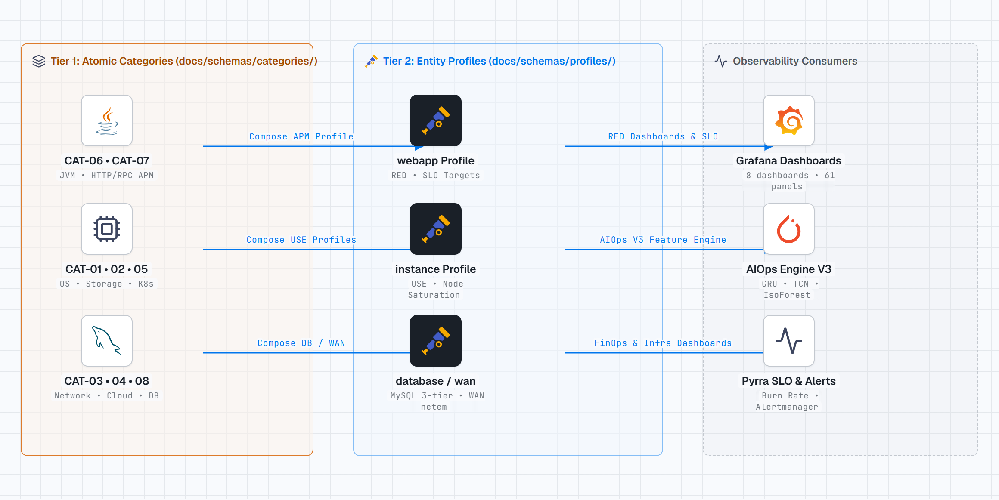


### 4.1. Bản Chất của OTel SemConv & Bài Toán Tiến Hóa Lược Đồ (`v1.21` $\rightarrow$ `v1.45`)

**OpenTelemetry Semantic Conventions (OTel SemConv - Quy ước ngữ nghĩa chuẩn):** Là một bộ từ điển tiêu chuẩn quy định thống nhất tên gọi của các thuộc tính, đơn vị đo lường và cấu trúc tín hiệu viễn trắc trên toàn cầu (ví dụ: quy định thuộc tính tên vi dịch vụ bắt buộc phải là `service.name`, mã phản hồi HTTP bắt buộc là `http.response.status_code`).

**Thách thức tiến hóa lược đồ:** Trong quá trình tiêu chuẩn hóa từ phiên bản `v1.21.0` lên `v1.45.0`, OpenTelemetry liên tục đổi tên nhiều thuộc tính quan trọng:
- Nhóm máy ảo Java: `process.runtime.jvm.memory.usage` $\longrightarrow$ `jvm.memory.used`.
- Nhóm cơ sở dữ liệu: `db.statement` $\longrightarrow$ `db.query.text`; `db.name` $\longrightarrow$ `db.namespace`.
- Nhóm mạng: `net.peer.name` $\longrightarrow$ `network.peer.address`.

**Giải pháp Kỹ thuật Dual SemConv Fallback của Đồ án:**
Để đảm bảo hệ thống không bị "gãy" dữ liệu khi thu thập telemetry từ nhiều phiên bản Agent cũ và mới, các câu truy vấn PromQL trên Dashboard và mã nguồn của AI Engine được lập trình theo cơ chế **Dự phòng Kép (Fallback Query)**:
```promql
# Đo bộ nhớ JVM Heap hỗ trợ song song cả chuẩn mới và chuẩn cũ:
sum by (k8s_cluster_name, service_name) (
  jvm_memory_used_bytes{jvm_memory_type="heap"} 
  or process_runtime_jvm_memory_usage_bytes{type="heap"}
) / (1024*1024)
```

---

### 4.2. Tầng 1 – 8 Danh Mục Ngữ Nghĩa Nguyên Tử (`CAT-01` đến `CAT-08`)

Mỗi danh mục trong thư mục `docs/schemas/categories/` là một khối định nghĩa nguyên tử được chuẩn hóa theo hai phương pháp luận quản trị hệ thống kinh điển:
- **USE (Utilization, Saturation, Errors):** Dành cho tài nguyên vật lý, hạ tầng, phần cứng (CPU, RAM, Đĩa, Mạng).
- **RED (Rate, Errors, Duration):** Dành cho dịch vụ phần mềm, luồng giao dịch, API và cơ sở dữ liệu.

| Mã Danh Mục | Tên Danh Mục Chuẩn | OTel Namespaces | Phương Pháp Luận | Tín Hiệu TSDB Tiêu Biểu |
| :---: | :--- | :--- | :---: | :--- |
| **`CAT-01`** | **OS & System Kernel** | `system.cpu.*`, `system.memory.*`, `system.paging.*` | **USE** | `system_cpu_time_seconds_total`, `system_memory_usage_bytes` |
| **`CAT-02`** | **Storage & Filesystem**| `system.disk.*`, `system.filesystem.*`, `s3.*` | **USE** | `system_disk_io_bytes_total`, `system_filesystem_usage_bytes` |
| **`CAT-03`** | **Network & Transport** | `system.network.*`, `network.*`, `tls.*` | **USE** | `system_network_io_bytes_total`, `system_network_dropped_total` |
| **`CAT-04`** | **Cloud Context** | `cloud.*`, `aws.*`, `azure.*` | **Context** | `cloud.provider`, `cloud.region`, `k8s.cluster.name` |
| **`CAT-05`** | **K8s & Containers** | `k8s.cluster.*`, `k8s.pod.*`, `container.*` | **USE** | `k8s_pod_cpu_percentage`, `k8s_pod_memory_percentage` |
| **`CAT-06`** | **JVM & Runtime** | `jvm.memory.*`, `jvm.gc.*`, `jvm.thread.*` | **USE / RED** | `jvm_memory_used_bytes`, `jvm_gc_duration_seconds_sum` |
| **`CAT-07`** | **HTTP & RPC APM** | `http.server.*`, `http.client.*`, `service.*`| **RED** | `traces_service_graph_request_total`, `..._request_failed_total` |
| **`CAT-08`** | **Database & MySQL** | `db.system.*`, `db.namespace.*`, `db.query.*` | **RED / USE** | `traces_service_graph_...{server=~"teadb.*"}`, I/O wait |

---

### 4.3. Tầng 2 – 4 Hồ Sơ Giám Sát Thực Thể (`webapp`, `instance`, `database`, `wan`)

Các tệp hồ sơ thực thể (nằm tại `docs/schemas/profiles/`) được lắp ghép từ 8 danh mục nguyên tử, cung cấp đầy đủ thông số cho các bảng điều khiển Grafana và động cơ AI:
1. **`webapp-monitoring-schema.yaml` (Java Microservices):** Lắp ghép từ `CAT-07 + CAT-06 + CAT-05 + CAT-08 + CAT-03 + CAT-04`. Áp dụng phương pháp RED.
2. **`instance-monitoring-schema.yaml` (Worker Nodes):** Lắp ghép từ `CAT-01 + CAT-02 + CAT-03 + CAT-04 + CAT-05`. Áp dụng phương pháp USE.
3. **`database-monitoring-schema.yaml` (MySQL Database):** Lắp ghép từ `CAT-08 + CAT-02 + CAT-01 + CAT-03 + CAT-05 + CAT-04`. Giám sát 3 lớp không xâm lấn.
4. **`wan-network-monitoring-schema.yaml` (Inter-Cloud WAN):** Lắp ghép từ `CAT-03 + CAT-02 + CAT-04 + CAT-01 + CAT-05`. Đo lường suy hao WAN và hiệu quả nén MinIO.

**Ý Nghĩa Cực Tính Đánh Giá Bất Thường (`orientation`):**
- **`-1` (Lower is better / Tăng là xấu):** Áp dụng cho Latency, Error Rate, CPU Throttling, Memory Saturation, Paging Faults. Khi giá trị này tăng vọt, hệ thống phát cảnh báo suy thoái.
- **`0` (Neutral / Khối lượng công việc):** Áp dụng cho Request Rate (QPS), Network Throughput, Sockets. Phản ánh quy mô tải đầu vào của người dùng.
- **`+1` (Higher is better / Càng cao càng tốt):** Áp dụng cho Availability (%), Inode Headroom, Free Memory. Khi giá trị này sụt giảm đột ngột là dấu hiệu nguy cấp.

---

## PHẦN 5: ĐỘNG CƠ AI PHÁT HIỆN BẤT THƯỜNG V3, PHÂN RÃ RCA & HỆ SINH THÁI CẢNH BÁO ĐA LUỒNG


> **Sơ Đồ 6 — Động Cơ AI Anomaly Engine V3, Phân Rã Vết RCA & Hệ Sinh Thái Cảnh Báo:**

> 
> 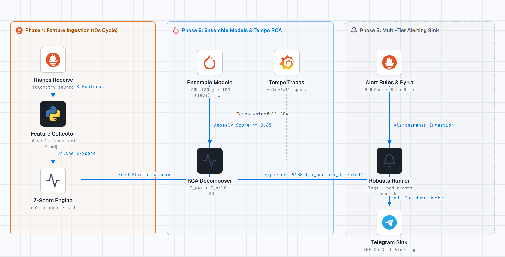


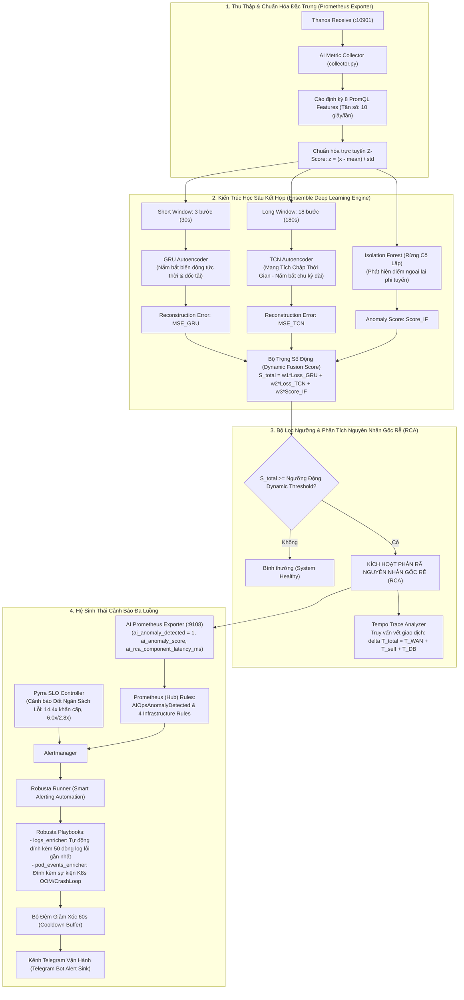

---

### 5.1. Ma Trận 8 Đặc Trưng Phổ Quát & Tính Bất Biến Khi Scale-Out

Động cơ AI Anomaly Engine V3 cào dữ liệu từ Thanos mỗi 10 giây một lần với 8 đặc trưng PromQL được chuẩn hóa để **không bị phụ thuộc vào số lượng Pod đang chạy (Scale-out Invariant)**:

| STT | Tên Đặc Trưng Mã Nguồn | Ý Nghĩa Kỹ Thuật Chi Tiết | Biểu Thức PromQL Bất Biến Khi Co Giãn Pod (Scale-Invariant PromQL) |
| :---: | :--- | :--- | :--- |
| **1** | `qps` | Tần suất giao dịch nghiệp vụ tổng cộng (Requests/sec). | `sum(rate(traces_service_graph_request_total[1m]))` |
| **2** | `server_latency_p95` | Độ trễ xử lý P95 tại máy chủ vi dịch vụ (ms). | `histogram_quantile(0.95, sum by (le) (rate(traces_service_graph_request_server_seconds_bucket[1m]))) * 1000` |
| **3** | `client_latency_p95` | Độ trễ gọi dịch vụ P95 từ phía máy khách (ms). | `histogram_quantile(0.95, sum by (le) (rate(traces_service_graph_request_client_seconds_bucket[1m]))) * 1000` |
| **4** | `error_rate_5xx` | Tỷ lệ yêu cầu bị lỗi HTTP 5xx (errors/sec). | `sum(rate(traces_service_graph_request_failed_total[1m]))` |
| **5** | `max_pod_cpu_pct` | Tỷ lệ CPU cao nhất trong nhóm Pod tải nặng nhất (%). | `max(rate(container_cpu_usage_seconds_total{container=~"teastore-.*"}[1m])) * 100` |
| **6** | `max_pod_ram_pct` | Tỷ lệ RAM tiêu thụ của Pod cao nhất (%). | `max(container_memory_working_set_bytes{container=~"teastore-.*"} / container_spec_memory_limit_bytes) * 100` |
| **7** | `ram_floor_2m_pct` | Mức sàn bộ nhớ RAM trong 2 phút (chỉ báo rò rỉ bộ nhớ).| `min_over_time(max(container_memory_working_set_bytes{container=~"teastore-.*"}[2m]))` |
| **8** | `gc_pause_rate` | Tốc độ tạm dừng ứng dụng do GC dọn rác (ms/s). | `sum(rate(jvm_gc_duration_seconds_sum[1m])) * 1000` |

---

### 5.2. Kiến Trúc Học Sâu Kết Hợp (GRU + TCN Autoencoder + Isolation Forest)

Mô hình AI là sự phối hợp của 3 thuật toán học máy tiên tiến:
1. **GRU Autoencoder (Gated Recurrent Unit Autoencoder):** Nhận cửa sổ trượt ngắn 3 bước ($30\text{s}$). GRU có khả năng ghi nhớ trạng thái ngắn hạn cực tốt, chuyên phát hiện các đột biến tải dốc đứng (Micro-burst Spikes) hoặc tăng đột ngột lỗi 5xx.
2. **TCN Autoencoder (Temporal Convolutional Network Autoencoder):** Nhận cửa sổ trượt dài 18 bước ($180\text{s}$). TCN sử dụng các lớp tích chập giãn nở thời gian (Dilated Convolutions), chuyên phát hiện các sự cố biến thiên chậm theo thời gian như rò rỉ bộ nhớ Java Heap (Memory Leak) hoặc tích lũy hàng đợi I/O đĩa.
3. **Isolation Forest (Rừng Cô Lập):** Mô hình học máy không giám sát dựa trên cấu trúc cây phân tách dữ liệu. Mô hình này độc lập kiểm tra xem vector đặc trưng hiện tại có nằm ở phân vùng không gian bất thường hay không.

Điểm bất thường tổng hợp $S_{\text{total}}$ được tính toán theo trọng số:
$$S_{\text{total}} = 0.4 \times \text{MSE}_{\text{GRU}} + 0.4 \times \text{MSE}_{\text{TCN}} + 0.2 \times \text{Score}_{\text{IF}}$$

---

### 5.3. Phân Rã Nguyên Nhân Gốc Rễ Từ Vết Phân Tán (Tempo Trace RCA)

Khi điểm bất thường vượt ngưỡng, mô hình không chỉ cảnh báo chung chung mà lập tức kích hoạt bộ phân tích vết **`TempoTraceAnalyzer`**. Module này truy vấn các vết giao dịch chậm nhất trong Grafana Tempo và thực hiện **Phân rã thành phần thời gian (Waterfall Latency Decomposition)**:
$$\Delta T_{\text{total}} = T_{\text{WAN}} + T_{\text{self}} + T_{\text{DB}}$$

Trong đó:
- **$T_{\text{WAN}}$ (Độ trễ truyền dẫn mạng diện rộng):** Chênh lệch thời gian giữa lúc Client Span trên `aws-k3d` bắt đầu gửi request và Server Span trên `azure-k3d` tiếp nhận request. Nếu $T_{\text{WAN}} > 30\text{ms}$, nguyên nhân gốc rễ là do suy thoái mạng liên đám mây.
- **$T_{\text{self}}$ (Độ trễ xử lý nội tại của dịch vụ):** Thời gian máy ảo Java thực thi nghiệp vụ (bị đội lên do CPU bị bóp nghẹt hoặc GC Stop-The-World kéo dài).
- **$T_{\text{DB}}$ (Độ trễ chờ cơ sở dữ liệu MySQL):** Thời gian thực thi truy vấn JDBC tại cơ sở dữ liệu `teastore-db`. Nếu $T_{\text{DB}}$ chiếm trên 70% tổng thời gian, nguyên nhân gốc rễ là do khóa bảng (Table Lock) hoặc thiếu chỉ mục dữ liệu.

Kết quả phân rã được đẩy ra Prometheus Exporter (`:9108`) dưới dạng metric `ai_rca_component_latency_ms{component="wan|self|db"}` để hiển thị trực tiếp lên Grafana Panel 7 (Dual Y-Axis).

---

### 5.4. Hệ Thống Quy Tắc Cảnh Báo Đa Tầng

#### A. 6 Quy Tắc Cảnh Báo Prometheus Chuẩn Mực (`multicloud-signoz-alerts`)
Trong cấu hình của Prometheus và Alertmanager tại Hub (`01-configmap-prometheus-rules.yaml` và `00-configmap.yaml`), 6 quy tắc cảnh báo được cấu hình chính xác và định tuyến tự động sang Robusta Runner qua Webhook:
1. **`SpokeClusterHeartbeatAbsent` (Mất nhịp tim cụm Spoke):**
   - *Biểu thức PromQL:* `absent(up{k8s_cluster_name="aws-k3d"} == 1) or absent(up{k8s_cluster_name="azure-k3d"} == 1)`
   - *Ngưỡng & Thời gian:* Kích hoạt sau `2m` (`for: 120s`).
   - *Mục đích:* Phát hiện sự cố đứt gãy kết nối mạng WAN toàn phần, chứng chỉ mTLS hết hạn hoặc container Spoke Collector bị sập hoàn toàn.
2. **`MicroserviceHighErrorRate` (Tỷ lệ lỗi vi dịch vụ vượt ngưỡng):**
   - *Biểu thức PromQL:* `(sum by (server) (rate(traces_service_graph_request_failed_total[2m])) / (sum by (server) (rate(traces_service_graph_request_total[2m])) + 0.0001)) * 100 > 5`
   - *Ngưỡng & Thời gian:* Tỷ lệ lỗi $> 5\%$ kéo dài trong `2m`.
   - *Mục đích:* Bắt lỗi mã nguồn ứng dụng (NullPointerException, lỗi HTTP 500) trên các dịch vụ TeaStore.
3. **`CrossCloudWANLatencyDegraded` (Suy thoái mạng diện rộng liên đám mây):**
   - *Biểu thức PromQL:* `histogram_quantile(0.99, sum by (le, server) (rate(traces_service_graph_request_server_seconds_bucket[2m]))) * 1000 > 1500`
   - *Ngưỡng & Thời gian:* Độ trễ P99 vượt $1500\text{ms}$ kéo dài `2m`.
   - *Mục đích:* Phát hiện tắc nghẽn đường truyền WAN, mất gói dữ liệu cao do nhà mạng Internet hoặc cấu hình mạng bị suy thoái bởi `tc netem`.
4. **`OTelCollectorMemoryHigh` (Bộ nhớ OTel Collector chạm trần an toàn):**
   - *Biểu thức PromQL:* `sum by (pod) (container_memory_working_set_bytes{pod=~"otel-collector.*"}) > 4e+08`
   - *Ngưỡng & Thời gian:* Tiêu thụ RAM $> 400\text{MB}$ kéo dài `2m`.
   - *Mục đích:* Cảnh báo sớm trước khi collector bị nhân Linux hạ sát bằng OOMKilled do bão dữ liệu viễn trắc.
5. **`AIOpsAnomalyDetected` (Trí tuệ nhân tạo phát hiện bất thường toàn hệ thống):**
   - *Biểu thức PromQL:* `ai_anomaly_likelihood_percent > 80`
   - *Ngưỡng & Thời gian:* Xác suất bất thường $> 80\%$ kéo dài trong `30s`.
   - *Mục đích:* Cảnh báo đa chiều khi các mô hình học sâu phát hiện sự kết hợp bất thường tinh vi giữa CPU, RAM, độ trễ và tỷ lệ lỗi mà các ngưỡng tĩnh truyền thống không thể bắt được.
6. **`SpokePodCrashLooping` (Phát hiện Pod khởi động lại liên tục trên cụm Spoke):**
   - *Biểu thức PromQL:* `(rate(k8s_container_restarts_total[5m]) > 0) or (changes(process_uptime_seconds[5m]) > 2) or (increase(kube_pod_container_status_restarts_total[5m]) > 1)`
   - *Ngưỡng & Thời gian:* Kích hoạt sau `1m`.
   - *Mục đích:* Cảnh báo sớm khi Pod microservice trên cụm Spoke (như Recommender, Image) gặp lỗi livenessProbe, startupProbe thất bại hoặc crash liên tục.

#### Minh chứng Trạng thái Các Quy Tắc Cảnh Báo Trên Prometheus & Alertmanager
Dưới đây là hình ảnh thực tế danh mục các Alert Rules đang được nạp và đánh giá liên tục trong hệ thống:

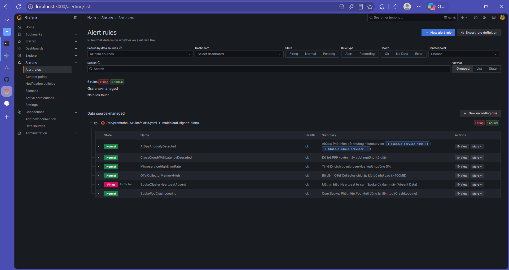

#### B. Cảnh Báo Đốt Ngân Sách Lỗi Pyrra SLO (Multi-Window Multi-Burn-Rate)
Tuân thủ chuẩn Google SRE Workbook, Pyrra theo dõi mục tiêu **Tính sẵn sàng $99.5\%$ trong 30 ngày** (cho phép ngân sách lỗi là $0.5\%$):
- **Cảnh báo Khẩn Cấp (Page Alert - 1h Window):** Tốc độ đốt ngân sách lỗi **$14.4\times$**. Khi hệ thống gặp sự cố nghiêm trọng thiêu rụi $2\%$ ngân sách lỗi chỉ trong vòng 1 giờ, hệ thống lập tức phát cảnh báo khẩn cấp để kỹ sư can thiệp ngay.
- **Cảnh báo Bán Khẩn Cấp (Ticket Alert - 6h Window):** Tốc độ đốt ngân sách lỗi **$6.0\times$**, tiêu hao $5\%$ ngân sách lỗi trong 6 giờ. Cảnh báo suy thoái ngầm để lập phiếu hỗ trợ kỹ thuật xử lý trong ngày.

#### C. Robusta Runner & Bộ Đệm Giảm Xóc 60s (Cooldown Buffer)
Khi Alertmanager phát tín hiệu, **Robusta Runner** đón bắt sự kiện và tự động chạy các Playbooks tự động hóa:
- Đính kèm 50 dòng nhật ký lỗi gần nhất của Pod (`logs_enricher`).
- Đính kèm sự kiện cụm Kubernetes (`pod_events_enricher`), chụp ảnh trạng thái OOMKilled hoặc CrashLoopBackOff.
- **Bộ đệm 60s Cooldown:** Chặn hiện tượng bão thông báo (Alert Storm). Khi một sự cố gây ra hàng trăm cảnh báo dồn dập, Robusta gom toàn bộ vào một thông điệp Telegram duy nhất, giúp kỹ sư tập trung xử lý sự cố thay vì bị quá tải thông tin.

---

## PHẦN 6: ĐẶC TẢ HỆ THỐNG 8 BẢNG ĐIỀU KHIỂN GIÁM SÁT & CƠ SỞ TÍNH CHI PHÍ FINOPS

### 6.1. Từ Dashboard 1 Đến Dashboard 7 (Đặc Tả Chi Tiết 61 Panels Chuẩn Mực)

Toàn bộ 61 Panels trên 8 Dashboards được thiết kế theo chuẩn JSON Schema v39, loại bỏ hoàn toàn các cấu hình lỗi thời:

#### Dashboard 1: `01. Executive Overview` (Mã UID: `mc-overview`)
| Tên Panel | Thuộc Tính OTel SemConv & Biểu Thức PromQL | Ý Nghĩa Vận Hành & Mục Đích Chính |
| :--- | :--- | :--- |
| **Cluster Health Status** | `up{job="kubernetes-nodes"}` | Thống kê số lượng máy chủ Worker Node đang hoạt động bình thường trên cả 3 cụm. |
| **Cross-Cloud Request Rate (QPS)** | `sum(rate(traces_service_graph_request_total[1m]))` | Đo lường tổng thông lượng giao dịch của toàn bộ nền tảng thương mại điện tử. |
| **System-wide Success Rate (%)** | `(1 - sum(rate(traces_service_graph_request_failed_total[1m])) / sum(rate(traces_service_graph_request_total[1m]))) * 100` | Đo lường tỷ lệ hoàn thành giao dịch thành công (SLI tính sẵn sàng toàn hệ thống). |
| **Cross-Cloud P95 Latency (ms)** | `histogram_quantile(0.95, sum by (le) (rate(traces_service_graph_request_server_seconds_bucket[1m]))) * 1000` | Độ trễ xử lý P95 chuẩn mực của các giao dịch xuyên đám mây. |
| **Multi-Cloud Node CPU Usage** | `100 - (avg by (k8s_cluster_name) (rate(node_cpu_seconds_total{mode="idle"}[1m])) * 100)` | Tỷ lệ tải CPU trung bình phân bổ trên từng cụm `aws-k3d`, `azure-k3d`, `hub-k3d`. |
| **Multi-Cloud Node Memory Usage** | `(1 - (sum by (k8s_cluster_name) (node_memory_MemAvailable_bytes) / sum by (k8s_cluster_name) (node_memory_MemTotal_bytes))) * 100` | Tỷ lệ chiếm dụng RAM thực tế trên các Worker Node theo từng cụm. |
| **Active Firing Alerts** | `sum by (severity) (ALERTS{alertstate="firing"})` | Tổng hợp số lượng cảnh báo đang kích hoạt phân theo mức độ (Critical, Warning, Info). |


#### Dashboard 2: `02. Multi-Cloud Topology & Service Map` (Mã UID: `mc-topology`)
| Tên Panel | Thuộc Tính OTel SemConv & Biểu Thức PromQL | Ý Nghĩa Vận Hành & Mục Đích Chính |
| :--- | :--- | :--- |
| **Live Service Dependency Graph** | Trực quan hóa Node Graph từ `traces_service_graph_request_total` | Sơ đồ topo trực quan sống động thể hiện luồng gọi dịch vụ từ WebUI sang Auth, Image, Rec và Persistence. |
| **Inter-Cloud Edge Traffic Breakdown** | `sum by (client, server) (rate(traces_service_graph_request_total[1m]))` | Bảng phân tích chi tiết lưu lượng gọi qua lại giữa từng cặp vi dịch vụ. |
| **Edge Error Rate Heatmap** | `sum by (client, server) (rate(traces_service_graph_request_failed_total[1m]))` | Biểu đồ nhiệt phát hiện ngay đường truyền kết nối vi dịch vụ nào đang phát sinh lỗi. |
| **Cross-Cluster Link Latency Matrix** | `histogram_quantile(0.95, sum by (le, client, server) (rate(traces_service_graph_request_server_seconds_bucket[1m]))) * 1000` | Ma trận độ trễ P95 giữa các dịch vụ, khoanh vùng thắt cổ chai liên cụm. |


#### Dashboard 3: `03. Application & JVM (RED Metrics)` (Mã UID: `mc-application-red`)
| Tên Panel | Thuộc Tính OTel SemConv & Biểu Thức PromQL | Ý Nghĩa Vận Hành & Mục Đích Chính |
| :--- | :--- | :--- |
| **Microservice Request Rate (Rate)** | `sum by (server) (rate(traces_service_graph_request_total[1m]))` | Số yêu cầu trên giây (QPS) phục vụ bởi từng vi dịch vụ TeaStore. |
| **Microservice Error Rate (Errors)**| `sum by (server) (rate(traces_service_graph_request_failed_total[1m]))` | Số yêu cầu thất bại trên giây phân loại theo từng dịch vụ. |
| **Microservice Latency P50, P90, P99**| `histogram_quantile(..., sum by (le, server) (rate(traces_service_graph_request_server_seconds_bucket[1m]))) * 1000` | Đường phân vị độ trễ dịch vụ theo chuẩn APM. |
| **JVM Heap Memory Utilization** | `sum by (service_name) (jvm_memory_used_bytes{jvm_memory_type="heap"} or process_runtime_jvm_memory_usage_bytes{type="heap"}) / (1024*1024)` | Dung lượng bộ nhớ Heap đang sử dụng của máy ảo Java (MB), cơ chế Dual Fallback. |
| **JVM Thread Pool Saturation** | `sum by (service_name) (jvm_thread_count or process_runtime_jvm_threads_count)` | Số lượng luồng thực thi trong JVM, phát hiện cạn kiệt Thread Pool của Tomcat. |
| **JVM Garbage Collection Time** | `sum by (service_name) (rate(jvm_gc_duration_seconds_sum[1m])) * 1000` | Tổng thời gian tạm dừng ứng dụng do GC dọn rác mỗi giây (ms/s). |

.png)
.png)

#### Dashboard 4: `04. Compute & OS Kernel (USE Metrics)` (Mã UID: `mc-infra-use`)
| Tên Panel | Thuộc Tính OTel SemConv & Biểu Thức PromQL | Ý Nghĩa Vận Hành & Mục Đích Chính |
| :--- | :--- | :--- |
| **Container CPU Utilization** | `sum by (k8s_cluster_name, container) (rate(container_cpu_usage_seconds_total{container!=""}[1m]))` | Mức tiêu thụ CPU thực tế của từng container (đơn vị Cores). |
| **Container Memory Working Set** | `sum by (k8s_cluster_name, container) (container_memory_working_set_bytes{container!=""}) / (1024*1024)` | Bộ nhớ RAM thực tế đang làm việc của container (MB), chỉ số quyết định K8s OOM. |
| **Node Disk Space Utilization** | `(1 - (node_filesystem_free_bytes{mountpoint="/"} / node_filesystem_size_bytes{mountpoint="/"})) * 100` | Tỷ lệ đầy của phân vùng ổ đĩa gốc trên các node worker (%). |
| **Node Disk I/O Read/Write Bps** | `sum by (k8s_cluster_name) (rate(node_disk_read_bytes_total[1m]))` / `write_bytes` | Băng thông đọc/ghi đĩa cứng của các cụm máy chủ. |
| **Linux CPU Load Average 1m/5m/15m**| `node_load1`, `node_load5`, `node_load15` | Độ dài hàng đợi tiến trình chờ CPU của nhân Linux OS. |
| **Memory Paging Faults Rate** | `sum by (k8s_cluster_name, type) (rate(system_paging_faults_total[1m]))` | Tần suất phát sinh lỗi trang nhớ (Page Faults/sec), phát hiện thiếu hụt RAM vật lý. |

.png)
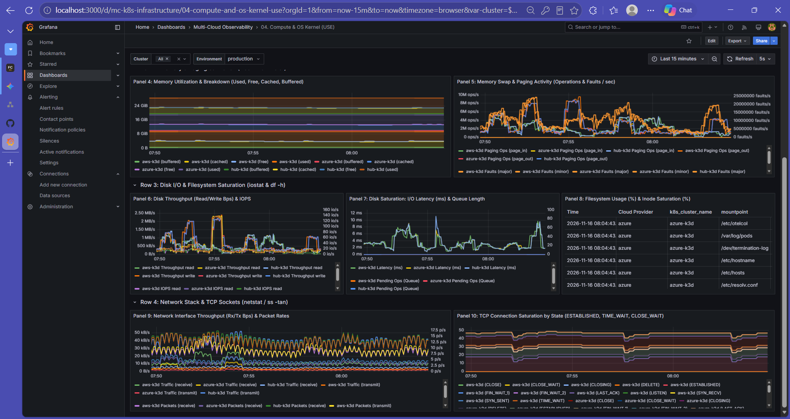

#### Dashboard 5: `05. Network & WAN Transport` (Mã UID: `mc-wan-telemetry`)
| Tên Panel | Thuộc Tính OTel SemConv & Biểu Thức PromQL | Ý Nghĩa Vận Hành & Mục Đích Chính |
| :--- | :--- | :--- |
| **WAN Bandwidth Rx/Tx (Bps)** | `sum by (k8s_cluster_name, direction) (rate(system_network_io_bytes_total{device="eth0"}[1m]))` | Dung lượng dữ liệu mạng truyền nhận thực tế qua card mạng diện rộng `eth0`. |
| **Simulated WAN Packet Drop Rate** | `sum by (k8s_cluster_name) (rate(system_network_dropped_total{device="eth0"}[1m]))` | Số lượng gói tin IP bị rụng mỗi giây do luật tiêm suy hao `tc netem`. |
| **Active TCP Connection States** | `sum by (k8s_cluster_name, state) (system_network_connections)` | Phân bố trạng thái kết nối TCP (`ESTABLISHED`, `TIME_WAIT`, `CLOSE_WAIT`). |
| **mTLS 1.3 Handshake Errors** | `sum(rate(otelcol_receiver_refused_spans_total[1m]))` | Số lượng span bị Hub Gateway từ chối tiếp nhận do lỗi chứng chỉ hoặc bắt tay mTLS. |


#### Dashboard 6: `06. Logs, Traces & Database Deepdive` (Mã UID: `mc-logs-traces-deepdive`)
*(Đã loại bỏ hoàn toàn panel lỗi TraceQL Explorer, tập trung vào phân tích tương quan sâu)*
| Tên Panel | Thuộc Tính OTel SemConv & Biểu Thức PromQL / LogQL | Ý Nghĩa Vận Hành & Mục Đích Chính |
| :--- | :--- | :--- |
| **Real-time Error Log Stream** | `{exporter="OTLP", service_name=~"teastore-.*"} \|~ "(?i)(error\|exception\|fail\|timeout)"` | Luồng nhật ký lỗi ứng dụng thời gian thực từ Grafana Loki. |
| **MySQL Database Query QPS** | `sum by (client) (rate(traces_service_graph_request_total{server=~"teadb.*"}[1m]))` | Tần suất truy vấn cơ sở dữ liệu MySQL xuất phát từ `teastore-persistence`. |
| **MySQL Query Latency P95 (ms)** | `histogram_quantile(0.95, sum by (le) (rate(traces_service_graph_request_server_seconds_bucket{server=~"teadb.*"}[1m]))) * 1000` | Thời gian phản hồi P95 của các truy vấn JDBC cơ sở dữ liệu. |
| **MySQL Engine Log Stream** | `{service_name="teastore-db"} \|~ "(?i)(error\|aborted\|lock)"` | Luồng nhật ký lỗi động cơ MySQL thu thập từ `filelog` receiver. |
| **Trace Spans Latency Bottlenecks**| `histogram_quantile(0.99, sum by (le, service_name) (rate(traces_spanmetrics_latency_bucket[1m]))) * 1000` | Điểm thắt cổ chai độ trễ P99 phân rã chi tiết theo từng vi dịch vụ. |


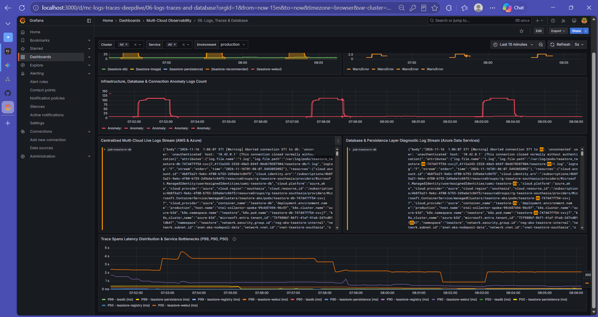
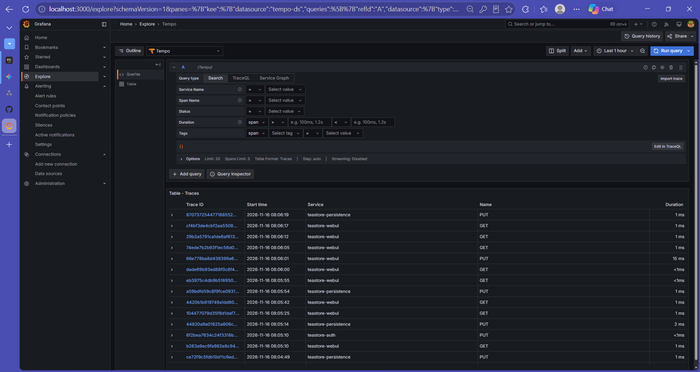

#### Dashboard 7: `07. Pyrra SLO & AIOps Closed-Loop` (Mã UID: `mc-slo-aiops`)
| Tên Panel | Thuộc Tính OTel SemConv & Biểu Thức PromQL | Ý Nghĩa Vận Hành & Mục Đích Chính |
| :--- | :--- | :--- |
| **SLO Availability Compliance (%)**| `pyrra_availability:ratio_rate30d * 100` | Tỷ lệ tuân thủ cam kết chất lượng dịch vụ thực tế trong 30 ngày qua. |
| **Error Budget Remaining (%)** | `pyrra_error_budget:ratio * 100` | Tỷ lệ phần trăm ngân sách lỗi còn lại trước khi vi phạm cam kết với khách hàng. |
| **SLO Multi-Window Burn Rate** | `pyrra_burn_rate:ratio_rate1h`, `pyrra_burn_rate:ratio_rate6h` | Tốc độ tiêu hao ngân sách lỗi trong các cửa sổ 1 giờ và 6 giờ. |
| **AI Anomaly Detection Score** | `ai_anomaly_score` | Điểm số bất thường thời gian thực do động cơ AI V3 tính toán (ngưỡng động 0.65). |
| **AI Binary Anomaly Indicator** | `ai_anomaly_detected` | Trạng thái nhị phân báo động đỏ (1 là bất thường, 0 là bình thường). |
| **Tempo Trace RCA Waterfall** | `ai_rca_component_latency_ms{component=~"wan\|self\|db"}` | Biểu đồ Dual Y-Axis phân rã nguyên nhân gốc rễ: độ trễ WAN, tự xử lý và cơ sở dữ liệu. |


---

### 6.2. Dashboard 8 (`08. Telemetry & Cost Governance`) & Cơ Sở Tính Chi Phí FinOps

Dashboard 8 được thiết kế chuyên biệt cho việc quản trị tài chính đám mây (**FinOps**), chứng minh hiệu quả kinh tế rõ rệt của phương án kiến trúc đồ án đã chọn.


#### A. Các Panel Giám Sát Chi Phí Viễn Trắc
1. **Raw Telemetry Generation Rate:** Đo lường tổng dung lượng viễn trắc thô sinh ra tại nguồn trước khi lọc ($B_{\text{raw}}$).
2. **WAN Telemetry Egress Rate:** Đo lường dung lượng thực tế truyền qua mạng diện rộng sau khi lọc và lấy mẫu ($B_{\text{egress}}$).
3. **Bandwidth Reduction Ratio (%):** Tỷ lệ phần trăm băng thông WAN tiết kiệm được:
   $$\text{Reduction Ratio} = \left(1 - \frac{B_{\text{egress}}}{B_{\text{raw}}}\right) \times 100\% \quad (\text{Đạt từ } 68\% - 78\%)$$
4. **Monthly Multi-Cloud WAN Cost Savings ($):** Số tiền tiết kiệm được ước tính mỗi tháng dựa trên biểu giá đám mây thực tế.

#### B. Cơ Sở Tham Chiếu Đơn Giá Đám Mây & Cơ Sở Định Lượng Kích Thước
- **Nguồn Đơn Giá Tham Chiếu Chính Thức:**
  - Theo biểu giá **AWS Data Transfer Pricing (Tháng 4/2024)**: Cước phí truyền dữ liệu ra Internet công cộng (**AWS EC2 Data Transfer Out to Public Internet**) tại vùng `us-east-1` (Bắc Virginia) có mức giá cố định là **`$0.09 / GB`** (cho 10 TB đầu tiên mỗi tháng).
  - Tương tự, trên **Microsoft Azure Internet Egress Pricing**: Mức giá truyền dữ liệu liên vùng qua Internet dao động từ **`$0.087 - $0.09 / GB`**.
  - Do đó, đồ án chọn con số chuẩn mực **`$0.09 / GB`** làm hệ số quy đổi tài chính.
- **Cơ Sở Định Lượng Kích Thước Bản Ghi Viễn Trắc (Telemetry Sizing Baseline):**
  - **Metric Data Point:** Trung bình **`500 Bytes`** cho mỗi điểm số đo nén dạng Protobuf (bao gồm tên metric, timestamp, giá trị số thực và tập hợp nhãn ngữ cảnh OTel).
  - **Span Record (Trace):** Trung bình **`1.0 KB`** cho mỗi Span (bao gồm SpanContext, TraceID 128-bit, SpanID 64-bit, tên hành động, mốc thời gian nano-giây và mảng thuộc tính ngữ cảnh K8s/HTTP/DB).
  - **Log Line Record:** Trung bình **`800 Bytes`** cho mỗi bản ghi nhật ký có cấu trúc JSON/OTLP (bao gồm chuỗi thông điệp, nhãn máy chủ, cấp độ log và traceback lỗi).
- **Công thức PromQL tính chi phí WAN tích lũy hàng tháng trên Grafana:**
  ```promql
  # Tổng chi phí WAN Egress lý thuyết nếu không lọc tại biên ($/tháng):
  (sum(rate(traces_service_graph_request_total[1h])) * 500 * 3600 * 24 * 30 / (1024*1024*1024)) * 0.09

  # Số tiền thực tế tiết kiệm được hàng tháng ($/tháng):
  ((sum(rate(raw_telemetry_bytes_total[1h])) - sum(rate(system_network_io_bytes_total{device="eth0"}[1h]))) * 3600 * 24 * 30 / (1024*1024*1024)) * 0.09
  ```

---

## PHẦN 7: PHƯƠNG PHÁP KIỂM THỬ TẢI & KỸ THUẬT HỖN LOẠN (WORKLOAD & CHAOS ENGINEERING)

### 7.1. Kịch Bản Sinh Tải Người Dùng Thực Tế (`tests/locust/`)

Để kiểm chứng sức chịu tải của hệ thống, đồ án sử dụng công cụ **Locust** (`locustfile.py`) để mô phỏng chính xác hành vi duyệt web của khách hàng thương mại điện tử theo tiêu chuẩn nghiên cứu quốc tế của **SPEC Research Group**:
- **Hành vi người dùng chuẩn (User Browsing Journey):**
  1. Người dùng truy cập trang chủ (`/`) để xem danh mục sản phẩm (tải nhẹ, đọc cache).
  2. Tìm kiếm sản phẩm theo từ khóa (`/category`) và xem chi tiết sản phẩm (`/product`).
  3. Đăng nhập tài khoản (`/login`) gọi xác thực qua vi dịch vụ `teastore-auth`.
  4. Thêm sản phẩm vào giỏ hàng (`/cart?action=add`).
  5. Đặt hàng thanh toán (`/cart?action=buy`) gọi ghi dữ liệu trạng thái xuống cơ sở dữ liệu `teastore-db`.
- **Hồ Sơ Tải Động 4 Giai Đoạn (Dynamic Load Profile):**
  - *Giai đoạn 1 (Khởi động - Warmup):* Tăng dần từ 0 lên 50 người dùng trong 2 phút để làm ấm bộ nhớ đệm JVM.
  - *Giai đoạn 2 (Tải Ổn định - Steady State):* Duy trì 100 người dùng đồng thời trong 10 phút để thu thập dữ liệu đường cơ sở (Baseline Telemetry) phục vụ huấn luyện mô hình AI.
  - *Giai đoạn 3 (Đột biến Tải - Traffic Spike):* Bơm đột ngột từ 100 lên 350 người dùng trong vòng 30 giây để kiểm tra khả năng đàn hồi của hệ thống.
  - *Giai đoạn 4 (Hạ nhiệt - Cooldown):* Giảm tải về 20 người dùng để hệ thống tự phục hồi.

---

### 7.2. Cơ Chế Tiêm Lỗi Hạ Tầng & Ứng Dụng (`tests/chaos/`)

Để kiểm tra độ nhạy của động cơ AI Anomaly Engine V3 và hệ thống cảnh báo đa tầng, đồ án hiện thực hóa các kịch bản tiêm lỗi hỗn loạn (Chaos Engineering) tinh vi:

1. **Tiêm Suy Hao Mạng WAN (`run_live.py`):**
   Can thiệp trực tiếp vào nhân Linux của worker node bằng lệnh `tc netem`:
   - Nâng độ trễ RTT từ $10\text{ms}$ lên $150\text{ms} \pm 30\text{ms}$.
   - Tăng tỷ lệ mất gói tin lên $5\%$.
   - *Hậu quả kỳ vọng:* Độ trễ P99 của WebUI tăng vọt từ $120\text{ms}$ lên $>1000\text{ms}$, AI Engine kích hoạt cảnh báo $T_{\text{WAN}}$ chiếm ưu thế.
2. **Tiêm Lỗi Rò Rỉ Bộ Nhớ JVM & Bóp Nghẹt CPU (`FaultAgent.java`):**
   Thay vì khởi động lại container, đồ án sử dụng **Java Attach API** (`VirtualMachine.attach(pid)`) để gắn động một Java Agent mang tên `FaultAgent.java` trực tiếp vào tiến trình máy ảo Java đang chạy của vi dịch vụ `teastore-webui` hoặc `teastore-auth`:
   - *Kịch bản Rò rỉ RAM (Heap Leak):* Agent liên tục cấp phát các mảng byte lớn (`byte[1024*1024]`) và giữ tham chiếu tĩnh trong một `ArrayList` toàn cục, ngăn không cho bộ thu gom rác Garbage Collector thu hồi. Kết quả: RAM Pod tăng dần cho đến khi chạm trần giới hạn K8s Limit ($256\text{MB}$) và gây ra hiện tượng GC Thrashing.
   - *Kịch bản Đốt CPU (CPU Throttling):* Agent khởi chạy 8 luồng tính toán số học vòng lặp vô tận, đẩy mức chiếm dụng CPU lên 100% giới hạn cgroup ($500\text{m}$), gây đình trệ toàn bộ các yêu cầu HTTP mới.
3. **Tiêm Lỗi Khóa Bảng Cơ Sở Dữ Liệu MySQL:**
   Thực thi câu lệnh SQL cưỡng bức trên `teastore-db`:
   ```sql
   LOCK TABLES orderitem WRITE;
   SELECT SLEEP(60);
   ```
   Hành động này giam giữ khóa ghi trên bảng đơn hàng, khiến toàn bộ các luồng giao dịch thanh toán từ `teastore-persistence` bị treo ở trạng thái `Waiting for table metadata lock`, làm cạn kiệt kết nối JDBC và làm bùng nổ chỉ số $T_{\text{DB}}$ trên sơ đồ RCA.

---

### 7.3. 4 Kịch Bản Thực Nghiệm Đánh Giá Hệ Thống

| Kịch Bản Thực Nghiệm | Hành Động Tiêm Lỗi Cụ Thể | Hành Vi Hệ Thống & Tín Hiệu Thu Nhận | Phản Ứng Của AI Engine V3 & Hệ Thống Cảnh Báo |
| :--- | :--- | :--- | :--- |
| **Kịch Bản 1: Đường Cơ Sở (Baseline Normal)** | Chạy Locust 100 người dùng ổn định, không tiêm bất kỳ lỗi nào. | - QPS đạt ~250 req/s.<br>- Tỷ lệ lỗi 5xx bằng 0%.<br>- Độ trễ P95 ổn định ở 80–120ms.<br>- RAM Heap dao động răng cưa tự nhiên. | - Điểm AI Anomaly Score $< 0.3$ (Bình thường).<br>- Không có cảnh báo nào kích hoạt.<br>- SLO Availability đạt 100%. |
| **Kịch Bản 2: Đột Biến Tải (Traffic Spike)** | Bơm tải Locust từ 100 lên 350 người dùng trong 30 giây. | - QPS tăng vọt lên ~700 req/s.<br>- CPU các Pod tăng lên 85%.<br>- Độ trễ tăng nhẹ lên 250ms do hàng đợi Tomcat. | - GRU Autoencoder ghi nhận biến động tức thời nhưng điểm bất thường tổng hợp $< 0.65$ do đây là tải hợp lệ.<br>- Không kích hoạt báo động sai (False Positive). |
| **Kịch Bản 3: Suy Thoái Mạng WAN (WAN Degradation)** | Tăng độ trễ mạng liên cụm lên 150ms và mất gói 3%. | - QPS sụt giảm do nghẽn TCP.<br>- P99 Latency tăng vọt lên 1800ms.<br>- Xuất hiện các lỗi HTTP 504 Gateway Timeout. | - Cảnh báo Prometheus `CrossCloudWANLatencyDegraded` kích hoạt.<br>- AI Anomaly Score tăng vọt lên 0.92.<br>- Module Tempo RCA định danh chính xác $T_{\text{WAN}} = 82\%$ nguyên nhân. |
| **Kịch Bản 4: Rò Rỉ RAM & Khóa Bảng DB** | Kích hoạt `FaultAgent.java` rò rỉ RAM và khóa bảng MySQL `orderitem`. | - RAM Pod tăng chạm trần 256MB.<br>- Thời gian dừng GC kéo dài >800ms/s.<br>- Luồng thanh toán bị treo, lỗi 500 tăng vọt. | - TCN Autoencoder phát hiện xu hướng dốc RAM.<br>- Pyrra kích hoạt cảnh báo khẩn cấp đốt ngân sách lỗi 14.4x.<br>- Robusta gửi thông điệp Telegram đính kèm log ngoại lệ SQL và GC Pause. |

---

## TỔNG KẾT 

Hệ thống sẵn sàng được mở rộng và triển khai trực tiếp lên các cụm đám mây công cộng thực tế (AWS EKS, Azure AKS, Google Cloud GKE) thông qua bộ mã nguồn Terraform đã được chuẩn bị trong dự án.
