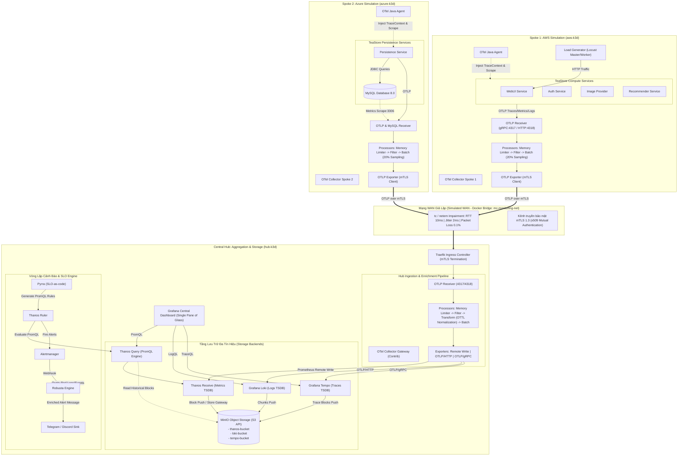
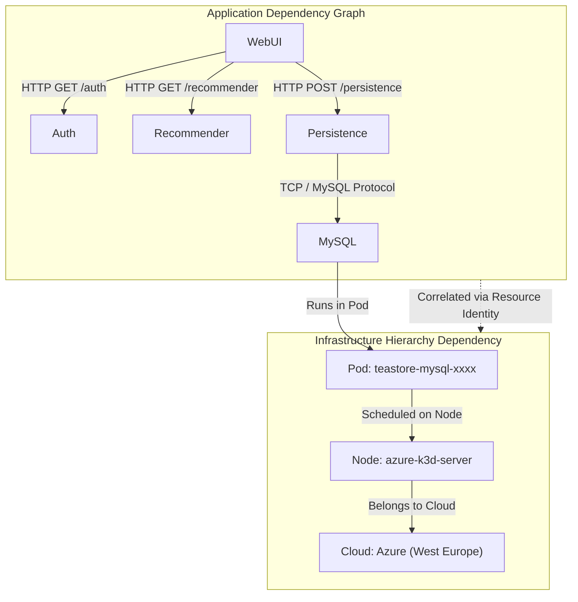
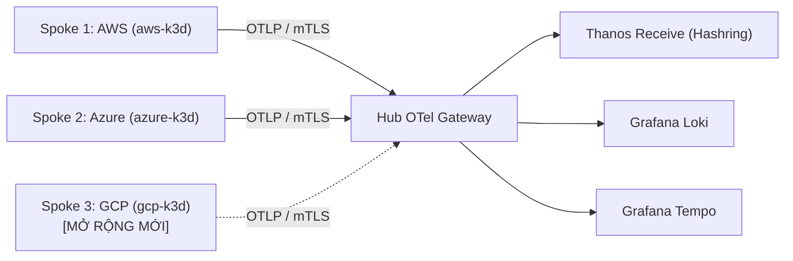

# Kế Hoạch Kiến Trúc Hệ Thống & Đánh Giá Benchmark Ứng Dụng (System Architecture Plan & Benchmark Evaluation)

> **Tài liệu:** `docs/architecture/01_SystemArchitecturePlan.md`  
> **Phiên bản:** 1.0 (Phase 0 — Baseline Architecture Plan)  
> **Trạng thái:** Kế hoạch kiến trúc phê duyệt (Approved Architecture Plan)  
> **Quyết định nền tảng:** Triển khai theo **Phương án A** (Edge-Filtered Ingestion with Centralized Processing & Batch Ingestion). Tạm thời chưa tích hợp streaming AI inference ở phase này (sẽ tích hợp ở phase sau). Tỷ lệ lấy mẫu vết (trace sampling rate) khởi điểm là **20%** và sẽ giảm dần theo các kịch bản tối ưu hóa.

---

## 1. Tổng Quan Kiến Trúc Hệ Thống & Lộ Trình Triển Khai (4 Phases)

Kiến trúc hệ thống được xây dựng nhằm hiện thực hóa mô hình quan sát đa đám mây (Multi-Cloud Observability) phân tán theo cấu trúc **Hub-Spoke**, giải quyết triệt để bài toán cô lập dữ liệu, tối ưu chi phí băng thông truyền tải qua mạng diện rộng (WAN egress cost) và thống nhất phân tích 3 trụ cột dữ liệu viễn trắc (Metrics, Logs, Traces).

### 1.1. Sơ Đồ Kiến Trúc Hệ Thống (System Architecture Diagram)

Dưới đây là sơ đồ chi tiết phản ánh toàn bộ các thành phần đã được chuẩn hóa từ [SystemArchitecture.drawio](file:///d:/Workstation/HCMUS/Grade4/01_TTDATN_K23/Tuần%203/multicloud-monitoring/docs/architecture/SystemArchitecture.drawio):



---

### 1.2. Giải Thích Chi Tiết 4 Phase Triển Khai

| Giai đoạn (Phase) | Mục tiêu trọng tâm | Chi tiết kỹ thuật & Tiêu chí hoàn thành (Exit Criteria) |
|---|---|---|
| **Phase 1: Local Infrastructure & Network Baseline** | Thiết lập hạ tầng cụm cục bộ và mô phỏng mạng WAN | - Sử dụng **Ansible** tự động hóa tạo 3 cụm k3d (`aws-k3d`, `azure-k3d`, `hub-k3d`) gắn trên Docker bridge `mc-monitoring-net`.<br>- Sử dụng Linux `tc` (Traffic Control) và `netem` tiêm suy hao mạng WAN: trễ khứ hồi (RTT) 10ms, jitter 2ms, tỉ lệ mất gói (packet loss) 0.1%.<br>- Khởi tạo hạ tầng khóa công khai PKI (CA nội bộ), phát hành chứng chỉ x509 cho Traefik Ingress và OTel Collectors phục vụ mTLS.<br>- *Exit criteria:* 3 cụm giao tiếp thông suốt qua FQDN nội bộ; DNS phân giải đúng; mạng WAN bị giới hạn đúng tham số mô phỏng. |
| **Phase 2: Workload & Telemetry Collection (Spoke Layer)** | Triển khai TeaStore và thu thập viễn trắc tại biên | - Triển khai các vi dịch vụ tính toán của TeaStore trên `aws-k3d` và tầng lưu trữ MySQL trên `azure-k3d`.<br>- Tích hợp OTel Java Auto-Instrumentation Agent vào tất cả container Java.<br>- Cấu hình OTel Edge Collector tại từng Spoke: áp dụng thứ tự xử lý `Memory Limiter -> Filter -> Batch`.<br>- Cấu hình tỷ lệ lấy mẫu vết ban đầu ở mức **20% (Head-based sampling)** đối với traffic bình thường; giữ lại 100% trace lỗi và latency cao.<br>- *Exit criteria:* Dữ liệu viễn trắc được OTel Edge Collector thu nhận đầy đủ và đẩy thành công qua kênh mTLS sang Hub. |
| **Phase 3: Central Hub Aggregation, Storage & Alerting** | Hoàn thiện tầng trung tâm tiếp nhận, lưu trữ và cảnh báo | - Triển khai OTel Collector Gateway tại `hub-k3d` để làm giàu dữ liệu (enrichment), gán nhãn định danh và chuẩn hóa timestamp về UTC.<br>- Triển khai Thanos Receive/Query, Grafana Loki, Grafana Tempo gắn kết với MinIO Object Storage (3 bucket riêng biệt).<br>- Tích hợp Grafana tạo dashboard liên kết 3 trụ cột (Trace-to-Logs và Metrics-to-Traces correlation).<br>- Cấu hình Pyrra quản lý SLO-as-code, Thanos Ruler sinh cảnh báo, Alertmanager và Robusta đẩy sự cố kèm ngữ cảnh pod về Telegram.<br>- *Exit criteria:* Dữ liệu hiển thị trực quan trên Grafana; alert gửi thành công về Telegram khi kích hoạt lỗi mô phỏng. |
| **Phase 4: Benchmark, Evaluation & Cloud Transition** | Thực nghiệm đo lường hiệu năng và chuẩn bị lên Cloud | - Chạy kịch bản benchmark chuẩn với Locust (`locustfile.py`: ramp-up, steady-state, cooldown).<br>- Đo lường độ bao phủ (coverage), độ chính xác (accuracy so với ground truth), độ trễ end-to-end và phụ phí mã hóa (mTLS overhead).<br>- Lưu trữ dữ liệu thô bất biến (raw telemetry immutability) gắn với `experiment_id`.<br>- Xây dựng các module Terraform để chuẩn bị di chuyển hạ tầng lên AWS EKS, Azure AKS thực tế sau khi hoàn thành phase cục bộ.<br>- *Exit criteria:* Báo cáo thực nghiệm hoàn chỉnh, có biểu đồ phân phối p50/p95/p99 và dữ liệu tái lập được 100%. |

---

## 2. Ứng Dụng Kiểm Chuẩn — TeaStore Benchmark Application

### 2.1. Kiến Trúc Vi Dịch Vụ Của TeaStore
TeaStore là ứng dụng chuẩn được cộng đồng nghiên cứu SPEC RG (Standard Performance Evaluation Corporation Research Group) công nhận rộng rãi. Ứng dụng mô phỏng hệ thống thương mại điện tử với 5 microservices Java độc lập và 1 cơ sở dữ liệu:
1. **WebUI (`aws-k3d`):** Cung cấp giao diện web cho người dùng, xử lý các request HTTP từ client, điều phối gọi các dịch vụ bên dưới.
2. **Auth (`aws-k3d`):** Xác thực người dùng, cấp phát và kiểm tra token phiên làm việc (session tokens).
3. **Image Provider (`aws-k3d`):** Quản lý và phân phối hình ảnh sản phẩm (I/O-intensive).
4. **Recommender (`aws-k3d`):** Sử dụng thuật toán lọc cộng tác (collaborative filtering) để đề xuất sản phẩm liên quan (CPU-intensive & memory-intensive).
5. **Persistence Service (`azure-k3d`):** Cung cấp API truy cập dữ liệu trung gian, xử lý logic nghiệp vụ đọc/ghi dữ liệu sản phẩm, danh mục, giỏ hàng và đơn hàng.
6. **Database (`azure-k3d`):** Cơ sở dữ liệu MySQL 8.0 lưu trữ bền vững trạng thái hệ thống.

### 2.2. Lý Do Lựa Chọn & Phân Bổ Kiến Trúc Đa Đám Mây (Multi-Cloud Splitting)
- **Mô phỏng chân thực mô hình Multi-Cloud:** Việc phân tách các vi dịch vụ tính toán (WebUI, Auth, Image, Recommender) chạy tại Spoke 1 (`aws-k3d`) và dịch vụ lưu trữ dữ liệu (Persistence, MySQL) chạy tại Spoke 2 (`azure-k3d`) tái hiện mô hình thực tế: Doanh nghiệp đặt compute tại một cloud để tối ưu chi phí tính toán hoặc mở rộng linh hoạt, trong khi cơ sở dữ liệu lõi được đặt tại một cloud khác do yêu cầu bảo mật hoặc chính sách dữ liệu.
- **Tạo ra luồng giao tiếp liên cụm (Cross-Cluster / Inter-Spoke Communication):** Khi người dùng duyệt web, WebUI tại Spoke 1 bắt buộc phải gọi sang Persistence tại Spoke 2 qua mạng WAN mô phỏng. Điều này tạo điều kiện thực nghiệm hoàn hảo để đánh giá tính phân tán của OTel Tracing (Distributed Tracing qua W3C TraceContext).

---

## 3. Giải Quyết Chuyên Sâu 10 Câu Hỏi & Yêu Cầu Kỹ Thuật Bắt Buộc

### 3.1. Chuẩn Hóa Timestamp Về Central Hub Khi Khác Region

#### Vấn đề kỹ thuật
Trong môi trường đa đám mây phân tán giữa các khu vực địa lý (multi-region):
1. **Lệch múi giờ (Timezone offsets):** Các server/node có thể thiết lập múi giờ địa phương khác nhau.
2. **Độ trôi đồng hồ (Clock Skew / Drift):** Mặc dù các cloud provider sử dụng NTP/Chrony, sự bất đồng bộ giữa các máy chủ vật lý vẫn dao động từ vài phần nghìn giây (vài milliseconds) đến hàng chục milliseconds.
3. Nếu Hub tự ý ghi đè timestamp tại nguồn bằng thời điểm nhận được gói tin, toàn bộ thứ tự xảy ra sự kiện (causal ordering) và phép đo thời gian thực thi (duration) của microservices sẽ bị sai lệch hoàn toàn.

#### Giải pháp: Hợp đồng thời gian 4 lớp (4-Tier Timestamp Contract)
Hệ thống tuân thủ nghiêm ngặt quy tắc tại [telemetry-schema-time](file:///d:/Workstation/HCMUS/Grade4/01_TTDATN_K23/Tuần%203/multicloud-monitoring/.agent/rules/agents__rules__10-telemetry-data-integrity.md):
```
[Event Source] ----------> [Spoke Collector] ------------> [Hub Gateway] ------------> [Unified Storage]
  event_timestamp           observed_timestamp              received_timestamp         normalized_timestamp
  (Gốc tại app)             (Lúc Collector bắt)             (Lúc Hub tiếp nhận)        (Chuẩn ISO 8601 UTC)
```

1. **`event_timestamp`:** Thời điểm chính xác sự kiện phát sinh trong ứng dụng (tính bằng nanosecond UTC epoch). Thuộc tính này là bất biến (immutable), không bao giờ bị ghi đè.
2. **`observed_timestamp`:** Thời điểm OTel Edge Collector tại Spoke nhận được bản ghi viễn trắc từ tiến trình cục bộ.
3. **`received_timestamp`:** Thời điểm Ingress/Gateway tại Central Hub tiếp nhận gói tin OTLP sau khi truyền qua mạng WAN.
4. **`normalized_timestamp`:** Giá trị thời gian được bộ vi xử lý Transform OTTL tại Hub chuẩn hóa sang định dạng chuỗi chuẩn ISO 8601 UTC (`YYYY-MM-DDTHH:mm:ss.ssssssZ`).

#### Đo lường và Bóc tách Độ trễ (Latency Decomposition)
Nhờ lưu trữ đầy đủ 4 mốc thời gian, hệ thống bóc tách chính xác từng thành phần trễ mà không gây nhầm lẫn:
- **Độ trễ truyền thông WAN (Network Transit Latency):**
  $$\Delta t_{\text{transit}} = \text{received\_timestamp} - \text{observed\_timestamp}$$
- **Độ trễ xử lý tại Agent/Edge (Edge Pipeline Latency):**
  $$\Delta t_{\text{edge}} = \text{observed\_timestamp} - \text{event\_timestamp}$$
- **Độ trễ toàn trình đến khi sẵn sàng truy vấn (End-to-End Freshness Latency):**
  $$\Delta t_{\text{e2e}} = \text{query\_visible\_timestamp} - \text{event\_timestamp}$$

#### Xử lý độ bất định đồng hồ (Clock Uncertainty)
Tại mỗi Spoke, node agent định kỳ kiểm tra trạng thái đồng bộ NTP qua lệnh Chrony và bổ sung siêu dữ liệu vào thuộc tính tài nguyên:
- `clock.source`: `"chrony_ptp"` hoặc `"ntp"`
- `clock.uncertainty_ms`: Độ lệch ước lượng tối đa (ví dụ: `2.4ms`)
- `time.quality`: Gắn cờ `"trusted"` nếu uncertainty < 10ms; `"skew_warning"` nếu uncertainty $\ge$ 10ms.

---

### 3.2. Thu Thập Dữ Liệu Phụ Thuộc (Dependency Telemetry)

Hệ thống theo dõi tự động cả hai tầng phụ thuộc: **Phụ thuộc Ứng dụng (Application Dependencies)** và **Phụ thuộc Hạ tầng/Đám mây (Cloud & Infrastructure Dependencies)**.



#### 1. Thu thập phụ thuộc ứng dụng (Application Dependencies)
- **Cơ chế:** Sử dụng chuẩn W3C TraceContext do OTel Java Agent tiêm vào request header. Khi WebUI gọi sang Auth hoặc Persistence, agent tự động chèn 2 HTTP headers:
  - `traceparent`: `00-4bf92f3577b34da6a3ce929d0e0e4736-00f067aa0ba902b7-01` (phiên bản, trace_id, parent_span_id, trace_flags).
  - `tracestate`: lưu trữ thông tin nhà cung cấp trung gian.
- **Xác định mối quan hệ:**
  - Phía gọi (Caller) sinh span với `SpanKind = SPAN_KIND_CLIENT`.
  - Phía nhận (Callee) sinh span với `SpanKind = SPAN_KIND_SERVER`.
  - Đối với MySQL, OTel JDBC wrapper sinh span với `SpanKind = SPAN_KIND_CLIENT` kèm thuộc tính `db.system = "mysql"`, `net.peer.name = "teastore-mysql"`, `net.peer.port = 3306`.
- **Dựng Service Graph:** Tempo và Grafana tự động gom nhóm các cặp Client-Server spans này để tạo biểu đồ phụ thuộc động (Dynamic Dependency Graph) hiển thị lưu lượng (throughput), tỷ lệ lỗi (error rate) và độ trễ (latency) trên từng nhánh liên kết.

#### 2. Thu thập phụ thuộc hạ tầng & đám mây (Cloud & Infrastructure Dependencies)
- **Cơ chế:** Sử dụng `k8sattributesprocessor` kết hợp với `kubeletstatsreceiver` trong OTel Collector.
- **Ánh xạ phân cấp định danh:**
  - Pod $\longrightarrow$ Node $\longrightarrow$ Cụm $\longrightarrow$ Khu vực $\longrightarrow$ Nhà cung cấp.
  - Các thuộc tính định danh chính tắc (Canonical Resource Identity):
    - `service.name`: Tên định danh vi dịch vụ (vd: `teastore-webui`).
    - `service.instance.id`: ID duy nhất của instance (vd: `teastore-webui-7694f4848-x8k2l`).
    - `k8s.pod.name`: Tên pod Kubernetes.
    - `k8s.node.name`: Tên node máy chủ.
    - `cloud.provider`: Định danh provider (`aws` cho Spoke 1, `azure` cho Spoke 2, `hub` cho Hub).
    - `cloud.region`: Định danh khu vực (vd: `us-east-1`, `westeurope`).

---

### 3.3. Tính Bất Biến Của Dữ Liệu Gốc & Quản Lý Trường Bị Thiếu (Immutability & Missing Data Tracking)

#### 1. Tính bất biến của dữ liệu gốc (Raw Telemetry Immutability)
- **Nguyên tắc:** Toàn bộ dữ liệu viễn trắc thô (raw telemetry) thu thập trong các đợt chạy thực nghiệm được lưu trữ nguyên trạng, không bị chỉnh sửa, làm mịn hoặc xóa bỏ các điểm dị biệt (outliers) để làm đẹp biểu đồ.
- **Cơ chế lưu trữ:**
  - Mỗi phiên chạy kiểm chuẩn được gán một định danh duy nhất: `YYYYMMDD_<workload>_<scenario>_<runNN>` (ví dụ: `20261104_teastore_baseline_run01`).
  - Dữ liệu thô từ OTel Collector được xuất song song sang một bucket dành riêng trên MinIO (`raw-telemetry-archive`) dưới định dạng nén OTLP JSON / Parquet kèm theo mã băm checksum SHA-256.
  - Bất kỳ tập dữ liệu phái sinh (derived dataset) nào sử dụng cho nghiên cứu đều phải ghi rõ `source_run_id` và các bước chuyển đổi (transformation steps).

#### 2. Từ vựng chuẩn hóa quản lý dữ liệu thiếu (Missing-Data Vocabulary)
Hệ thống cấm tuyệt đối việc gán giá trị mặc định là `0` hoặc `null` khi thiếu dữ liệu, vì điều này làm sai lệch các phép toán thống kê và mô hình phát hiện bất thường. Bắt buộc sử dụng bộ từ vựng chuẩn hóa:
- `present`: Trường dữ liệu tồn tại và có giá trị hợp lệ.
- `missing`: Nguồn phát có định nghĩa trường này nhưng không gửi dữ liệu trong bản tin cụ thể.
- `unsupported`: Nguồn phát (hoặc phiên bản hệ điều hành/k3s) không hỗ trợ thuộc tính này (ví dụ: cAdvisor trên k3d không đo được nhiệt độ phần cứng).
- `not_applicable`: Thuộc tính không có ý nghĩa đối với thực thể hiện tại (ví dụ: `db.statement` không thể có trên WebUI HTTP span).
- `filtered`: Dữ liệu bị loại bỏ chủ động bởi Filter Processor tại Spoke.
- `sampled_out`: Dữ liệu bị loại bỏ theo chính sách lấy mẫu (20% trace sampling).
- `parse_error`: Dữ liệu có tồn tại nhưng bị lỗi cú pháp khi collector giải mã.
- `unknown`: Trạng thái chưa xác định.

Hệ thống duy trì tệp `telemetry-field-inventory.csv` để đối chiếu từng thuộc tính theo từng nhà cung cấp và đánh giá mức độ bao phủ thực tế.

---

### 3.4. Cơ Chế Khám Phá Dịch Vụ (Service Discovery)

Hệ thống thiết lập cơ chế khám phá dịch vụ hai cấp độ:

```
[Intra-Cluster Service Discovery]      <---> [Kubernetes CoreDNS & Endpoints]
[Inter-Cluster / Multi-Cloud Discovery] <---> [Traefik Ingress Gateway + mTLS SNI Routing]
```

1. **Khám phá dịch vụ nội bộ cụm (Intra-cluster Service Discovery):**
   - Dựa trên **Kubernetes CoreDNS** chuẩn. Các vi dịch vụ trong cùng cụm gọi nhau qua cú pháp DNS: `<service-name>.<namespace>.svc.cluster.local`.
   - OTel Collector sử dụng cơ chế `kubernetes_sd_configs` của Prometheus Receiver để tự động quét toàn bộ Pods, Nodes và Endpoints thông qua API Server mà không cần khai báo địa chỉ IP tĩnh.
2. **Khám phá dịch vụ xuyên cụm / WAN (Cross-cluster Service Discovery):**
   - Khi `teastore-webui` (tại `aws-k3d`) cần gọi `teastore-persistence` (tại `azure-k3d`), request không thể dùng IP nội bộ của cụm kia.
   - **Giải pháp:** Sử dụng **Traefik Ingress Controller** làm Gateway tại mỗi Spoke.
   - Dịch vụ Persistence được công khai qua một Ingress Route với tên miền nội bộ mạng giả lập: `persistence.azure.local`.
   - WebUI tại Spoke 1 được cấu hình trỏ tới `https://persistence.azure.local:8443` thông qua cấu hình DNS bổ sung trong CoreDNS (`hosts` plugin) hoặc Docker network DNS.
   - Kết nối xuyên cụm này bắt buộc đi qua mTLS: Traefik xác thực client certificate của WebUI trước khi chuyển tiếp vào pod Persistence.

---

### 3.5. Quản Lý Trạng Thái Hệ Thống & Cụm (System & Cluster State Tracking)

Hệ thống theo dõi trạng thái đa tầng nhằm đảm bảo độ tin cậy vận hành:

| Tầng giám sát | Thành phần theo dõi | Chỉ số / Trạng thái ghi nhận | Ý nghĩa & Hành vi xử lý |
|---|---|---|---|
| **Cụm & Node K8s** | `kube-state-metrics` & `kubeletstats` | `kube_node_status_condition{condition="Ready"}`<br>`kube_node_spec_unschedulable` | Giám sát sức khỏe node máy chủ k3d. Cảnh báo ngay khi node chuyển sang trạng thái `NotReady` hoặc cạn kiệt tài nguyên. |
| **Pod & Container** | `kube-state-metrics` | `kube_pod_status_phase` (Running, Pending, Failed)<br>`kube_pod_container_status_waiting_reason` (CrashLoopBackOff, ImagePullBackOff) | Theo dõi vòng đời pod. Robusta tự động kích hoạt điều tra khi phát hiện `CrashLoopBackOff`. |
| **Ứng dụng TeaStore** | Kubernetes Probes & Spring Boot Actuator | `http_get :8080/actuator/health`<br>- Liveness Probe (kiểm tra tiến trình sống)<br>- Readiness Probe (sẵn sàng nhận tải) | Tự động cô lập pod khỏi service endpoint nếu probe thất bại; tự động restart container nếu dead-lock. |
| **Cơ sở dữ liệu** | `mysqlreceiver` & `mysqld_exporter` | `mysql_up` (0 hoặc 1)<br>`mysql_global_status_threads_connected`<br>`mysql_global_status_slow_queries` | Theo dõi tính sẵn sàng của MySQL, cảnh báo nghẽn connection pool và truy vấn chậm làm nghẽn Persistence service. |
| **Pipeline Viễn trắc** | OTel Collector Internal Metrics | `otelcol_receiver_accepted_spans`<br>`otelcol_receiver_refused_spans`<br>`otelcol_processor_dropped_spans`<br>`otelcol_exporter_enqueue_failed_spans` | Đảm bảo tính toàn vẹn của hệ thống giám sát. Cảnh báo ngay khi collector bị quá tải bộ nhớ hoặc nghẽn hàng đợi (queue backpressure). |

---

### 3.6. Tính Toán Dung Lượng Lưu Trữ & Chiến Lược Retention (Storage Sizing & Retention)

#### 1. Mô hình tính toán dung lượng dữ liệu phát sinh (Data Volume Sizing)

Dựa trên cấu hình thí nghiệm gồm 100 containers/pods viễn trắc hoạt động liên tục:
- **Metrics (Prometheus / Thanos):**
  - Số lượng chuỗi thời gian hoạt động (Active Time Series): $100 \text{ pods} \times 50 \text{ metrics/pod} = 5,000 \text{ series}$.
  - Tần suất cào dữ liệu (Scrape interval): 15 giây $\longrightarrow 4 \text{ samples/phút/series}$.
  - Dung lượng mỗi mẫu sau nén TSDB (Gorilla chunk compression): $\approx 1.5 \text{ bytes/sample}$.
  - *Tốc độ phát sinh:* $5,000 \times 4 \times 1.5 = 30,000 \text{ bytes/phút} \approx 1.8 \text{ MB/giờ} \approx 1.3 \text{ GB/tháng}$.
- **Logs (Grafana Loki):**
  - Tần suất log trung bình: $100 \text{ logs/giây}$ trên toàn hệ thống.
  - Kích thước trung bình mỗi dòng log thô: $500 \text{ bytes}$.
  - Nén Snappy trong chunk của Loki: tỷ lệ nén $\approx 1:5$ ($\approx 100 \text{ bytes/log}$).
  - *Tốc độ phát sinh:* $100 \text{ logs/s} \times 100 \text{ bytes} = 10 \text{ KB/s} \approx 864 \text{ MB/ngày} \approx 26 \text{ GB/tháng}$.
- **Traces (Grafana Tempo với chính sách lấy mẫu 20%):**
  - Tần suất request ứng dụng: $200 \text{ requests/giây}$ (RPS).
  - Số lượng spans trung bình mỗi trace: $8 \text{ spans/trace}$.
  - Kích thước mỗi span đã nén ZSTD: $\approx 400 \text{ bytes}$.
  - **Áp dụng chính sách lấy mẫu 20%:** Chỉ lưu trữ $200 \times 0.20 = 40 \text{ traces/giây}$ (giảm được 80% dung lượng WAN và lưu trữ!).
  - *Tốc độ phát sinh:* $40 \text{ traces/s} \times 8 \text{ spans} \times 400 \text{ bytes} \approx 128 \text{ KB/giây} \approx 11 \text{ GB/ngày}$.

#### 2. Chiến lược phân tầng lưu trữ (Storage Tiering & Retention Policies)

Hệ thống kết hợp bộ nhớ đệm tốc độ cao và MinIO Object Storage theo 2 tầng:

```
[Hot Tier: RAM & SSD Cục Bộ]  --- (Sau 2 giờ) --->  [Warm/Cold Tier: MinIO S3 Object Storage]
- Thanos Receive (TSDB 2h)                          - thanos-bucket (Retention: 30 ngày lab, downsample 5m/1h)
- Loki Ingester (Chunk Memory 2h)                   - loki-bucket (Retention: 14 ngày lab)
- Tempo Ingester (Block Memory 1h)                  - tempo-bucket (Retention: 7 ngày lab)
```

- **Downsampling tự động của Thanos:** Sau 40 giờ, dữ liệu thô 15s được Thanos Compact nén thành mẫu 5 phút; sau 14 ngày được nén thành mẫu 1 giờ, giúp tiết kiệm hơn 85% dung lượng lưu trữ dài hạn mà vẫn bảo toàn xu hướng biểu đồ.

---

### 3.7. Thiết Kế Telemetry Schema Chi Tiết (Web App vs Instance)

Để đảm bảo dữ liệu thu thập có cấu trúc chuẩn mực và tránh bùng nổ nhãn (cardinality explosion), hệ thống phân tách schema cho 2 đối tượng theo chuẩn OpenTelemetry Semantic Conventions:

#### 1. Schema Theo Dõi Web Application (Theo phương pháp RED: Rate, Errors, Duration)

| Nhóm thuộc tính | Tên thuộc tính chính tắc (Canonical Name) | Kiểu dữ liệu | Ý nghĩa & Ví dụ giá trị |
|---|---|---|---|
| **Resource** | `service.name`<br>`service.version`<br>`service.instance.id`<br>`deployment.environment` | string | `teastore-webui`<br>`v1.4.0`<br>`teastore-webui-7694f4848-x8k2l`<br>`production` |
| **HTTP Request** | `http.request.method`<br>`http.response.status_code`<br>`http.route`<br>`http.url` | string<br>int<br>string<br>string | `GET`<br>`200`, `500`<br>`/tools.descartes.teastore.webui/cart`<br>(Chỉ lưu trên Traces, không làm metric label!) |
| **Database Call** | `db.system`<br>`db.name`<br>`db.statement`<br>`db.operation` | string<br>string<br>string<br>string | `mysql`<br>`teastore`<br>`SELECT * FROM products WHERE id = ?`<br>`SELECT` |
| **RED Metrics** | `http.server.request.count`<br>`http.server.response.5xx.count`<br>`http.server.duration` | counter<br>counter<br>histogram | Tần suất request (Rate)<br>Tần suất lỗi phía server (Errors)<br>Độ trễ phân bổ theo buckets (Duration: p50, p90, p99) |

> [!WARNING] **Kiểm soát Cardinality rủi ro cao:**
> Tuyệt đối không đưa các giá trị động không giới hạn (unbounded values) như URL đầy đủ chứa query param, Session ID, User ID, hoặc nội dung câu thông báo lỗi chi tiết vào Metric Labels. Các trường này chỉ được phép xuất hiện trong **Trace Attributes** hoặc **Log Body**.

#### 2. Schema Theo Dõi Instance / Node / Container (Theo phương pháp USE: Utilization, Saturation, Errors)

| Nhóm thuộc tính | Tên thuộc tính chính tắc (Canonical Name) | Kiểu dữ liệu | Đơn vị | Ý nghĩa & Phương pháp USE |
|---|---|---|---|---|
| **Resource** | `host.id`<br>`host.name`<br>`k8s.node.name`<br>`k8s.pod.name`<br>`k8s.container.name`<br>`cloud.provider`<br>`cloud.region` | string | - | Định danh tài nguyên hạ tầng và đám mây (`aws`, `azure`, `hub`). |
| **Utilization (Sử dụng)** | `system.cpu.utilization`<br>`system.memory.usage`<br>`container.cpu.utilization`<br>`container.memory.working_set_bytes` | double<br>int<br>double<br>int | 1 (tỉ lệ)<br>Bytes<br>1 (tỉ lệ)<br>Bytes | Tỷ lệ % CPU đang bận.<br>Dung lượng RAM đang tiêu thụ thực tế. |
| **Saturation (Bão hòa)** | `system.cpu.load_average.15m`<br>`container.cpu.cfs.throttled_time`<br>`system.memory.paging.faults` | double<br>double<br>counter | 1<br>Seconds<br>1 | Hàng đợi CPU chờ xử lý.<br>Thời gian container bị kernel kẹp bóp CPU quota.<br>Tần suất lỗi trang bộ nhớ (thiếu RAM). |
| **Errors (Lỗi)** | `system.network.errors`<br>`system.disk.io.errors`<br>`container.restart_count` | counter<br>counter<br>counter | 1<br>1<br>1 | Số gói tin mạng bị lỗi interface.<br>Số lỗi đọc/ghi ổ cứng.<br>Số lần container bị Crash/OOMKilled. |

---

### 3.8. Đánh Giá Độ Bao Phủ & Độ Chính Xác (Coverage & Accuracy Evaluation)

#### 1. Đánh giá độ bao phủ (Coverage Evaluation)
Độ bao phủ được đo lường dựa trên tỷ lệ giữa số thuộc tính/thực thể quan sát được thực tế so với danh mục kỳ vọng trong `telemetry-field-inventory.csv`:
$$\text{Coverage}_{\text{Signal}} = \frac{N_{\text{observed}}}{N_{\text{expected}}} \times 100\%$$

- **Độ bao phủ hạ tầng:** Tỷ lệ số node, container, disk interface phát sinh metric đầy đủ.
- **Độ bao phủ ứng dụng:** Tỷ lệ các API endpoints của TeaStore được bọc trace spans và log tương ứng.
- Mọi trường dữ liệu thiếu đều phải có lý do minh bạch trong báo cáo (xem Mục 3.3).

#### 2. Đánh giá độ chính xác (Accuracy Evaluation so với Ground Truth)
Để chứng minh dữ liệu viễn trắc phản ánh đúng thực tế khách quan chứ không bị bóp méo qua collector:
- **Số lượng giao dịch (Request Count):**
  - *Giá trị gốc (Ground Truth):* Số lượng HTTP requests do Load Generator (Locust) ghi nhận tại client ($Y_{\text{real}}$).
  - *Giá trị quan sát (Observed):* Tổng số span HTTP nhận được tại Tempo + Tổng số request count ghi nhận tại Prometheus ($Y_{\text{observed}}$).
  - *Sai số tương đối (Mean Absolute Percentage Error - MAPE):*
    $$\text{MAPE} = \frac{|Y_{\text{real}} - Y_{\text{observed}}|}{Y_{\text{real}}} \times 100\%$$
    *Mục tiêu nghiệm thu:* $\text{MAPE} \le 1.0\%$ khi không áp dụng sampling, và sai số tỷ lệ đúng $\approx 80\% \pm 1.5\%$ khi áp dụng 20% sampling.
- **Mức tiêu thụ CPU/RAM:**
  - *Giá trị gốc:* Đo đạc trực tiếp từ Linux Kernel cgroups của host container qua `/proc/stat` và `/sys/fs/cgroup`.
  - *Giá trị quan sát:* Metric `container_cpu_usage_seconds_total` từ cAdvisor/OTel KubeletStats.
  - *Mục tiêu nghiệm thu:* $\text{MAPE} \le 2.0\%$.

---

### 3.9. Độ Trễ Telemetry & Phương Pháp Đo Lường Độ Trễ Sau Khi Mã Hóa

#### 1. Độ trễ toàn trình viễn trắc (End-to-End Telemetry Latency)
Độ trễ từ thời điểm sự kiện xảy ra trong ứng dụng cho đến khi hiển thị trên bảng điều khiển Grafana được xác định bởi công thức:
$$L_{\text{e2e}} = T_{\text{grafana\_render}} - T_{\text{source\_event}}$$

Phân rã chi tiết luồng xử lý:
$$L_{\text{e2e}} = L_{\text{agent\_buffer}} + L_{\text{edge\_batch}} + L_{\text{wan\_transit}} + L_{\text{hub\_pipeline}} + L_{\text{tsdb\_index}} + L_{\text{query\_refresh}}$$
- $L_{\text{agent\_buffer}}$: Thời gian đệm span trong Java Agent (mặc định 100ms - 500ms).
- $L_{\text{edge\_batch}}$: Thời gian gom mẻ trong OTel Collector Batch Processor (cấu hình `timeout: 1s`, `send_batch_size: 512`).
- $L_{\text{wan\_transit}}$: Thời gian truyền gói qua mạng WAN giả lập ($10\text{ms} \pm 2\text{ms}$).
- $L_{\text{hub\_pipeline}}$: Thời gian chạy qua Transform OTTL tại Hub Gateway ($\approx 5\text{ms}$).
- $L_{\text{tsdb\_index}}$: Thời gian ghi dữ liệu vào Thanos/Loki/Tempo WAL ($\approx 100\text{ms} - 500\text{ms}$).
- $L_{\text{query\_refresh}}$: Chu kỳ làm mới của dashboard Grafana (cấu hình 5s hoặc 10s).
- **Kết luận:** Độ trễ hiển thị thực tế trên Grafana dao động từ **3 giây đến 8 giây**, hoàn toàn đáp ứng tiêu chuẩn giám sát vận hành thời gian thực (Near Real-Time).

#### 2. Phương pháp đo lường độ trễ mã hóa (Post-Encryption / mTLS Overhead Measurement)

Để đánh giá chính xác cái giá phải trả về độ trễ và tài nguyên khi bật mã hóa mTLS trên WAN, hệ thống thực hiện thí nghiệm đối chứng ghép cặp (**Matched Pair A/B Experiment**):

```
Kịch bản A (Baseline - Plaintext):
[Spoke Collector] === (OTLP gRPC Plaintext / Không mã hóa) ===> [Hub Ingress]

Kịch bản B (Treatment - mTLS 1.3):
[Spoke Collector] === (OTLP gRPC over mTLS 1.3 / AES-256-GCM) ===> [Hub Ingress]
```

**Các tiêu chí đo lường định lượng bắt buộc:**
1. **Thời gian bắt tay bảo mật (Handshake Setup Latency):** Đo thời gian thiết lập phiên TLS 1.3 ban đầu (gồm trao đổi khóa ECDHE, chứng chỉ x509 và client certificate verification).
2. **Độ trễ truyền gói tin ổn định (Steady-State Packet Latency):** Sử dụng các gói ping viễn trắc có gắn timestamp để đo $\Delta t_{\text{transit}}$ trong kịch bản A so với kịch bản B. Độ trễ do thuật toán mã hóa đối xứng AES-256-GCM dự kiến chỉ tăng $< 1.5\text{ms}$ nhờ tập lệnh phần cứng Intel AES-NI.
3. **Phụ phí CPU Collector (CPU Utilization Overhead):** Đo mức tăng tiêu thụ CPU của OTel Collector pod khi phải liên tục mã hóa/giải mã các mẻ OTLP:
   $$\Delta \text{CPU}_{\text{overhead}} = \text{CPU}_{\text{mTLS}} - \text{CPU}_{\text{plaintext}}$$
4. **Phụ phí kích thước gói tin (Network Framing Overhead):** Bổ sung TLS Record Layer Header (5 bytes) + Initialization Vector + Authentication Tag (16 bytes) trên mỗi bản tin TLS record.

---

### 3.10. Khả Năng Mở Rộng Hệ Thống Khi Bổ Sung Cloud Provider Mới (Extensibility)

> [!IMPORTANT] **Câu hỏi cốt lõi:**  
> *"Nếu có thêm 1 provider khác tích hợp vào hệ thống (ví dụ bổ sung thêm Google Cloud Platform - GCP Spoke `gcp-k3d`), thì hệ thống có bị ảnh hưởng gì không?"*

**Câu trả lời khẳng định:** **Hoàn toàn KHÔNG bị ảnh hưởng tiêu cực hay phá vỡ kiến trúc.**  
Hệ thống được thiết kế theo nguyên lý **Decoupled Hub-Spoke**, cho phép mở rộng tuyến tính (horizontal scalability) theo chiều ngang khi thêm Spoke mới.



#### Bằng chứng kiến trúc đảm bảo khả năng mở rộng (Architectural Proof):
1. **Tính độc lập hoàn toàn của Spoke (Spoke Decoupling):**
   - Mỗi Spoke là một đơn vị tự trị (autonomous cluster). Cụm Spoke 3 (`gcp-k3d`) chỉ cần cài đặt OTel Edge Collector nội bộ.
   - Collector tại Spoke 3 chỉ cần gán thêm nhãn metadata: `cloud.provider = "gcp"`, `cloud.region = "asia-southeast1"`.
   - Không cần sửa đổi bất kỳ dòng code hay cấu hình nào của Spoke 1 và Spoke 2.
2. **Khả năng tiếp nhận không chạm tại Central Hub (Zero-Code Hub Ingestion):**
   - Central Hub sử dụng Traefik Ingress Controller hỗ trợ xác thực mTLS dựa trên Certificate Authority (CA) dùng chung. Khi Spoke mới được cấp chứng chỉ x509 hợp lệ từ CA, Hub tự động chấp nhận kết nối mà không cần khởi động lại Ingress.
   - OTel Collector Gateway tại Hub xử lý dữ liệu dựa trên **Canonical Schema chuẩn hóa**; nó tiếp nhận mọi luồng OTLP chuẩn mà không phụ thuộc vào tên nhà cung cấp đám mây.
3. **Mở rộng tuyến tính tầng lưu trữ (Storage Scalability):**
   - **Thanos Receive** hỗ trợ cơ chế băm nhất quán (**Consistent Hashing / Hashring**). Khi lưu lượng metrics tăng do có thêm Spoke, ta chỉ việc tăng số lượng replica của Thanos Receive trong Hashring mà không làm gián đoạn việc ghi dữ liệu.
   - **Loki & Tempo** ghi trực tiếp dữ liệu dạng chunk/block vào MinIO Object Storage. Do MinIO mở rộng dung lượng theo mô hình lưu trữ đối tượng không trạng thái (stateless storage architecture), dung lượng lưu trữ chỉ đơn giản là tăng dung lượng đĩa của MinIO mà không gặp hiện tượng thắt cổ chai về metadata như các cơ sở dữ liệu quan hệ.
4. **Phân tách trên Bảng Điều Khiển (Dashboard Multi-Tenancy):**
   - Toàn bộ dashboard Grafana được thiết kế với biến động (template variable) `$cloud_provider`. Khi Spoke 3 gia nhập, Grafana tự động nhận diện giá trị `gcp` trong biến dropdown thông qua câu truy vấn PromQL:
     `label_values(up, cloud.provider)`
   - Người quản trị có thể lọc xem riêng Spoke AWS, Azure, GCP hoặc xem biểu đồ so sánh chéo hiệu năng giữa 3 đám mây trên cùng một màn hình.

---

## 4. Tóm Tắt Kế Hoạch Triển Khai Tiếp Theo

1. **Hoàn thiện cấu hình manifest Kustomize:** Phân tách rõ ràng thư mục manifests `k8s/base/` và `k8s/overlays/local-k3d/`.
2. **Kích hoạt kịch bản Ansible:** Khởi tạo hạ tầng 3 cụm k3d, cấu hình mạng WAN mô phỏng `tc/netem` và kiểm tra kênh mTLS thông suốt.
3. **Triển khai ứng dụng TeaStore:** Bật OTel Java Agent và kiểm tra đồ thị phân tán vi dịch vụ trên Grafana Tempo với chính sách lấy mẫu 20%.
4. **Thực hiện bài đo kiểm chuẩn đầu tiên:** Xuất báo cáo đánh giá thực nghiệm tuân thủ nghiêm ngặt quy tắc liêm chính dữ liệu viễn trắc.

