# Cấu Trúc Thư Mục Toàn Diện Của Đồ Án (Project Master Directory Structure)

> **Tài liệu:** `docs/architecture/03_ProjectStructure.md`  
> **Phiên bản:** 3.0 (Master Final Architecture - Post AI Integration & Infrastructure Alignment)  
> **Trạng thái:** Tài liệu chính thức phản ánh 100% cấu trúc kho mã nguồn hiện tại sau khi chốt hoàn toàn đồ án.  
> **Nguyên tắc cốt lõi:**  
> 1. **Đơn nhiệm (Single Responsibility Principle - SRP):** Mỗi tệp tin manifest Kubernetes chỉ giải quyết đúng **MỘT** tài nguyên duy nhất, tiền tố theo thứ tự nạp (`00-namespace`, `01-secret`, `02-configmap`, `03-pvc`, `04-statefulset`, `05-service`).  
> 2. **Chuẩn Kustomize (Base vs Overlays):** Manifest gốc được tập trung tại `k8s/base/`, các đặc thù của cụm được tách vào `k8s/overlays/local-k3d/`.  
> 3. **Ghim cứng phiên bản (No Floating Tags):** Toàn bộ tech stack được định nghĩa phiên bản cụ thể tại [`infra/README.md`](file:///d:/Workstation/HCMUS/Grade4/01_TTDATN_K23/Tuần%203/multicloud-monitoring/infra/README.md), nghiêm cấm nhãn `latest`.  
> 4. **Điều phối tự động qua Makefile:** Quản lý toàn bộ vòng đời triển khai chỉ qua các lệnh `make`.  
> 5. **Bảo mật tập trung:** Toàn bộ thông tin nhạy cảm và credentials được gom về file `.env` duy nhất tại thư mục gốc.

---

## 1. Các Điểm Nâng Cấp & Chuẩn Hóa Cốt Lõi

1. **Hợp Nhất Module AI Anomaly Detection V3 (`ai-engine/`):**
   - Đóng gói toàn bộ mã nguồn học sâu đa biến (Ensemble Universal GRU + TCN Autoencoders + Isolation Forest).
   - Module suy luận thời gian thực `detector.py` tích hợp:
     - Tự động khám phá thực thể động $O(1)$ PromQL từ Thanos.
     - Phân rã độ trễ vết W3C từ Tempo (`TempoTraceAnalyzer`) thành $T_{\text{WAN}}$, $T_{\text{self}}$, $T_{\text{DB}}$.
     - Máy chủ nhúng **Prometheus Metrics Exporter (cổng `9108`)** xuất ngược các chỉ số AI vào hệ thống giám sát.
     - Module **Telegram Alert Sink** gửi cảnh báo thông minh kèm phân tích RCA và cooldown 60s.
2. **Kịch Bản Sinh Tải & Kiểm Thử Hỗn Loạn (`tests/`):**
   - `tests/locust/`: Chứa `locustfile.py` chuẩn SPEC RG TeaStore và `traffic_generator.py` (sinh tải động 4 giai đoạn hoặc tải bất định).
   - `tests/chaos/`: Chứa `run_live.py` (tiêm trễ WAN `tc netem`), `run_service_faults.py` (tiêm lỗi tài nguyên), `FaultAgent.java` (nạp động vào Tomcat JVM qua Java Attach API), và các unit test tự động.
3. **Phân Tách Manifests Chuẩn Kustomize Base/Overlays:**
   - `k8s/base/`: 9 thành phần gốc (TeaStore, OTel Edge/Gateway, Thanos, Loki, Tempo, MinIO, Grafana, Pyrra, Robusta).
   - `k8s/overlays/local-k3d/`: Gồm 3 cụm `hub`, `spoke-aws`, `spoke-azure`.
4. **Bộ 7 Dashboards SRE Grafana Tự Động Mount:**
   - Toàn bộ 7 dashboards chuẩn SRE nằm tại `k8s/base/visualization-grafana/dashboards/`.
   - Bổ sung **Panel 7** trên `red-metrics.json` hiển thị trực quan AIOps Anomaly Likelihood & Tempo Trace RCA (Dual Y-Axis).
5. **Đặc Tả Lược Đồ Tài Nguyên Thống Nhất (`docs/schemas/`):**
   - Tài liệu đặc tả `RESOURCE_MONITORING_SCHEMAS.md` và 2 tệp schema máy đọc được `webapp-monitoring-schema.yaml`, `instance-monitoring-schema.yaml`.

---

## 2. Toàn Cảnh Cây Thư Mục Thực Tế (Visual Directory Tree)

```text
multicloud-monitoring/
├── Makefile                                # Master Makefile: Điều phối toàn bộ vòng đời hạ tầng & AI
├── .env                                    # Biến môi trường & bí mật tập trung (Root CA, Passwords, Tokens)
├── .env.example                            # Mẫu cấu hình môi trường chuẩn
├── AGENTS.md                               # Hướng dẫn quy tắc & hợp đồng kỹ thuật cho AI Assistant
├── PLAN.md                                 # Bản đồ kế hoạch & nhật ký quyết định kiến trúc
├── README.md                               # Hướng dẫn tổng quan đồ án (Tiếng Việt & English)
│
├── .agent/                                 # Quy tắc, prompt & kỹ năng AI (Rules, Skills)
│   ├── rules/                              # 00-project-baseline, 10-telemetry, 20-security, 40-manifests
│   └── skills/                             # otel-collector, observability-backends, k3d-ansible-lab,...
│
├── ai-engine/                              # MODULE TRÍ TUỆ NHÂN TẠO PHÁT HIỆN BẤT THƯỜNG (AIOPS V3)
│   ├── README.md                           # Hướng dẫn chi tiết kiến trúc mô hình & suy luận
│   ├── configs/
│   │   └── model_config.yaml               # Cấu hình 8 features, scale floors, dual-window, endpoints
│   ├── data/
│   │   ├── collector.py                    # Thu thập 8 đặc trưng PromQL O(1) từ Thanos (Dual SemConv)
│   │   ├── analyze_data.py                 # Phân tích thống kê EDA dữ liệu viễn trắc
│   │   ├── preprocess.py                   # Chuẩn hóa Z-Score per-entity & Sliding Window 12 bước
│   │   ├── raw/                            # Thư mục chứa dữ liệu viễn trắc thô (.csv)
│   │   └── processed/                      # Báo cáo EDA, ma trận tương quan & baselines (.json)
│   ├── inference/
│   │   ├── detector.py                     # Động cơ suy luận real-time, Tempo RCA, :9108 Exporter, Telegram Sink
│   │   ├── evaluate_test.py                # Đánh giá độ chính xác mô hình trên tập kiểm thử
│   │   └── streaming.py                    # Xử lý histogram deltas, recovery & trace evidence
│   ├── models/
│   │   ├── gru_autoencoder.py              # Kiến trúc mạng Universal GRU Autoencoder
│   │   ├── tcn_autoencoder.py              # Kiến trúc mạng Temporal Convolutional Network (TCN)
│   │   ├── scoring.py                      # Bộ chấm điểm Dual Sliding Window & Z-score Directional Errors
│   │   └── saved/                          # Checkpoints đã huấn luyện (.pt, .joblib, threshold_config.json)
│   └── training/
│       ├── train.py                        # Kịch bản huấn luyện Autoencoder với Early Stopping
│       ├── recalibrate.py                  # Tự động hiệu chuẩn lại ngưỡng bất thường P99
│       └── training_report.md              # Báo cáo kết quả huấn luyện mô hình
│
├── tests/                                  # HỆ THỐNG KIỂM THỬ TẢI & KỸ THUẬT HỖN LOẠN (CHAOS & WORKLOAD)
│   ├── locust/                             # Kịch bản sinh tải người dùng TeaStore
│   │   ├── locustfile.py                   # Kịch bản tải chuẩn SPEC RG (Browse, Category, Cart, Checkout)
│   │   └── traffic_generator.py            # Bộ tạo tải động 4 giai đoạn hoặc tải bất định (Zero-dependency)
│   └── chaos/                              # Kịch bản tiêm lỗi thực tế trong lab k3d
│       ├── run_live.py                     # Tiêm suy hao mạng WAN tc netem (azure_wan_delay, aws_wan_delay)
│       ├── run_service_faults.py           # Tiêm lỗi tài nguyên (CPU, rò rỉ RAM, khóa bảng MySQL, HTTP 5xx)
│       ├── scenarios.json                  # 11 kịch bản lỗi mẫu phục vụ kiểm thử offline
│       ├── test_ai.py                      # Unit test toán học mô hình AI & Tempo RCA
│       ├── test_live_evaluation.py         # Unit test đánh giá kết quả tiêm lỗi
│       ├── test_missing_data.py            # Unit test khả năng chống chịu khi mất dữ liệu viễn trắc
│       ├── test_streaming.py               # Unit test luồng dữ liệu streaming
│       └── java/
│           └── FaultAgent.java             # Java Agent nạp động vào Tomcat JVM qua Attach API
│
├── docs/                                   # HỆ THỐNG TÀI LIỆU KHOA HỌC & ĐẶC TẢ ĐỒ ÁN
│   ├── architecture/
│   │   ├── 00_TechStack.md                 # Quyết định tech stack & vai trò từng công cụ (v3.0)
│   │   ├── 01_SystemArchitecturePlan.md    # Kế hoạch kiến trúc Master Plan & Closed-Loop AIOps (v3.0)
│   │   ├── 02_SystemArchitecturePlan.md    # Tài liệu định tuyến Kế hoạch Kiến trúc Hệ thống
│   │   ├── 03_ProjectStructure.md          # Cấu trúc thư mục đồ án toàn diện (Tài liệu này)
│   │   ├── 04_AI_Engine_Architecture.md    # Đặc tả kiến trúc chuyên sâu Module AI
│   │   ├── SystemArchitecture.drawio       # Sơ đồ kiến trúc gốc (XML Draw.io)
│   │   └── systemArchitecture.png          # Sơ đồ kiến trúc xuất dạng ảnh
│   ├── progress/
│   │   ├── 00_result_progress.md           # Nhật ký tiến độ chi tiết toàn bộ các phase
│   │   ├── 01_implemetation_issue.md       # Bảng theo dõi và xử lý triệt để 16 sự cố kỹ thuật (INC-P3-01 -> 16)
│   │   ├── 02_solution_plan.md             # Kế hoạch chi tiết phương án kỹ thuật
│   │   ├── 03_resource_monitor.md          # Báo cáo thiết kế giải pháp giám sát tài nguyên
│   │   ├── 04_ai_engine.md                 # Báo cáo hợp nhất AI Anomaly Detection & Closed-Loop AIOps
│   │   ├── 05_SigNoz_strategy.md           # Báo cáo chiến lược quan sát nâng cao học hỏi từ SigNoz
│   │   └── IMPLEMENTATION.md               # Sổ tay hướng dẫn cài đặt & vận hành hệ thống bằng Makefile
│   ├── schemas/
│   │   ├── README.md                       # Hướng dẫn sử dụng thư mục Schemas
│   │   ├── RESOURCE_MONITORING_SCHEMAS.md  # Đặc tả kiến trúc thu thập 3 tầng & hợp đồng SLI/SLO
│   │   ├── webapp-monitoring-schema.yaml   # Đặc tả máy đọc được cho Web Application
│   │   └── instance-monitoring-schema.yaml # Đặc tả máy đọc được cho Compute Instance
│   └── research/
│       ├── RESEARCH_ANALYSIS.md            # Báo cáo tổng hợp từ 9 bài báo khoa học hàng đầu
│       └── related-work-matrix.csv         # Ma trận so sánh các công trình nghiên cứu liên quan
│
├── infra/                                  # TỰ ĐỘNG HÓA HẠ TẦNG (INFRASTRUCTURE AS CODE)
│   ├── README.md                           # Bảng ghim cứng phiên bản của TẤT CẢ công cụ (Strict Version Pinning)
│   ├── ansible/                            # Tự động hóa Local Lab (k3d, Docker, WAN Netem)
│   │   ├── ansible.cfg                     # Cấu hình Ansible runner
│   │   ├── inventory.ini                   # Khai báo máy trạm cục bộ (localhost)
│   │   └── playbooks/
│   │       ├── site.yml                    # Playbook tổng điều phối toàn bộ kịch bản
│   │       ├── 00_cleanup_all.yml          # Dọn dẹp sạch toàn bộ cụm k3d, mạng Docker, volumes
│   │       ├── 01_setup_host_tools.yml     # Kiểm tra các công cụ trên host (Docker, k3d, kubectl)
│   │       ├── 02_provision_k3d_clusters.yml # Tạo 3 cụm k3d (aws, azure, hub) mở cổng 8080, 8089, 31112
│   │       ├── 03_emulate_wan_latency.yml  # Tiêm suy hao WAN tc netem (RTT 10ms, jitter 2ms, loss 0.1%)
│   │       ├── 04_sync_cluster_hosts.yml   # Đồng bộ DNS và phân giải FQDN giữa các cụm
│   │       ├── 05_deploy_hub_storage.yml   # Triển khai tầng lưu trữ MinIO Object Storage
│   │       ├── 05_verify_clusters.yml      # Kiểm tra trạng thái sẵn sàng của 3 cụm
│   │       ├── 06_distribute_mtls_secrets.yml # Phân phối Secret chứng chỉ mTLS cho các cụm
│   │       ├── 07_generate_mtls_certs.yml  # Sinh chứng chỉ x509 SAN mTLS 1.3
│   │       ├── 08_deploy_hub_visualization.yml # Triển khai Grafana và tự động nạp Dashboards
│   │       └── 99_reset_wan_emulation.yml  # Khôi phục trạng thái mạng WAN ban đầu
│   ├── k3d/                                # Thư mục cấu hình cụm k3d
│   │   ├── hub/                            # Cấu hình cụm Hub
│   │   ├── spoke-aws/                      # Cấu hình cụm Spoke 1 (AWS)
│   │   └── spoke-azure/                    # Cấu hình cụm Spoke 2 (Azure)
│   └── scripts/                            # Shell scripts hỗ trợ
│       ├── pull_images.sh                  # Kéo trước toàn bộ Docker images ghim cứng phiên bản
│       ├── import_k3d_images.sh            # Nạp image vào cụm k3d không cần kéo từ Internet
│       └── clean_images.sh                 # Xóa sạch toàn bộ project images và dangling images khi teardown
│
├── security/                               # AN NINH & HẠ TẦNG KHÓA CÔNG KHAI (PKI / mTLS 1.3)
│   └── pki/
│       ├── certs-hub/                      # Cấu hình mở rộng chứng chỉ máy chủ Hub (server_ext.cnf)
│       ├── certs-spoke1/                   # Cấu hình mở rộng chứng chỉ Spoke 1 AWS (client_ext.cnf)
│       ├── certs-spoke2/                   # Cấu hình mở rộng chứng chỉ Spoke 2 Azure (client_ext.cnf)
│       └── scripts/                        # Shell scripts sinh chứng chỉ x509 chuẩn SAN
│           ├── 01-generate-ca.sh           # Khởi tạo Root CA nội bộ
│           ├── 02-generate-hub-cert.sh     # Cấp phát chứng chỉ server mTLS cho Hub Ingress
│           └── 03-generate-spoke-cert.sh   # Cấp phát chứng chỉ client mTLS cho Spoke Collectors
│
├── k8s/                                    # KHAI BÁO KUBERNETES MANIFESTS (CHUẨN KUSTOMIZE SRP)
│   ├── base/                               # ĐỊNH NGHĨA TÀI NGUYÊN GỐC (SINGLE RESPONSIBILITY PRINCIPLE)
│   │   ├── teastore/                       # Ứng dụng mẫu microservices TeaStore
│   │   │   ├── namespace/                  # 00-namespace.yaml
│   │   │   ├── registry/                   # 00-deployment.yaml, 01-service.yaml (Port 31112)
│   │   │   ├── webui/                      # 00-deployment.yaml, 01-service.yaml (Port 8080)
│   │   │   ├── auth/                       # 00-deployment.yaml, 01-service.yaml
│   │   │   ├── image-provider/             # 00-deployment.yaml, 01-service.yaml
│   │   │   ├── recommender/                # 00-deployment.yaml, 01-service.yaml
│   │   │   ├── persistence/                # 00-deployment.yaml, 01-service.yaml (Port 31111)
│   │   │   └── mysql/                      # 00-deployment.yaml, 01-service.yaml (Port 3306)
│   │   │
│   │   ├── otel-collector/                 # OpenTelemetry Collectors
│   │   │   ├── edge/                       # 00-sa, 01-rbac, 02-configmap (7 hostmetrics, 20% sample), 03-deploy, 04-svc
│   │   │   └── gateway/                    # 00-ns, 01-sa, 02-rbac, 03-configmap (OTTL, ServiceGraph), 04-deploy, 05-svc
│   │   │
│   │   ├── storage-minio/                  # MinIO S3 Object Storage
│   │   │   ├── 00-namespace.yaml
│   │   │   ├── 02-configmap.yaml
│   │   │   ├── 03-pvc.yaml
│   │   │   ├── 04-statefulset.yaml
│   │   │   ├── 05-service-api.yaml         # Port 9000 (S3 API)
│   │   │   └── 06-service-ui.yaml          # Port 9001 (Web Console)
│   │   │
│   │   ├── metrics-thanos/                 # Thanos & Prometheus TSDB
│   │   │   ├── 01-configmap-prometheus.yaml# Scrape OTel Hub (:8889), Tempo, Loki, MinIO, ai-engine (:9108)
│   │   │   ├── 02-pvc.yaml
│   │   │   ├── 03-statefulset-prometheus.yaml
│   │   │   ├── 04-service-prometheus.yaml  # Port 9090
│   │   │   ├── 05-deployment-thanos-query.yaml
│   │   │   ├── 06-service-thanos-query.yaml# Port 9090
│   │   │   └── objstore.yml                # Cấu hình kết nối MinIO bucket
│   │   │
│   │   ├── logs-loki/                      # Grafana Loki Chunk-based Log Storage
│   │   │   ├── 01-configmap.yaml
│   │   │   ├── 02-pvc.yaml
│   │   │   ├── 03-statefulset.yaml
│   │   │   └── 04-service.yaml             # Port 3100
│   │   │
│   │   ├── traces-tempo/                   # Grafana Tempo Distributed Tracing
│   │   │   ├── 01-configmap.yaml
│   │   │   ├── 02-pvc.yaml
│   │   │   ├── 03-statefulset.yaml
│   │   │   └── 04-service.yaml             # Port 3200 (TraceQL) & 4317 (OTLP)
│   │   │
│   │   ├── visualization-grafana/          # Grafana SRE Visualization
│   │   │   ├── 01-config-datasources.yaml  # Khai báo Thanos, Loki, Tempo
│   │   │   ├── 02-config-providers.yaml    # Auto-loader cấu hình dashboards
│   │   │   ├── 03-deployment.yaml
│   │   │   ├── 04-service.yaml             # Port 3000
│   │   │   └── dashboards/                 # 7 BỘ GRAFANA SRE DASHBOARDS CHUẨN HÓA
│   │   │       ├── k8s-infrastructure.json # 10 panels tài nguyên nút và pod theo phương pháp USE
│   │   │       ├── wan-telemetry.json      # Giám sát mạng WAN giả lập (packet drops, trễ, lỗi)
│   │   │       ├── system-topology.json    # Đồ thị topology dịch vụ liên đám mây từ ServiceGraph
│   │   │       ├── red-metrics.json        # RED Metrics (Rate, Error, Duration, JVM & Panel 7 AI Anomaly)
│   │   │       ├── logs-traces-deepdive.json# Điều tra nhật ký tương quan và truy vết phân tán
│   │   │       ├── mc-executive-overview.json # Ma trận sức khỏe toàn bộ hạm đội đa đám mây
│   │   │       └── slo-governance.json     # Quản trị mục tiêu SLO và ngân sách lỗi Error Budget
│   │   │
│   │   ├── slo-pyrra/                      # Pyrra SLO Management
│   │   │   ├── 00-crds.yaml                # CustomResourceDefinition: ServiceLevelObjective
│   │   │   ├── 01-rbac.yaml
│   │   │   ├── 02-deployment.yaml
│   │   │   ├── 03-service.yaml             # Port 9099
│   │   │   └── 04-slos-teastore.yaml       # Định nghĩa SLO Multi-Burn-Rate cho TeaStore
│   │   │
│   │   └── smart-alerting-robusta/         # Robusta Smart Alerting Engine
│   │       ├── 00-rbac.yaml
│   │       ├── 02-configmap-playbooks.yaml # Kịch bản chẩn đoán CrashLoopBackOff, OOMKilled
│   │       └── 03-runner-deployment.yaml   # Runner container kết nối Telegram Bot
│   │
│   └── overlays/local-k3d/                 # CẤU HÌNH GHI ĐÈ THEO CỤM (KUSTOMIZE OVERLAYS)
│       ├── hub/                            # Cụm hub-k3d
│       │   ├── kustomization.yaml          # Nạp toàn bộ base giám sát và sinh secret từ .env
│       │   ├── .env                        # Biến môi trường cục bộ
│       │   └── .env.example
│       ├── spoke-aws/                      # Cụm aws-k3d
│       │   ├── kustomization.yaml          # Nạp TeaStore Compute + Edge Collector
│       │   └── patches/
│       │       └── patch-cluster-identity.yaml # Gán nhãn CLUSTER_NAME: aws-k3d, CLOUD_PROVIDER: aws
│       └── spoke-azure/                    # Cụm azure-k3d
│           ├── kustomization.yaml          # Nạp TeaStore Persistence + MySQL + Edge Collector
│           └── patches/
│               └── patch-cluster-identity.yaml # Gán nhãn CLUSTER_NAME: azure-k3d, CLOUD_PROVIDER: azure
│
└── prompting/prompts/                      # NHẬT KÝ PROMPT ĐIỀU HƯỚNG DỰ ÁN (PROMPT-DRIVEN DEVELOPMENT)
    ├── 01_setup.md                         # Prompt thiết lập hạ tầng ban đầu
    ├── 02_review.md                        # Prompt rà soát và lựa chọn phương án kiến trúc
    ├── 03_monitor_strategy_v1.md           # Prompt chiến lược giám sát viễn trắc
    ├── 04_monitor_strategy_v2.md           # Prompt tinh chỉnh cấu hình thu thập
    ├── 05_monitor_strategy_v3.md           # Prompt nâng cấp 7 hostmetrics và 7 Grafana dashboards
    ├── 06_merge_Anomaly-detection.md       # Prompt hợp nhất nhánh AI Anomaly Detection
    └── 07_ai_strategy_v1.md                # Prompt kiểm tra đối chiếu mã nguồn và Closed-Loop AIOps
```

---

## 3. Tối Ưu Hóa Topology Network: Tiền Tính Toán Service Graph

Theo định hướng kiến trúc, phần dựng đồ thị Topology liên cụm (**AWS Spoke $\longleftrightarrow$ Azure Spoke**) được tối ưu hóa vượt bậc so với cách làm truyền thống:

```mermaid
flowchart TD
    subgraph BadMethod ["Phương Án Cũ: Quét Thô Bằng TraceQL (Không Khuyến Nghị)"]
        A1[Grafana Dashboard] -->|Mỗi lần mở UI: Gửi TraceQL| A2[Tempo Querier]
        A2 -->|Quét giải nén hàng triệu Parquet Blocks| A3[MinIO S3 Bucket]
        A3 -.->|Rất chậm: 10s - 30s hoặc Timeout| A1
    end

    subgraph OptimalMethod ["Phương Án Tối Ưu: Tiền Tính Toán Thành Chỉ Số (Pre-aggregated Metrics)"]
        B1[Spans từ Spoke AWS & Azure] -->|OTLP| B2[Hub OTel Gateway: servicegraphconnector]
        B2 -->|Ghép cặp Client-Server lúc nạp| B3[Sinh chỉ số: traces_service_graph_request_total]
        B3 -->|Prometheus Remote Write| B4[Thanos Receive / Query]
        B5[Grafana Dashboard] -->|Truy vấn PromQL siêu nhẹ: < 50ms| B4
        B4 -->|Render Topology tức thì mượt mà| B5
    end
```



1. **Hiệu năng tức thì:** Truy vấn qua PromQL nhẹ nhàng với thời gian phản hồi $< 50\text{ms}$ thay vì phải giải nén hàng nghìn khối block Parquet trên MinIO.
2. **Bảo tồn dài hạn:** Thanos Compact nén và lưu trữ chỉ số đồ thị dịch vụ qua các cấp độ downsampling (5 phút, 1 giờ) lên tới 1 năm.
3. **Cảnh báo tức thời:** Thiết lập alerting rule trực tiếp trên tỷ lệ lỗi liên cụm:
   ```promql
   sum(rate(traces_service_graph_request_failed_total{client_cloud="aws", server_cloud="azure"}[5m]))
   /
   sum(rate(traces_service_graph_request_total{client_cloud="aws", server_cloud="azure"}[5m])) > 0.05
   ```

---

## 4. Tóm Tắt & Kết Luận

Cấu trúc thư mục Monorepo phiên bản 3.0 đã chuẩn hóa 100% đồ án:
1. **Phân cấp Kustomize SRP hoàn hảo:** Base độc lập và Overlays mỏng giúp hệ thống dễ dàng mở rộng sang các nhà cung cấp đám mây thực tế.
2. **Khép kín AIOps:** Tích hợp trọn vẹn từ huấn luyện, suy luận, bóc tách vết RCA tới hiển thị trên Grafana và cảnh báo qua Telegram.
3. **Sẵn sàng cho Phase 4 Benchmark:** Toàn bộ công cụ tạo tải (Locust) và tiêm lỗi (Chaos Engineering) đã đồng bộ sẵn sàng cho thực nghiệm khoa học.
