# Đề Xuất Cấu Trúc Thư Mục Dự Án (Project Directory Structure Proposal)

> **Tài liệu:** `docs/architecture/03_ProjectStructure.md`  
> **Phiên bản:** 2.0 (Refined Architecture Baseline)  
> **Trạng thái:** Bản đề xuất hoàn thiện sau tối ưu Kustomize Base/Overlays, Grafana Dashboards, Locust LoadGen & Topology Pre-aggregation.  
> **Nguyên tắc cốt lõi:**  
> 1. **Đơn nhiệm (Single Responsibility Principle - SRP):** Mỗi tệp tin manifest chỉ giải quyết đúng **MỘT** tài nguyên Kubernetes duy nhất.  
> 2. **Chuẩn Kustomize (Base vs Overlays):** Manifest gốc được tập trung tại `k8s/base/`, các đặc thù của cụm được tách vào `k8s/overlays/` để tái sử dụng tối đa và sẵn sàng mở rộng Cloud.  
> 3. **Ghim cứng phiên bản (No Floating Tags):** Toàn bộ tech stack được định nghĩa phiên bản cụ thể tại [`infra/README.md`](file:///d:/Workstation/HCMUS/Grade4/01_TTDATN_K23/Tuần%203/multicloud-monitoring/infra/README.md), nghiêm cấm nhãn `latest`.

---

## 1. Các Điểm Cải Tiến & Tối Ưu Hóa Trọng Tâm (Key Refinements)

1. **Phân Tách Manifests Chuẩn Kustomize (`base/` vs `overlays/`):**
   - Thay vì xếp phẳng các tệp manifest trực tiếp vào từng cụm, toàn bộ định nghĩa tài nguyên gốc của **TeaStore Microservices**, **OTel Collectors (Edge & Gateway)**, **Thanos**, **Loki**, **Tempo**, **MinIO**, **Grafana**, **Pyrra**, **Robusta** và **Locust** được đưa vào `k8s/base/`.
   - Thư mục `k8s/overlays/local-k3d/` chứa các patch đặc thù cho môi trường cục bộ (gán nhãn `cloud.provider`, địa chỉ FQDN, cổng NodePort). Khi mở rộng sang đám mây thực tế (`k8s/overlays/cloud-production/`) hoặc thêm cụm thứ 3 (`spoke-gcp`), ta chỉ cần tạo thêm overlay mà không phải sao chép hay chỉnh sửa manifests gốc.
2. **Quản Lý Grafana Dashboards Tự Động (`dashboards/` sub-directory):**
   - Bổ sung thư mục `k8s/base/visualization-grafana/dashboards/` chứa trực tiếp các tệp dashboard `.json` (`system-topology.json`, `red-metrics.json`, `slo-burn-rate.json`, `cloud-comparison.json`).
   - Tận dụng cơ chế **Grafana Dashboard Provider (Sidecar/ConfigMap Loader)** để tự động mount và load toàn bộ dashboard khi Pod khởi động mà không cần thao tác thủ công qua giao diện.
3. **Chuẩn Hóa Kịch Bản Sinh Tải Bằng Locust:**
   - Loại bỏ hoàn toàn định dạng JMeter (`.jmx`), chuyển dịch đồng bộ 100% sang **Locust** theo kịch bản chuẩn hóa từ [`Benchmark-app/TeaStore/examples/locust/locustfile.py`](file:///d:/Workstation/HCMUS/Grade4/01_TTDATN_K23/Tuần%203/multicloud-monitoring/Benchmark-app/TeaStore/examples/locust/locustfile.py).
   - Đóng gói kịch bản tải phân tán gồm Locust Master và Locust Workers trong `k8s/base/load-generator/`.
4. **Tối Ưu Hóa Topology Network: Tiền Tính Toán Chỉ Số Service Graph:**
   - Bổ sung cấu hình `servicegraphconnector` trực tiếp trong OTel Gateway tại Hub để ghép cặp spans Client-Server trong bộ nhớ lúc nạp, tự động xuất chỉ số `traces_service_graph_request_total` đẩy thẳng sang Thanos Receive.
   - Giúp Grafana vẽ biểu đồ Topology liên cụm (AWS Spoke $\longleftrightarrow$ Azure Spoke) tức thì ($< 50\text{ms}$) mà không cần quét thô hàng triệu spans trong MinIO qua TraceQL.
5. **Ghim Cứng Phiên Bản Toàn Bộ Tech Stack:**
   - Toàn bộ phiên bản được ghi nhận chi tiết tại [`infra/README.md`](file:///d:/Workstation/HCMUS/Grade4/01_TTDATN_K23/Tuần%203/multicloud-monitoring/infra/README.md).

---

## 2. Toàn Cảnh Cây Thư Mục Đề Xuất (Visual Directory Tree)

```text
multicloud-monitoring/
├── .agent/                               # Quy tắc, prompt và kỹ năng cho trợ lý AI
├── docs/                                 # Tài liệu kiến trúc, nghiên cứu & đặc tả
│   ├── architecture/
│   │   ├── 00_TechStack.md               # Quyết định tech stack & vai trò từng công cụ
│   │   ├── 01_SystemArchitecturePlan.md  # Kế hoạch kiến trúc hệ thống & giải quyết 10 câu hỏi
│   │   ├── 02_DecisionRecords.md         # Hồ sơ ghi nhận các quyết định kiến trúc (ADRs)
│   │   ├── 03_ProjectStructure.md        # Cây thư mục đề xuất (Tài liệu này)
│   │   ├── SystemArchitecture.drawio     # Sơ đồ kiến trúc gốc (XML Draw.io)
│   │   └── systemArchitecture.png        # Sơ đồ kiến trúc xuất dạng ảnh
│   ├── research/                         # Báo cáo tổng hợp từ 9 bài báo khoa học & ma trận
│   │   ├── RESEARCH_ANALYSIS.md
│   │   └── docs__research__related-work-matrix.md
│   └── schemas/                          # Định nghĩa lược đồ dữ liệu & manifest thực nghiệm
│       ├── docs__schemas__experiment-manifest.example.yaml
│       └── docs__schemas__telemetry-field-inventory.example.csv
│
├── infra/                                # Tự động hóa hạ tầng (IaC)
│   ├── README.md                         # Bảng ghim cứng phiên bản của TẤT CẢ tech stack (No latest)
│   ├── ansible/                          # Tự động hóa Local Lab (k3d, Docker, WAN Netem)
│   │   ├── ansible.cfg                   # Cấu hình Ansible runner
│   │   ├── inventory.ini                 # Khai báo máy trạm cục bộ (localhost)
│   │   ├── playbooks/
│   │   │   ├── 00-cleanup-all.yml        # Kịch bản dọn dẹp sạch toàn bộ cụm k3d, network, volumes khi cần gỡ nhanh
│   │   │   ├── 01-prerequisites.yml      # Kiểm tra Docker, k3d, kubectl, iproute2/tc
│   │   │   ├── 02-docker-network.yml     # Khởi tạo mạng bridge: mc-monitoring-net
│   │   │   ├── 03-k3d-clusters.yml       # Tạo 3 cụm: aws-k3d, azure-k3d, hub-k3d
│   │   │   ├── 04-wan-impairment.yml     # Áp dụng tc/netem: RTT 10ms, Loss 0.1%
│   │   │   └── 05-deploy-ingress-pki.yml # Triển khai Traefik Ingress & cấp phát mTLS
│   │   └── roles/
│   │       ├── k3d_provision/            # Role đóng gói logic tạo cụm k3d
│   │       ├── wan_netem/                # Role áp dụng cấu hình suy hao mạng WAN
│   │       └── pki_setup/                # Role khởi tạo CA nội bộ
│   └── terraform/                        # Hạ tầng đám mây thực tế (Dành cho Phase Cloud sau)
│       ├── environments/                 # Cấu hình môi trường (aws, azure, gcp)
│       └── modules/                      # Các module tái sử dụng (eks, aks, gke, vpc)
│
├── security/                             # Quản lý an ninh, chứng chỉ & mTLS
│   └── pki/
│       ├── ca/                           # Certificate Authority nội bộ (Root CA)
│       │   └── ca-cert.pem.placeholder
│       ├── certs-hub/                    # Chứng chỉ server cho Hub Ingress
│       ├── certs-spoke1/                 # Chứng chỉ client cho Spoke 1 (AWS)
│       ├── certs-spoke2/                 # Chứng chỉ client cho Spoke 2 (Azure)
│       └── scripts/                      # Shell scripts sinh chứng chỉ x509 chuẩn SAN
│           ├── 01-generate-ca.sh         # Khởi tạo Root CA
│           ├── 02-generate-hub-cert.sh   # Cấp chứng chỉ cho Hub Ingress
│           └── 03-generate-spoke-cert.sh # Cấp chứng chỉ cho Spoke Collectors
│
├── k8s/                                  # Khai báo Kubernetes Manifests (Chuẩn Kustomize Base/Overlays)
│   ├── base/                             # Định nghĩa tài nguyên gốc (Single Responsibility Principle)
│   │   ├── teastore/                     # Ứng dụng mẫu TeaStore (SPEC RG)
│   │   │   ├── registry/                 # Dịch vụ định danh & đăng ký dịch vụ (Registry)
│   │   │   │   ├── 00-deployment.yaml    # Pod spec, container image, inject OTel Java Agent
│   │   │   │   ├── 01-service.yaml       # Service NodePort cổng 31112 tiếp nhận đăng ký liên cụm
│   │   │   │   └── kustomization.yaml
│   │   │   ├── webui/                    # Dịch vụ giao diện WebUI
│   │   │   │   ├── 00-deployment.yaml    # Pod spec, container image, inject OTel Java Agent
│   │   │   │   ├── 01-service.yaml       # Service ClusterIP cổng 8080
│   │   │   │   ├── 02-ingress.yaml       # Ingress Route truy cập giao diện
│   │   │   │   └── kustomization.yaml
│   │   │   ├── auth/                     # Dịch vụ xác thực Auth
│   │   │   │   ├── 00-deployment.yaml
│   │   │   │   ├── 01-service.yaml
│   │   │   │   └── kustomization.yaml
│   │   │   ├── image-provider/           # Dịch vụ cung cấp hình ảnh sản phẩm
│   │   │   │   ├── 00-deployment.yaml
│   │   │   │   ├── 01-service.yaml
│   │   │   │   └── kustomization.yaml
│   │   │   ├── recommender/              # Dịch vụ gợi ý sản phẩm
│   │   │   │   ├── 00-deployment.yaml
│   │   │   │   ├── 01-service.yaml
│   │   │   │   └── kustomization.yaml
│   │   │   ├── persistence/              # Dịch vụ Persistence API
│   │   │   │   ├── 00-deployment.yaml
│   │   │   │   ├── 01-service.yaml
│   │   │   │   ├── 02-ingress-mtls.yaml  # Mở cổng nhận request xuyên cụm qua mTLS
│   │   │   │   └── kustomization.yaml
│   │   │   └── mysql/                    # Cơ sở dữ liệu MySQL 8.0
│   │   │       ├── 00-secret.yaml        # Mật khẩu root & user
│   │   │       ├── 01-configmap-initdb.yaml # Script SQL nạp dữ liệu ban đầu
│   │   │       ├── 02-pvc.yaml           # Đĩa cứng lưu trữ dữ liệu MySQL
│   │   │       ├── 03-statefulset.yaml   # StatefulSet MySQL Pod
│   │   │       ├── 04-service.yaml       # Service nội bộ cổng 3306
│   │   │       └── kustomization.yaml
│   │   │
│   │   ├── otel-collector/               # Bộ thu thập OpenTelemetry Collector
│   │   │   ├── edge/                     # Collector tại biên (Spoke)
│   │   │   │   ├── 00-serviceaccount.yaml
│   │   │   │   ├── 01-rbac.yaml          # Quyền đọc Kubelet stats & Pods
│   │   │   │   ├── 02-secret-mtls.yaml   # Chứng chỉ client kết nối Hub
│   │   │   │   ├── 03-configmap.yaml     # Pipeline: 20% Head-Sampling + Batch 512
│   │   │   │   ├── 04-daemonset.yaml     # Chạy trên từng node
│   │   │   │   ├── 05-service.yaml       # Tiếp nhận OTLP nội bộ cụm (4317/4318)
│   │   │   │   └── kustomization.yaml
│   │   │   └── gateway/                  # Gateway Collector tại Hub
│   │   │       ├── 00-namespace.yaml     # Tạo namespace monitoring
│   │   │       ├── 01-serviceaccount.yaml
│   │   │       ├── 02-rbac.yaml
│   │   │       ├── 03-secret-certs.yaml  # Chứng chỉ mTLS server
│   │   │       ├── 04-configmap.yaml     # Pipeline: OTTL chuẩn hóa UTC, Cloud Semconv & ServiceGraph
│   │   │       ├── 05-deployment.yaml    # Deployment Hub Gateway Pod
│   │   │       ├── 06-service.yaml       # Cổng tiếp nhận OTLP tập trung
│   │   │       └── kustomization.yaml
│   │   │
│   │   ├── load-generator/               # Bộ sinh tải phân tán Locust
│   │   │   ├── 00-configmap-locustfile.yaml # Nạp locustfile.py từ benchmark/workloads
│   │   │   ├── 01-deployment-master.yaml # Locust Master điều phối tải
│   │   │   ├── 02-deployment-worker.yaml # Locust Workers sinh request song song
│   │   │   ├── 03-service.yaml           # Cổng web UI 8089 & cổng nội bộ 5557
│   │   │   └── kustomization.yaml
│   │   │
│   │   ├── storage-minio/                # Lưu trữ đối tượng S3 MinIO
│   │   │   ├── 00-namespace.yaml         # Tạo namespace storage
│   │   │   ├── 01-secret.yaml            # Secret ROOT_USER & ROOT_PASSWORD
│   │   │   ├── 02-configmap.yaml         # Biến môi trường hệ thống & vùng miền
│   │   │   ├── 03-pvc.yaml               # Yêu cầu cấp phát ổ đĩa (10Gi)
│   │   │   ├── 04-statefulset.yaml       # StatefulSet MinIO Server
│   │   │   ├── 05-service-api.yaml       # Service ClusterIP cổng 9000 (S3 API)
│   │   │   ├── 06-service-ui.yaml        # Service cổng 9001 (Web Console)
│   │   │   ├── 07-job-init-buckets.yaml  # Job chạy mc CLI tạo sẵn 3 buckets
│   │   │   └── kustomization.yaml
│   │   │
│   │   ├── metrics-thanos/               # Bộ thành phần Thanos
│   │   │   ├── receive/                  # Tiếp nhận Remote Write cổng 19291
│   │   │   │   ├── 00-secret-s3.yaml
│   │   │   │   ├── 01-config-hashring.yaml
│   │   │   │   ├── 02-pvc.yaml
│   │   │   │   ├── 03-statefulset.yaml
│   │   │   │   ├── 04-service.yaml
│   │   │   │   └── kustomization.yaml
│   │   │   ├── query/                    # Endpoint PromQL cổng 9090
│   │   │   │   ├── 00-deployment.yaml
│   │   │   │   ├── 01-service.yaml
│   │   │   │   └── kustomization.yaml
│   │   │   ├── store-gateway/            # Đọc dữ liệu dài hạn từ MinIO
│   │   │   │   ├── 00-statefulset.yaml
│   │   │   │   ├── 01-service.yaml
│   │   │   │   └── kustomization.yaml
│   │   │   ├── compact/                  # Gom block & downsampling (5m, 1h)
│   │   │   │   ├── 00-statefulset.yaml
│   │   │   │   └── kustomization.yaml
│   │   │   └── ruler/                    # Đánh giá PromQL Alerting Rules
│   │   │       ├── 00-config-rules.yaml
│   │   │       ├── 01-statefulset.yaml
│   │   │       ├── 02-service.yaml
│   │   │       └── kustomization.yaml
│   │   │
│   │   ├── logs-loki/                    # Grafana Loki lưu trữ Logs
│   │   │   ├── 00-secret-s3.yaml
│   │   │   ├── 01-configmap.yaml         # Cấu hình nén Snappy, chunk limits
│   │   │   ├── 02-pvc.yaml               # Đệm WAL cục bộ
│   │   │   ├── 03-statefulset.yaml
│   │   │   ├── 04-service.yaml           # Endpoint OTLP/HTTP & LogQL cổng 3100
│   │   │   └── kustomization.yaml
│   │   │
│   │   ├── traces-tempo/                 # Grafana Tempo lưu trữ Traces
│   │   │   ├── 00-secret-s3.yaml
│   │   │   ├── 01-configmap.yaml         # Cấu hình Parquet blocks
│   │   │   ├── 02-pvc.yaml               # Đệm WAL
│   │   │   ├── 03-statefulset.yaml
│   │   │   ├── 04-service.yaml           # Endpoint OTLP cổng 4317 & TraceQL cổng 3200
│   │   │   └── kustomization.yaml
│   │   │
│   │   ├── visualization-grafana/        # Grafana Dashboard tập trung
│   │   │   ├── 00-secret-admin.yaml      # Mật khẩu admin
│   │   │   ├── 01-config-datasources.yaml# Khai báo datasource Thanos, Loki, Tempo
│   │   │   ├── 02-config-providers.yaml  # Cấu hình Dashboard Provider tự động load thư mục
│   │   │   ├── 03-deployment.yaml        # Deployment Grafana Pod
│   │   │   ├── 04-service.yaml           # Service cổng 3000
│   │   │   ├── 05-ingress.yaml           # Ingress truy cập Grafana UI
│   │   │   ├── dashboards/               # THƯ MỤC CHỨA DASHBOARDS JSON CHUẨN HÓA
│   │   │   │   ├── system-topology.json  # Biểu đồ Service Graph liên cụm (AWS <-> Azure)
│   │   │   │   ├── red-metrics.json      # Bảng chỉ số RED (Rate, Errors, Duration)
│   │   │   │   ├── slo-burn-rate.json    # Biểu đồ Error Budget Burn Rate từ Pyrra
│   │   │   │   ├── cloud-comparison.json # So sánh hiệu năng & tài nguyên giữa 2 clouds
│   │   │   │   └── otel-pipeline-health.json # Giám sát sức khỏe collector (dropped spans, queues)
│   │   │   └── kustomization.yaml
│   │   │
│   │   ├── slo-pyrra/                    # Quản lý SLO-as-code
│   │   │   ├── 00-crds.yaml              # CustomResourceDefinition: ServiceLevelObjective
│   │   │   ├── 01-rbac.yaml
│   │   │   ├── 02-deployment.yaml
│   │   │   ├── 03-service.yaml           # Service cổng 9099
│   │   │   ├── 04-slos-teastore.yaml     # Định nghĩa SLO Multi-Burn-Rate cho TeaStore
│   │   │   └── kustomization.yaml
│   │   │
│   │   └── alerting-robusta/             # Động cơ tự động hóa sự cố K8s
│   │       ├── 00-rbac.yaml              # Quyền điều tra Pod Logs, Events K8s
│   │       ├── 01-secret-tokens.yaml     # Telegram Bot Token & signing keys
│   │       ├── 02-configmap-playbooks.yaml # Kịch bản bắt CrashLoopBackOff, OOM
│   │       ├── 03-runner-deployment.yaml # Robusta Engine
│   │       ├── 04-forwarder-daemonset.yaml # Lắng nghe sự kiện K8s API Server
│   │       └── kustomization.yaml
│   │
│   └── overlays/                         # Cấu hình ghi đè theo môi trường (Overlays)
│       ├── local-k3d/                    # MÔI TRƯỜNG LAB CỤC BỘ (3 CỤM K3D)
│       │   ├── hub/                      # Cụm hub-k3d
│       │   │   ├── kustomization.yaml    # Tập hợp các base của Hub
│       │   │   └── patches/              # Patches cấu hình NodePort, tài nguyên máy trạm
│       │   │       ├── patch-resources.yaml
│       │   │       └── patch-ingress.yaml
│       │   ├── spoke-aws/                # Cụm aws-k3d
│       │   │   ├── kustomization.yaml    # Tập hợp base TeaStore Compute + Edge Collector + Locust
│       │   │   └── patches/
│       │   │       ├── patch-cluster-identity.yaml # Gán cloud.provider: aws, cluster.id: aws-k3d
│       │   │       ├── patch-persistence-url.yaml  # Trỏ endpoint sang https://persistence.azure.local:8443
│       │   │       └── patch-sampling-rate.yaml    # Cấu hình 20% head-sampling
│       │   └── spoke-azure/              # Cụm azure-k3d
│       │       ├── kustomization.yaml    # Tập hợp base TeaStore Persistence + MySQL + Edge Collector
│       │       └── patches/
│       │           ├── patch-cluster-identity.yaml # Gán cloud.provider: azure, cluster.id: azure-k3d
│       │           └── patch-persistence-ingress.yaml # Mở Ingress mTLS cho WebUI kết nối
│       │
│       └── cloud-production/             # MÔI TRƯỜNG ĐÁM MÂY THỰC TẾ (PHASE SAU)
│           ├── hub-cloud/                # Cụm Hub trên EKS / AKS
│           ├── spoke-aws-eks/            # Spoke 1 trên AWS EKS
│           ├── spoke-azure-aks/          # Spoke 2 trên Azure AKS
│           └── spoke-gcp-gke/            # Spoke 3 trên GCP GKE (Khi mở rộng Cloud thứ 3!)
│
├── otel/                                 # Cấu hình OpenTelemetry chuyên sâu
│   ├── semantic-conventions/             # Từ điển quy tắc OTel Semantic Conventions
│   │   ├── canonical-attributes.yaml     # Định nghĩa các trường chính tắc (cloud, host, k8s, db)
│   │   ├── mapping-aws.yaml              # Bảng quy đổi thuộc tính từ AWS sang chuẩn OTel
│   │   ├── mapping-azure.yaml            # Bảng quy đổi thuộc tính từ Azure sang chuẩn OTel
│   │   └── mapping-gcp.yaml              # Bảng quy đổi thuộc tính mở rộng cho GCP
│   └── ottl/                             # Các tệp biểu thức OpenTelemetry Transformation Language
│       ├── 01-normalize-timestamps.ottl  # Logic chuẩn hóa nanosecond UTC ISO 8601
│       ├── 02-normalize-cloud-deps.ottl  # Logic chuẩn hóa cloud.provider & host.id
│       ├── 03-sampling-head-20pct.ottl   # Logic lọc 20% head sampling (bảo toàn error/latency)
│       ├── 04-mask-sensitive-data.ottl   # Logic làm mờ mật khẩu, token trong span attributes
│       └── 05-service-graph-rules.ottl   # Logic phân loại client-server edge liên cụm
│
├── benchmark/                            # Quản lý kịch bản kiểm chuẩn (SPEC RG Benchmark)
│   ├── workloads/                        # Mã nguồn kịch bản kiểm thử tải bằng Locust
│   │   ├── locustfile.py                 # Kịch bản gốc chuẩn hóa từ Benchmark-app/TeaStore
│   │   └── profiles/                     # Các kịch bản tải chuyên biệt
│   │       ├── 01-browse-only.py         # Kịch bản tải nhẹ: Chỉ duyệt danh mục & sản phẩm
│   │       ├── 02-browse-and-buy.py      # Kịch bản tải thực tế: Đăng nhập + Giỏ hàng + Mua hàng
│   │       └── 03-stress-spike.py        # Kịch bản tải đột biến: Đánh giá khả năng chịu tải & rớt gói
│   └── profiles/                         # Hồ sơ tham số môi trường mạng
│       ├── network-baseline.json         # WAN bình thường (10ms RTT, 0.1% loss)
│       └── network-degraded.json         # WAN suy hao nặng (100ms RTT, 2% loss)
│
├── experiments/                          # Quản lý kết quả & liêm chính thực nghiệm
│   ├── manifests/                        # Hồ sơ mô tả đợt chạy (bất biến)
│   │   └── 20261104_teastore_baseline_run01.yaml
│   ├── raw/                              # Dữ liệu viễn trắc thô nén (OTLP snapshot)
│   │   └── .gitkeep
│   ├── processed/                        # Dữ liệu sau chuẩn hóa dùng cho phân tích
│   │   └── .gitkeep
│   └── analysis/                         # Mã nguồn phân tích thống kê thực nghiệm
│       ├── 01-calc-latency-percentiles.py# Tính toán p50, p90, p95, p99 từ log/trace
│       ├── 02-calc-mtls-overhead.py      # Bóc tách phụ phí trễ và CPU của mã hóa mTLS
│       ├── 03-calc-accuracy-mape.py      # So sánh giá trị quan sát với Ground Truth
│       └── 04-plot-coverage-matrix.py    # Vẽ biểu đồ nhiệt độ bao phủ thuộc tính
│
├── tests/                                # Kiểm thử tự động hệ thống
│   ├── sanity/                           # Kiểm tra tính sẵn sàng sau cài đặt
│   │   ├── test_cluster_reachability.sh  # Kiểm tra kết nối ping & DNS giữa 3 cụm
│   │   └── test_mtls_handshake.sh        # Kiểm tra xác thực chứng chỉ mTLS Spoke-Hub
│   └── validation/                       # Xác thực tính toàn vẹn của dữ liệu viễn trắc
│       └── test_telemetry_flow.py        # Gửi trace thử và kiểm tra xuất hiện trên Tempo/Grafana
│
├── AGENTS.md                             # Hướng dẫn quy tắc cho AI Agent
├── PLAN.md                               # Kế hoạch tổng thể và lộ trình các Phase
└── README.md                             # Hướng dẫn tổng quan vận hành dự án
```

---

## 3. Phân Tích Kỹ Thuật: Tối Ưu Topology Network Bằng Tiền Tính Toán Chỉ Số

Theo định hướng kiến trúc, để phần vẽ sơ đồ Topology liên cụm (**AWS Spoke $\longleftrightarrow$ Azure Spoke**) trở thành điểm sáng kỹ thuật trong báo cáo, hệ thống so sánh và lựa chọn phương án như sau:

### 3.1. So Sánh Hai Phương Án Dựng Sơ Đồ Topology

```mermaid
flowchart TD
    subgraph BadMethod ["Phương Án Cũ: Quét Thô Bằng TraceQL (Không Khuyến Nghị)"]
        A1[Grafana Dashboard] -->|Mỗi lần mở UI: Gửi TraceQL| A2[Tempo Querier]
        A2 -->|Quét giải nén hàng triệu Parquet Blocks| A3[MinIO S3 Bucket]
        A3 -.->|Rất chậm: 10s - 30s hoặc Timeout| A1
    end

    subgraph OptimalMethod ["Phương Án Tối Ưu: Tiền Tính Toán Thành Chỉ Số (Pre-aggregated Metrics)"]
        B1[Spans từ Spoke AWS & Azure] -->|OTLP| B2[Hub OTel Gateway: servicegraphconnector]
        B2 -->|Ghép cặp Client-Server lúc nạp| B3[Sinh chỉ số: traces_service_graph_request_total]
        B3 -->|Prometheus Remote Write| B4[Thanos Receive / Query]
        B5[Grafana Dashboard] -->|Truy vấn PromQL siêu nhẹ: < 50ms| B4
        B4 -->|Render Topology tức thì mượt mà| B5
    end
```



1. **Nhược điểm của việc quét thô vết (Ad-hoc Scan via TraceQL):**
   - Mỗi lần người dùng tải trang Grafana, hệ thống phải quét ngược lại toàn bộ block dấu vết trong MinIO để tìm các span có quan hệ cha-con.
   - Khi khối lượng trace lớn (hàng triệu span trong bài test tải), truy vấn thường xuyên bị timeout (> 30 giây), gây tiêu tốn lượng lớn CPU/RAM của MinIO và máy trạm.
   - Không thể biểu diễn xu hướng lưu lượng theo chuỗi thời gian (time-series graph) sau khi các trace hết hạn lưu trữ (retention 7 ngày).
2. **Ưu điểm vượt trội của việc Tiền tính toán chỉ số (Pre-aggregated Metrics):**
   - **Tốc độ truy vấn tức thời:** Biểu đồ Topology được vẽ dựa trên các câu truy vấn PromQL đơn giản đối với các time-series đã được tính sẵn trong Thanos Receive, thời gian phản hồi hiển thị giảm từ 20 giây xuống **dưới 50 milliseconds**.
   - **Bảo toàn lịch sử:** Dữ liệu topology được Thanos Compact lưu trữ dài hạn (30 ngày đến 1 năm qua downsampling 5m/1h), cho phép quan sát sự biến động của lưu lượng mạng liên cụm qua nhiều tuần.
   - **Chủ động cảnh báo (Alerting):** Có thể thiết lập quy tắc PromQL cảnh báo tức thì ngay khi phát hiện tỷ lệ lỗi trên cung liên kết mạng giữa AWS và Azure vượt ngưỡng:
     ```promql
     sum(rate(traces_service_graph_request_failed_total{client_cloud="aws", server_cloud="azure"}[5m]))
     /
     sum(rate(traces_service_graph_request_total{client_cloud="aws", server_cloud="azure"}[5m])) > 0.05
     ```

---

## 4. Tóm Tắt & Kết Luận

Cấu trúc thư mục Monorepo phiên bản 2.0 đã giải quyết trọn vẹn 3 nhận xét tinh chỉnh:
1. **Chuẩn hóa Kustomize Base/Overlays:** Đảm bảo toàn bộ tài nguyên gốc được tái sử dụng 100%, sẵn sàng cho cả Local Lab k3d lẫn Cloud thực tế (EKS/AKS/GCP).
2. **Tự động hóa Grafana Dashboards:** Thư mục `k8s/base/visualization-grafana/dashboards/` sẵn sàng nạp các file JSON chuẩn mực ngay khi container khởi động.
3. **Đồng bộ hóa kiểm thử tải Locust:** Toàn bộ kịch bản test tải được chuẩn hóa bằng Python Locust (`locustfile.py`), kết hợp cấu trúc phân tán Master-Worker trong Kubernetes.
4. **Topology Network đỉnh cao:** Tiền tính toán `traces_service_graph_request_total` tại Hub Gateway mang lại hiệu năng vẽ Topology vượt trội, tiết kiệm tài nguyên và phục vụ trực tiếp cho báo cáo khoa học.
5. **Ghim cứng phiên bản:** Bảng kê [`infra/README.md`](file:///d:/Workstation/HCMUS/Grade4/01_TTDATN_K23/Tuần%203/multicloud-monitoring/infra/README.md) bảo đảm 100% tính tái lập của mọi đợt thực nghiệm.
