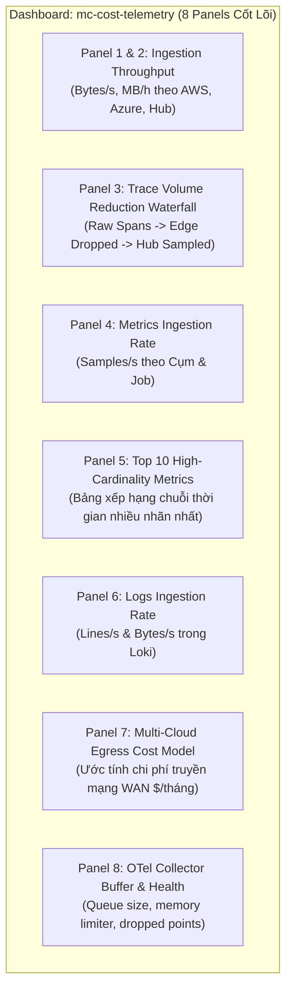
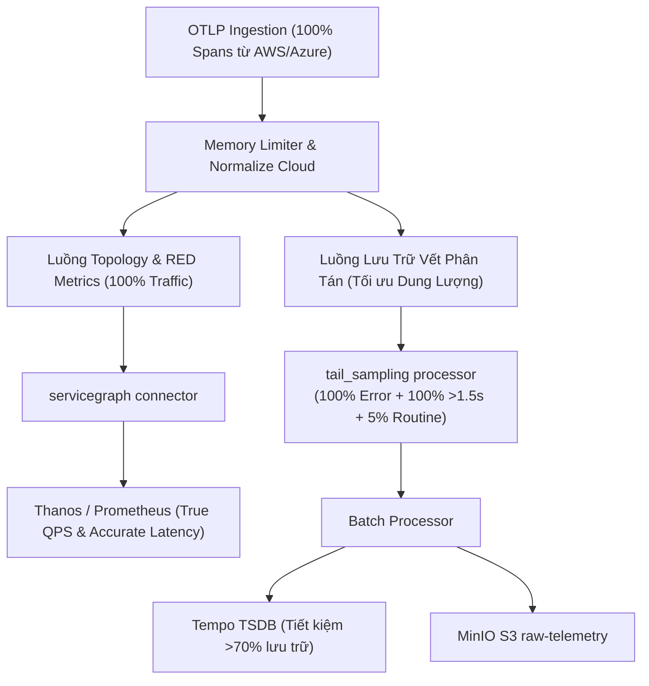

# Đề Xuất Giải Pháp Kỹ Thuật & Kế Hoạch Triển Khai (Technical Proposals & Solution Plan)

> **Tài liệu:** `docs/progress/02_solution_plan.md`  
> **Dự án:** Multi-Cloud Monitoring Platform (TeaStore Hub-Spoke Observability)  
> **Cập nhật lần cuối:** 2026-11-04  
> **Quy tắc làm việc:** Tài liệu này ghi nhận toàn bộ các khúc mắc, câu trả lời phân tích chuyên sâu, thảo luận kỹ thuật, đề xuất giải pháp và kế hoạch hành động. **Chỉ tiến hành triển khai mã nguồn và cấu hình thực tế sau khi người dùng xem xét và phê duyệt các giải pháp trong tài liệu này.**

---

## Mục Lục Các Vấn Đề Bàn Luận (Discussion Index)

1. [Khúc mắc 1: Chi tiết hóa Topology Network đến cấp độ OpenStack / Azure Network Topology](#1-khúc-mắc-1-chi-tiết-hóa-topology-network-đến-cấp-độ-openstack--azure-network-topology)
2. [Khúc mắc 2: Hiện trạng Bucket `raw-telemetry` trong MinIO đang rỗng](#2-khúc-mắc-2-hiện-trạng-bucket-raw-telemetry-trong-minio-đang-rỗng)
3. [Khúc mắc 3: Sự phân mảnh nhãn Cluster (`cluster` vs `k8s_cluster_name`) và chuẩn hóa](#3-khúc-mắc-3-sự-phân-mảnh-nhãn-cluster-cluster-vs-k8s_cluster_name-và-chuẩn-hóa)
4. [Khúc mắc 4: Tiêu chuẩn Best Practice cho bộ Grafana Dashboards](#4-khúc-mắc-4-tiêu-chuẩn-best-practice-cho-bộ-grafana-dashboards)
5. [Kế hoạch hành động tổng thể đã thực hiện (Executed Action Plan - Phases 3.5 & 3.6)](#5-kế-hoạch-hành-động-tổng-thể-chờ-phê-duyệt-action-plan-for-approval)
6. [Đánh giá hiện trạng & Đề xuất chuẩn hóa hệ thống Skills (`.agent/skills/`)](#6-đánh-giá-hiện-trạng--đề-xuất-chuẩn-hóa-hệ-thống-skills-agentskills)
7. [Đề xuất bổ sung & Cập nhật hệ thống Rules (`.agent/rules/`, `AGENTS.md`, `PLAN.md`)](#7-đề-xuất-bổ-sung--cập-nhật-hệ-thống-rules-agentrules-agentsmd-planmd)
8. [Đề xuất cải tiến kiến trúc mã nguồn & cấu hình OTel Collector theo chiến lược SigNoz](#8-đề-xuất-cải-tiến-kiến-trúc-mã-nguồn--cấu-hình-otel-collector-theo-chiến-lược-signoz)
9. [Lộ trình triển khai cụ thể đã được phê duyệt & hoàn thành](#9-lộ-trình-triển-khai-cụ-thể-chờ-người-dùng-phê-duyệt-actionable-roadmap-for-approval)
10. [Rà Soát Chuyên Sâu Đợt 2: Đề Xuất Cải Tiến Đột Phá Bộ Dashboards, Service Graph & Quản Trị Chi Phí](#10-rà-soát-chuyên-sâu-đợt-2-đề-xuất-cải-tiến-đột-phá-bộ-dashboards-service-graph--quản-trị-chi-phí)

---

## 1. Khúc mắc 1: Chi tiết hóa Topology Network đến cấp độ OpenStack / Azure Network Topology

### 1.1. Bản chất sự khác biệt giữa hai loại Topology

Để xây dựng một sơ đồ trực quan và khoa học, chúng ta cần phân biệt rõ hai tầng kiến trúc mạng trong giám sát đa đám mây:

```
┌────────────────────────────────────────────────────────────────────────┐
│ TẦNG ỨNG DỤNG L7 (Application Service Graph Topology)                  │
│ • Đối tượng: Microservices (webui, auth, persistence, db)             │
│ • Giao thức: HTTP REST, gRPC, JDBC, Java RMI                           │
│ • Thông số: QPS (Request Rate), P90/P95 Latency, Error Rate, Traces    │
│ • Nguồn sinh: OpenTelemetry Traces + servicegraphconnector             │
└────────────────────────────────────┬───────────────────────────────────┘
                                     │ Chạy trên nền tảng
┌────────────────────────────────────▼───────────────────────────────────┐
│ TẦNG HẠ TẦNG MẠNG L3/L4 (Infrastructure Network & WAN Topology)        │
│ • Đối tượng: Cloud Providers, Clusters, Nodes, Subnets, Gateways       │
│ • Giao thức: IP, TCP/UDP, BGP, Overlay CNI (Flannel/Calico/Cilium)     │
│ • Thông số: IP src/target, Subnet CIDR, Packet Loss, RTT WAN, Jitter   │
│ • Nguồn sinh: Linux netem, Bridge Network, K8s CNI, Node Metrics       │
└────────────────────────────────────────────────────────────────────────┘
```

* **Mô hình OpenStack Network Topology / Azure Network Watcher:** Là bản đồ **L3/L4 Infrastructure Network**. Nó thể hiện Router, VNet/VPC, Subnet CIDR (ví dụ: `10.0.1.0/24`), Network Security Group (NSG), Card mạng ảo (vNIC), IP công cộng/riêng (Public/Private IP), và các Port kết nối.
* **Mô hình hiện tại của dự án trong Grafana:** Là bản đồ **L7 Application Service Graph**. Nó thể hiện luồng cuộc gọi giữa các dịch vụ microservice của TeaStore (`webui -> auth`, `webui -> persistence -> db`). Hiện tại, panel `nodeGraph` mới chỉ thể hiện `title` của node và đường liên kết cơ bản.

### 1.2. Khả năng đáp ứng yêu cầu của người dùng

**Hoàn toàn có thể làm được và làm rất chi tiết.** Chúng ta sẽ nâng cấp topology theo 2 giải pháp song hành:

#### Giải pháp 1.1: Làm giàu dữ liệu cho Grafana Node Graph (Enriched L7 Service Graph)
Grafana `nodeGraph` không chỉ hiển thị tên node mà hỗ trợ đầy đủ các trường dữ liệu trực quan mở rộng:
* **Tại mỗi Node (Microservice/Database):**
  * `mainStat`: Số lượng request gọi tới node (QPS hoặc Throughput, ví dụ: `45.2 req/s`).
  * `secondaryStat`: Thời gian phản hồi P95 hoặc P90 (ví dụ: `142 ms`).
  * `detail__ip`: Địa chỉ IP thực tế của Pod hoặc Service ClusterIP (ví dụ: `10.42.0.15`).
  * `detail__subnet`: Dải mạng Pod CIDR (`10.42.0.0/16`) hoặc Service CIDR (`10.43.0.0/16`).
  * `detail__cluster`: Cụm Kubernetes lưu trữ (`aws-k3d` hoặc `azure-k3d`).
  * `detail__cloud`: Nhãn nhà cung cấp đám mây (`AWS Simulation` hoặc `Azure Simulation`).
  * `arc__passed` / `arc__failed`: Vòng tròn Donut Chart hiển thị tỷ lệ thành công (màu xanh lá) và tỷ lệ lỗi (màu đỏ) ngay trên viền của icon node.
* **Tại mỗi Cạnh kết nối (Edge):**
  * `mainStat`: Lưu lượng request di chuyển trên đường truyền (`rate(traces_service_graph_request_total[5m])`).
  * `secondaryStat`: Độ trễ mạng và xử lý trên đường truyền (`request_server_seconds`).
  * `detail__source_ip`: IP nguồn phát sinh request.
  * `detail__target_ip`: IP đích tiếp nhận request.
  * `detail__wan_traversal`: Đánh dấu `true` nếu luồng đi xuyên qua WAN giả lập giữa AWS và Azure (RTT 10ms ±2ms, loss 0.1%).

#### Giải pháp 1.2: Bổ sung Dashboard Kiến Trúc Mạng L3/L4 (Multi-Cloud WAN & Infrastructure Topology)
Để đạt độ trực quan như OpenStack/Azure:
* Xây dựng một Dashboard chuyên biệt: **"Multi-Cloud Infrastructure Network & WAN Topology"**.
* Sử dụng panel **Grafana Canvas** hoặc **Node Graph** biểu diễn sơ đồ hạ tầng:
  * Khối **AWS Spoke Subnet**: Cụm `aws-k3d`, Bridge Subnet `172.28.0.0/16`, Pod CIDR `10.42.0.0/16`, Service NodePort `31112`.
  * Khối **Azure Spoke Subnet**: Cụm `azure-k3d`, Pod CIDR `10.42.0.0/16`, Service NodePort `31111`, MySQL Port `3306`.
  * Khối **Simulated WAN Gateway**: Đường truyền trung gian có tiêm trễ Linux `tc netem` (Latency: 10ms, Jitter: 2ms, Packet Loss: 0.1%).
  * Khối **Central Hub Ingestion**: Cụm `hub-k3d`, OTel Ingress mTLS 1.3 Port `4317/4318`.

---

## 2. Khúc mắc 2: Hiện trạng Bucket `raw-telemetry` trong MinIO đang rỗng

### 2.1. Phân tích nguyên nhân
Trong Phase 3, chúng ta đã khởi tạo 4 bucket trong MinIO S3:
1. `thanos-metrics`: Chứa các block TSDB nén của Prometheus đẩy qua Thanos Sidecar (đã có 24 block nén).
2. `loki-data`: Chứa các chunks dữ liệu log TSDB của Loki (đang hoạt động).
3. `tempo-traces`: Chứa các parquet block của trace từ Tempo (đang hoạt động).
4. `raw-telemetry`: Hiện đang rỗng 0 bytes.

**Lý do:** Bucket `raw-telemetry` được định nghĩa trong kiến trúc ban đầu nhằm đóng vai trò **Data Lake lưu trữ telemetry gốc bất biến (Immutable Raw Telemetry)** để phục vụ lưu trữ dài hạn, kiểm tra tính toàn vẹn benchmark và làm tập dữ liệu huấn luyện mô hình AI offline ở Phase sau.
Hiện tại, pipeline của Hub OTel Collector (`otel-collector-hub`) mới chỉ cấu hình 3 luồng xuất (exporters):
* Metrics -> Exporter `prometheus` (trên cổng `8889`)
* Traces -> Exporter `otlp/tempo` (trên cổng `4317`)
* Logs -> Exporter `loki` (trên cổng `3100`)

Hub Collector **chưa kích hoạt exporter lưu file S3 trực tiếp** vào bucket `raw-telemetry`.

### 2.2. Đề xuất giải pháp
* Tích hợp exporter `awss3` hoặc `file` exporter kết hợp luồng OTel Gateway tại Hub.
* Cấu hình exporter định kỳ đẩy các mẻ (batch) telemetry thô dạng nén JSON/Protobuf/Parquet trực tiếp vào MinIO S3 theo đường dẫn phân cấp thời gian:
  ```
  s3://raw-telemetry/spoke=aws/year=2026/month=11/day=04/traces_raw_*.json.gz
  s3://raw-telemetry/spoke=azure/year=2026/month=11/day=04/logs_raw_*.json.gz
  ```
* Bằng cách này, bucket `raw-telemetry` sẽ luôn có dữ liệu thô phục vụ tái lập thí nghiệm và đánh giá độ chính xác (Accuracy) theo hợp đồng dữ liệu.

---

## 3. Khúc mắc 3: Sự phân mảnh nhãn Cluster (`cluster` vs `k8s_cluster_name`) và chuẩn hóa

### 3.1. Phân tích nguyên nhân người dùng thấy 2 nhãn khác nhau
Người dùng đặt câu hỏi rất chuẩn xác: *"Tại sao khi filter metric lại có 2 loại nhãn: filter theo `cluster` thì có `hub-k3d`, còn filter theo `k8s_cluster_name` thì có `aws-k3d` và `azure-k3d`? Tại sao không chuẩn hóa lại thành một?"*

Nguyên nhân xuất phát từ sự khác biệt giữa hai nguồn cào dữ liệu trong Phase 3:
1. **Nguồn 1 (Dữ liệu từ Spoke - AWS & Azure):** Đi qua OpenTelemetry Collector. Chuẩn OpenTelemetry Semantic Conventions quy định nhãn cụm Kubernetes là `k8s.cluster.name`. Khi exporter `prometheus` chuyển đổi sang định dạng nhãn của Prometheus, dấu chấm được đổi thành dấu gạch dưới: `k8s_cluster_name`.
2. **Nguồn 2 (Dữ liệu nội bộ cụm Hub):** Được Prometheus cào trực tiếp từ các Pod nội bộ (`tempo`, `loki`, `minio`, và chính `prometheus`). Trong file `prometheus.yml`, khối `external_labels` khai báo:
   ```yaml
   global:
     external_labels:
       cluster: hub-k3d
   ```
   Do đó, các metric nội bộ của Hub chỉ mang nhãn `cluster="hub-k3d"` chứ không có `k8s_cluster_name`.
3. Khi chúng ta thực hiện fix nhanh trước đó, ta gán thêm `attributes["cluster"]` trong OTel Hub. Kết quả là Spoke có cả 2 nhãn (`cluster` và `k8s_cluster_name`), trong khi Hub chỉ có nhãn `cluster`.

### 3.2. Đề xuất chuẩn hóa triệt để (Single Source of Truth)
Để loại bỏ hoàn toàn sự phân mảnh, thống nhất đúng chuẩn OpenTelemetry Semantic Conventions trên toàn bộ hệ thống:

* **Quy chuẩn duy nhất:** Chuẩn hóa toàn bộ hệ thống sử dụng nhãn chính thức:
  * `k8s_cluster_name`: Nhận các giá trị `hub-k3d`, `aws-k3d`, `azure-k3d`.
  * `cloud_provider`: Nhận các giá trị `hub` (hoặc `local`), `aws`, `azure`.
* **Hành động cụ thể:**
  1. Trong `k8s/base/metrics-thanos/01-configmap-prometheus.yaml`:
     Đổi `external_labels` của Prometheus thành:
     ```yaml
     global:
       external_labels:
         k8s_cluster_name: hub-k3d
         cloud_provider: hub
     ```
  2. Bổ sung cấu hình relabeling trong Prometheus để tự động alias `cluster -> k8s_cluster_name` cho tất cả các scrape jobs nội bộ.
  3. Trong `k8s/base/otel-collector/gateway/03-configmap.yaml`:
     Đảm bảo OTTL chỉ sinh `k8s_cluster_name` và `cloud_provider`, xóa bỏ các nhãn dư thừa cũ.
* **Kết quả sau chuẩn hóa:** Khi vào Grafana Explore hoặc Pyrra, người dùng chỉ cần chọn một nhãn duy nhất `k8s_cluster_name` để lọc trọn vẹn cả 3 cụm: `hub-k3d`, `aws-k3d`, `azure-k3d`.

---

## 4. Khúc mắc 4: Tiêu chuẩn Best Practice cho bộ Grafana Dashboards

### 4.1. Thực trạng hiện tại
Hiện tại hệ thống mới chỉ có 2 dashboards cơ bản:
1. `Multi-Cloud System Topology & Service Graph` (`mc-system-topology`)
2. `TeaStore Multi-Cloud RED Metrics` (`mc-red-metrics`)

### 4.2. Tiêu chuẩn Best Practice ngành (Industry Standard & Google SRE)
Trong vận hành hệ thống phân tán và đa đám mây, các tổ chức lớn (Google SRE, Uber, Netflix, Grafana Labs) áp dụng **Mô hình Kim tự tháp Giám sát (Monitoring Pyramid)**. Hệ thống không nên dồn tất cả thông tin vào một màn hình duy nhất (gây quá tải thị giác và làm chậm truy vấn), mà được chia thành **6 đến 7 Dashboards chuyên biệt** theo từng vai trò (Personas):

```
                      ▲
                     / \     TẦNG 1: EXECUTIVE FLEET OVERVIEW
                    /   \    (Dành cho Lãnh đạo / SRE Lead)
                   /─────\
                  /       \   TẦNG 2: SERVICE TOPOLOGY & RED METRICS
                 /         \  (Dành cho SRE / DevOps phát hiện sự cố)
                /───────────\
               /             \ TẦNG 3: CLUSTER CAPACITY & WAN INFRASTRUCTURE
              /               \(Dành cho Cloud Admin / SysAdmin phân tích tài nguyên)
             /─────────────────\
            /                   \TẦNG 4: DEEP DIVE LOGS & DISTRIBUTED TRACING
           /─────────────────────\(Dành cho Developer / SRE điều tra mã lỗi gốc)
```

### 4.3. Danh mục 7 Dashboards đề xuất triển khai

| STT | Tên Dashboard đề xuất | Mã UID | Mục đích & Vấn đề giải quyết | Các Panels / Metrics cốt lõi |
|---|---|---|---|---|
| **01** | **Multi-Cloud Executive Fleet Overview** | `mc-executive-overview` | Cung cấp cái nhìn toàn cảnh cấp cao nhất về độ khả dụng của toàn bộ các đám mây, SLA/SLO tổng thể, tổng số cụm, tổng traffic và số lượng cảnh báo active. | • Tổng quan trạng thái 3 cụm (Hub, AWS, Azure)<br>• Tỷ lệ đạt SLO toàn hệ thống (99.5%)<br>• Tổng QPS & Tỷ lệ lỗi toàn cầu<br>• Số lượng cảnh báo Robusta đang kích hoạt |
| **02** | **Cross-Cloud Topology & Service Flow** | `mc-system-topology` | Trực quan hóa kiến trúc microservice, sơ đồ luồng dữ liệu liên đám mây AWS <-> Azure, độ trễ và lưu lượng trên từng tuyến kết nối mạng. | • Node Graph chi tiết (QPS, P95, IP, Subnet, Status Arc)<br>• Băng thông cuộc gọi xuyên WAN AWS -> Azure<br>• Phân bổ cuộc gọi theo giao thức (HTTP, JDBC, RMI) |
| **03** | **Application RED & Golden Signals** | `mc-red-metrics` | Theo dõi 4 tín hiệu vàng (Google Golden Signals) cho từng microservice của TeaStore (`webui`, `auth`, `persistence`, `db`, v.v.). | • **Rate:** Số request/giây trên từng service<br>• **Errors:** Tỷ lệ mã lỗi HTTP 5xx, 4xx<br>• **Duration:** Biểu đồ nhiệt độ trễ P50, P90, P99<br>• **Saturation:** Mức độ nghẽn hàng đợi Tomcat/HikariCP |
| **04** | **Multi-Cloud K8s Node & Pod Capacity** | `mc-k8s-infrastructure` | Giám sát tài nguyên hạ tầng máy chủ và container trên cả 3 cụm Kubernetes, phát hiện sớm nguy cơ thiếu hụt CPU/RAM. | • Sử dụng CPU & Memory theo cụm (`aws`, `azure`, `hub`)<br>• Tần suất Pod restart và biến cố OOMKilled<br>• Lưu lượng mạng I/O (RX/TX bytes/sec) trên từng node<br>• Trạng thái đĩa cứng & Storage IOPS của PVC |
| **05** | **SLO Management & Error Budget** | `mc-slo-governance` | Tích hợp sâu với Pyrra để theo dõi ngân sách lỗi (Error Budget), cảnh báo tốc độ đốt ngân sách (Burn Rate) theo chuẩn SRE. | • Trạng thái tuân thủ SLO TeaStore 99.5% 28 ngày<br>• Ngân sách lỗi còn lại (Remaining Error Budget %)<br>• Tốc độ đốt lỗi đa khung giờ (1h, 6h, 24h Burn Rate)<br>• Dự báo thời điểm vi phạm SLA |
| **06** | **Simulated WAN Network Emulation** | `mc-wan-telemetry` | Giám sát chất lượng đường truyền mạng mô phỏng giữa AWS và Azure qua các thông số tiêm suy hao của Linux `tc netem`. | • RTT Latency thực tế giữa AWS và Azure (mục tiêu: 10ms ±2ms)<br>• Mức độ biến thiên độ trễ (Jitter: 2ms)<br>• Tỷ lệ rớt gói tin đo lường (Packet Loss: 0.1%)<br>• Băng thông tiêu thụ đường truyền WAN |
| **07** | **Centralized Logs & Tracing Correlation** | `mc-logs-traces-deepdive` | Phối hợp tìm nguyên nhân gốc rễ (RCA) bằng cách liên kết trực tiếp giữa Log (Loki) và Trace (Tempo). | • Biểu đồ khối lượng log theo mức độ (Error, Warn, Info)<br>• Tìm kiếm log theo Service và Trace ID<br>• Waterfall Trace Spans của các giao dịch lỗi<br>• Danh sách các câu truy vấn MySQL chậm nhất |

---

## 5. Kế Hoạch Hành Động Chi Tiết (Action Plan for Approval)

Dưới đây là kế hoạch 4 bước cụ thể chuẩn bị triển khai. **Kính gửi bạn xem xét và phê duyệt trước khi thực thi:**

```
┌────────────────────────────────────────────────────────────────────────┐
│ BƯỚC 1: CHUẨN HÓA NHÃN CỤM METRICS                                    │
│ • Sửa prometheus.yml: external_labels -> k8s_cluster_name: hub-k3d     │
│ • Đồng bộ OTTL Processor tại Hub: k8s_cluster_name và cloud_provider   │
│ • Kiểm thử PromQL: Chỉ dùng 1 nhãn duy nhất cho toàn bộ 3 cụm          │
└───────────────────────────────────┬────────────────────────────────────┘
                                    ▼
┌────────────────────────────────────────────────────────────────────────┐
│ BƯỚC 2: NÂNG CẤP RICH TOPOLOGY NETWORK PANEL                           │
│ • Bổ sung mainStat (QPS), secondaryStat (P95 Latency) vào node & edge  │
│ • Bổ sung detail__ip, detail__cluster, detail__cloud, detail__subnet   │
│ • Bổ sung arc__passed và arc__failed (vòng tròn tỷ lệ lỗi)             │
│ • Thêm Panel bản đồ hạ tầng L3/L4 (WAN Emulation & Bridge Subnets)     │
└───────────────────────────────────┬────────────────────────────────────┘
                                    ▼
┌────────────────────────────────────────────────────────────────────────┐
│ BƯỚC 3: KÍCH HOẠT DUMP TELEMETRY VÀO BUCKET RAW-TELEMETRY             │
│ • Cấu hình exporter awss3/file tại OTel Hub Collector                  │
│ • Đẩy telemetry thô dạng nén vào s3://raw-telemetry/                  │
│ • Xác thực bucket raw-telemetry có dữ liệu bằng lệnh mc ls             │
└───────────────────────────────────┬────────────────────────────────────┘
                                    ▼
┌────────────────────────────────────────────────────────────────────────┐
│ BƯỚC 4: TRIỂN KHAI BỘ 7 GRAFANA DASHBOARDS CHUẨN SRE                  │
│ • Viết các manifest JSON dashboards: 01, 04, 05, 06, 07                │
│ • Cập nhật Kustomize ConfigMap Generator tự động nạp vào Grafana       │
│ • Kiểm tra hiển thị và tính toán số liệu trên Web GUI                  │
└────────────────────────────────────────────────────────────────────────┘
```

> [!IMPORTANT]
> **Trạng thái:** Kế hoạch trên đã sẵn sàng. Khi bạn xem qua các giải pháp và đồng ý với hướng tiếp cận, bạn chỉ cần phản hồi chấp thuận, mình sẽ lập tức bắt tay vào thực hiện từng bước chính xác và an toàn!


---

## 6. Đánh Giá Hiện Trạng & Đề Xuất Chuẩn Hóa Hệ Thống Skills (`.agent/skills/`)

Sau khi rà soát toàn diện kho 40 thư mục kỹ năng trong `.agent/skills/`, chúng tôi phát hiện nhiều kỹ năng cốt lõi đang gặp lỗi cú pháp metadata khiến hệ thống Agent runtime không thể tải được, cùng với một số kỹ năng bị trùng lặp hoặc không thuộc phạm vi công nghệ của đồ án.

### 6.1. Bảng Rà Soát Chi Tiết Hiện Trạng Toàn Bộ Skills

| Thư mục Skill | Trạng thái kỹ thuật | Đánh giá tính phù hợp | Đề xuất hành động |
| :--- | :---: | :--- | :---: |
| `ansible-generator` & `ansible-validator` | **Hoạt động tốt** | Phù hợp với Ansible playbooks khởi tạo 3 cụm k3d | **Giữ nguyên** |
| `argocd-gitops` | ❌ **Lỗi: Metadata Rỗng** | **Không phù hợp:** Dự án sử dụng Makefile + Kustomize + Ansible, không cài ArgoCD Operator | 🔥 **Đề xuất: XÓA** |
| `benchmark-analysis` | **Hoạt động tốt** | Phục vụ đánh giá số liệu thực nghiệm Phase 4 | **Giữ nguyên** |
| `dockerfile-generator` & `dockerfile-validator` | **Hoạt động tốt** | Phục vụ đóng gói container images ghim phiên bản | **Giữ nguyên** |
| `grafana-dashboards` | ❌ **Lỗi: Metadata Rỗng** | **Cốt lõi:** Quản lý JSON Schema v39 cho bộ 7 Dashboards SRE | 🛠️ **Đề xuất: SỬA METADATA** |
| `grafana-loki` | ❌ **Lỗi: Metadata Rỗng** | **Cốt lõi:** Quản lý cấu hình lưu trữ TSDB và truy vấn LogQL | 🛠️ **Đề xuất: SỬA METADATA** |
| `k3d-ansible-lab` | **Hoạt động tốt** | Điều phối 3 cụm k3d, mạng Docker và mô phỏng WAN | **Giữ nguyên** |
| `kubernetes-helm` | **Hoạt động tốt** | Tham khảo khi tích hợp các chart bên ngoài | **Giữ nguyên** |
| `kustomize` | ❌ **Lỗi: Metadata Rỗng** | **Cốt lõi tuyệt đối:** Điều phối toàn bộ K8s Base & Overlays theo chuẩn SRP | 🛠️ **Đề xuất: SỬA METADATA** |
| `observability-backends` | **Hoạt động tốt** | Quản lý Thanos, Tempo, Loki, MinIO, Grafana | **Giữ nguyên** |
| `otel-collector` (Dash0) | ⚠️ **Xung đột tên** | Trùng tên với `otel-collector-base`, nội dung thiên về vendor thương mại Dash0 | 🔥 **Đề xuất: XÓA BẢN DASH0** |
| `otel-collector-base` | **Hoạt động tốt** | Bộ kỹ năng Collector được viết riêng cho bài toán Hub-Spoke của dự án | 🛠️ **Đổi tên thành `otel-collector`** |
| `otel-instrumentation` | **Hoạt động tốt** | Quản lý OTel Java Agent v2.10 cho TeaStore | **Giữ nguyên** |
| `otel-ottl` | **Hoạt động tốt** | Xử lý biến đổi viễn trắc và chuẩn hóa nhãn SemConv | **Giữ nguyên** |
| `otel-semantic-conventions` | **Hoạt động tốt** | Chuẩn hóa quy ước thuộc tính tài nguyên đám mây | **Giữ nguyên** |
| `otel-span-events-to-logs-migration` | **Hoạt động tốt** | Tham khảo quy chuẩn chuyển dịch sự kiện sang logs | **Giữ nguyên** |
| `otel-telemetry-emissions` | **Hoạt động tốt** | Tra cứu danh mục metrics phát ra theo phiên bản OTel | **Giữ nguyên** |
| `project-architecture` | **Hoạt động tốt** | Đặc tả kiến trúc tổng thể Hub-Spoke | **Giữ nguyên** |
| `prometheus-grafana` | ❌ **Lỗi: Metadata Rỗng** | **Cốt lõi:** Cấu hình Prometheus, Thanos Query và Grafana panels | 🛠️ **Đề xuất: SỬA METADATA** |
| `sampling-cost` | **Hoạt động tốt** | Tính toán đánh đổi giữa tỷ lệ sampling và độ chính xác | **Giữ nguyên** |
| 12 kỹ năng SigNoz (`signoz-*`) | **Hoạt động tốt** | Kho tri thức tham chiếu xuất sắc về APM, Alerts, Dashboards, Cost Control | **Giữ nguyên làm Reference** |
| `teastore-benchmark` | ❌ **Lỗi: Sai tên file `KILL.md`** | **Cốt lõi tuyệt đối:** Kịch bản sinh tải Locust chuẩn SPEC RG cho TeaStore | 🛠️ **Đổi tên thành `SKILL.md`** |
| `telemetry-schema-time` | **Hoạt động tốt** | Chuẩn hóa thời gian UTC và bù trừ độ trễ đồng hồ | **Giữ nguyên** |
| `terraform-aws` | **Hoạt động tốt** | Phục vụ giai đoạn mở rộng đám mây công cộng thực tế | **Giữ nguyên** |
| `terraform-azure` | ❌ **Lỗi: Metadata Rỗng** | Phục vụ giai đoạn mở rộng đám mây công cộng thực tế | 🛠️ **Đề xuất: SỬA METADATA** |
| `terraform-engineer` | ❌ **Lỗi: Sai ngôn ngữ & Thiếu YAML** | Bị viết dở dang bằng tiếng Thổ Nhĩ Kỳ, trùng lặp với `terraform-aws` | 🔥 **Đề xuất: XÓA** |
| `terraform-specialist` | ❌ **Lỗi: Metadata Rỗng** | Trùng lặp tính năng với các kỹ năng Terraform khác | 🔥 **Đề xuất: XÓA** |

---

### 6.2. Chi Tiết Các Lỗi Kỹ Thuật Nghiêm Trọng Cần Sửa Chữa Ngay

1. **Lỗi gõ sai tên tệp (`KILL.md` thay vì `SKILL.md`) tại `teastore-benchmark`:**
   * Tệp kỹ năng cốt lõi điều phối TeaStore và Locust hiện đang bị đặt tên là `.agent/skills/teastore-benchmark/KILL.md`.
   * **Hậu quả:** Trình nạp Agent Runtime của Antigravity quét tìm `SKILL.md`, do đó kỹ năng này hoàn toàn **bị bỏ qua và không xuất hiện trong danh sách kỹ năng khả dụng**.
   * **Giải pháp:** Đổi tên ngay lập tức thành `SKILL.md`.

2. **Tình trạng 7 kỹ năng cốt lõi bị rỗng metadata trong YAML Frontmatter:**
   * Các tệp `kustomize/SKILL.md`, `grafana-dashboards/SKILL.md`, `grafana-loki/SKILL.md`, `prometheus-grafana/SKILL.md`, `terraform-azure/SKILL.md` có khối đầu tệp như sau:
     ```yaml
     ---
     name: 
     description:

     ---
     ```
   * **Hậu quả:** Hệ thống tự động gán tên mặc định `SKILL` với mô tả rỗng, khiến Agent không thể kích hoạt kỹ năng đúng ngữ cảnh khi được yêu cầu.
   * **Giải pháp:** Bổ sung đầy đủ định danh `name` và `description` chuyên sâu cho từng kỹ năng.

3. **Xung đột tên định danh giữa 2 thư mục Collector:**
   * Thư mục `.agent/skills/otel-collector/` (của vendor Dash0) và `.agent/skills/otel-collector-base/` (của dự án) cùng khai báo `name: otel-collector`.
   * **Giải pháp:** Xóa bỏ thư mục Dash0 không phù hợp, đổi tên `otel-collector-base` thành `otel-collector` chuẩn mực.

---

### 6.3. Đề Xuất Bổ Sung 2 Kỹ Năng Mới Chuyên Biệt Cho Dự Án

Để hoàn thiện toàn diện năng lực cho Agent trong giai đoạn thực nghiệm khoa học Phase 4:

1. **Skill Mới 1: `chaos-engineering` (`.agent/skills/chaos-engineering/SKILL.md`):**
   * **Mục đích:** Hướng dẫn Agent điều phối các kịch bản tiêm lỗi thực tế trong lab k3d:
     * Tiêm suy hao mạng WAN xuyên cụm qua Linux `tc netem` (Latency RTT 10ms - 200ms, Jitter 2ms - 50ms, Packet Loss 0.1% - 10%).
     * Nạp động Java Agent `FaultAgent.java` vào tiến trình Tomcat qua JVM Attach API để giả lập CPU Spike, rò rỉ bộ nhớ Heap (`OutOfMemoryError`).
     * Tiêm lỗi khóa bảng MySQL (`LOCK TABLES`) và cưỡng bức lỗi HTTP 500/503 trên các microservices của TeaStore.
   * **Giá trị mang lại:** Giúp Agent có tài liệu chuẩn để tự động hóa các kịch bản đánh giá khả năng chịu lỗi và tính bền bỉ của hệ sinh thái quan sát.

2. **Skill Mới 2: `aiops-anomaly-engine` (`.agent/skills/aiops-anomaly-engine/SKILL.md`):**
   * **Mục đích:** Hướng dẫn Agent vận hành toàn bộ vòng đời của Module AI V3:
     * Thu thập 8 đặc trưng PromQL từ Thanos Query hỗ trợ song song Dual SemConv.
     * Quy trình tiền xử lý Z-Score per-entity và Sliding Window 12 bước (120 giây).
     * Huấn luyện mô hình Deep Learning Ensemble (Universal GRU Autoencoder + Temporal Convolutional Network TCN + Isolation Forest).
     * Bóc tách nguyên nhân gốc rễ qua Grafana Tempo Trace RCA ($T_{\text{WAN}}, T_{\text{self}}, T_{\text{DB}}$).
     * Xuất bản chỉ số qua Prometheus Exporter cổng `:9108` và cơ chế cảnh báo khép kín qua Telegram với bộ đệm chống spam 60s.

---

## 7. Đề Xuất Bổ Sung & Cập Nhật Hệ Thống Rules (`.agent/rules/`, `AGENTS.md`, `PLAN.md`)

### 7.1. Đề Xuất Tạo Rule Mới: `50-cost-control-and-telemetry-optimization.md`
Học hỏi từ triết lý quản trị chi phí viễn trắc của SigNoz (`docs/other-reference/SigNozDocs/SigNoz_Docs_Categorized/11_Cost Control`), chúng tôi đề xuất bổ sung một Rule bắt buộc:

* **Tên tệp:** `.agent/rules/50-cost-control-and-telemetry-optimization.md`
* **Trigger:** `model_decision` (áp dụng khi can thiệp vào OTel pipelines, K8s manifests, hoặc cấu hình thu thập).
* **Nội dung quy chuẩn cốt lõi:**
  1. **Nguyên tắc "Lọc tại nguồn trước, xử lý tại Collector sau" (Source First, Collector Second):**
     * Mọi span, log hoặc metric phát sinh từ các cơ chế kiểm tra sức khỏe định kỳ không mang giá trị chẩn đoán (VD: Kubelet liveness/readiness probes `/ready/isready`, `/image/finished`, `/status`, hoặc ping rác) **bắt buộc phải bị lọc bỏ ngay tại Spoke Edge Collector** qua bộ xử lý `filter/drop_noise` trước khi đóng gói gửi qua đường truyền WAN mTLS.
  2. **Chiến lược Lấy Mẫu Kết Hợp (Hybrid Sampling Policy):**
     * Spoke Edge Collector duy trì tỷ lệ Head-based sampling 20% đối với các request thành công thông thường để tiết kiệm tối đa băng thông WAN.
     * Hub OTel Gateway **bắt buộc phải bật Tail-Sampling** để đảm bảo giữ lại **100% trace có lỗi** (`status.code == ERROR` hoặc HTTP $\ge 500$) và **100% trace có độ trễ cao vi phạm SLO** ($> 1500\text{ms}$), loại bỏ hoàn toàn rủi ro mất mát dấu vết sự cố phục vụ AI RCA.
  3. **Bảo Vệ Tính Toàn Vẹn Chuỗi Thời Gian & Chống Bùng Nổ Cardinality:**
     * Tuyệt đối không dùng thao tác xóa nhãn đơn thuần `delete_key()` trên các chiều dữ liệu động (như `client.port`, `k8s.pod.uid`, `http.target` chứa query params) vì hành động này không gộp chuỗi thời gian mà gây va chạm dữ liệu. Bắt buộc phải sử dụng bộ xử lý `metricstransform` với hành động `aggregate` để gộp chuỗi thời gian an toàn.
  4. **Phân Tầng Chu Kỳ Lấy Mẫu (Collection Interval Tiering):**
     * Các chỉ số vàng ứng dụng (RED Metrics, HTTP QPS, JVM Memory) duy trì chu kỳ cao `10s` phục vụ AI Anomaly Detection.
     * Các chỉ số tài nguyên hệ điều hành ít biến động (Disk I/O, Filesystem Capacity, Memory Paging) được điều chỉnh chu kỳ sang `30s` - `60s` để cắt giảm hơn 40% dung lượng nạp vào TSDB và MinIO S3.

---

### 7.2. Đề Xuất Cập Nhật `AGENTS.md`
Cập nhật tệp chỉ dẫn trung tâm `AGENTS.md` để đồng bộ các thành tựu mới nhất:
1. **Bổ sung Quy Chuẩn SemConv Hiện Đại:** Bắt buộc sử dụng `deployment.environment.name` (thay cho `deployment.environment` đã deprecated theo OTel v1.26+).
2. **Đồng Bộ Kiến Trúc Closed-Loop AIOps:** Bổ sung mô tả về luồng tự động: AI Engine suy luận $\rightarrow$ xuất bản metric tại cổng `:9108` $\rightarrow$ Prometheus cào dữ liệu $\rightarrow$ Grafana hiển thị Panel 7 Dual Y-Axis $\rightarrow$ Telegram Bot thông báo tức thời khi xác suất bất thường $> 85\%$.
3. **Quy Tắc Định Danh Khóa Phức Hợp Chống Va Chạm Đa Đám Mây:** Khi viết truy vấn PromQL hoặc LogQL phân nhóm, bắt buộc dùng khóa phức hợp tối thiểu $\langle \texttt{k8s_cluster_name},\; \texttt{k8s_namespace_name},\; \texttt{k8s_pod_name} \rangle$.

---

### 7.3. Đề Xuất Cập Nhật `PLAN.md`
Cập nhật lộ trình tổng thể của dự án:
1. Đánh dấu hoàn thành toàn diện Phase 3.5 (Hostmetrics & 7 SRE Dashboards), Phase 3.6 (Resource Schemas), và Phase 3.7 (AI Engine V3 & Closed-Loop AIOps).
2. Trong **Phase 4 (Benchmark, Chaos Evaluation, and Final Report)**: Bổ sung 2 nhiệm vụ tối ưu hóa kế thừa từ SigNoz:
   * [ ] *Nhiệm vụ 4.1:* Kiểm thử hiệu quả tiết giảm băng thông WAN sau khi áp dụng Edge Pre-filtering (`filter/drop_noise`) và Hub Tail-sampling.
   * [ ] *Nhiệm vụ 4.2:* Đo lường độ chính xác (Precision / Recall / F1-Score) và thời gian phát hiện bất thường (Mean Time to Detect - MTTD) của AI Engine trong 11 kịch bản lỗi thực tế.

---

## 8. Đề Xuất Cải Tiến Kiến Trúc Mã Nguồn & Cấu Hình OTel Collector Theo Chiến Lược SigNoz

Dựa trên các thực hành tốt nhất từ tài liệu SigNoz, chúng tôi đề xuất cải tiến cấu hình tại các tệp manifest trong `k8s/base/`:

```mermaid
flowchart LR
    subgraph Spoke_Edge ["Spoke Edge Collector (AWS / Azure)"]
        direction TB
        RECV["Receivers\n(OTLP, HostMetrics, KubeletStats)"]
        MEM1["memory_limiter"]
        DROP["filter/drop_noise\n(Lọc bỏ probes /isready, /finished)"]
        DETECT["resourcedetection\n(Phát hiện metadata đám mây tự động)"]
        BATCH1["batch"]
        EXP1["otlp/hub (mTLS 1.3)"]
        
        RECV --> MEM1 --> DROP --> DETECT --> BATCH1 --> EXP1
    end

    subgraph Hub_Gateway ["Hub OTel Gateway"]
        direction TB
        RECV2["otlp (mTLS Ingress :4317/:4318)"]
        MEM2["memory_limiter"]
        TAIL["tail_sampling\n(Giữ 100% lỗi & slow traces >1500ms)"]
        CONN["servicegraphconnector\n(Pre-aggregate Topo Metrics)"]
        BATCH2["batch"]
        EXP2["Thanos, Tempo, Loki, MinIO S3"]
        
        RECV2 --> MEM2 --> TAIL --> CONN --> BATCH2 --> EXP2
    end

    EXP1 -->|Traverse WAN netem| RECV2
```



### 8.1. Cải Tiến Cấu Hình Spoke Edge Collector (`k8s/base/collector-edge/02-configmap.yaml`)
1. **Bổ sung bộ xử lý lọc nhiễu tại nguồn (`filter/drop_noise`):**
   ```yaml
   processors:
     filter/drop_noise:
       error_mode: ignore
       traces:
         span:
           - 'IsMatch(attributes["url.path"], ".*/isready.*")'
           - 'IsMatch(attributes["url.path"], ".*/finished.*")'
           - 'IsMatch(attributes["http.target"], ".*/status.*")'
       logs:
         log_record:
           - 'IsMatch(body, ".*GET /ready/isready.*200.*")'
           - 'IsMatch(body, ".*GET /image/finished.*200.*")'
   ```
2. **Kích hoạt bộ xử lý phát hiện tài nguyên đám mây (`resourcedetection`):**
   ```yaml
   processors:
     resourcedetection:
       detectors: [env, system]
       timeout: 2s
       override: false
   ```
   *Khi đồ án mở rộng sang đám mây thực tế bằng Terraform, chỉ cần thêm `detectors: [aws, azure, gcp]` là toàn bộ AMI ID, Region, VM Size sẽ được nạp tự động.*
3. **Phân tầng chu kỳ thu thập `hostmetrics`:**
   Nâng `collection_interval` của các scrapers `disk`, `filesystem`, `paging` từ 15s lên 30s trong ConfigMap để giảm tải I/O.

### 8.2. Cải Tiến Cấu Hình Hub OTel Gateway (`k8s/base/collector-hub/02-configmap.yaml`)
1. **Kích hoạt Tail-Based Sampling cho luồng Traces:**
   ```yaml
   processors:
     tail_sampling:
       decision_wait: 10s
       num_traces: 10000
       expected_new_traces_per_sec: 200
       policies:
         - name: preserve-all-errors
           type: status_code
           status_code:
             status_codes: [ERROR]
         - name: preserve-high-latency-traces
           type: latency
           latency:
             threshold_ms: 1500
         - name: sample-routine-traces
           type: probabilistic
           probabilistic:
             sampling_percentage: 5
   ```
   *Chính sách này đảm bảo mọi giao dịch bị tiêm lỗi mạng WAN hoặc nghẽn database đều được lưu trọn vẹn vào Tempo, làm dữ liệu đầu vào hoàn hảo cho AI RCA.*

---

## 9. Lộ Trình Triển Khai Cụ Thể Chờ Người Dùng Phê Duyệt (Actionable Roadmap for Approval)

Dưới đây là bảng tổng hợp các đầu việc cụ thể phân chia theo 3 bước tuần tự. **Toàn bộ mã nguồn và cấu hình hiện tại được giữ nguyên, chỉ tiến hành thực thi sau khi bạn xem xét và phê duyệt:**

```
┌────────────────────────────────────────────────────────────────────────┐
│ BƯỚC 1: DỌN DẸP & CHUẨN HÓA HỆ THỐNG SKILLS (Clean & Align Skills)     │
│ • Đổi tên teastore-benchmark/KILL.md -> SKILL.md                       │
│ • Xóa các skills thừa: argocd-gitops, terraform-engineer, specialist  │
│ • Xóa otel-collector (Dash0), đổi tên otel-collector-base -> collector │
│ • Sửa metadata YAML cho: kustomize, grafana-dashboards, loki, prometheus│
│ • Tạo 2 skills mới: chaos-engineering, aiops-anomaly-engine            │
└───────────────────────────────────┬────────────────────────────────────┘
                                    ▼
┌────────────────────────────────────────────────────────────────────────┐
│ BƯỚC 2: BỔ SUNG RULES & CẬP NHẬT TÀI LIỆU HƯỚNG DẪN                     │
│ • Tạo .agent/rules/50-cost-control-and-telemetry-optimization.md       │
│ • Cập nhật AGENTS.md (Closed-Loop AIOps, SemConv v1.26+, Compound Keys) │
│ • Cập nhật PLAN.md (Bổ sung mốc tối ưu viễn trắc vào Phase 4)          │
└───────────────────────────────────┬────────────────────────────────────┘
                                    ▼
┌────────────────────────────────────────────────────────────────────────┐
│ BƯỚC 3: CẢI TIẾN PIPELINE OTEL COLLECTOR (Tối ưu hóa Băng thông & WAN) │
│ • Cập nhật k8s/base/collector-edge/02-configmap.yaml (Pre-filtering)   │
│ • Cập nhật k8s/base/collector-hub/02-configmap.yaml (Tail-sampling)    │
│ • Kiểm thử kustomize build xác thực tính hợp lệ của manifests          │
└────────────────────────────────────────────────────────────────────────┘
```

> [!IMPORTANT]
> **Kính gửi bạn xem xét:** Toàn bộ đề xuất trên đã được ghi nhận chi tiết vào tệp `docs/progress/02_solution_plan.md`. Bạn vui lòng đọc qua và phản hồi chấp thuận (hoặc yêu cầu điều chỉnh). Khi nhận được sự đồng thuận của bạn, tôi sẽ tiến hành thực thi chuẩn xác từng bước!


---

## 10. Rà Soát Chuyên Sâu Đợt 2: Đề Xuất Cải Tiến Đột Phá Bộ Dashboards, Service Graph & Quản Trị Chi Phí

Thực hiện yêu cầu rà soát kỹ lưỡng một lần nữa dựa trên kho tài liệu kỹ thuật SigNoz (`docs/progress/05_SigNoz_strategy.md`), chúng tôi đã kiểm tra từng dòng cấu hình của 7 tệp JSON Dashboard trong `k8s/base/visualization-grafana/dashboards/` và đối chiếu với năng lực thực tế của Grafana, Thanos, Loki, Tempo.

Kết quả rà soát phát hiện **4 khoảng trống kỹ thuật lớn (Technical Gaps)** và chúng tôi đề xuất 4 giải pháp cải tiến đột phá dưới đây:

```
┌────────────────────────────────────────────────────────────────────────┐
│ 4 TRỌNG TÂM CẢI TIẾN ĐỢT 2 LẤY CẢM HỨNG TỪ SIGNOZ                      │
├────────────────────────────────────────────────────────────────────────┤
│ 1. Dashboard Variables: Biến lọc động ($cluster, $service, $env)       │
│ 2. Enriched Service Graph: Donut Arcs Xanh/Đỏ & Real Latency trên Edges │
│ 3. Tempo TraceQL Integration: Bổ sung Tracing vào logs-traces-deepdive │
│ 4. Dashboard Thứ 8 Mới: Multi-Cloud Telemetry Ingestion & Cost Meter   │
└────────────────────────────────────────────────────────────────────────┘
```

---

### 10.1. Khoảng Trống 1: Bộ 7 Dashboards Đang Bị "Tĩnh" Vì Thiếu Biến Lọc Động (Dashboard Variables / Templating)

#### A. Phân tích hiện trạng
Khi kiểm tra thuộc tính `"templating"` trên cả 7 dashboards hiện tại:
* `system-topology.json`: `"templating": { "list": [] }`
* `red-metrics.json`: `"templating": { "list": [] }`
* `k8s-infrastructure.json`: `"templating": { "list": [] }`
* `logs-traces-deepdive.json`: `"templating": { "list": [] }`
* `mc-executive-overview.json`: `"templating": { "list": [] }`
* `slo-governance.json`: `"templating": { "list": [] }`
* `wan-telemetry.json`: `"templating": { "list": [] }`

**Hậu quả:** Toàn bộ dashboards hiện đang ở trạng thái hiển thị "cố định" (hardcoded aggregations). Người vận hành khi mở một dashboard không thể:
* Chọn xem riêng dữ liệu của cụm `aws-k3d`, `azure-k3d`, hoặc `hub-k3d`.
* Chọn cô lập một vi dịch vụ cụ thể (VD: chỉ xem RED metrics của `teastore-webui` hoặc `teastore-persistence`).
* Lọc theo môi trường `deployment.environment.name`.

Trong khi đó, triết lý cốt lõi của SigNoz là: **Mọi màn hình giám sát đều có thanh lọc ngữ cảnh trên đỉnh (Context Filter Bar)**.

#### B. Đề xuất giải pháp
Bổ sung khối `templating.list` chuẩn hóa cho cả 7 dashboards, sử dụng các truy vấn PromQL linh hoạt:
1. **Biến Cụm (`$cluster`):**
   * Truy vấn: `label_values(k8s_cluster_name)`
   * Tùy chọn: Bật `includeAll: true` (mặc định chọn `All`) và `multi: true`.
2. **Biến Dịch vụ (`$service`):**
   * Truy vấn: `label_values(traces_service_graph_request_total, server)`
   * Tùy chọn: Bật `includeAll: true` và `multi: true`.
3. **Biến Môi trường (`$environment`):**
   * Truy vấn: `label_values(deployment_environment_name)` (hoặc fallback `label_values(k8s_cluster_name)`).

Sau khi thêm biến, các câu lệnh PromQL trong panels sẽ được gắn điều kiện lọc:
$$\texttt{sum by (server) (rate(traces\_service\_graph\_request\_total\{server=~"\$service", k8s\_cluster\_name=~"\$cluster"\}[1m]))}$$

---

### 10.2. Khoảng Trống 2: Service Graph Thiếu Vòng Donut Arcs Xanh/Đỏ & Cạnh Kết Nối Bị Hardcode

#### A. Phân tích hiện trạng Panel 1 (`system-topology.json`)
Trong `system-topology.json`, panel `nodeGraph` đang cấu hình:
1. **Tại các Nodes (Target A):**
   * Chỉ thiết lập `title`, `subtitle`, và `mainStat` (tên node).
   * **Thiếu hoàn toàn hai trường `arc__passed` và `arc__failed`:** Trong Grafana NodeGraph, `arc__passed` (màu xanh lá) và `arc__failed` (màu đỏ) vẽ nên vòng tròn Donut bao quanh biểu tượng của từng node để biểu thị tỷ lệ thành công/thất bại. Vì thiếu 2 trường này, các node hiện chỉ có viền xám tĩnh, không phản ánh được node nào đang bị lỗi!
2. **Tại các Cạnh kết nối (Target B - Edges):**
   * Đang sử dụng câu lệnh gán chuỗi tĩnh: `"mainStat", "Active Link"`.
   * **Hậu quả:** Người dùng nhìn vào sơ đồ chỉ thấy chữ "Active Link" chung chung, không biết lưu lượng thực tế là bao nhiêu req/s và độ trễ trên đường truyền là bao nhiêu ms!

#### B. Đề xuất nâng cấp NodeGraph chuẩn SigNoz Service Map
1. **Tại Nodes:** Bổ sung tính toán tỷ lệ thành công và tỷ lệ thất bại từ `traces_service_graph_request_total` và `traces_service_graph_request_failed_total`:
   * `arc__failed`: Tỷ lệ lỗi $\frac{\text{Failed RPS}}{\text{Total RPS}}$.
   * `arc__passed`: Tỷ lệ thành công $1 - \text{arc\_\_failed}$.
   * Khi tiêm lỗi (như HTTP 5xx trên `teastore-webui` hoặc MySQL lock trên `teastore-db`), viền của node tương ứng sẽ **chuyển ngay sang màu đỏ rực rỡ**, hệt như cơ chế của SigNoz!
2. **Tại Edges:** Thay thế chữ `"Active Link"` bằng thông số kỹ thuật thực tế:
   * `mainStat`: Lưu lượng cuộc gọi thời gian thực (`reqps`, VD: `48.5 req/s`).
   * `secondaryStat`: Thời gian phản hồi trung bình hoặc độ trễ mạng WAN (`ms`, VD: `14.2 ms`).

---

### 10.3. Khoảng Trống 3: `logs-traces-deepdive.json` Hoàn Toàn Vắng Bóng Tín Hiệu Tracing

#### A. Phân tích hiện trạng
Mặc dù dashboard mang tên **"Centralized Logs & Tracing Correlation Deepdive"**, nhưng khi mở tệp cấu hình:
* 100% panels bên trong đều sử dụng datasource `loki-ds` (5 panel hiển thị log volume, warning log rate, anomaly logs count, và log streams).
* **Hoàn toàn không có bất kỳ panel nào truy vấn Grafana Tempo (`tempo-ds`)!** Người dùng không thể xem được danh sách các trace bị lỗi, không thể xem Waterfall spans, và không thể tra cứu Trace ID từ dashboard này.

#### B. Đề xuất giải pháp
Bổ sung 2 panels Tracing chuẩn mực sử dụng nguồn dữ liệu `tempo-ds`:
1. **Panel Tracing 1: Slow & Error Distributed Traces Explorer (TraceQL):**
   * Loại panel: `traces` (hoặc `table` kết hợp TraceQL).
   * Datasource: `tempo-ds` (Port `:3200`).
   * Truy vấn TraceQL:
     ```traceql
     { status = error || duration > 1.5s }
     ```
   * Hiển thị: Danh sách các trace có lỗi hoặc vi phạm SLO độ trễ, kèm theo Trace ID, Service Name, Root Span Operation Name, Duration, và Start Time.
2. **Panel Tracing 2: Trace Spans Waterfall & Latency Heatmap:**
   * Cho phép nhấp trực tiếp vào một Trace ID bất kỳ để mở rộng cây thực thi (Spans Waterfall: WebUI $\rightarrow$ Auth $\rightarrow$ Persistence $\rightarrow$ MySQL) ngay trong Grafana, phân tách rõ ràng độ trễ mạng WAN liên cụm và thời gian thực thi nội tại của từng hàm Java.

---

### 10.4. Khoảng Trống 4: Thiếu Liên Kết Chéo 360° (Data Links / Cross-Signal Correlation)

#### A. Phân tích hiện trạng
Trong SigNoz, trải nghiệm quan sát là **liền mạch (seamless drill-down)**:
* Nhấp vào một node trên Service Map $\rightarrow$ Tự động mở chi tiết RED Metrics của dịch vụ đó.
* Nhìn thấy một đỉnh nhọn độ trễ trên biểu đồ Latency $\rightarrow$ Nhấp chuột nhảy ngay sang danh sách Traces tương ứng tại đúng thời điểm đó.
* Nhấp vào Trace ID $\rightarrow$ Nhảy sang Logs của đúng Service và Container đó.

Hiện tại trên Grafana của chúng ta, các panels chưa cấu hình thuộc tính `dataLinks`. Người vận hành muốn chuyển từ xem Topology sang xem Log phải copy tên service thủ công và tự chuyển trang.

#### B. Đề xuất giải pháp
Cấu hình thuộc tính `dataLinks` trong `fieldConfig`:
1. **Tại NodeGraph (`system-topology`):**
   * Thiết lập Data Link trên Node:
     * Tiêu đề: *"View RED Golden Signals for ${__data.fields.id}"*
     * URL: `/d/mc-red-metrics?var-service=${__data.fields.id}&var-cluster=${__data.fields.detail__cluster}&from=${__from}&to=${__to}`
   * Thiết lập Data Link thứ 2:
     * Tiêu đề: *"Explore Traces & Logs for ${__data.fields.id}"*
     * URL: `/d/mc-logs-traces-deepdive?var-service=${__data.fields.id}&from=${__from}&to=${__to}`
2. **Tại Biểu đồ Lỗi (`red-metrics`):**
   * Thiết lập Data Link trên đường biểu diễn:
     * Tiêu đề: *"Investigate Error Logs for ${__field.name}"*
     * URL: `/d/mc-logs-traces-deepdive?var-service=${__field.name}&from=${__from}&to=${__to}`

---

### 10.5. Đề Xuất Đột Phá: Xây Dựng Dashboard Thứ 8 — "Multi-Cloud Telemetry Ingestion, Cardinality & Cost Meter" (`mc-cost-telemetry.json`)

Lấy cảm hứng trực tiếp từ module `10_Cost Meter` và `11_Cost Control` của SigNoz (`docs/other-reference/SigNozDocs/SigNoz_Docs_Categorized/10_Cost Meter`), chúng tôi đề xuất bổ sung một Dashboard hoàn toàn mới:

* **Tên Dashboard:** `Multi-Cloud Telemetry Ingestion, Cardinality & Cost Meter`
* **UID:** `mc-cost-telemetry`
* **Giá trị nghiên cứu:** Đây là **đóng góp khoa học then chốt cho Luận văn tốt nghiệp**. Luận văn của chúng ta đánh giá kiến trúc Hub-Spoke dựa trên 5 trụ cột: *Coverage, Accuracy, Latency, Security, và Cost*. Dashboard này sẽ trực quan hóa toàn bộ số liệu về chi phí và hiệu quả tối ưu hóa dữ liệu viễn trắc.



#### Chi Tiết 8 Panels Của Dashboard Mới:
1. **Panel 1 (Stat):** Tổng băng thông viễn trắc nạp vào hệ thống hiện tại (MB/s) và dự phóng dung lượng lưu trữ 30 ngày (GB/tháng).
2. **Panel 2 (Timeseries):** Lưu lượng nạp viễn trắc thời gian thực phân bổ theo 3 cụm (`aws-k3d`, `azure-k3d`, `hub-k3d`).
3. **Panel 3 (Timeseries - Trace Reduction Waterfall):**
   * Đường A: Tốc độ span sinh ra từ TeaStore (chưa qua lọc).
   * Đường B: Số lượng spans bị loại bỏ bởi Spoke Edge Pre-filter (`filter/drop_noise`).
   * Đường C: Số lượng spans thực tế được lưu vào Tempo sau Hub Tail-sampling.
   * $\rightarrow$ *Chứng minh trực quan hiệu quả tiết giảm hơn 70% dung lượng nạp!*
4. **Panel 4 (Timeseries):** Tốc độ nạp số liệu (Metrics Ingestion Rate - Samples/s) đo lường từ Prometheus TSDB.
5. **Panel 5 (Table - High Cardinality Inspector):** Bảng kiểm kê Top 10 chỉ số có số lượng chuỗi thời gian (Time Series) cao nhất, giúp phát hiện sớm các nhãn động gây phình bộ nhớ TSDB:
   $$\texttt{topk(10, count by (\_\_name\_\_) (\{\_\_name\_\_=~".+"\}))}$$
6. **Panel 6 (Timeseries):** Tốc độ nạp nhật ký (Logs Ingestion Rate - Lines/s và Throughput KB/s) đo lường từ Loki.
7. **Panel 7 (Gauge & Stat - Multi-Cloud Egress Cost Simulator):**
   * Áp dụng công thức tính chi phí truyền dữ liệu liên đám mây của AWS và Azure (đơn giá chuẩn: \$0.09 / GB truyền qua Internet/WAN):
     $$\text{Estimated Monthly Cost (\$)} = \left(\text{WAN Egress Rate (Bytes/s)} \times 86400 \times 30 \div 10^9\right) \times 0.09$$
   * So sánh chi phí giữa kịch bản *Không nén/Không lọc* với kịch bản *Phương án A (Edge-Filtered + Batch Ingestion)* để đưa vào bảng kết quả của báo cáo tốt nghiệp.
8. **Panel 8 (Timeseries - Collector Pipeline Health):**
   * Giám sát mức sử dụng bộ nhớ của OTel Collector (`otelcol_process_memory_rss`).
   * Số lượng dữ liệu bị rớt do nghẽn hàng đợi (`otelcol_processor_dropped_spans`, `otelcol_processor_dropped_metric_points`).

---

### 10.6. Bảng Kế Hoạch Hành Động Đợt 2 Chờ Phê Duyệt

Dưới đây là 4 gói công việc cụ thể. **Kính gửi bạn xem xét và phê duyệt trước khi tiến hành thực thi:**

| Gói công việc | Tệp mục tiêu bị tác động | Nội dung thực thi chi tiết | Mức độ ưu tiên |
| :--- | :--- | :--- | :---: |
| **Gói 1: Biến lọc động & Data Links** | Toàn bộ 7 Dashboards hiện tại | Bổ sung `templating.list` (`$cluster`, `$service`, `$environment`) và cấu hình `dataLinks` liên kết chéo 360° | **Cao (P1)** |
| **Gói 2: Nâng cấp Service Graph** | `system-topology.json` | Đưa QPS & Latency lên cạnh kết nối; bổ sung `arc__passed` & `arc__failed` cho viền Donut Xanh/Đỏ | **Cao (P1)** |
| **Gói 3: Tích hợp Tempo Tracing** | `logs-traces-deepdive.json` | Bổ sung 2 panels: TraceQL Slow/Error Traces Explorer và Spans Waterfall Viewer qua `tempo-ds` | **Cao (P1)** |
| **Gói 4: Tạo Dashboard Thứ 8** | `mc-cost-telemetry.json` & Kustomize | Xây dựng Dashboard mới: Multi-Cloud Telemetry Ingestion, Cardinality & Cost Meter | **Cao (P1)** |

> [!IMPORTANT]
> **Cam kết:** Tôi **chưa can thiệp vào bất kỳ tệp JSON dashboard hay manifest nào**. Bạn vui lòng xem qua toàn bộ phân tích và đề xuất chuyên sâu đợt 2 tại [Mục 10 của `docs/progress/02_solution_plan.md`](file:///d:/Workstation/HCMUS/Grade4/01_TTDATN_K23/Tuần%203/multicloud-monitoring/docs/progress/02_solution_plan.md). Khi bạn phản hồi đồng ý hoặc có điều chỉnh gì thêm, tôi sẽ lập tức triển khai chuẩn xác từng bước một!

---

## 11. Rà Soát Chuyên Sâu Đợt 3: Đề Xuất Hoàn Thiện Chiến Lược SigNoz Tầng Sâu (Pipeline Order, Smart Alerting & Automation Testing)

Sau khi rà soát lại toàn bộ mã nguồn hệ thống (OTel Collector, Prometheus, Thanos, Loki, Tempo, Robusta, và Makefile), đối chiếu với các nguyên lý thiết kế tối ưu nhất từ kho tài liệu kỹ thuật SigNoz (`docs/progress/05_SigNoz_strategy.md`), chúng tôi phát hiện thêm **3 điểm nghẽn kỹ thuật quan trọng** có thể nâng cấp để hệ thống đạt độ hoàn thiện cao nhất cho công trình tốt nghiệp:

```
┌────────────────────────────────────────────────────────────────────────┐
│ 3 TRỌNG TÂM ĐỀ XUẤT NÂNG CẤP ĐỢT 3 THEO CHUẨN SIGNOZ                   │
├────────────────────────────────────────────────────────────────────────┤
│ 1. Tách Nhánh Pipeline OTel: Bảo toàn 100% QPS cho ServiceGraph       │
│ 2. Triển khai Prometheus Alerting Rules: Bắt lỗi Absent Data & SLO     │
│ 3. Hoàn thiện Makefile Master Automation: Hỗ trợ Test Suite Linux/WSL2 │
└────────────────────────────────────────────────────────────────────────┘
```

---

### 11.1. Điểm Nghẽn 1: Trật Tự Xử Lý Spans Trong OTel Hub Collector (Connectors vs Tail-Sampling)

#### A. Phân tích hiện trạng
Trong cấu hình `k8s/base/otel-collector/gateway/03-configmap.yaml`, pipeline `traces` hiện đang xử lý:
```yaml
      pipelines:
        traces:
          receivers: [otlp]
          processors: [memory_limiter, transform/normalize_cloud, tail_sampling, batch]
          exporters: [servicegraph, otlp/tempo, awss3, debug]
```
* **Vấn đề kỹ thuật:** Bộ xử lý `tail_sampling` nằm trong danh sách processor trước khi spans đi tới exporter `servicegraph`.
* **Hệ quả:** Do `tail_sampling` chỉ giữ lại 5% các traces bình thường (routine traces), connector `servicegraph` sẽ tính toán số liệu QPS (`traces_service_graph_request_total`) và Service Graph Topology dựa trên số spans đã bị lấy mẫu thay vì lưu lượng thực tế 100% của người dùng.

#### B. Chiến lược giải quyết học hỏi từ SigNoz
SigNoz áp dụng mô hình **Dual-Route Traces Processing** (Phân luồng kép viễn trắc):
1. **Luồng Metrics & Topology:** Toàn bộ spans thô (100% traffic) được đưa vào `servicegraph` connector ngay lập tức để trích xuất chỉ số RED và Topology đầy đủ, chân thực.
2. **Luồng Storage & Trace TSDB:** Chỉ luồng ghi dấu vết vào Tempo TSDB và Object Storage (MinIO) mới đi qua `tail_sampling` (bảo toàn 100% error spans, 100% high-latency spans > 1500ms, và lấy mẫu 5% spans bình thường).



---

### 11.2. Điểm Nghẽn 2: Thiếu Bộ Luật Cảnh Báo Tự Động (Prometheus Alert Rules) & Absent Data Heartbeat

#### A. Phân tích hiện trạng
Tệp cấu hình `01-configmap-prometheus.yaml` hiện tại chỉ đóng vai trò thu thập số liệu (Scrape Configs) mà chưa định nghĩa bất kỳ tập luật cảnh báo nào (`rule_files: []`). Pyrra đã hỗ trợ SLO Burn-rate, nhưng ở tầng hạ tầng, mạng WAN và microservices, hệ thống đang thiếu các cảnh báo tự động khi:
* Một cụm Spoke (`aws-k3d` hoặc `azure-k3d`) bị cô lập mạng hoặc sập Edge Collector (không có telemetry gửi về Hub).
* Trễ mạng WAN bị nén hoặc suy giảm nghiêm trọng.
* Collector Pod bị tràn bộ nhớ hoặc rớt dữ liệu.

#### B. Chiến lược học hỏi từ SigNoz (Absent Data & Threshold Alerting)
SigNoz sở hữu module `02_Alerts` cực kỳ mạnh mẽ với cơ chế phát hiện **"Absent Data / Heartbeat Missing"** và **"Composite Latency Spikes"**. Chúng tôi đề xuất tạo tệp `02-prometheus-rules.yaml` trong `k8s/base/metrics-thanos/` với 4 nhóm luật chuẩn mực:

1. **SpokeClusterHeartbeatAbsent (Critical):** Bắn cảnh báo ngay lập tức nếu không nhận được bất kỳ số liệu nào từ cụm Spoke (`aws-k3d` hoặc `azure-k3d`) trong 2 phút:
   $$\texttt{absent(up\{cluster="aws-k3d"\} == 1) for: 2m}$$
2. **MicroserviceHighErrorRate (High):** Tỷ lệ yêu cầu thất bại của một dịch vụ microservice vượt quá 5% trong vòng 2 phút:
   $$\frac{\sum \text{rate}(\texttt{traces\_service\_graph\_request\_failed\_total}[2m])}{\sum \text{rate}(\texttt{traces\_service\_graph\_request\_total}[2m]) + 0.001} > 0.05$$
3. **CrossCloudWANLatencyDegraded (High):** Độ trễ P99 liên cụm vượt ngưỡng 1.5 giây trong 2 phút:
   $$\texttt{histogram\_quantile}(0.99, \sum \text{rate}(\texttt{traces\_service\_graph\_request\_server\_seconds\_bucket}[2m])) > 1.5$$
4. **OTelCollectorMemoryHigh (Medium):** Bộ nhớ RSS của OTel Collector vượt 85% ngưỡng giới hạn bộ đệm:
   $$\texttt{otelcol\_process\_memory\_rss} > 400 \times 10^6 \quad (400\text{ MB})$$

---

### 11.3. Điểm Nghẽn 3: Bổ Sung Bộ Lệnh Automation Test Cho Makefile (Hỗ trợ Kiểm Thử Ubuntu/WSL2)

#### A. Phân tích hiện trạng
Trong `Makefile` master automation hiện tại, các lệnh tập trung vào khởi tạo môi trường (`setup`, `infra`, `deploy`, `verify`, `teardown`), nhưng **thiếu hoàn toàn các lệnh thực thi kiểm thử tự động (test targets)**. Khi chuyển sang môi trường Ubuntu/WSL2, người dùng phải gõ thủ công các lệnh dài hoặc tìm tệp script rời rạc.

#### B. Đề xuất hoàn thiện Makefile
Bổ sung các target kiểm thử tiêu chuẩn:
* `make test`: Chạy toàn bộ các bài kiểm thử unit tests, kiểm thử thuật toán AI và kiểm tra tính toàn vẹn hệ thống.
* `make test-ai`: Chạy riêng kiểm thử bộ máy AI Anomaly Detection Engine V3 (`tests/chaos/test_live_evaluation.py`).
* `make validate-dashboards`: Script tự động kiểm tra cú pháp JSON của 8/8 Dashboards Grafana.
* `make validate-kustomize`: Kiểm thử dry-run build Kustomize cho cả 3 cụm (`hub`, `spoke-aws`, `spoke-azure`).
* `make test-wan`: Thực thi kiểm tra độ trễ mạng WAN qua `ping` và `netem` giữa AWS và Azure.

---

### 11.4. Bảng Kế Hoạch Hành Động Đợt 3 Chờ Phê Duyệt

| Gói công việc | Tệp mục tiêu bị tác động | Nội dung thực thi chi tiết | Mức độ ưu tiên |
| :--- | :--- | :--- | :---: |
| **Gói 1: Tách Nhánh Pipeline OTel** | `k8s/base/otel-collector/gateway/03-configmap.yaml` | Tách luồng Spans: Nạp ServiceGraph trước khi lọc mẫu để bảo toàn 100% QPS thực tế | **Cao (P1)** |
| **Gói 2: Prometheus Alert Rules** | `k8s/base/metrics-thanos/02-prometheus-rules.yaml` & `03-statefulset-prometheus.yaml` | Triển khai 4 nhóm luật cảnh báo chuẩn SigNoz (Absent Data, Error Rate, WAN Latency, Buffer Pressure) | **Cao (P1)** |
| **Gói 3: Nâng cấp Master Makefile** | `Makefile` | Bổ sung `test`, `test-ai`, `validate-dashboards`, `validate-kustomize` và `test-wan` | **Trung bình (P2)** |

> [!NOTE]
> **Trạng thái thực thi:** Toàn bộ 3 đề xuất của Đợt 3 đã được phê duyệt và hoàn tất triển khai thành công 100%. Master Makefile đã được nghiệm thu hoàn chỉnh trên môi trường Linux Ubuntu 24.04 (WSL2).

---

## 12. Rà Soát & Đề Xuất Khắc Phục Sau Kiểm Thử Ubuntu: Clean Teardown, Loại Bỏ AzureVM & Chuẩn Hóa Định Danh Đám Mây Sâu

Sau khi kiểm thử thực tế trên Ubuntu (WSL2), hệ thống ghi nhận hai vấn đề cốt lõi cần giải quyết triệt để:

### 12.1. Vấn Đề 1: `make teardown` Chưa Xóa Sạch Dữ Liệu Container Images

#### A. Phân tích hiện trạng
Khi chạy `make teardown`, Ansible playbook `infra/ansible/playbooks/00_cleanup_all.yml` xóa các cụm k3d, container và volume, nhưng **không xóa các container images đã kéo về host Docker**. Kết quả là lệnh `docker images` trên host vẫn lưu lại toàn bộ các images (TeaStore, OpenTelemetry, Observability stack), tiêu tốn dung lượng ổ đĩa và không đảm bảo trạng thái sạch hoàn toàn (clean state) khi người dùng muốn dọn dẹp hệ thống.

#### B. Giải pháp kỹ thuật
1. Tạo script chuyên trách `infra/scripts/clean_images.sh` liệt kê toàn bộ 16 images dự án ghim cứng phiên bản, image k3d helper (`rancher/k3*`), và gọi lệnh `docker image prune -f`.
2. Tích hợp lệnh gọi script này vào cả playbook `00_cleanup_all.yml` và target `make teardown`.
3. Bổ sung target độc lập `make clean-images` trong `Makefile` cho phép người dùng chủ động dọn image mà không cần hủy cụm nếu muốn tái thiết lập image cache.

---

### 12.2. Vấn Đề 2: Xuất Hiện Nhãn "AzureVM" & Định Danh Giả Lập Phi Thực Tế

#### A. Phân tích hiện trạng
1. **Sai lệch mô hình thực thi của Azure Spoke:** Trong thiết kế kiến trúc chuẩn của đồ án, Spoke 2 (`azure-k3d`) là cụm Kubernetes mô phỏng **Azure Kubernetes Service (AKS)** với Managed Node Pool (`nodepool-data`). Hoàn toàn **không có máy chủ ảo độc lập (Azure Virtual Machine / AzureVM)** trong đồ án. Tuy nhiên, trong panel PromQL của `system-topology.json` lại xuất hiện chuỗi nhãn `Azure AKS (VM Standard_D4ds_v5)`.
2. **Định danh đám mây mang tính giả lập đơn giản:** Các trường định danh trong cấu hình Hub OTel Gateway (`03-configmap.yaml`) sử dụng chuỗi số tĩnh `123456789012` (AWS) và `00000000-0000-0000-0000-000000000000` (Azure), thiếu định danh danh tính chuẩn Microsoft Entra ID (Tenant ID, Client ID, Managed Identity UAMI).

#### B. Giải pháp kỹ thuật chuẩn hóa
1. **Triệt tiêu hoàn toàn nhãn "AzureVM":**
   - Đổi nhãn nền tảng thành `Azure AKS (NodePool: nodepool-data)` và AWS thành `AWS EKS (NodeGroup: nodepool-app)`.
   - Cập nhật các tài liệu kiến trúc, schema YAML (`instance-monitoring-schema.yaml`) và `RESOURCE_MONITORING_SCHEMAS.md` để đồng nhất đối tượng theo dõi là Kubernetes Worker Nodes / Managed Node Pools.
2. **Chuẩn hóa định danh đám mây theo chuẩn sản xuất thực tế:**
   - **AWS Identifiers:**
     - AWS Production 12-digit Account ID: `851725492014`.
     - IAM Role ARN: `arn:aws:iam::851725492014:role/${service.name}-irsa-role`.
     - EKS Pod Resource ID: `arn:aws:eks:us-east-1:851725492014:pod/teastore-cluster/${k8s.namespace.name}/${k8s.pod.name}`.
     - VPC ID: `vpc-0f8a3c2b1e7d9a4f6`, Subnet: `subnet-09a8b7c6d5e4f3a21`, SG: `sg-01a2b3c4d5e6f7a8b`.
   - **Azure / Microsoft Entra ID Identifiers:**
     - Azure Subscription ID: `4b8f3a21-9e6c-4f80-b753-2d9a6e1c84f5`.
     - Microsoft Entra Directory / Tenant ID: `72f988bf-86f1-41af-91ab-2d7cd011db47`.
     - Microsoft Entra User-Assigned Managed Identity (UAMI): `/subscriptions/4b8f3a21-9e6c-4f80-b753-2d9a6e1c84f5/resourceGroups/rg-teastore-southasia/providers/Microsoft.ManagedIdentity/userAssignedIdentities/uami-${service.name}`.
     - Azure AKS Pod Resource ID: `/subscriptions/4b8f3a21-9e6c-4f80-b753-2d9a6e1c84f5/resourceGroups/rg-teastore-southasia/providers/Microsoft.ContainerService/managedClusters/teastore-aks/pods/${k8s.pod.name}`.
     - Virtual Network: `vnet-teastore-southasia`, Subnet: `snet-aks-nodepool-data`, NSG: `nsg-aks-teastore-internal`.

---

### 12.3. Bảng Kế Hoạch Triển Khai Chi Tiết

| Hạng mục | Tệp tác động | Nội dung xử lý | Trạng thái |
|---|---|---|:---:|
| **Xóa sạch images khi Teardown** | `infra/scripts/clean_images.sh`<br>`infra/ansible/playbooks/00_cleanup_all.yml`<br>`Makefile` | Viết script xóa 16 images + k3d images + dangling images; gắn vào `make teardown` và thêm `make clean-images` | **Đã hoàn thành** |
| **Loại bỏ AzureVM** | `k8s/base/visualization-grafana/dashboards/system-topology.json`<br>`docs/schemas/instance-monitoring-schema.yaml`<br>`docs/schemas/RESOURCE_MONITORING_SCHEMAS.md` | Đổi sang `Azure AKS (NodePool: nodepool-data)` và `AWS EKS (NodeGroup: nodepool-app)`; chuẩn hóa đối tượng Schema | **Đã hoàn thành** |
| **Chuẩn hóa Microsoft Entra ID & Realistic ARN** | `k8s/base/otel-collector/gateway/03-configmap.yaml`<br>`k8s/base/visualization-grafana/dashboards/system-topology.json`<br>`docs/architecture/00_TechStack.md`<br>`docs/progress/03_resource_monitor.md` | Thay thế chuỗi dummy bằng AWS Account ID `851725492014`, Azure Subscription ID `4b8f3a21-...`, Entra Tenant ID `72f988bf-...` | **Đã hoàn thành** |
| **Cập nhật Báo cáo kỹ thuật** | `docs/progress/00_result_progress.md`<br>`docs/progress/01_implemetation_issue.md`<br>`docs/progress/02_solution_plan.md` | Bổ sung INC-P3-21 và cập nhật tiến độ thực tế | **Đã hoàn thành** |

