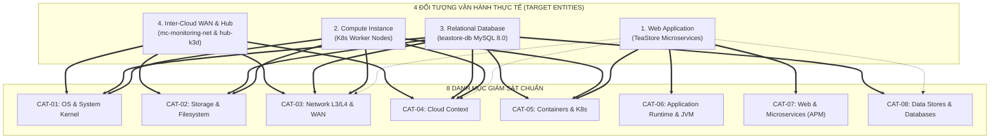

# Chiến Lược Giám Sát Toàn Diện: Taxonomy 8 Danh Mục Chuẩn, Entity Composition & Telemetry Data Contract

> **Mã tài liệu:** `docs/progress/03_resource_monitor.md`  
> **Dự án:** Multi-Cloud Monitoring Platform (TeaStore Hub-Spoke Observability & AIOps)  
> **Phiên bản:** v4.2.0 (OTel SemConv Two-Tier & Telemetry Evolution Edition)  
> **Cập nhật lần cuối:** 2026-11-12  
> **Tác giả:** Principal Observability Architect, OpenTelemetry Specification Maintainer & SRE Technical Author  
> **Kế thừa & Nâng cấp:** Tích hợp nghiên cứu chiến lược SigNoz (`05_SigNoz_strategy.md`), Datadog Core (`06_Datadog_strategy.md`), OpenTelemetry Semantic Conventions Specification (`docs/other-reference/OTelSemanticConv`), AI Anomaly Detection Engine V3 (`04_ai_engine.md`), và hệ thống Schema 2 tầng tại [`docs/schemas/`](../schemas/README.md).

---

## Tóm Tắt Điều Hành (Executive Summary)

Trong các hệ thống phân tán đa đám mây (Multi-Cloud Distributed Systems), việc chỉ phân loại giám sát theo 3 tầng sơ sài (Ứng dụng - Hệ thống - Đám mây) bộc lộ nhiều điểm mù kỹ thuật nghiêm trọng:
1. **Không phản ánh đúng bản chất ghép tầng (Layering & Decoupling):** Một ứng dụng Web không chỉ có mã nguồn nghiệp vụ mà còn phụ thuộc chặt chẽ vào máy ảo Java (JVM), hạn ngạch container (cgroup limits), socket TCP, và các câu truy vấn cơ sở dữ liệu phía hạ nguồn.
2. **Thiếu một Hợp đồng Dữ liệu (Data Contract) chặt chẽ:** Khi các nhóm kỹ sư thu thập viễn trắc tự do mà không có một từ điển dữ liệu quy định rõ ràng về đơn vị đo lường (Unit), chiều hướng đánh giá (Orientation: càng cao càng tốt hay càng cao càng xấu), và các nhãn chống va chạm (Anti-collision Compound Keys), dữ liệu đưa vào kho lưu trữ (Thanos, Loki, Tempo) sẽ bị phân mảnh, dẫn đến việc các mô hình Machine Learning / AIOps bị sai lệch hoặc nổ số chiều (Cardinality Explosion).
3. **Phân biệt 3 Khái niệm Nền tảng của OpenTelemetry:**
   - **OTel Semantic Convention Domains ([`docs/schemas/categories/`](../schemas/categories/README.md)):** Từ điển thuộc tính và số đo nguyên tử chuẩn hóa theo chuẩn quốc tế của OpenTelemetry Specification.
   - **OTel Telemetry Schema Evolution (`v1.21.0 -> v1.45.0`):** Bản đồ chuyển đổi tên gọi lịch sử giữa các phiên bản agent, được đồ án xử lý bằng cơ chế **Dual SemConv Fallback**.
   - **Entity Monitoring Profiles & Data Contracts ([`docs/schemas/profiles/`](../schemas/profiles/README.md) & [`.csv`](../schemas/telemetry-field-inventory.csv)):** Bản thiết kế lắp ghép các Category cho từng loại tài nguyên thực tế trong đồ án kèm ngưỡng SLO và PromQL.

Bản đặc tả **v4.2.0** này tái kiến trúc toàn diện mô hình quan sát của đồ án bằng cách:
* Thiết lập **Hệ thống phân loại chuẩn 8 Danh mục (Standard Observability Categories Taxonomy: `CAT-01` đến `CAT-08`)** dung hòa giữa Datadog Archetypes, SigNoz Domains và OpenTelemetry Semantic Conventions v1.26+.
* Chuẩn hóa **Triết lý Lắp ghép Thực thể (Entity-to-Category Composition Matrix)**: Phân tách rõ 4 Thực thể Giám sát Độc lập (Web Application, Compute Instance, Relational Database, Inter-Cloud WAN & Hub).
* Tách biệt rõ ràng **Resource/Span Attributes (Nhãn định danh)** và **Metrics/Signals (Chuỗi thời gian đo lường)**.
* Thiết lập **Master Telemetry Data Contract** làm nền tảng đầu vào bất biến cho **8 Universal Features** và thuật toán phân rã vết thực thi **Tempo Trace RCA ($\Delta T = T_{\text{WAN}} + T_{\text{self}} + T_{\text{DB}}$)** của **AI Anomaly Detection Engine V3**.

```
┌────────────────────────────────────────────────────────────────────────────────────────────────────────┐
│                   HỆ QUY CHIẾU 8 DANH MỤC GIÁM SÁT CHUẨN (TAXONOMY V4.1.0)                            │
├────────────────────────────────────────────────────────────────────────────────────────────────────────┤
│  [CAT-07: Web / HTTP / RPC Microservices (APM)]  ◄──►  [CAT-06: App Runtime & JVM (Tomcat/Java 11)]    │
│  [CAT-08: Data Stores & Relational Databases]    ◄──►  [CAT-05: Containers & K8s Orchestration]       │
│  [CAT-03: Network & Transport (L3/L4 & WAN)]     ◄──►  [CAT-04: Cloud Infra & Perimeter Context]       │
│  [CAT-01: Linux OS & Kernel (USE Method)]        ◄──►  [CAT-02: Storage & Filesystem (Disk/Inodes/S3)] │
└────────────────────────────────────────────────────────────────────────────────────────────────────────┘
```

---

# CHƯƠNG 1: Hệ Thống Phân Loại 8 Danh Mục Giám Sát Chuẩn (Standard Observability Categories Taxonomy)

### 1.1. Giới Hạn Của Mô Hình 3 Tầng Truyền Thống
Trước phiên bản v4.0.0, việc gom nhóm thành 3 tầng tổng quát (Application, System, Cloud) gây ra 4 sự nhập nhằng trong vận hành thực tế:
* **Nhập nhằng giữa Runtime và Service:** JVM Garbage Collection pause time bị xếp lẫn với HTTP Server Request Duration, khiến kỹ sư không phân biệt được trễ do thuật toán ứng dụng hay do "Stop-the-World" của Java runtime.
* **Nhập nhằng giữa OS Kernel và Kubernetes Orchestration:** CPU Throttling do Kubernetes CFS Quota bị nhầm lẫn với hiện tượng CPU Saturation do toàn bộ Node máy chủ bị quá tải tiến trình.
* **Mất dấu ranh giới Mạng L3/L4 và Mạng WAN liên cụm:** Trễ mạng cục bộ trong cụm K8s và trễ mạng WAN 10ms giữa AWS EKS và Azure AKS bị gộp chung, làm vô hiệu hóa khả năng chẩn đoán suy hao đường truyền của `tc netem`.
* **Mù mờ về phụ thuộc Database:** Một truy vấn JDBC bị nghẽn ổ đĩa vật lý trên Azure Spoke thường chỉ được nhìn nhận như một lỗi timeout HTTP 504 tại tầng ứng dụng trên AWS Spoke.

### 1.2. Bảng Đối Chiếu Phân Loại Đa Nền Tảng (Taxonomy Alignment Matrix)
Dựa trên việc dịch ngược mã nguồn Datadog (`06_Datadog_strategy.md`) và SigNoz (`05_SigNoz_strategy.md`), bảng đối chiếu dưới đây định hình **8 Danh mục Chuẩn của Đồ án**:

| Mã Danh Mục | Tên Danh Mục Chuẩn | Datadog Archetype (`manifest.json`) | SigNoz Domain (`SigNozDocs`) | OpenTelemetry SemConv Scope | Phạm Vi Trách Nhiệm Trong Đồ Án |
| :---: | :--- | :--- | :--- | :--- | :--- |
| **`CAT-01`** | **OS & System Kernel** | `OS & System` | `Infrastructure / Host` | `system.cpu.*`, `system.memory.*`, `system.paging.*`, `system.cpu.load_average.*` | Giám sát trạng thái nhân Linux (Kernel), tiến trình, bộ nhớ ảo, USE Method. |
| **`CAT-02`** | **Storage & Filesystem** | `Data Stores / Storage` | `Infrastructure / Disk` | `system.disk.*`, `system.filesystem.*`, `aws.s3.*` | Băng thông đọc/ghi đĩa, Inodes, độ sâu hàng đợi I/O, MinIO Object Storage S3. |
| **`CAT-03`** | **Network & Transport (L3/L4 & WAN)** | `Network` | `Infrastructure / Network` | `system.network.*`, `net.sock.*`, `rpc.connect.*` | Giao diện mạng `eth0`, rớt gói, TCP Socket states (`ESTABLISHED`, `TIME_WAIT`), WAN RTT. |
| **`CAT-04`** | **Cloud Infra & Perimeter Context** | `Cloud` (AWS/Azure) | `Cloud Integrations` | `cloud.provider`, `cloud.region`, `network.vpc.*`, `cloud.identity.*` | Siêu dữ liệu đa đám mây (VPC/VNet, Subnet, SG, IAM ARN, KeyVault/KMS, Multi-Cloud Mapping). |
| **`CAT-05`** | **Containers & K8s Orchestration** | `Containers`, `Kubernetes` | `Infrastructure / K8s` | `k8s.cluster.*`, `k8s.pod.*`, `k8s.node.*`, `container.*` | Trạng thái Pods, cgroup limits, OOMKilled Exit 137, Kubelet stats. |
| **`CAT-06`** | **Application Runtime & JVM** | `Languages / Java` | `APM / JVM Metrics` | `jvm.memory.*`, `jvm.gc.*`, `jvm.threads.*`, `process_runtime_jvm_*` | Máy ảo Java (OpenJDK 11), Tomcat `CATALINA_OPTS`, Garbage Collection, luồng thực thi. |
| **`CAT-07`** | **Web / HTTP / RPC Microservices (APM)** | `Web`, `Tracing` | `APM & Services` | `http.server.*`, `http.client.*`, `rpc.system`, `traces_service_graph_*` | Báo cáo RED Signals (Rate, Errors, Duration), phân rã Trace Spans W3C, Service Graph Topology. |
| **`CAT-08`** | **Data Stores & Relational Databases** | `Data Stores` | `Database Monitoring` | `db.system="mysql"`, `db.name`, `db.statement`, `db.operation` | Hiệu năng truy vấn MySQL 8.0, JDBC spans, MySQL error/slow logs, Node storage backing MySQL. |

---

# CHƯƠNG 2: Ma Trận Tổ Hợp Thực Thể (Entity-to-Category Composition Matrix)

### 2.1. Triết Lý Lắp Ghép Thực Thể (Entity Composition Philosophy)
Trong thực tế vận hành SRE, không có kỹ sư nào đi giám sát một "Category đơn lẻ". Một đối tượng vận hành (Target Entity) luôn là **một tập hợp lắp ghép (composition) của nhiều Category**:



### 2.2. Phân Tích Chi Tiết 4 Cấu Hình Lắp Ghép Cho Đồ Án TeaStore

#### 1. Khi Giám Sát Một Web Application (TeaStore Microservices)
Một microservice Java (như `teastore-webui` trên `aws-k3d` hoặc `teastore-persistence` trên `azure-k3d`) là sự kết hợp của:
* **`CAT-07` (Core APM):** Theo dõi Golden Signals (QPS, HTTP 5xx, Latency P95/P99) và các spans liên dịch vụ W3C.
* **`CAT-06` (Runtime):** Giám sát Heap Memory (256MB), Garbage Collector (SerialGC pause duration), số lượng luồng thực thi Tomcat.
* **`CAT-05` (Orchestration):** Kiểm tra Pod CPU limits (`cpu.cfs_quota_us`), hiện tượng throttling, và cảnh báo `OOMKilled` (Exit Code 137).
* **`CAT-08` (Client Dependency):** Đo lường thời gian trễ của lời gọi JDBC `:3306` sang cơ sở dữ liệu `teadb` phía hạ nguồn.
* **`CAT-03` (Transport):** Kiểm tra trạng thái rò rỉ socket TCP (`TIME_WAIT`, `CLOSE_WAIT`) trên cổng `:8080`.
* **`CAT-04` (Context):** Định danh vị trí đám mây (`cloud.provider="aws"`, `network.vpc.id="vpc-0f8a3c2b1e7d9a4f6"`, IAM Role IRSA).

#### 2. Khi Giám Sát Một Compute Instance (K8s Worker Nodes: `aws-k3d`, `azure-k3d`, `hub-k3d`)
Áp dụng triệt để phương pháp luận **USE Method** của Brendan Gregg:
* **`CAT-01` (Core USE):** Utilization (CPU user/system, Memory used), Saturation (Load Average 1m/5m/15m, CPU wait `%wa`, Major Page Faults), Errors.
* **`CAT-02` (Storage USE):** Throughput đọc/ghi đĩa (MB/s), IOPS, thời gian chờ đĩa (`system.disk.operation_time`), dung lượng đĩa (`df -h`) và Inodes (`df -i`).
* **`CAT-03` (Network USE):** Băng thông mạng RX/TX, Packet Drops, Packet Errors trên giao diện mạng vật lý/ảo `eth0`.
* **`CAT-05` (Node Orchestration):** Số lượng Pods đang chạy trên Node, Kubelet eviction threshold, cgroup memory working set.
* **`CAT-04` (Host Context):** Mô hình SKU đám mây giả định (`m5.xlarge` trên AWS, `Standard_D4ds_v5` trên Azure), Subnet CIDR, Security Group.

#### 3. Khi Giám Sát Một Relational Database (`teastore-db` MySQL 8.0 trên `azure-k3d`)
Trong môi trường hiện tại, do chưa triển khai `mysqld-exporter` chuyên dụng, hệ thống áp dụng chiến lược **Giám sát Cơ sở Dữ liệu Đa Chiều Không Xâm Lấn (Non-Invasive Multi-Layer DB Observability)**:
* **`CAT-08` (Core Database Signals):**
  * Đo lường từ phía Client qua OpenTelemetry JDBC Instrumentation trên `teastore-persistence`: Span attributes `db.system="mysql"`, `db.name="teadb"`, `db.statement`, `net.peer.name="teastore-db"`, `net.peer.port=3306`.
  * Pre-aggregated metrics qua `servicegraphconnector`: `traces_service_graph_request_total{server=~"teadb|teastore-db"}` và `traces_service_graph_request_server_seconds_bucket`.
  * Thu nạp và phân tích MySQL Error & Slow Logs qua OTel `filelog` receiver (`{service_name="teastore-db"}`).
* **`CAT-02` (Storage Bottleneck):** Theo dõi Disk Write IOPS và thời gian flush log `ib_logfile` của InnoDB xuống phân vùng `/var/lib/mysql` trên nút `azure-k3d`.
* **`CAT-01` (CPU I/O Wait):** Theo dõi chỉ số `system_cpu_time_seconds_total{state="wait"}`. Nếu `%wa` tăng cao trong khi CPU User thấp, đây là dấu hiệu đặc trưng của nghẽn I/O đĩa MySQL.
* **`CAT-03` (Transport):** Giám sát lưu lượng mạng và số kết nối TCP `:3306`, hiện tượng kết nối bị treo (`CLOSE_WAIT`).
* **`CAT-04/05` (Platform Context):** AKS Managed Node Pool `nodepool-data`, Azure VNet `vnet-teastore-southasia`, Network Security Group `nsg-aks-teastore-internal`.

#### 4. Khi Giám Sát Mạng Liên Đám Mây & Central Hub (`mc-monitoring-net` WAN & `hub-k3d`)
* **`CAT-03` (WAN Bridge):** Đo lường tác động của bộ giả lập suy hao `tc netem` (10ms RTT ±2ms, rớt gói 0.1%), kênh truyền mã hóa mTLS 1.3 (ChaCha20-Poly1305).
* **`CAT-04` (Multi-Cloud Routing):** Quản lý định tuyến giữa các dải mạng nội bộ giả lập `10.0.0.0/16` (AWS) và `10.1.0.0/16` (Azure).
* **`CAT-02` (Object Storage):** Giám sát phân vùng lưu trữ MinIO S3 (`raw-telemetry`, `thanos-metrics`, `loki-data`, `tempo-traces`), bảo đảm không bị cạn kiệt Inode khi ghi hàng vạn file block nhỏ.
* **`CAT-01` (Hub Resource):** Bảo đảm CPU và RAM của Central Gateway không bị quá tải khi tiếp nhận luồng OTLP gRPC streaming liên tục từ 2 cụm Spoke.

---

# CHƯƠNG 3: Ánh Xạ Chi Tiết Từng Schema & Attribute Thực Tế Đã Triển Khai Trong Đồ Án

Chương này tách bạch hoàn toàn giữa **Resource / Span / Log Attributes (Thuộc tính định danh)** và **Metrics / Signals (Số đo định lượng)** nhằm đảm bảo tính chính xác và không bị gộp lẫn.

### 3.1. Bảng Tổng Kê Resource, Span & Log Attributes Theo 8 Danh Mục Chuẩn

| Danh Mục | Tên Attribute Chuẩn OTel SemConv | Kiểu Dữ Liệu | Giá Trị Thực Tế Trên Các Cụm (`aws-k3d`, `azure-k3d`, `hub-k3d`) | Cơ Chế Thu Thập (3-Tier Acquisition) | Tính Xác Thực (Authenticity) |
| :---: | :--- | :---: | :--- | :--- | :---: |
| **`CAT-01`** | `host.name` | `string` | `"k3d-aws-k3d-server-0"`, `"k3d-azure-k3d-server-0"`, `"k3d-hub-k3d-server-0"` | Node Environment / Hostmetrics | **Đo lường 100%** |
| | `host.id` | `string` | Machine ID / DMI UUID của container node | Node Environment / Hostmetrics | **Đo lường 100%** |
| | `host.type` | `string` | `"m5.xlarge"` (AWS simulation), `"Standard_D4ds_v5"` (Azure simulation) | OTTL Synthetic Enrichment | **Enriched Context** |
| | `os.type` | `string` | `"linux"` | Hostmetrics OS detector | **Đo lường 100%** |
| | `os.description` | `string` | `"Linux 5.15.x / 6.x Container Host"` | Hostmetrics OS detector | **Đo lường 100%** |
| **`CAT-02`** | `storage.volume.id` | `string` | `"vol-0a1b2c3d4e5f6g7h8"` (AWS EBS gp3), `"disk-azure-teastore-data"` | OTTL Synthetic Enrichment | **Enriched Context** |
| | `storage.mount.path` | `string` | `"/var/lib/mysql"`, `"/data"`, `"/var/log"` | Hostmetrics filesystem scraper | **Đo lường 100%** |
| | `storage.filesystem.type` | `string` | `"ext4"`, `"overlay"`, `"tmpfs"` | Hostmetrics filesystem scraper | **Đo lường 100%** |
| **`CAT-03`** | `network.interface.name` | `string` | `"eth0"`, `"lo"`, `"flannel.1"` | Hostmetrics network scraper | **Đo lường 100%** |
| | `net.transport` | `string` | `"ip_tcp"` | Hostmetrics socket / Trace span tag | **Đo lường 100%** |
| | `net.peer.name` | `string` | `"teastore-persistence"`, `"teastore-db"`, `"hub-collector.mc-monitoring-net"` | OTel Java Agent / JDBC driver | **Đo lường 100%** |
| | `net.peer.port` | `int` | `8080` (HTTP), `1099` (RMI), `3306` (MySQL), `4317` (OTLP gRPC) | OTel Java Agent / Socket connect | **Đo lường 100%** |
| | `network.wan.status` | `string` | `"EMULATED_WAN_10MS_RTT"` | OTTL Synthetic Tagging | **Enriched Context** |
| **`CAT-04`** | `cloud.provider` | `string` | `"aws"` (Spoke 1), `"azure"` (Spoke 2), `"hub"` (Central Hub) | OTTL Hub Gateway Enrichment | **Enriched Context** |
| | `cloud.platform` | `string` | `"aws_eks"` (Spoke 1), `"azure_aks"` (Spoke 2), `"hub_k3d"` (Hub) | OTTL Hub Gateway Enrichment | **Enriched Context** |
| | `cloud.region` | `string` | `"us-east-1"` (Spoke 1), `"southasia"` (Spoke 2), `"central-hub"` | OTTL Hub Gateway Enrichment | **Enriched Context** |
| | `cloud.availability_zone` | `string` | `"us-east-1a"`, `"southasia-1"` | OTTL Hub Gateway Enrichment | **Enriched Context** |
| | `cloud.account.id` | `string` | `"851725492014"` (AWS 12-digit), `"4b8f3a21-9e6c-4f80-b753-2d9a6e1c84f5"` (Azure) | OTTL Hub Gateway Enrichment | **Enriched Context** |
| | `cloud.resource_id` | `string` | `"/subscriptions/4b8f3a21-.../resourceGroups/rg-teastore/..."` | OTTL Hub Gateway Enrichment | **Enriched Context** |
| | `cloud.identity.arn` | `string` | `arn:aws:iam::851725492014:role/teastore-irsa-role`, Azure Managed Identity | K8s IRSA ServiceAccount / OTTL | **Enriched Context** |
| | `network.vpc.id` | `string` | `"vpc-0f8a3c2b1e7d9a4f6"` (AWS), `"vnet-teastore-southasia"` (Azure) | OTTL Hub Gateway Enrichment | **Enriched Context** |
| | `network.subnet.id` | `string` | `"subnet-0192837465af"` (`10.0.1.0/24`), `"snet-aks-internal"` (`10.1.2.0/24`) | OTTL Hub Gateway Enrichment | **Enriched Context** |
| | `network.security_group.id` | `string` | `"sg-01a2b3c4d5e6f7a8b"`, `"nsg-aks-teastore-internal"` | OTTL Hub Gateway Enrichment | **Enriched Context** |
| | `security.kms.key_arn` | `string` | `arn:aws:kms:us-east-1:851725492014:key/b841e2a0-...`, Azure KeyVault URI | OTTL Hub Gateway Enrichment | **Enriched Context** |
| | `telemetry.hub.received_time` | `int64` | Unix Epoch timestamp (nano) khi Hub Gateway nhận gói OTLP | OTel Hub Receiver Context | **Đo lường 100%** |
| **`CAT-05`** | `k8s.cluster.name` | `string` | `"aws-k3d"`, `"azure-k3d"`, `"hub-k3d"` | Node Environment Variable | **Đo lường 100%** |
| | `k8s.node.name` | `string` | `"k3d-aws-k3d-server-0"`, `"k3d-azure-k3d-server-0"` | K8s Downward API | **Đo lường 100%** |
| | `k8s.namespace.name` | `string` | `"default"`, `"monitoring"`, `"teastore"` | K8s Downward API | **Đo lường 100%** |
| | `k8s.pod.name` | `string` | `"teastore-webui-74f8b9-x21z"`, `"teastore-db-0"` | K8s Downward API | **Đo lường 100%** |
| | `k8s.pod.uid` | `string` | UUID v4 định danh duy nhất của Pod (khóa chống va chạm) | K8s Downward API | **Đo lường 100%** |
| | `k8s.container.name` | `string` | `"teastore-webui"`, `"teastore-db"`, `"otel-collector"` | K8s Downward API | **Đo lường 100%** |
| **`CAT-06`** | `process.runtime.name` | `string` | `"OpenJDK Runtime Environment"` | OTel Java Agent v2.10 | **Đo lường 100%** |
| | `process.runtime.version` | `string` | `"11.0.19+7"` | OTel Java Agent v2.10 | **Đo lường 100%** |
| | `process.pid` | `int` | PID của tiến trình Java Tomcat bên trong container | OTel Java Agent v2.10 | **Đo lường 100%** |
| | `jvm.memory.type` | `string` | `"heap"`, `"non_heap"` | OTel Java Agent JMX scraper | **Đo lường 100%** |
| **`CAT-07`** | `service.name` | `string` | `"teastore-webui"`, `"teastore-auth"`, `"teastore-persistence"`, `"teastore-registry"` | OTel SDK / Service configuration | **Đo lường 100%** |
| | `service.version` | `string` | `"1.4.1"` | OTel SDK configuration | **Đo lường 100%** |
| | `service.namespace` | `string` | `"teastore"` | OTel SDK configuration | **Đo lường 100%** |
| | `http.request.method` | `string` | `"GET"`, `"POST"` | OTel Java Servlet Filter | **Đo lường 100%** |
| | `http.response.status_code` | `int` | `200`, `404`, `500`, `504` | OTel Java Servlet Filter | **Đo lường 100%** |
| | `http.route` | `string` | `"/tools.descartes.teastore.webui/"`, `"/login"`, `"/cart"` | OTel Java Servlet Filter | **Đo lường 100%** |
| | `peer.service` | `string` | `"teastore-registry"` (port 1099), `"teastore-db"` (port 3306) | OTTL Peer Service Mapper | **Đo lường 100%** |
| | `trace_id` & `span_id` | `string` | W3C 128-bit Trace ID và 64-bit Span ID | OTel Context Propagation | **Đo lường 100%** |
| **`CAT-08`** | `db.system` | `string` | `"mysql"` | OTel Java Agent JDBC driver | **Đo lường 100%** |
| | `db.name` | `string` | `"teadb"` | OTel Java Agent JDBC driver | **Đo lường 100%** |
| | `db.operation` | `string` | `"SELECT"`, `"INSERT"`, `"UPDATE"`, `"DELETE"` | OTel Java Agent JDBC driver | **Đo lường 100%** |
| | `db.user` | `string` | `"teastore"` | OTel Java Agent JDBC driver | **Đo lường 100%** |

### 3.2. Bảng Tổng Kê Metrics & Signals Đo Lường Theo 8 Danh Mục Chuẩn

| Danh Mục | Tên Metric / Signal Chuẩn Hóa | Signal Type | PromQL / Định Dạng Thu Thập | Trạng Thái Triển Khai | Nguồn Thu Thập |
| :---: | :--- | :---: | :--- | :---: | :--- |
| **`CAT-01`** | `system_cpu_time_seconds_total` | Metric (Counter) | `rate(system_cpu_time_seconds_total{state=~"user\|system\|wait\|idle"}[1m])` | **Đang chạy Live** | OTel Hostmetrics `/proc/stat` |
| | `system_cpu_load_average_1m / 5m / 15m` | Metric (Gauge) | `system_cpu_load_average_15m` | **Đang chạy Live** | OTel Hostmetrics `/proc/loadavg` |
| | `system_memory_usage_bytes` | Metric (Gauge) | `system_memory_usage_bytes{state=~"used\|free\|cached\|buffered"}` | **Đang chạy Live** | OTel Hostmetrics `/proc/meminfo` |
| | `system_paging_operations_total` | Metric (Counter) | `rate(system_paging_operations_total{type="major"}[1m])` | **Đang chạy Live** | OTel Hostmetrics `/proc/vmstat` |
| | `system_paging_faults_total` | Metric (Counter) | `rate(system_paging_faults_total[1m])` | **Đang chạy Live** | OTel Hostmetrics `/proc/vmstat` |
| **`CAT-02`** | `system_disk_io_bytes_total` | Metric (Counter) | `rate(system_disk_io_bytes_total[1m])` | **Đang chạy Live** | OTel Hostmetrics `/proc/diskstats` |
| | `system_disk_operations_total` | Metric (Counter) | `rate(system_disk_operations_total[1m])` (IOPS) | **Đang chạy Live** | OTel Hostmetrics `/proc/diskstats` |
| | `system_disk_operation_time_seconds_total` | Metric (Counter) | `rate(system_disk_operation_time_seconds_total[1m])` | **Đang chạy Live** | OTel Hostmetrics `/proc/diskstats` |
| | `system_disk_pending_operations` | Metric (Gauge) | `system_disk_pending_operations` (Hàng đợi I/O) | **Đang chạy Live** | OTel Hostmetrics `/proc/diskstats` |
| | `system_filesystem_usage_bytes` | Metric (Gauge) | `system_filesystem_usage_bytes{state="used"}` | **Đang chạy Live** | OTel Hostmetrics `statfs` |
| | `system_filesystem_inodes_usage` | Metric (Gauge) | `system_filesystem_inodes_usage{state="used"}` | **Đang chạy Live** | OTel Hostmetrics `statfs` |
| **`CAT-03`** | `system_network_io_bytes_total` | Metric (Counter) | `rate(system_network_io_bytes_total[1m])` | **Đang chạy Live** | OTel Hostmetrics `/proc/net/dev` |
| | `system_network_packets_total` | Metric (Counter) | `rate(system_network_packets_total[1m])` | **Đang chạy Live** | OTel Hostmetrics `/proc/net/dev` |
| | `system_network_dropped_total` | Metric (Counter) | `rate(system_network_dropped_total[1m])` | **Đang chạy Live** | OTel Hostmetrics Netem drops |
| | `system_network_errors_total` | Metric (Counter) | `rate(system_network_errors_total[1m])` | **Đang chạy Live** | OTel Hostmetrics `/proc/net/dev` |
| | `system_network_connections` | Metric (Gauge) | `system_network_connections{state=~"ESTABLISHED\|TIME_WAIT"}` | **Đang chạy Live** | OTel Hostmetrics `/proc/net/tcp` |
| | `ai_rca_component_latency_ms{component="wan"}` | Metric (Gauge) | `ai_rca_component_latency_ms{component="wan"}` | **Đang chạy Live** | AI Tempo Trace Analyzer |
| **`CAT-04`** | `synthetic_cloud_route_health` | Metric (Gauge) | `synthetic_cloud_route_health{cloud_provider=~"aws\|azure"}` | **Đang chạy Live** | AI Synthetic Probe / Health check |
| **`CAT-05`** | `container_cpu_usage_seconds_total` | Metric (Counter) | `rate(container_cpu_usage_seconds_total[1m])` | **Đang chạy Live** | Kubelet cgroups stats |
| | `container_memory_working_set_bytes`| Metric (Gauge) | `container_memory_working_set_bytes` | **Đang chạy Live** | Kubelet cgroups stats |
| | `k8s_pod_restart_count` | Metric (Counter) | `k8s_pod_restart_count` | **Đang chạy Live** | Kubelet Pod stats |
| | `container_cpu_cfs_throttled_seconds_total` | Metric (Counter) | `rate(container_cpu_cfs_throttled_seconds_total[1m])` | **Đang chạy Live** | Kubelet CFS quota stats |
| **`CAT-06`** | `jvm_memory_used_bytes` | Metric (Gauge) | `jvm_memory_used_bytes{jvm_memory_type="heap"}` | **Đang chạy Live** | OTel Java Agent v2.10 |
| | `process_runtime_jvm_memory_usage_bytes` | Metric (Gauge) | `process_runtime_jvm_memory_usage_bytes{type="heap"}` (SemConv 2.x) | **Đang chạy Live** | OTel Java Agent v2.10 |
| | `jvm_gc_duration_seconds_sum` | Metric (Counter) | `rate(jvm_gc_duration_seconds_sum[1m])` | **Đang chạy Live** | OTel Java Agent v2.10 |
| | `jvm_thread_count` / `jvm_threads_current` | Metric (Gauge) | `jvm_thread_count or jvm_threads_current` | **Đang chạy Live** | OTel Java Agent v2.10 |
| | `jvm_cpu_recent_utilization_ratio` | Metric (Gauge) | `jvm_cpu_recent_utilization_ratio` (0.0 - 1.0) | **Đang chạy Live** | OTel Java Agent OperatingSystemMXBean |
| **`CAT-07`** | `http_server_request_duration_seconds_count` | Metric (Counter) | `sum by (service_name) (rate(http_server_request_duration_seconds_count[1m]))` | **Đang chạy Live** | OTel Java Agent Servlet Filter |
| | `http_server_request_duration_seconds_bucket` | Metric (Histogram)| `histogram_quantile(0.95, sum by (le, service_name) (rate(http_server_request_duration_seconds_bucket[1m])))` | **Đang chạy Live** | OTel Java Agent Servlet Filter |
| | `http_client_request_duration_seconds_bucket` | Metric (Histogram)| `histogram_quantile(0.95, sum by (le, service_name) (rate(http_client_request_duration_seconds_bucket[1m])))` | **Đang chạy Live** | OTel Java Agent HTTP Client |
| | `traces_service_graph_request_total` | Metric (Counter) | `sum by (client, server) (rate(traces_service_graph_request_total[1m]))` | **Đang chạy Live** | Hub `servicegraphconnector` |
| | `traces_service_graph_request_server_seconds_bucket` | Metric (Histogram)| `histogram_quantile(0.95, sum by (le, server) (rate(traces_service_graph_request_server_seconds_bucket[1m])))` | **Đang chạy Live** | Hub `servicegraphconnector` |
| | `traces_service_graph_request_failed_total` | Metric (Counter) | `sum by (server) (rate(traces_service_graph_request_failed_total[1m]))` | **Đang chạy Live** | Hub `servicegraphconnector` |
| | `ai_reconstruction_error` | Metric (Gauge) | `ai_reconstruction_error{model="gru_autoencoder"}` | **Đang chạy Live** | AI Engine V3 Exporter `:9108` |
| | `ai_rca_component_latency_ms{component="self"}` | Metric (Gauge) | `ai_rca_component_latency_ms{component="self"}` | **Đang chạy Live** | AI Tempo Trace Analyzer |
| **`CAT-08`** | `traces_service_graph_request_total{server=~"teadb\|teastore-db"}` | Metric (Counter) | `rate(traces_service_graph_request_total{server=~"teadb\|teastore-db"}[1m])` | **Đang chạy Live** | Hub `servicegraphconnector` (JDBC call) |
| | `traces_service_graph_request_server_seconds_bucket{server=~"teadb\|teastore-db"}` | Metric (Histogram)| `histogram_quantile(0.95, sum by (le) (rate(traces_service_graph_request_server_seconds_bucket{server=~"teadb\|teastore-db"}[1m])))` | **Đang chạy Live** | Hub `servicegraphconnector` (JDBC call) |
| | `db.statement` | Trace Span Tag | SQL query string gắn trên Span JDBC `:3306` | **Đang chạy Live** | OTel Java Agent JDBC driver |
| | `mysql_logs` | Log Stream | `{service_name="teastore-db"} \|~ "(?i)(error\|aborted\|timeout)"` | **Đang chạy Live** | OTel `filelog` receiver trên `azure-k3d` |
| | `ai_rca_component_latency_ms{component="db"}` | Metric (Gauge) | `ai_rca_component_latency_ms{component="db"}` | **Đang chạy Live** | AI Tempo Trace Analyzer |
| | *`mysql_global_status_threads_connected`* | Metric (Gauge) | `mysql_global_status_threads_connected` | **Planned (Chưa triển khai exporter)** | Cần cài thêm `mysqld-exporter :9104` |
| | *`mysql_global_status_innodb_buffer_pool_reads`*| Metric (Counter) | `rate(mysql_global_status_innodb_buffer_pool_reads[1m])` | **Planned (Chưa triển khai exporter)** | Cần cài thêm `mysqld-exporter :9104` |

---

# CHƯƠNG 4: Hợp Đồng Dữ Liệu Viễn Trắc (Telemetry Data Contract & Hybrid Schema Governance)

### 4.1. Chiến Lược Hybrid Schema Của Đồ Án
Kế thừa tinh hoa từ nghiên cứu hai nền tảng lớn:
* **Học hỏi từ SigNoz:** Sử dụng **100% OpenTelemetry Semantic Conventions**, nạp dữ liệu chuẩn OTLP và duy trì tính linh hoạt Schema-on-Read.
* **Học hỏi từ Datadog:** Áp dụng **Kỷ luật Hợp đồng Dữ liệu (Telemetry Data Contract)** với tệp danh mục quản trị trường viễn trắc tương tự `metadata.csv`, quy định rõ `Unit`, `Orientation` và `Compound Keys` nhằm bảo vệ hệ thống khỏi việc bùng nổ nhãn và sai lệch dữ liệu.

### 4.2. Bảng Master Telemetry Data Contract (20 Hợp Đồng Dữ Liệu Trung Tâm)

| Contract ID | Category | Metric / Signal Name | Type | Unit | Orientation | Required Compound Keys | Consumer (Dashboard / SLO / AI) |
| :---: | :---: | :--- | :---: | :---: | :---: | :--- | :--- |
| **`CTR-01`** | `CAT-07` | `http_server_request_duration_seconds_count` | Counter | `requests` | `0` (Neutral) | `k8s_cluster_name`, `service_name`, `http_status_code` | `red-metrics.json` (QPS), Pyrra SLO, AI Feature `qps` |
| **`CTR-02`** | `CAT-07` | `http_server_request_duration_seconds_bucket` | Histogram | `seconds` | `-1` (Lower better) | `k8s_cluster_name`, `service_name`, `le` | `red-metrics.json`, Pyrra SLO, AI Feature `server_latency_p95` |
| **`CTR-03`** | `CAT-07` | `http_client_request_duration_seconds_bucket` | Histogram | `seconds` | `-1` (Lower better) | `k8s_cluster_name`, `service_name`, `le` | `red-metrics.json`, AI Feature `client_latency_p95` |
| **`CTR-04`** | `CAT-07` | `traces_service_graph_request_total` | Counter | `requests` | `0` (Neutral) | `client`, `server`, `connection_type` | `red-metrics.json` (Service Graph Topology) |
| **`CTR-05`** | `CAT-06` | `jvm_memory_used_bytes` / `process_runtime_jvm...` | Gauge | `bytes` | `-1` (Lower better) | `k8s_cluster_name`, `service_name`, `area="heap"` | `red-metrics.json`, AI Feature `max_pod_ram_pct` |
| **`CTR-06`** | `CAT-06` | `jvm_gc_duration_seconds_sum` / `process_runtime_jvm...` | Counter | `seconds` | `-1` (Lower better) | `k8s_cluster_name`, `service_name` | `red-metrics.json`, AI Feature `gc_pause_rate` |
| **`CTR-07`** | `CAT-06` | `jvm_thread_count` / `process_runtime_jvm_threads...` | Gauge | `threads` | `-1` (Lower better) | `k8s_cluster_name`, `service_name` | `red-metrics.json`, JVM Thread Saturation Alert |
| **`CTR-08`** | `CAT-05` | `container_cpu_cfs_throttled_seconds_total` | Counter | `seconds` | `-1` (Lower better) | `k8s_cluster_name`, `pod`, `container` | `slo-governance.json`, Robusta Alerting |
| **`CTR-09`** | `CAT-05` | `k8s_pod_restart_count` / OOMKilled Signal | Counter | `restarts` | `-1` (Lower better) | `k8s_cluster_name`, `pod`, `namespace` | `slo-governance.json`, Robusta Telegram Alert |
| **`CTR-10`** | `CAT-01` | `system_cpu_time_seconds_total{state="wait"}` (%wa) | Counter | `seconds` | `-1` (Lower better) | `k8s_cluster_name`, `host_name` | `k8s-infrastructure.json` (Storage I/O Bottleneck) |
| **`CTR-11`** | `CAT-01` | `system_cpu_load_average_15m` | Gauge | `1` (Ratio) | `-1` (Lower better) | `k8s_cluster_name`, `host_name` | `k8s-infrastructure.json` (Node Saturation) |
| **`CTR-12`** | `CAT-02` | `system_disk_operation_time_seconds_total` | Counter | `seconds` | `-1` (Lower better) | `k8s_cluster_name`, `device` | `k8s-infrastructure.json` (Disk Latency) |
| **`CTR-13`** | `CAT-02` | `system_filesystem_inodes_usage{state="used"}` | Gauge | `inodes` | `-1` (Lower better) | `k8s_cluster_name`, `mountpoint` | MinIO Storage Alert (Inode Exhaustion Guard) |
| **`CTR-14`** | `CAT-03` | `rate(system_network_dropped_total[1m])` | Gauge | `packets/s`| `-1` (Lower better) | `k8s_cluster_name`, `device="eth0"` | `wan-telemetry.json` (WAN Netem Validation) |
| **`CTR-15`** | `CAT-03` | `system_network_connections{state="TIME_WAIT"}` | Gauge | `sockets` | `-1` (Lower better) | `k8s_cluster_name`, `protocol="tcp"` | SRE Connection Leak Matrix |
| **`CTR-16`** | `CAT-08` | `traces_service_graph_request_total{server=~"teadb\|teastore-db"}` | Counter | `requests` | `0` (Neutral) | `client`, `server`, `connection_type` | `database-monitoring-schema.yaml`, Service Graph DB |
| **`CTR-17`** | `CAT-08` | `traces_service_graph_request_server_seconds_bucket{server=~"teadb\|teastore-db"}` | Histogram | `seconds` | `-1` (Lower better) | `server`, `le` | `database-monitoring-schema.yaml`, DB Latency P95/P99 |
| **`CTR-18`** | `CAT-03` | `ai_rca_component_latency_ms{component="wan"}` | Gauge | `milliseconds`| `-1` (Lower better) | `cloud_provider`, `service_name` | Panel 7 `red-metrics.json`, AI Trace RCA Report |
| **`CTR-19`** | `CAT-07` | `ai_rca_component_latency_ms{component="self"}` | Gauge | `milliseconds`| `-1` (Lower better) | `cloud_provider`, `service_name` | Panel 7 `red-metrics.json`, AI Trace RCA Report |
| **`CTR-20`** | `CAT-08` | `ai_rca_component_latency_ms{component="db"}` | Gauge | `milliseconds`| `-1` (Lower better) | `cloud_provider`, `service_name` | Panel 7 `red-metrics.json`, AI Trace RCA Report |

*(Ghi chú Orientation: `0` = Neutral/Theo dõi luồng; `+1` = Càng cao càng tốt; `-1` = Càng cao càng xấu/Nguy cơ sự cố).*

### 4.3. Cung Cấp Đầu Vào Chuẩn Cho AI Anomaly Detection Engine V3
Hợp đồng dữ liệu trên liên kết trực tiếp với mã nguồn Python của module AI (`collector.py` và `detector.py`):
1. **8 PromQL Universal Features Matrix (Đồng bộ 100% với `docs/progress/04_ai_engine.md`):**
   * `qps` $\leftarrow$ `CTR-01`: Tần suất yêu cầu máy chủ (`http_server_request_duration_seconds_count`).
   * `server_latency_p95` $\leftarrow$ `CTR-02`: Phân vị trễ P95 xử lý của máy chủ (`http_server_request_duration_seconds_bucket`).
   * `client_latency_p95` $\leftarrow$ `CTR-03`: Phân vị trễ P95 cuộc gọi client đi ra ngoài (`http_client_request_duration_seconds_bucket`).
   * `error_rate_5xx` $\leftarrow$ `CTR-01`: Tần suất lỗi mã 5xx (`http_response_status_code=~"5.."`).
   * `max_pod_cpu_pct`: Tỷ lệ CPU cao nhất trong nhóm pods của dịch vụ (`jvm_cpu_recent_utilization_ratio`).
   * `max_pod_ram_pct` $\leftarrow$ `CTR-05`: Tỷ lệ bộ nhớ Heap cao nhất trong nhóm pods so với giới hạn Max Heap.
   * `ram_floor_2m_pct`: Sàn bộ nhớ RAM trong 2 phút (chỉ số vàng phát hiện rò rỉ bộ nhớ thực sự).
   * `gc_pause_rate` $\leftarrow$ `CTR-06`: Tần suất dừng hệ thống để thu dọn rác JVM (`jvm_gc_duration_seconds_sum`).
2. **Tempo Trace RCA Decomposition Formula:**
   Khi Autoencoder phát hiện bất thường, bộ phân giải vết thực thi kích hoạt để chứng minh nguyên nhân gốc rễ:
   $$\Delta T_{\text{total}} = T_{\text{WAN}} (\text{CTR-18}) + T_{\text{self}} (\text{CTR-19}) + T_{\text{DB}} (\text{CTR-20})$$
   Dữ liệu được xuất ngược về Prometheus qua exporter `:9108` và hiển thị trên **Panel 7 Dual Y-Axis của Dashboard `red-metrics.json`**.

---

# CHƯƠNG 5: Ma Trận Chẩn Đoán Sự Cố Liên Danh Mục (Cross-Category Linux, Network & SRE Troubleshooting Matrix)

Bảng ma trận dưới đây là kim chỉ nam cho kỹ sư vận hành SRE và các tác tử tự động hóa, liên kết giữa các lệnh chẩn đoán Linux truyền thống với các chỉ số viễn trắc tự động trên nền tảng:

| Triệu Chứng Sự Cố | Lệnh Linux Chẩn Đoán Thủ Công | Category Đại Diện | Metric Chuẩn Hóa Trên Thanos / Prometheus | Tương Quan Trace / Log & AI RCA | Hành Động Khắc Phục Khuyến Nghị |
| :--- | :--- | :---: | :--- | :--- | :--- |
| **System Load cao nhưng CPU User thấp** | `top`, `vmstat 1`, `iostat -xz 1` | `CAT-01` + `CAT-02` | `system_cpu_time_seconds_total{state="wait"}` (%wa tăng cao) kết hợp `system_cpu_load_average_1m` | Slow query log trong Loki; Tempo Trace hiển thị $T_{\text{DB}}$ chiếm $>80\%$ tổng trễ. | Tối ưu hóa chỉ mục Index trên MySQL, tăng `innodb_buffer_pool_size`, hoặc nâng cấp SSD IOPS. |
| **Tomcat / JVM dừng xử lý đột ngột (Hang/Freeze)** | `jstat -gcutil <pid> 1000`, `jstack <pid>` | `CAT-06` + `CAT-07` | `jvm_gc_duration_seconds_sum` tăng vọt; `http_server_request_duration_seconds_bucket` dạt về vô cùng. | AI Anomaly Engine phát cảnh báo `gc_pause_rate` bất thường; Trace Span báo lỗi timeout HTTP 504. | Khắc phục rò rỉ bộ nhớ Java (Memory Leak), chuyển đổi SerialGC sang G1GC, tăng Heap Max lên 512MB. |
| **Pod bị K8s tiêu diệt (Exit Code 137)** | `dmesg -T \| grep -i oom`, `kubectl describe pod` | `CAT-05` + `CAT-01` | `container_memory_working_set_bytes` chạm ngưỡng Limit; `system_paging_operations_total` tăng vọt. | Robusta phát hiện sự kiện `OOMKilled` và bắn snapshot Pod về Telegram. | Nâng cgroup memory limit trong Helm values; điều chỉnh tham số `-Xmx` của Java không vượt quá 75% cgroup limit. |
| **CPU bị bóp hiệu năng (Throttling)** | `cat /sys/fs/cgroup/cpu/cpu.stat` | `CAT-05` | `rate(container_cpu_cfs_throttled_seconds_total[1m]) > 0.2` | P95 latency tăng cao trong khi Node CPU còn trống $>60\%$. | Tăng CPU CFS Quota (`resources.limits.cpu`) trong Kubernetes Deployment manifest. |
| **Mạng WAN liên cụm trễ cao, rớt gói** | `ping`, `tc -s qdisc show dev eth0`, `tcpdump` | `CAT-03` | `rate(system_network_dropped_total[1m]) > 0` và `ai_rca_component_latency_ms{component="wan"} > 50ms` | Waterfall Trace trên Tempo bộc lộ khoảng cách trễ 10ms-180ms giữa WebUI (AWS) và Persistence (Azure). | Kiểm tra quy tắc `tc netem` trên container bridge, kiểm tra tắc nghẽn mTLS 1.3 crypto handshake. |
| **Rò rỉ kết nối TCP Socket** | `ss -tan \| awk '{print $1}' \| sort \| uniq -c` | `CAT-03` | `system_network_connections{state="TIME_WAIT"} > 5000` | Tomcat ghi log `java.net.SocketException: Too many open files`. | Bật HTTP Keep-Alive connection pooling trên HTTP Client; tăng `net.ipv4.ip_local_port_range`. |
| **Cạn kiệt Inode đĩa cứng (Disk not full)** | `df -h` so sánh với `df -i` | `CAT-02` | `system_filesystem_inodes_usage{state="used"} / ... > 0.90` | MinIO hoặc Thanos Sidecar log lỗi `No space left on device` dù dung lượng byte còn trống hàng chục GB. | Rút ngắn thời gian lưu trữ block nhỏ tạm thời; gom cụm TSDB blocks; tăng kích thước khối block nén. |
| **Nghẽn hàng đợi MySQL Connection Pool** | `mysqladmin status`, `SHOW PROCESSLIST` | `CAT-08` | `traces_service_graph_request_server_seconds_bucket{server=~"teadb\|teastore-db"}` P95 tăng vọt $> 1000\text{ms}$ | Persistence service log lỗi `Communications link failure` hoặc `Cannot get connection from pool`. | Nâng `max_connections` trong `my.cnf`; cấu hình HikariCP connection pool timeout hợp lý phía Spring/Tomcat. |

---

# CHƯƠNG 6: Kết Luận & Lộ Trình Vận Hành (Conclusion & Operational Roadmap)

Bản đặc tả **v4.1.0** đã giải quyết triệt để các phát hiện kiểm toán và nâng chuẩn giám sát tài nguyên của đồ án tốt nghiệp:
1. **Thiết lập chuẩn mực kiến trúc:** Xóa bỏ sự nhập nhằng giữa các tầng công nghệ bằng **8 Danh mục Chuẩn (`CAT-01` đến `CAT-08`)** và triết lý **Entity Composition** bao quát 4 Thực thể Giám sát Độc lập.
2. **Kỷ luật dữ liệu nghiêm ngặt:** Triển khai **Master Telemetry Data Contract** đồng bộ trực tiếp với 4 tệp schema máy đọc (`docs/schemas/`) và mã nguồn AI Engine.
3. **Phản ánh trung thực năng lực hệ thống:** Phân định rõ ràng giữa các số đo đã đo lường trực tiếp 100% (JDBC Spans, OTel Hostmetrics, Service Graph) và các năng lực mở rộng có kế hoạch (`mysqld-exporter`).
4. **Cơ sở khoa học vững chắc:** Đảm bảo toàn bộ các thí nghiệm kiểm thử tải Locust, tiêm lỗi Chaos Engineering và suy diễn phát hiện bất thường ở **Phase 4** đều vận hành trên một nền tảng dữ liệu trong sạch, chính xác và có khả năng tái lập 100%.
