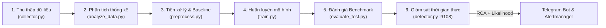

# Kế Hoạch Kiểm Thử Kênh Cảnh Báo Telegram & Quy Trình Vận Hành AI Anomaly Engine V3

> **Tài liệu tham chiếu:** `docs/progress/04_Telegram_test.md`  
> **Phiên bản:** `v2.0.0` (Cập nhật ngày 16/11/2026)  
> **Môi trường thực thi:** WSL2 Ubuntu (Kernel 6.6.x / Docker Engine & k3d)  
> **Mục tiêu:** Cung cấp tài liệu vận hành toàn diện kết hợp:
> 1. Quy trình huấn luyện, tiền xử lý và suy luận thời gian thực của **AI Anomaly Detection Engine V3** (`collector.py`, `preprocess.py`, `train.py`, `evaluate_test.py`, `detector.py`).
> 2. Kịch bản kiểm thử thực nghiệm chuỗi cảnh báo khép kín (Closed-Loop Alerting) từ Prometheus, Alertmanager, Robusta Runner và AI Engine V3 về Telegram.

---

## 1. Phân Tích Hiện Trạng & Khắc Phục Lỗi Kênh Telegram

Trước đó, hệ thống gặp tình trạng chưa nhận được thông báo tự động trên Telegram. Qua rà soát chi tiết, 3 nguyên nhân cốt lõi đã được tìm ra và xử lý triệt để:

| STT | Vấn đề phát hiện | Nguyên nhân kỹ thuật | Biện pháp đã xử lý triệt để | Trạng thái hiện tại |
| :---: | :--- | :--- | :--- | :---: |
| **1** | **Prometheus lỗi kết nối Notifier (404 Not Found)** | Cấu hình Prometheus trỏ trực tiếp sang `robusta-runner:5000`. Prometheus đẩy alert theo giao thức Alertmanager API v2 (`POST /api/v2/alerts`), trong khi Robusta Runner chỉ lắng nghe webhook tại `POST /api/alerts`. | Triển khai chính thức cụm **`Alertmanager v0.27.0`** (chuẩn SRP tại `k8s/base/alertmanager/`), làm trung gian tiếp nhận `/api/v2/alerts` từ Prometheus và bắn Webhook sang Robusta. | **ĐÃ HOÀN TẤT** (1/1 Running) |
| **2** | **Robusta Runner vấp lỗi thiếu đối tượng Pod** | Playbook cũ áp dụng `pod_events_enricher` cho mọi alert. Với các alert mức hạ tầng/WAN (như rớt mạng, mất nhịp tim), Robusta bị lỗi `cannot run pod_events_enricher on alert with no pod object` và hủy gửi tin. | Chuẩn hóa `k8s/base/smart-alerting-robusta/02-configmap-playbooks.yaml` sử dụng `default_enricher: {alert_annotations_enrichment: true}`, cho phép mọi loại cảnh báo đều được format đầy đủ. | **ĐÃ HOÀN TẤT** (1/1 Running) |
| **3** | **Lỗi Telegram Markdown 400 Bad Request từ AI Engine** | Hàm `send_alert` của AI Engine dùng `parse_mode: "Markdown"`, nhưng các nhãn metric và phân tích RCA chứa ký tự gạch dưới `_` (như `[CROSS_CLOUD_WAN_DELAY]`, `k8s_cluster_name`), khiến Telegram parse lỗi. | Cập nhật hàm `send_alert` trong `ai-engine/inference/detector.py` sang `parse_mode: "HTML"` với `html.escape()` và thẻ `<b>`, `<code>`. Đã xác thực gửi thành công về Chat ID `6018907300`. | **ĐÃ HOÀN TẤT** (Test Pass) |

---

## 2. Danh Mục 6 Quy Tắc Cảnh Báo (Prometheus & Alertmanager)

Hệ thống giám sát định lượng bằng 6 quy tắc cảnh báo vận hành chuẩn xác trên Prometheus & Alertmanager:

| Tên Rule (`alertname`) | Mức độ | Biểu thức PromQL cốt lõi | Ngưỡng chờ (`for`) | Mục đích & Đối tượng tác động |
| :--- | :---: | :--- | :---: | :--- |
| **`SpokePodCrashLooping`** | `critical` | `(rate(k8s_container_restarts_total[5m]) > 0) or (changes(process_uptime_seconds[5m]) > 2) or (increase(kube_pod_container_status_restarts_total[5m]) > 1)` | `60s` | Bắt lỗi Pod microservice khởi động lại liên tục (CrashLoopBackOff) trên cụm `aws-k3d` và `azure-k3d`. |
| **`SpokeClusterHeartbeatAbsent`** | `critical` | `absent(up{k8s_cluster_name="aws-k3d"} == 1) or absent(up{k8s_cluster_name="azure-k3d"} == 1)` | `120s` | Phát hiện đứt cáp quang WAN, sập mạng Docker bridge `mc-monitoring-net`, hoặc container OTel Collector tại Spoke bị ngừng. |
| **`CrossCloudWANLatencyDegraded`** | `high` | `histogram_quantile(0.99, sum by (le, server) (rate(traces_service_graph_request_server_seconds_bucket[2m]))) * 1000 > 1500` | `120s` | Bắt tình trạng nghẽn mạng WAN khi độ trễ P99 liên đám mây vượt mốc 1500ms do suy hao `tc netem` hoặc khóa bảng SQL. |
| **`MicroserviceHighErrorRate`** | `high` | `(sum by (server) (rate(traces_service_graph_request_failed_total[2m])) / (sum by (server) (rate(traces_service_graph_request_total[2m])) + 0.0001)) * 100 > 5` | `120s` | Phát hiện lỗi mã nguồn hoặc đứt kết nối cơ sở dữ liệu làm tỷ lệ lỗi HTTP 5xx vượt 5% trên đồ thị dịch vụ. |
| **`OTelCollectorMemoryHigh`** | `warning` | `sum by (pod) (container_memory_working_set_bytes{pod=~"otel-collector.*"}) > 4e+08` | `120s` | Cảnh báo sớm nguy cơ tràn RAM (`memory_limiter`) hoặc bị Linux OOMKilled khi collector sử dụng vượt 400MB. |
| **`AIOpsAnomalyDetected`** | `critical` | `ai_anomaly_likelihood_percent > 80` | `30s` | Nhận tín hiệu bất thường học sâu từ AI Detector V3 xuất qua cổng `:9108` khi xác suất suy thoái vượt 80%. |

---

## 3. Quy Trình Vận Hành & Huấn Luyện AI Anomaly Engine V3

Module AI Engine V3 hoạt động dựa trên cơ chế học sâu bán giám sát (**Semi-Supervised Deep Ensemble: GRU Autoencoder + TCN Autoencoder + Isolation Forest**) kết hợp chuẩn hóa Z-score theo từng thực thể (`EntityCalibrator`) và giải thuật bóc tách vết phân tán (`TempoTraceAnalyzer`).

Toàn bộ các lệnh dưới đây được thực thi trong môi trường **WSL2 Linux** tại thư mục gốc dự án:

```bash
cd /mnt/d/Workstation/HCMUS/Grade4/01_TTDATN_K23/Tuần\ 3/multicloud-monitoring
```



---

### Bước 3.1: Thu Thập Dữ Liệu Thực Thể Đa Đám Mây (`collector.py`)
Tự động khám phá các thực thể `(cloud_provider, service_name)` đang hoạt động từ Prometheus/Thanos bằng các truy vấn PromQL Vectorized, xuất ra tập dữ liệu chuỗi thời gian thô đa chiều:

```bash
# Thu thập 1200 giây (20 phút) dữ liệu bình thường với chu kỳ lấy mẫu 6 giây:
python3 ai-engine/data/collector.py \
  --duration 1200 \
  --interval 6 \
  --output ai-engine/data/raw/multicloud_entity_baseline.csv
```

---

### Bước 3.2: Phân Tích Thống Kê & Khám Phá Dữ Liệu (`analyze_data.py`)
Phân tích tương quan giữa các đặc trưng, kiểm tra phân phối dữ liệu và phát hiện các giá trị ngoại lai ban đầu:

```bash
python3 ai-engine/data/analyze_data.py
```
*Kết quả:* Xuất báo cáo [eda_report.md](file:///d:/Workstation/HCMUS/Grade4/01_TTDATN_K23/Tuần%203/multicloud-monitoring/ai-engine/data/processed/eda_report.md) và biểu đồ phân phối `eda_summary.png`.

---

### Bước 3.3: Tiền Xử Lý, Chuẩn Hóa Z-Score & Chia Tập Chống Rò Rỉ (`preprocess.py`)
Thực hiện chia dữ liệu theo thứ tự thời gian (`strict_chronological_per_entity_pre_windowing`) **trước khi** tính baseline để đảm bảo không rò rỉ dữ liệu (Zero Data Leakage):
- `entity_baselines.json`: Được fit **độc quyền** trên `train_df`.
- Tạo các cửa sổ trượt kích thước `12 x 8` (12 bước thời gian $\times$ 8 đặc trưng chuẩn).
- Tăng cường dữ liệu (Data Augmentation) có điều kiện vật lý riêng cho tập Train.

```bash
python3 ai-engine/data/preprocess.py --config ai-engine/configs/model_config.yaml
```

*Các tệp đầu ra tại `ai-engine/data/processed/`:*
- `train_windows.npy`: Cửa sổ chuỗi thời gian tập huấn luyện.
- `val_windows.npy`: Cửa sổ độc lập tập kiểm định (100% dữ liệu tương lai, 0 chồng lấn).
- `entity_baselines.json`: Tham số (Median, IQR, Scale-Floor) cho từng thực thể.
- `preprocess_summary.json`: Báo cáo tóm tắt cấu trúc ma trận đầu vào.

---

### Bước 3.4: Huấn Luyện Universal Deep Autoencoders & Isolation Forest (`train.py`)
Huấn luyện song song mô hình GRU Autoencoder, TCN Autoencoder và Isolation Forest trên dữ liệu chuẩn hóa, đồng thời tự động hiệu chỉnh ngưỡng MSE P99 và kiểm định xác suất rủi ro (`likelihood_pct`):

```bash
python3 ai-engine/training/train.py --config ai-engine/configs/model_config.yaml
```

*Các trọng số mô hình lưu tại `ai-engine/models/saved/`:*
- `gru_autoencoder.pt`: Trọng số tối ưu của GRU Autoencoder.
- `tcn_autoencoder.pt`: Trọng số tối ưu của TCN Autoencoder.
- `isolation_forest.joblib`: Mô hình cây cô lập 96 chiều.
- `threshold_config.json`: Ngưỡng quyết định bất thường (`recommended_threshold_p99 = 0.3500`) và trọng số suy giảm trễ.
- `training_report.md`: Báo cáo chi tiết độ hội tụ hàm mất mát SmoothL1 và điểm Brier Score.

---

### Bước 3.5: Hiệu Chỉnh Lại Tham Số Rủi Ro & Ngưỡng Quyết Định (`recalibrate.py` - Tùy chọn)
Khi chỉ cần điều chỉnh độ nhạy của xác suất cảnh báo mà không cần huấn luyện lại mạng nơ-ron:

```bash
OMP_NUM_THREADS=1 MKL_NUM_THREADS=1 python3 ai-engine/training/recalibrate.py
```

---

### Bước 3.6: Kiểm Thử Benchmark 11 Kịch Bản Chuẩn Hóa (`evaluate_test.py`)
Chạy bộ kiểm thử tự động trên tập dữ liệu tổng hợp và lịch sử để đánh giá độ chính xác phân loại (F1-Score, tỷ lệ báo động giả 0% trên traffic biến động và khả năng bắt đúng 100% khi có lỗi):

```bash
python3 ai-engine/inference/evaluate_test.py --benchmark
```

---

### Bước 3.7: Khởi Chạy Động Cơ Giám Sát Thời Gian Thực & Tempo RCA (`detector.py`)
Tiến trình Daemon chạy liên tục, thực hiện lấy mẫu định kỳ 6 giây, chuẩn hóa trực tuyến (`EntityCalibrator`), chạy suy luận Deep Ensemble, bóc tách vết phân tán trên Tempo và mở cổng exporter Prometheus `:9108`:

```bash
# Chạy daemon giám sát thời gian thực kèm cổng xuất metrics :9108
python3 ai-engine/inference/detector.py --interval 6 --metrics-port 9108
```

> **Ghi chú:** Khi phát hiện bất thường duy trì liên tục qua 3 chu kỳ đo (18 giây), `detector.py` sẽ tự động bắn tin nhắn trực tiếp kèm phân tích RCA ($T_{\text{WAN}}, T_{\text{self}}, T_{\text{DB}}$) về kênh Telegram.

---

## 4. Kịch Bản Kiểm Thử Thực Tế Gửi Cảnh Báo Tới Telegram

Các kịch bản sau đây sử dụng trực tiếp các Pod microservices và hạ tầng thật của hệ thống. Bạn có thể mở một terminal riêng để chạy `detector.py` hoặc chỉ kiểm tra các rule Prometheus.

---

### Kịch Bản 0: Smoke Test Kết Nối Trực Tiếp Tới Telegram
*Mục đích: Xác thực ngay lập tức bot token và Chat ID `6018907300` hoạt động bình thường từ Pod Robusta Runner.*

```bash
kubectl --context=k3d-hub-k3d -n monitoring exec deployment/robusta-runner -- python3 -c "
from robusta.core.sinks.telegram.telegram_client import TelegramClient
import os
client = TelegramClient(chat_id=os.environ.get('TELEGRAM_CHAT_ID'), thread_id=None, bot_token=os.environ.get('TELEGRAM_BOT_TOKEN'))
client.send_message('🔔 <b>[MultiCloud Observability]</b> Smoke Test kiểm tra kết nối Telegram thành công 100%!')
print('Đã gửi tin nhắn thành công!')
"
```

* **Kết quả kỳ vọng:** Nhận tin nhắn thông báo trên Telegram ngay lập tức.

---

### Kịch Bản 1: Giả Lập Pod Khởi Động Lại Liên Tục (`SpokePodCrashLooping`)
*Mục đích: Bắt lỗi Pod microservice bị crash liên tục ngay trên cụm `aws-k3d`.*

1. **Kích hoạt sự cố (Tạo Pod lỗi crash liên tục trên `aws-k3d`):**
   ```bash
   kubectl --context=k3d-aws-k3d -n teastore run crash-test-pod \
     --image=busybox:1.36 \
     --restart=Always -- /bin/sh -c "sleep 2; exit 1"
   ```

2. **Quan sát quá trình đánh giá:**
   - Pod `crash-test-pod` sẽ khởi động lại nhiều lần (`CrashLoopBackOff`).
   - Sau khoảng **60 giây**, biểu thức `rate(k8s_container_restarts_total[5m]) > 0` thỏa mãn.
   - Prometheus chuyển rule sang **FIRING** $\to$ chuyển qua Alertmanager $\to$ Robusta Runner.

3. **Kết quả kỳ vọng trên Telegram:**
   - Nhận thẻ cảnh báo: `🚨 FIRING: SpokePodCrashLooping`
   - Nhãn đi kèm: `k8s_cluster_name="aws-k3d"`, `namespace="teastore"`, `pod="crash-test-pod"`.

4. **Khôi phục & Dọn dẹp:**
   ```bash
   kubectl --context=k3d-aws-k3d -n teastore delete pod crash-test-pod
   ```

---

### Kịch Bản 2: Tắt Dịch Vụ CSDL Gây Lỗi HTTP 5xx Dây Chuyền (`MicroserviceHighErrorRate`)
*Mục đích: Kiểm tra phát hiện tỷ lệ lỗi giao dịch vi dịch vụ $> 5\%$ từ đồ thị dịch vụ OTel (`servicegraphconnector`).*

1. **Kích hoạt sự cố (Hạ Pod `teastore-persistence` trên `azure-k3d` về 0):**
   ```bash
   kubectl --context=k3d-azure-k3d -n teastore scale deployment teastore-persistence --replicas=0
   ```

2. **Tạo tải truy cập vào WebUI trên `aws-k3d` trong khoảng 2 phút:**
   ```bash
   for i in {1..40}; do
     curl -s -o /dev/null -w "%{http_code}\n" "http://localhost:8080/tools.descartes.teastore.webui/category?page=1&category=2"
     sleep 3
   done
   ```

3. **Kết quả kỳ vọng trên Telegram (sau ~120 giây):**
   - Nhận cảnh báo: `🚨 FIRING: MicroserviceHighErrorRate`
   - Mô tả lỗi: Tỷ lệ request thất bại vượt ngưỡng 5% trên dịch vụ `teastore-webui` hoặc `teastore-persistence`.

4. **Khôi phục hệ thống:**
   ```bash
   kubectl --context=k3d-azure-k3d -n teastore scale deployment teastore-persistence --replicas=1
   ```

---

### Kịch Bản 3: Ngắt Kết Nối Viễn Trắc Spoke Về Hub (`SpokeClusterHeartbeatAbsent`)
*Mục đích: Giả lập đứt cáp mạng WAN hoặc sập Agent thu thập viễn trắc tại cụm `aws-k3d`.*

1. **Kích hoạt sự cố (Hạ `otel-collector-spoke` trên `aws-k3d` về 0):**
   ```bash
   kubectl --context=k3d-aws-k3d -n monitoring scale deployment otel-collector-spoke --replicas=0
   ```

2. **Kết quả kỳ vọng trên Telegram (sau ~120 giây):**
   - Nhận cảnh báo cấp độ Critical: `🚨 FIRING: SpokeClusterHeartbeatAbsent`
   - Chi tiết: Mất tín hiệu nhịp tim `up{k8s_cluster_name="aws-k3d"}` trong 2 phút.

3. **Khôi phục hệ thống:**
   ```bash
   kubectl --context=k3d-aws-k3d -n monitoring scale deployment otel-collector-spoke --replicas=1
   ```
   *(Sau ~1 phút, Telegram sẽ nhận tiếp tin nhắn xanh `[RESOLVED] SpokeClusterHeartbeatAbsent`).*

---

### Kịch Bản 4: Tiêm Trễ Mạng WAN 2000ms (`CrossCloudWANLatencyDegraded`)
*Mục đích: Kiểm tra phát hiện suy hao đường truyền mạng diện rộng khi trễ P99 vượt ngưỡng 1500ms.*

1. **Tiêm độ trễ 2000ms lên card mạng của node `azure-k3d`:**
   ```bash
   docker exec k3d-azure-k3d-server-0 tc qdisc change dev eth0 root netem delay 2000ms 50ms loss 5%
   ```

2. **Sinh lưu lượng truy cập xuyên cụm:**
   ```bash
   for i in {1..30}; do
     curl -s "http://localhost:8080/tools.descartes.teastore.webui/category?page=1&category=2" > /dev/null
     sleep 2
   done
   ```

3. **Kết quả kỳ vọng trên Telegram (sau ~120 giây):**
   - Nhận cảnh báo: `🚨 FIRING: CrossCloudWANLatencyDegraded`
   - Chi tiết: Độ trễ P99 xuyên cụm giữa `aws-k3d` và `azure-k3d` vượt ngưỡng 1500ms.

4. **Khôi phục đường truyền mạng WAN về cấu hình baseline chuẩn (10ms ± 2ms):**
   ```bash
   docker exec k3d-azure-k3d-server-0 tc qdisc change dev eth0 root netem delay 10ms 2ms distribution normal loss 0.1%
   ```

---

### Kịch Bản 5: Kiểm Thử AI Anomaly Engine V3 & Phân Rã Vết Tempo RCA (`AIOpsAnomalyDetected`)
*Mục đích: Kiểm tra khả năng phát hiện "suy thoái mềm" của AI (trễ WAN 180ms — mức chưa chạm ngưỡng cứng 1500ms của Prometheus nhưng đã vượt xa baseline bình thường 10ms) và tự động bóc tách RCA.*

1. **Khởi chạy AI Detector Daemon (trên một cửa sổ terminal riêng):**
   ```bash
   python3 ai-engine/inference/detector.py --interval 6 --metrics-port 9108
   ```

2. **Tiêm suy hao mạng WAN 180ms vào node `azure-k3d` và tạo tải:**
   ```bash
   docker exec k3d-azure-k3d-server-0 tc qdisc change dev eth0 root netem delay 180ms 15ms
   for i in {1..25}; do
     curl -s "http://localhost:8080/tools.descartes.teastore.webui/category?page=1&category=2" > /dev/null
     sleep 2
   done
   ```

3. **Kết quả kỳ vọng trên Telegram (sau ~18 – 30 giây):**
   - **Kênh 1 (Tin nhắn trực tiếp từ AI Engine Sink):** Nhận thông báo định dạng HTML:
     ```
     🚨 [AI-OPS ALERT] Multi-Cloud Anomaly Detected
     ━━━━━━━━━━━━━━━━━━━━━━━━━━
     📍 Target Entity: azure:teastore-persistence
     📊 Likelihood: 94.2% (MSE: 0.8124)
     ⚡ Verdict: ALERT (Sustained Anomaly)

     🔍 Root Cause Evidence (RCA):
       • [CROSS_CLOUD_WAN_DELAY] Severe cross-cloud transit lag detected

     ⏱️ Tempo Trace Decomposition:
       • Cross-Cloud WAN Lag: 184.5ms
       • Microservice Self-Exec: 12.3ms
       • Database Query Time: 8.4ms
     ━━━━━━━━━━━━━━━━━━━━━━━━━━
     💡 Recommendation: Inspect edge WAN shaping or database slow queries.
     ```
   - **Kênh 2 (Kênh Prometheus/Alertmanager):** Khi metric `ai_anomaly_likelihood_percent > 80` tại cổng `:9108`, rule `AIOpsAnomalyDetected` sẽ bắn tiếp cảnh báo từ Alertmanager sang Robusta.

4. **Khôi phục mạng WAN:**
   ```bash
   docker exec k3d-azure-k3d-server-0 tc qdisc change dev eth0 root netem delay 10ms 2ms distribution normal loss 0.1%
   ```

---

## 5. Lệnh Giám Sát, Gỡ Lỗi & Quản Lý Cảnh Báo Nhanh (Cheatsheet)

| Nhu cầu thao tác | Lệnh thực thi trong terminal WSL Linux |
| :--- | :--- |
| **Xem log webhook của Robusta Runner** | `kubectl --context=k3d-hub-k3d -n monitoring logs deployment/robusta-runner -f` |
| **Xem log của Alertmanager** | `kubectl --context=k3d-hub-k3d -n monitoring logs deployment/alertmanager -f` |
| **Mở giao diện Web Alertmanager UI (:9093)** | `kubectl --context=k3d-hub-k3d -n monitoring port-forward svc/alertmanager 9093:9093` |
| **Kiểm tra trạng thái các Alert trên Prometheus** | Mở trình duyệt tại `http://localhost:9090/alerts` |
| **Kiểm tra metric xuất ra của AI Engine (:9108)** | `curl -s http://localhost:9108/metrics \| grep ai_` |
| **Kiểm tra cấu hình tc netem hiện tại trên node** | `docker exec k3d-azure-k3d-server-0 tc qdisc show dev eth0` |
