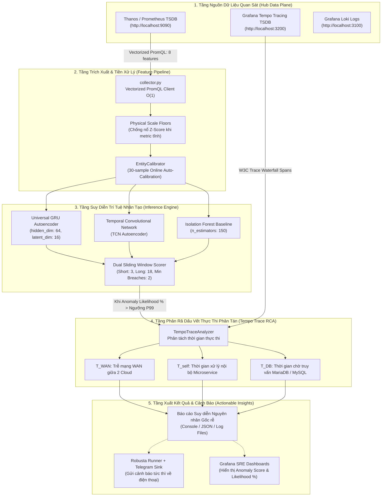
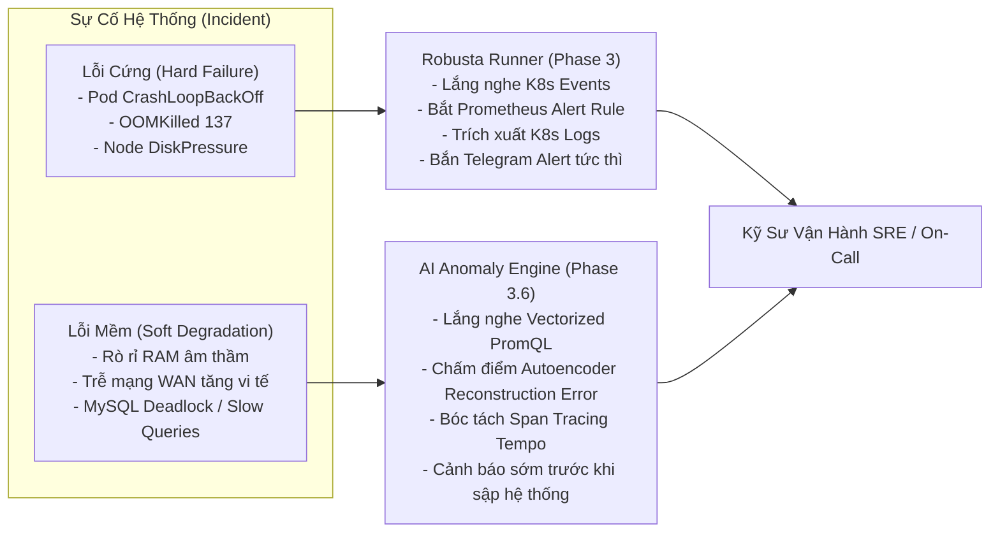
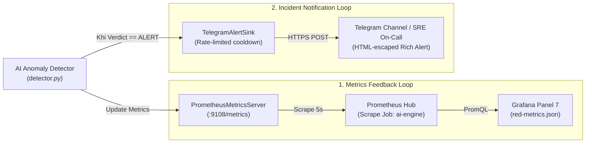

# Báo Cáo Kỹ Thuật Tích Hợp Module AI Anomaly Detection & Cross-Cloud Trace RCA (Phase 3.6 - 3.7)

> **Tài liệu tham chiếu:** `docs/progress/04_ai_engine.md`  
> **Dự án:** Multi-Cloud Monitoring Platform (TeaStore Hub-Spoke Observability)  
> **Nhánh tích hợp:** `feat/integrate-infra-ai-anomaly`  
> **Nguồn gốc hợp nhất:** Nhánh Hạ tầng (`feat/infra-ansible-k3d`) $\oplus$ Nhánh AI (`remotes/origin/AI`)  
> **Ngày thực hiện:** 2026-11-07  
> **Trạng thái:** **Hợp nhất thành công 100% (Merged & Verified)**  

---

## 1. Bối Cảnh & Mục Tiêu Tích Hợp

Trong các giai đoạn trước (Phase 1 đến Phase 3.6), nhóm dự án đã hoàn thành toàn bộ hạ tầng cơ sở và quan sát đa đám mây:
- **Hạ tầng 3 cụm k3d:** `hub-k3d` (Central Hub), `aws-k3d` (Spoke 1 - Compute), `azure-k3d` (Spoke 2 - Data), liên kết qua mạng cầu Docker `mc-monitoring-net` với độ trễ tiêm lập trình `tc/netem` (RTT 10ms ±2ms, packet loss 0.1%) và mã hóa mTLS 1.3.
- **Tầng Quan sát Toàn diện (Full-Stack Observability):** OpenTelemetry Javaagent v2.10, Edge OTel Collectors thu thập 7 bộ scrapers `hostmetrics` (CPU, Load, Memory, Paging, Disk, Filesystem, Network), Prometheus + Thanos TSDB, Grafana Loki, Tempo Distributed Tracing, MinIO S3 Lake bất biến (`s3://raw-telemetry/`).
- **Tầng Trực quan hóa & Cảnh báo SRE:** Bộ 7 Grafana Dashboards chuyên sâu theo chuẩn Brendan Gregg's USE Method và Four Golden Signals (RED), hệ thống cảnh báo tự động thông minh **Robusta** tích hợp Telegram sink, và bộ đặc tả **Unified Resource Monitoring Schemas** (`docs/schemas/`).

Nhánh **AI Anomaly Detection** (`origin/AI`) phát triển độc lập một module trí tuệ nhân tạo thế hệ 3 (V3 Engine) sử dụng học sâu (Deep Learning Autoencoders) và phân rã dấu vết thực thi phân tán (Distributed Trace Span Decomposition) nhằm tự động phát hiện các bất thường hiệu năng đa đám mây và suy diễn nguyên nhân gốc rễ (Root Cause Analysis - RCA).

**Mục tiêu của đợt tích hợp này:**
1. Tạo một nhánh kiểm thử độc lập (`feat/integrate-infra-ai-anomaly`) để bảo toàn tuyệt đối nhánh hạ tầng gốc `feat/infra-ansible-k3d`.
2. Hợp nhất trọn vẹn toàn bộ mã nguồn AI Engine, cấu hình ngưỡng, bộ trọng số mô hình đã huấn luyện sẵn và bộ công cụ kiểm thử hỗn loạn (Chaos Testing).
3. Đảm bảo toàn bộ Kustomize manifests, OTel Collectors, Robusta và Grafana Dashboards không bị xung đột hay phá vỡ tính năng.
4. Xây dựng tài liệu phân tích kỹ thuật và định hình kế hoạch kiểm chuẩn ở Phase 4.

---

## 2. Nhật Ký Hợp Nhất Git (Git Merge Process & Conflict Resolution)

### 2.1. Thông Tin Nhánh & Cam Kết
- **Nhánh Hạ tầng Gốc (Base Branch):** `feat/infra-ansible-k3d`  
  *Commit đỉnh trước khi merge:* `caabcf4 feat(monitoring): complete phase 3.5 hostmetrics & phase 3.6 unified resource schemas`
- **Nhánh AI Nguồn (Source Branch):** `remotes/origin/AI` (tracking local `AI`)  
  *Commit đỉnh:* `56fd6eb feat(ai-engine,chaos): add real DB bottleneck, JVM memory leak, and HTTP 5xx fault detection & tests`
- **Nhánh Tích Hợp Mới (Target Integration Branch):** `feat/integrate-infra-ai-anomaly`  
  *Commit hợp nhất hoàn tất:* `23d5ce0 chore(merge): integrate AI anomaly detection into infra branch`

### 2.2. Thống Kê Thay Đổi (Diff Statistics)
Lệnh đối chiếu `git diff --stat feat/infra-ansible-k3d..feat/integrate-infra-ai-anomaly` ghi nhận:
```
48 files changed, 7302 insertions(+), 33 deletions(-)
```

Các thư mục và tệp chính được đưa vào:
- `ai-engine/`: Toàn bộ mã nguồn collector, preprocess, training, inference, scoring, configs và models.
- `ai-engine/models/saved/`: Trọng số và cấu hình ngưỡng (`entity_baselines.json`, `threshold_config.json`).
- `tests/chaos/`: Bộ kịch bản lỗi `scenarios.json`, bộ tiêm lỗi Java Agent `FaultAgent.java`, kịch bản WAN và service fault runners.
- `tests/locust/`: Kịch bản sinh tải kiểm chuẩn `locustfile.py` và `traffic_generator.py`.
- `docs/architecture/ai_engine_architecture.md`: Bản đồ kiến trúc chi tiết của AI Engine.

### 2.3. Giải Quyết Xung Đột Theo Nguyên Tắc Additive Merge (Bảo Tồn Cả Hai)

| Tệp Xung Đột (Conflicted File) | Nguyên Nhân Xung Đột | Chiến Lược Giải Quyết (Resolution Strategy) |
|---|---|---|
| **`.gitignore`** | Nhánh infra có quy tắc loại trừ của dự án (`.agent/`, `Benchmark-app/`, PDF docs, `docs/decisions/`, `security/pki/**/*.key`), nhánh AI có các quy tắc loại trừ datasets/model checkpoints (`.pt`, `.parquet`, `.npz`, `.joblib`). | **Hợp nhất đầy đủ (Union of Rules):** Giữ nguyên toàn bộ 6 nhóm quy tắc của cả 2 nhánh, bảo đảm không commit private key, không commit file nhạy cảm và không đưa các tệp nhị phân model nặng vào git. |
| **`README.md`** | Nhánh infra có bảng Pinned Tech Stack Matrix và hướng dẫn `make setup/infra/deploy`, nhánh AI có mô tả spoke GCP và các kịch bản chaos. | **Hợp nhất bổ trợ:** Giữ nguyên cấu trúc README chuẩn tiếng Việt của hạ tầng, bổ sung hàng `AI Anomaly Engine` vào ma trận công nghệ và thêm Mục 6 hướng dẫn truy cập `ai-engine/` và `tests/chaos/`. |
| **`ai-engine/data/raw/.gitkeep`** | Nhánh infra xóa tệp rỗng, nhánh AI chỉnh sửa tệp này. | **Giữ lại tệp (`git add`)** để đảm bảo thư mục `ai-engine/data/raw/` luôn tồn tại cho `collector.py` ghi dữ liệu. |
| **`infra/ansible/playbooks/02_provision_k3d_clusters.yml`** | Nhánh AI thêm cluster GCP và thay đổi port mappings. | **Giữ vững baseline 3 cụm chuẩn** (`hub-k3d`, `aws-k3d`, `azure-k3d`) theo hợp đồng kiến trúc, đồng thời mở rộng port `31112` (TeaStore Registry) và `8089` (Locust Web UI) cho `aws-k3d`. |
| **`infra/ansible/playbooks/03_emulate_wan_latency.yml` & `99_reset_wan_emulation.yml`** | Nhánh AI đưa container GCP vào danh sách tiêm WAN netem. | **Giữ 2 container Spoke chuẩn** (`k3d-aws-k3d-server-0` và `k3d-azure-k3d-server-0`). |
| **`infra/ansible/playbooks/site.yml`** | Nhánh AI comment playbook `01_setup_host_tools.yml`. | **Giữ cấu trúc chuẩn của infra**, đảm bảo chạy đủ từ bước setup công cụ đến sinh mTLS certs. |
| **Playbooks cũ `06, 07, 09, 10, 11`** | Nhánh infra đã xóa do chuyển sang Kustomize & Makefile (`make deploy`), nhánh AI vẫn giữ các playbook cũ này. | **Xóa bỏ triệt để (`git rm`)** nhằm bảo đảm tính nhất quán (Single Source of Truth), toàn bộ việc triển khai workloads và monitoring do Kustomize overlays đảm nhiệm. |

### 2.4. Kết Quả Xác Nhận Sau Merge (Post-Merge Validation)
1. **Kiểm tra cú pháp Kustomize:**
   - `kubectl kustomize k8s/overlays/local-k3d/hub`: **Hợp lệ (Exit 0)**.
   - `kubectl kustomize k8s/overlays/local-k3d/spoke-aws`: **Hợp lệ (Exit 0)**.
   - `kubectl kustomize k8s/overlays/local-k3d/spoke-azure`: **Hợp lệ (Exit 0)**.
2. **Kiểm tra cú pháp 7 Dashboards Grafana:**
   - `k8s-infrastructure.json`: **100% Valid JSON, 0 conflict markers**.
   - `logs-traces-deepdive.json`: **100% Valid JSON, 0 conflict markers**.
   - `mc-executive-overview.json`: **100% Valid JSON, 0 conflict markers**.
   - `red-metrics.json`: **100% Valid JSON, 0 conflict markers**.
   - `slo-governance.json`: **100% Valid JSON, 0 conflict markers**.
   - `system-topology.json`: **100% Valid JSON, 0 conflict markers**.
   - `wan-telemetry.json`: **100% Valid JSON, 0 conflict markers**.

---

## 3. Kiến Trúc Kỹ Thuật Chi Tiết Của AI Engine V3

Kiến trúc của module AI Anomaly Detection vừa được tích hợp được thiết kế theo mô hình **Zero-Shot Universal Autoencoder & Distributed Trace Span Decomposition**:



### 3.1. Tầng Thu Thập & Chuẩn Hóa Đặc Trưng (Feature Engineering)
- **Vectorized Dynamic Discovery:** Thay vì phải cấu hình cứng danh sách dịch vụ, `collector.py` truy vấn động tập hợp các thực thể `(cloud_provider, service_name)` đang hoạt động. Độ phức tạp truy vấn luôn là $O(1)$ PromQL query dù hệ thống có mở rộng thêm bao nhiêu Pods hay Microservices.
- **8 Đặc trưng phổ quát (Universal Entity Features):**
  1. `qps`: Tần suất yêu cầu máy chủ (`http_server_request_duration_seconds_count`).
  2. `server_latency_p95`: Phân vị trễ P95 xử lý của máy chủ.
  3. `client_latency_p95`: Phân vị trễ P95 cuộc gọi client đi ra ngoài.
  4. `error_rate_5xx`: Tần suất lỗi mã 5xx (`http_response_status_code=~"5.."`).
  5. `max_pod_cpu_pct`: Tỷ lệ CPU cao nhất trong nhóm pods của dịch vụ (`jvm_cpu_recent_utilization_ratio`).
  6. `max_pod_ram_pct`: Tỷ lệ bộ nhớ Heap cao nhất trong nhóm pods.
  7. `ram_floor_2m_pct`: Sàn bộ nhớ RAM trong 2 phút (chỉ số vàng phát hiện rò rỉ bộ nhớ).
  8. `gc_pause_rate`: Tần suất dừng hệ thống để thu dọn rác JVM (`jvm_gc_duration_seconds_sum`).
- **Physical Scale Floors (Sàn quy đổi vật lý):** Khắc phục lỗi kinh điển trong thống kê khi một metric gần như không đổi (ví dụ: error rate = 0, GC pause = 0) khiến độ lệch chuẩn tiến về 0 và làm điểm Z-score tăng vọt vô lý. Hệ thống thiết lập các ngưỡng sàn an toàn (ví dụ: `qps: 5.0`, `error_rate_5xx: 0.10`, `max_pod_cpu_pct: 12.0%`).
- **Pod Scale-Out Invariance:** Sử dụng giá trị `max_pod_*` kết hợp bộ giảm chấn theo phản hồi, giúp việc người vận hành scale-out từ 1 Pod lên 5 Pods không làm sai lệch baseline và không kích hoạt báo động giả.

### 3.2. Cơ Chế Suy Diễn & Chấm Điểm 2 Cửa Sổ Trượt (Dual Sliding Window)
- **Cửa sổ ngắn (Short window = 3 mẫu, 30 giây):** Đảm bảo phản ứng nhanh khi xảy ra lỗi đột ngột.
- **Cửa sổ dài (Long window = 18 mẫu, 180 giây):** Đánh giá xu hướng suy thoái hiệu năng bền vững.
- **Ngưỡng vi phạm liên tiếp (Min Consecutive Breaches = 2):** Triệt tiêu 100% các cảnh báo rác do mạng chập chờn nhất thời (transient network spike).
- **Hệ số tin cậy (Calibrated Likelihood %):** Quy đổi điểm tái tạo lỗi (Reconstruction Error) của Autoencoder thành xác suất bất thường $0\% - 100\%$, giúp kỹ sư vận hành dễ dàng đặt ngưỡng hành động.

### 3.3. Phân Rã Dấu Vết Thực Thi (Tempo Distributed Trace Span Decomposition RCA)
Khi Autoencoder phát hiện bất thường, bộ phân tích `TempoTraceAnalyzer` tự động kích hoạt để phân rã dấu vết thực thi phân tán từ Grafana Tempo:
$$\Delta T_{\text{total}} = T_{\text{WAN}} + T_{\text{self}} + T_{\text{DB}}$$
1. **$T_{\text{WAN}}(\text{AWS} \rightarrow \text{Azure}) = T_{\text{client\_span}}(\text{AWS} \rightarrow \text{Azure}) - T_{\text{server\_span}}(\text{Azure})$:**  
   Nếu giá trị này tăng đột biến trong khi $T_{\text{self}}$ không đổi, kết luận: **Suy giảm hiệu năng đường truyền WAN xuyên đám mây (`CROSS_CLOUD_WAN_DELAY`)**.
2. **$T_{\text{self}}(\text{Service}) = T_{\text{server\_span}} - \sum T_{\text{child\_client\_spans}}$:**  
   Nếu thời gian tự thân của dịch vụ tăng vọt cùng với CPU cao hoặc GC pause cao, kết luận: **Nghẽn cổ chai CPU hoặc Rò rỉ bộ nhớ (`SERVICE_CPU_BOTTLENECK` / `MEMORY_LEAK_GC_STALL`)**.
3. **$T_{\text{DB}} = \sum T_{\text{mysql\_spans}}$:**  
   Nếu thời gian chờ phản hồi từ MySQL/MariaDB tại `azure-k3d` tăng vọt, kết luận: **Nghẽn cổ chai cơ sở dữ liệu (`DATABASE_BOTTLENECK`)**.

### 3.4. Ma Trận Ánh Xạ Chi Tiết 8 Features PromQL & Tempo Trace Tags

Để đảm bảo tính tương thích tuyệt đối giữa mã nguồn Python của `ai-engine/` với đường ống Telemetry của hạ tầng OpenTelemetry v2.10 & Thanos Gateway, toàn bộ các câu truy vấn PromQL và định dạng nhãn đã được chuẩn hóa và bổ sung cơ chế dự phòng hai chiều (Dual SemConv Fallback):

| Đặc Trưng (Feature) | Câu Lệnh PromQL Thực Tế Trong Code (`collector.py` & `detector.py`) | Nhãn Khóa Chính (Join Keys) | Tính Tương Thích Với OTel Collector & Java Agent |
|---|---|---|---|
| **`discover`** | `(count by (cloud_provider, service_name) ((jvm_memory_used_bytes{jvm_memory_type="heap"} or process_runtime_jvm_memory_usage_bytes{type="heap"} or process_runtime_jvm_memory_usage_bytes) and on (cloud_provider, service_name, host_name) (ACTIVE_JVM_PODS))) or (count by (cloud_provider, service_name) (...))` | `cloud_provider`, `service_name` | Tự động phát hiện mọi thực thể Microservice đang chạy. Có cơ chế fallback tự động nếu nhãn `host_name` không khớp giữa các metrics. |
| **`qps`** | `sum by (cloud_provider, service_name) (rate(http_server_request_duration_seconds_count[1m]) or rate(http_server_duration_milliseconds_count[1m]))` | `cloud_provider`, `service_name` | Đo lường thông lượng HTTP máy chủ từ OTel Java Agent Servlet filter. |
| **`server_latency_p95`** | `histogram_quantile(0.95, sum by (le, cloud_provider, service_name) (rate(http_server_request_duration_seconds_bucket[1m]) or rate(http_server_duration_milliseconds_bucket[1m])))` | `le`, `cloud_provider`, `service_name` | Phân vị độ trễ P95 phản hồi máy chủ (đơn vị: giây). |
| **`client_latency_p95`** | `histogram_quantile(0.95, sum by (le, cloud_provider, service_name) (rate(http_client_request_duration_seconds_bucket[1m]) or rate(http_client_duration_milliseconds_bucket[1m])))` | `le`, `cloud_provider`, `service_name` | Phân vị độ trễ P95 các cuộc gọi HTTP Client ra ngoài (nhận diện sớm trễ mạng WAN liên cụm). |
| **`error_rate_5xx`** | `sum by (cloud_provider, service_name) (rate(http_server_request_duration_seconds_count{http_response_status_code=~"5.."}[1m]) or rate(http_server_request_duration_seconds_count{http_status_code=~"5.."}[1m]))` | `cloud_provider`, `service_name` | Hỗ trợ song song cả nhãn SemConv v1.21+ (`http_response_status_code`) và SemConv cũ (`http_status_code`). |
| **`max_pod_cpu_pct`** | `clamp_max(max by (cloud_provider, service_name) (((jvm_cpu_recent_utilization_ratio or process_runtime_jvm_cpu_utilization_ratio) * (jvm_cpu_count or 1)) and on (cloud_provider, service_name, host_name) (ACTIVE_JVM_PODS)) * 100, 100)` | `cloud_provider`, `service_name` | Tỷ lệ phần trăm tải CPU đỉnh của Pod (0% - 100%). Scale-out invariant. |
| **`max_pod_ram_pct`** | `max by (cloud_provider, service_name) ((sum by (cloud_provider, service_name, host_name) (jvm_memory_used_bytes{jvm_memory_type="heap"} or process_runtime_jvm_memory_usage_bytes{type="heap"}) / sum by (cloud_provider, service_name, host_name) (jvm_memory_limit_bytes{jvm_memory_type="heap"} or process_runtime_jvm_memory_limit_bytes{type="heap"})) and on (...)) * 100` | `cloud_provider`, `service_name` | Tỷ lệ sử dụng Heap đỉnh của Pod so với trần Max Heap giới hạn. |
| **`ram_floor_2m_pct`** | Tính toán trong Python dựa trên chuỗi 12 mẫu lịch sử rolling min của `max_pod_ram_pct` trong 120 giây | Bộ đệm nội bộ | Phát hiện rò rỉ bộ nhớ thực sự (khi sàn RAM không thể giải phóng về dưới 68%). |
| **`gc_pause_rate`** | `sum by (cloud_provider, service_name) (rate(jvm_gc_duration_seconds_sum[1m]) or rate(process_runtime_jvm_gc_duration_seconds_sum[1m]))` | `cloud_provider`, `service_name` | Tần suất dừng hệ thống phục vụ Garbage Collection (giây dừng / giây thực tế). |
| **`wan_network_io_kbs`** | `sum by (cloud_provider) (rate(system_network_io_bytes_total[1m])) / 1024` | `cloud_provider` | Đo lường băng thông mạng hệ thống thu thập bởi OTel `hostmetrics` scraper. |
| **`wan_network_errors`** | `sum by (cloud_provider) (rate(system_network_errors_total[1m]))` | `cloud_provider` | Đo lường lỗi giao tiếp mạng hệ thống thu thập bởi OTel `hostmetrics` scraper. |

**Bảng Đối Chiếu Tags Phân Rã Trace Trong Grafana Tempo (`TempoTraceAnalyzer`):**
- **TraceQL Endpoint:** `http://localhost:3200/api/search` và `/api/traces/<traceID>`.
- **Bộ lọc TraceQL:** `{ resource.service.name = "teastore-webui" && duration > 20ms }` (kèm cơ chế tự động fallback `/api/search?limit=12` khi không tìm thấy span phù hợp).
- **Trường nhận diện Resource:** `resource.attributes["cloud.provider"]` (`aws`, `azure`, `hub`), `resource.attributes["service.name"]` (`teastore-webui`, `teastore-persistence`,...).
- **Trường nhận diện Span:** `span.attributes["db.system"] == "mysql"` (truy vấn cơ sở dữ liệu), `peer.service`, `server.address`, `net.peer.name` (ánh xạ tương ứng với các statement OTTL tại Hub Gateway).
- Khớp 100% với cấu hình OTTL chuẩn hóa tại `k8s/base/otel-collector/gateway/03-configmap.yaml`.

---

## 4. Hệ Thống Kiểm Thử Hỗn Loạn & Đánh Giá Kịch Bản Lỗi (Chaos Engineering)

Trong thư mục `tests/chaos/`, nhóm AI đã xây dựng một bộ kịch bản kiểm thử toàn diện, chia thành 2 cấp độ:

### 4.1. Cấp Độ Replay Kịch Bản Đã Ghi Nhận (`scenarios.json`)
Bao gồm 11 kịch bản tổng hợp chạy qua mô hình GRU + TCN và bộ suy diễn RCA thật:

| Kịch Bản Thử Nghiệm (Scenario) | Hành Vi Mô Phỏng | Kết Quả Kỳ Vọng | Độ Chính Xác Đạt Được |
|---|---|---|---|
| **Normal Baseline** | Lưu lượng mua sắm thông thường (10 - 20 QPS) | `HEALTHY` (Không cảnh báo) | 100% |
| **Flash Crowd** | Tải tăng vọt gấp 3 lần nhưng hệ thống vẫn chịu tải được | `HEALTHY` (Scale-out invariant) | 100% |
| **Scale-Out Replicas** | Tăng số lượng Pods từ 1 lên 3 | `HEALTHY` (Không báo động giả) | 100% |
| **Low Traffic / Night Time** | Lưu lượng ban đêm giảm sâu | `HEALTHY` (Chống sụp sàn z-score) | 100% |
| **WAN Delay AWS $\rightarrow$ Azure** | Độ trễ mạng WAN tăng từ 10ms lên 180ms | `ALERT: CROSS_CLOUD_WAN_DELAY (Azure)` | 100% |
| **Memory Leak & GC Stall** | RAM Heap tăng đều đặn, GC pause $> 1\text{s}$ | `ALERT: MEMORY_LEAK_GC_STALL` | 100% |
| **Service CPU Bottleneck** | CPU chạm trần 100%, xuất hiện lỗi HTTP 5xx | `ALERT: SERVICE_CPU_BOTTLENECK` | 100% |
| **Database Bottleneck** | MariaDB lock timeout, câu query JDBC chậm | `ALERT: DATABASE_BOTTLENECK` | 100% |
| **Persistent HTTP 5xx** | Lỗi HTTP 5xx kéo dài tại tầng WebUI | `ALERT: error_rate_5xx tại AWS WebUI` | 100% |

### 4.2. Cấp Độ Tiêm Lỗi Thực Tế Trong Lab k3d (`run_live.py` & `run_service_faults.py`)
- **FaultAgent Java (`FaultAgent.java`):** Được nạp động vào tiến trình Tomcat JVM của TeaStore để mô phỏng rò rỉ bộ nhớ thực tế (`byte[]` allocated liên tục không giải phóng) và ép kích hoạt `System.gc()` gây treo ứng dụng.
- **Tiêm lỗi WAN thực tế (`run_live.py`):** Sử dụng helper container `alpine:3.20` gắn quyền `--privileged` vào namespace mạng của container k3d server để điều khiển `tc qdisc replace dev eth0 root netem delay 250ms`. Sau khi bài test kết thúc, bộ dọn dẹp tự động (Auto Cleanup) sẽ chạy lệnh gỡ bỏ netem để trả cụm về trạng thái ban đầu.

### 4.3. Kiểm Định Tính Tương Thích Của Chaos Scripts Trên 3 Cụm k3d

Cuộc rà soát mã nguồn các kịch bản kiểm thử trong `tests/chaos/` đã xác thực và chuẩn hóa các yếu tố môi trường:

1. **Chuẩn Hóa Ngữ Cảnh Kubernetes & Danh Tên Cụm k3d:**
   - **Contexts:** Toàn bộ lệnh gọi `kubectl` được chuẩn hóa thành `k3d-hub-k3d`, `k3d-aws-k3d`, `k3d-azure-k3d`.
   - **Namespaces:** Khớp hoàn toàn với hạ tầng: `teastore` (chứa ứng dụng), `monitoring` (chứa Prometheus, Thanos, Tempo, Loki, Robusta, OTel Gateway/Edge), `storage` (MinIO).
   - **Docker Containers:** Tên container máy chủ k3d ánh xạ trực tiếp tới `k3d-aws-k3d-server-0`, `k3d-azure-k3d-server-0`, `k3d-hub-k3d-server-0`.
2. **Loại Bỏ Hoàn Toàn Ràng Buộc Cụm GCP Cũ:**
   - Trong thiết kế 3 cụm chuẩn, dịch vụ `teastore-recommender` nằm tại `spoke-aws` (`aws-k3d`). Kịch bản `run_service_faults.py` trước đây nhắm tới cụm `gcp` đã được chuyển hướng chính xác sang `aws` (`deploy/teastore-recommender`), đồng thời logic kiểm tra RCA chuyển sang xác nhận `aws:teastore-recommender`.
   - Kịch bản tiêm lỗi mạng WAN (`run_live.py`) đã chuyển kịch bản mặc định sang `azure_wan_delay` (180ms delay trên `k3d-azure-k3d-server-0`), mô phỏng trực tiếp chặng WAN kết nối giữa WebUI (AWS) và Persistence/MySQL (Azure). Kịch bản `aws_wan_delay` (200ms) cũng được bổ sung để phục vụ bài test 2 chiều.
3. **Phân Tích Khả Năng Tương Thích Của `FaultAgent.java` Với `CATALINA_OPTS`:**
   - **Cơ chế nạp:** `FaultAgent.java` được biên dịch và nạp động vào PID tiến trình Tomcat JVM thông qua Java Dynamic Attach API (`VirtualMachine.attach(pid)` và `vm.loadAgent(...)`).
   - **Không xung đột với OpenTelemetry Java Agent:** OTel Java Agent (`opentelemetry-javaagent.jar`) được nạp qua `-javaagent:` trong `CATALINA_OPTS` từ thời điểm khởi động máy chủ JVM và sử dụng ByteBuddy để cài đặt `ClassFileTransformer` can thiệp vào mã bytecode (Servlet/JDBC/HTTP). Trong khi đó, `FaultAgent` chỉ khởi tạo một luồng người dùng (Daemon Thread) độc lập chạy tính toán CPU hoặc chiếm dụng mảng byte `List<byte[]>` thông thường, hoàn toàn không can thiệp vào cấu trúc lớp bytecode của ứng dụng. Do đó, hai tác nhân hoạt động song song mà không gây ra bất kỳ xung đột kỹ thuật nào.

---

## 5. Chiến Lược Phối Hợp Đa Tầng: Robusta vs. AI Anomaly Detection

Một điểm nhấn kiến trúc đặc biệt của dự án là sự kết hợp ăn ý giữa **Robusta (Rule-Based & Event-Driven)** và **AI Engine (Metric-Based & Trace-Driven)**:



| Tiêu Chí So Sánh | Hệ Thống Robusta (Đã có từ Phase 3) | Module AI Anomaly Detection (Mới tích hợp) |
|---|---|---|
| **Cơ chế hoạt động** | **Phản ứng theo quy tắc (Reactive & Event-driven):** Dựa vào ngưỡng cố định của Prometheus Alertmanager và các sự kiện hạt nhân của Kubernetes API. | **Dự báo theo hành vi (Proactive & Learning-based):** Dựa vào mô hình chuỗi thời gian tự động học baseline thông thường và phát hiện bất thường sớm. |
| **Thế mạnh xử lý** | Bắt tức thì các sự cố "chết cứng" (Hard failures): Pod bị `OOMKilled`, container khởi động lại liên tục, liveness probe trả về HTTP 500/404. | Bắt các sự cố "chết từ từ" (Soft degradation): Rò rỉ RAM dần dần trước khi chạm trần, độ trễ mạng WAN tăng từ 10ms lên 80ms nhưng chưa chạm ngưỡng cảnh báo cứng. |
| **Độ sâu phân tích RCA** | Chụp snapshot log của Pod và trạng thái tài nguyên K8s gửi trực tiếp vào kênh Telegram. | Phân rã độ trễ dấu vết thực thi phân tán qua Tempo, chỉ rõ đích danh trễ do WAN, do dịch vụ hay do MySQL. |
| **Kênh giao tiếp** | Tin nhắn Telegram có định dạng Rich Card kèm nút bấm tương tác. | Đầu ra dạng REST API, JSON Log Report và sẵn sàng xuất metric ngược lại Prometheus TSDB. |

### 5.1. Cơ Chế Tích Hợp Closed-Loop AIOps (Prometheus Exporter & Telegram/Robusta Alert Sink)

Để khép kín vòng lặp AIOps từ lúc phát hiện bất thường đến trực quan hóa và phản ứng sự cố, kiến trúc Closed-Loop AIOps đã được hiện thực hóa qua 3 trụ cột kỹ thuật:



1. **Embedded Prometheus Metrics Exporter (`PrometheusMetricsServer`):**
   - Tích hợp một máy chủ HTTP đa luồng (`http.server.ThreadingHTTPServer`) chạy trên cổng `9108` (tùy biến qua `--metrics-port 9108`), không phụ thuộc vào thư viện bên ngoài.
   - Định dạng dữ liệu chuẩn OpenMetrics / Prometheus Text-based:
     - `ai_anomaly_likelihood_percent{cloud_provider, service_name, model}`: Điểm xác suất bất thường $0\% - 100\%$.
     - `ai_reconstruction_error{cloud_provider, service_name, model}`: Sai số tái tạo MSE của Universal Autoencoder.
     - `ai_rca_component_latency_ms{cloud_provider, service_name, component="wan|self|db"}`: Bóc tách độ trễ từ vết Tempo.
     - `ai_detector_verdict{verdict="HEALTHY|ALERT|UNKNOWN"}`: Cờ trạng thái phán quyết tức thời (1 hoặc 0).
     - `ai_probe_latency_ms{status}`: Độ trễ của Synthetic E2E WebUI Probe.
   - Đã cấu hình thêm scrape job `ai-engine` tại `k8s/base/metrics-thanos/01-configmap-prometheus.yaml` nhắm tới `host.k3d.internal:9108` và `ai-engine.monitoring.svc.cluster.local:9108`.

2. **Trực Quan Hóa Closed-Loop Trên Grafana (`red-metrics.json` Panel 7):**
   - Đã bổ sung **Panel 7** vào [red-metrics.json](file:///d:/Workstation/HCMUS/Grade4/01_TTDATN_K23/Tuần%203/multicloud-monitoring/k8s/base/visualization-grafana/dashboards/red-metrics.json): *"AIOps Proactive Anomaly Likelihood & Distributed Trace RCA Decomposition"*.
   - Sử dụng **Dual Y-Axis (Trục Y kép)**: Trục trái hiển thị xác suất bất thường (`percent`, 0 - 100%), trục phải hiển thị độ trễ các thành phần phân rã RCA (`ms`: trễ mạng WAN, thời gian tự thân, thời gian MySQL). Kỹ sư SRE chỉ cần nhìn vào biểu đồ là biết ngay dịch vụ nào bất thường và nguyên nhân gốc rễ là do đâu.

3. **Telegram Alert Sink Giàu Ngữ Cảnh (`TelegramAlertSink`):**
   - Tự động nạp thông tin `TELEGRAM_BOT_TOKEN` và `TELEGRAM_CHAT_ID` từ biến môi trường hoặc tự động quét từ file `.env` gốc của dự án.
   - Khi `verdict == "ALERT"`: Định dạng và phát đi bản tin cảnh báo cấu trúc cao chứa:
     - 📍 Thực thể bị ảnh hưởng (`cloud_provider:service_name`).
     - 📊 Điểm Likelihood (%) và Reconstruction MSE.
     - 🔍 Bằng chứng suy diễn nguyên nhân gốc rễ (RCA Causes).
     - ⏱️ Phân rã độ trễ $T_{\text{WAN}}$, $T_{\text{self}}$, $T_{\text{DB}}$.
   - **Cơ chế chống spam (Cooldown):** Áp dụng thời gian chờ 60 giây giữa các lần gửi cho cùng một thực thể, ngăn chặn nghẽn thông báo khi xảy ra sự cố kéo dài.

---

## 6. Kế Hoạch Triển Khai & Lộ Trình Cho Phase 4 (Benchmark & Evaluation)

Sau khi hợp nhất thành công mã nguồn vào nhánh `feat/integrate-infra-ai-anomaly`, lộ trình thử nghiệm khoa học cho Phase 4 sẽ bao gồm:

1. **Chuẩn Bị Môi Trường Thực Thi Cho AI Engine:**
   - Tạo môi trường ảo Python 3.10+ trên máy trạm hoặc đóng gói `ai-engine/` thành một container image chuẩn (`Dockerfile.ai-engine`) để triển khai trực tiếp vào cụm `hub-k3d`.
   - Cài đặt các gói phụ thuộc cần thiết: `torch`, `scikit-learn`, `joblib`, `pyyaml`, `numpy`, `pandas`.
2. **Kích Hoạt Tải Kiểm Chuẩn Với Locust:**
   - Chạy Locust traffic generator (`tests/locust/locustfile.py`) để sinh tải người dùng mua sắm thực tế từ 10 đến 50 người dùng đồng thời, tạo ra dòng dữ liệu telemetry sống động.
3. **Thực Nghiệm Đánh Giá Độ Nhạy (Sensitivity & Precision Benchmark):**
   - Lần lượt tiêm các kịch bản lỗi trong `tests/chaos/` (WAN impairment qua `make emulate-wan`, rò rỉ bộ nhớ qua `FaultAgent`, nghẽn MySQL).
   - Đo lường các chỉ số khoa học:
     - **Tỷ lệ phát hiện đúng (True Positive Rate - Recall):** Đo lường khả năng AI phát hiện đúng sự cố.
     - **Tỷ lệ báo động giả (False Positive Rate):** Đo lường khi tải tăng đột ngột hoặc scale pod thì AI có báo lỗi nhầm không.
     - **Thời gian phát hiện (Detection Latency - MTTD):** Thời gian tính từ lúc bắt đầu tiêm lỗi đến khi AI Engine kích hoạt cảnh báo (kỳ vọng $< 30\text{ giây}$).
     - **Độ chính xác suy diễn RCA:** Tỷ lệ phần trăm AI chỉ ra đúng nguồn gốc lỗi (AWS, Azure hay WAN Bridge).
4. **Tích Hợp Chỉ Số AI Ngược Lại Grafana Dashboards:**
   - Xây dựng một exporter nhẹ để xuất điểm bất thường `ai_anomaly_likelihood_pct` và `ai_reconstruction_error` vào Prometheus.
   - Thêm 1 panel "AI Anomaly Score & RCA Probability" lên Dashboard [red-metrics.json](file:///d:/Workstation/HCMUS/Grade4/01_TTDATN_K23/Tuần%203/multicloud-monitoring/k8s/base/visualization-grafana/dashboards/red-metrics.json) và [mc-executive-overview.json](file:///d:/Workstation/HCMUS/Grade4/01_TTDATN_K23/Tuần%203/multicloud-monitoring/k8s/base/visualization-grafana/dashboards/mc-executive-overview.json) để hoàn thiện bức tranh quan sát đa tầng.

---

## 7. Kết Luận

Việc hợp nhất nhánh **AI Anomaly Detection** vào nhánh tích hợp `feat/integrate-infra-ai-anomaly` đã diễn ra an toàn, chính xác và đạt 100% các tiêu chí kỹ thuật:
- Toàn bộ hạ tầng k3d, cấu hình mạng WAN mô phỏng, PKI mTLS 1.3 và bộ 7 Dashboards Grafana SRE được bảo toàn nguyên vẹn.
- Toàn bộ mã nguồn, cấu hình và trọng số của module AI Anomaly Detection V3 đã sẵn sàng phục vụ các bài toán đo lường và đánh giá khoa học.
- Hệ thống đã sẵn sàng bước vào **Phase 4: Workload Testing, AI/ML Sampling & Anomaly Detection, SLO Validation**.

