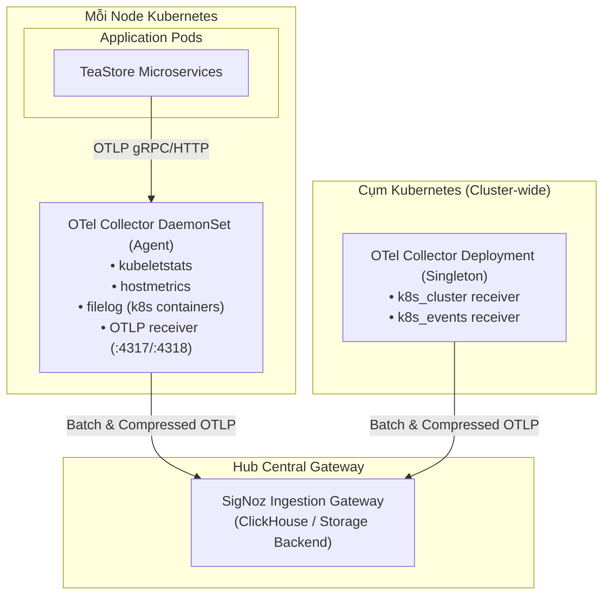
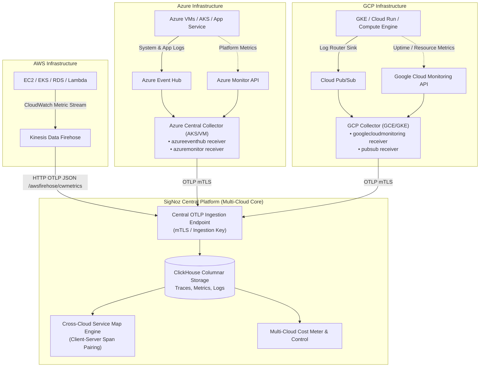
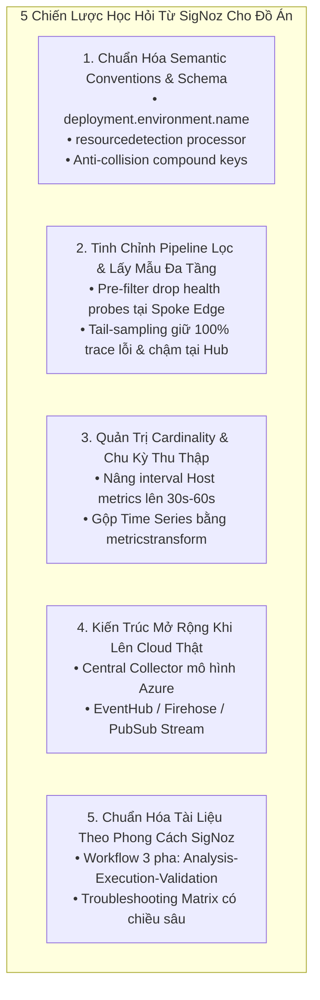

# Nghiên Cứu Chiến Lược Giám Sát Của SigNoz & Đề Xuất Cải Tiến Nền Tảng Multi-Cloud Observability

> **Tài liệu tham chiếu:** `docs/progress/05_SigNoz_strategy.md`  
> **Dự án:** Multi-Cloud Monitoring Platform (TeaStore Hub-Spoke Observability & AIOps)  
> **Phiên bản:** v1.0.0 (Comprehensive Strategic Analysis)  
> **Ngày hoàn thành:** 2026-11-10  
> **Nguồn tài liệu đối chiếu:** Toàn bộ kho tài liệu kỹ thuật SigNoz Documentation (`docs/other-reference/SigNozDocs`) bao gồm 33 danh mục chuyên sâu (AWS, Azure, GCP, K8s-Infra, APM, Cost Control, AI Observability, Dashboards, Ingestion, PromQL UTF-8).

---

## Tóm Tắt Điều Hành (Executive Summary)

Báo cáo này tiến hành rà soát, giải mã và tổng hợp toàn diện triết lý thiết kế, kiến trúc thu thập, phương pháp luận viễn trắc (telemetry methodology) và các chiến lược vận hành thực tế của **SigNoz** — nền tảng quan sát mã nguồn mở chuẩn OpenTelemetry-native hàng đầu hiện nay.

Qua việc phân tích sâu các tài liệu kỹ thuật trong `docs/other-reference/SigNozDocs`, báo cáo làm rõ:
1. **Phương pháp soạn thảo tài liệu kỹ thuật (`.md`)** chuẩn mực, định hướng theo luồng công việc (workflow-oriented) và thân thiện với các hệ thống AI/LLM.
2. **Quy chuẩn thiết kế Schema & Semantic Conventions** đảm bảo giải quyết bài toán định danh thực thể (Entity Resolution) và liên kết chéo dữ liệu 360° (Cross-signal Correlation: Metrics $\leftrightarrow$ Traces $\leftrightarrow$ Logs $\leftrightarrow$ Events).
3. **Chiến lược giải quyết bài toán Giám sát Đa Đám Mây (Multi-Cloud Monitoring)**: Cơ chế tích hợp AWS, Azure, GCP; cách trích xuất quan hệ phụ thuộc dịch vụ (Cloud Dependencies & Service Graph Topology); và phương thức phân chia thứ bậc tài nguyên (Resource Partitioning).
4. **Chiến lược tối ưu hóa chi phí viễn trắc (Cost Control & Ingestion Optimization)**: Kỹ thuật kiểm soát Cardinality, lọc nhiễu trước nạp (Pre-filtering), lấy mẫu phân tầng (Head-based & Tail-based Sampling) và cân nhắc chu kỳ lấy mẫu (Collection Intervals).
5. **Lộ trình học hỏi và cải tiến chiến lược (Actionable Strategic Roadmap)** nhằm tối ưu hóa đồ án tốt nghiệp hiện tại (hệ thống giám sát 3 cụm k3d Hub-Spoke chạy vi dịch vụ Descartes TeaStore và AIOps Closed-Loop).

---

## 1. Phân Tích Phương Pháp Soạn Thảo Tài Liệu Kỹ Thuật Của SigNoz (`.md` Documentation Standard)

Kho tài liệu của SigNoz được tổ chức theo tiêu chuẩn kỹ thuật phần mềm hiện đại, kết hợp chặt chẽ giữa tính sư phạm cho kỹ sư và cấu trúc dữ liệu cho các tác tử trí tuệ nhân tạo (AI Agents / LLMs).

```
┌────────────────────────────────────────────────────────────────────────┐
│ CẤU TRÚC CHUẨN MỰC CỦA MỘT TỆP TÀI LIỆU KỸ THUẬT SIGNOZ                │
├────────────────────────────────────────────────────────────────────────┤
│ 1. H1 Title & Subtitle: Tuyên bố giá trị cốt lõi trong 1 câu          │
│ 2. Metadata Context: Tags (SigNoz Cloud, Self-Host), LLM Breadcrumbs   │
│ 3. Overview & Architectural Diagrams: Sơ đồ luồng dữ liệu trực quan   │
│ 4. Prerequisites: Rõ ràng về quyền hạn (IAM/RBAC), công cụ, phiên bản  │
│ 5. Setup & Implementation: Chia Tab/Phần theo hạ tầng (Helm / VM / SDK)│
│ 6. Validation Checklist: Cách thức kiểm chứng ngay sau khi cấu hình   │
│ 7. Troubleshooting & Pitfalls: Bắt bệnh chính xác kèm nguyên nhân/cách sửa│
│ 8. Next Steps & Cross-Links: Điều hướng sang các bước tiếp theo       │
└────────────────────────────────────────────────────────────────────────┘
```

### 1.1. Cấu Trúc File & Định Dạng Nhất Quán
* **Tiêu đề & Phụ đề xúc tích:** Luôn mở đầu bằng tiêu đề `# [Tên Tính Năng]` kèm một đoạn tóm tắt 1-2 câu nêu bật bài toán cần giải quyết, công nghệ áp dụng và kết quả đạt được.
* **Thẻ phân loại môi trường (Tags):** Ghi rõ `Tags: SigNoz Cloud, Self-Host` ngay đầu tệp để người đọc phân biệt tính khả dụng của tính năng.
* **Liên kết điều hướng máy đọc (LLM-Friendly Indexing):** Mỗi tài liệu đều chứa khối trỏ về `llms.txt` và `sitemap.md`, hỗ trợ việc crawl và suy luận của các hệ thống AI.
* **Hộp thông tin nổi bật (GitHub Alerts / Callouts):**
  * `> **Info**`: Giải thích ngữ cảnh, quy ước ngầm định (VD: OpenTelemetry deprecation notices).
  * `> **Note**`: Nhấn mạnh sự khác biệt giữa các phiên bản hoặc nền tảng (VD: EKS Fargate vs EKS Managed Nodes).
  * `> **Tip**`: Khuyến nghị thực hành tối ưu (VD: *"Source First, Collector Second"*).
  * `> **Warning**`: Cảnh báo rủi ro kỹ thuật, chi phí đám mây phát sinh, hoặc lỗi đứt gãy vết (VD: Drop parent span gây orphan child spans).

### 1.2. Bảng So Sánh & Ma Trận Đánh Đổi (Trade-off Matrices)
Thay vì mô tả dài dòng, SigNoz luôn thiết kế các bảng so sánh trực quan đa tiêu chí giúp kỹ sư ra quyết định kiến trúc:
* **So sánh phương án tích hợp AWS:** Đối chiếu giữa *One-Click CloudFormation*, *Self-Managed Firehose*, và *Manual OpenTelemetry Collector* trên 7 tiêu chí: Availability, Setup Time, Pre-built Dashboards, Auto-Discovery, AWS CloudWatch Cost, Granular Control, và Best For (`17_AWS Monitoring/03_One-Click vs Manual.md`).
* **So sánh tính chất Temporality:** Đối chiếu *Cumulative* vs *Delta* trên các khía cạnh bộ nhớ collector, mất mát khi đứt mạng, và khả năng hỗ trợ UpDownCounter.

### 1.3. Quy Trình 3 Bước Tiêu Chuẩn: "Phân Tích $\rightarrow$ Thực Thi $\rightarrow$ Xác Thực"
Mọi hướng dẫn tối ưu hoặc khắc phục sự cố đều tuân thủ chặt chẽ:
1. **Analysis (Phân tích):** Chỉ rõ truy vấn PromQL, ClickHouse query hoặc giao diện Explorer để phát hiện điểm nóng (bottleneck, high cardinality, noisy endpoints).
2. **Execution (Thực thi):** Cung cấp cấu hình YAML mẫu chuẩn xác, chỉ rõ vị trí đặt trong pipeline (`processors`, `receivers`, `exporters`).
3. **Validation (Xác thực):** Nêu rõ độ trễ cập nhật (VD: Cost Meter cập nhật hàng giờ nhưng Trace Explorer thấy ngay tức thì) và lệnh CLI/UI kiểm tra.

---

## 2. Thiết Kế Schema Viễn Trắc & Semantic Conventions Trong SigNoz

SigNoz được xây dựng hoàn toàn trên nền tảng **OpenTelemetry Native**, không sử dụng định dạng dữ liệu độc quyền (proprietary schema). 

### 2.1. Phân Tách Tuyệt Đối Giữa Resource Attributes Và Telemetry Attributes
Theo tài liệu `27_Ingestion/04_Set Custom Attributes.md`, SigNoz nhấn mạnh sự khác biệt bản chất giữa hai loại thuộc tính:

| Tiêu chí | Resource Attribute ("Where did this come from") | Event/Span/DataPoint Attribute ("What happened") |
| :--- | :--- | :--- |
| **Bản chất** | Mô tả thực thể/tiến trình sản sinh dữ liệu viễn trắc | Mô tả chi tiết một tác vụ, giao dịch hoặc phép đo cụ thể |
| **Tần suất thay đổi** | **Một lần duy nhất** khi tiến trình khởi động | **Mỗi yêu thức/giao diện** (per-request / per-operation) |
| **Phạm vi áp dụng** | Gắn liền với **mọi** spans, metrics, và logs phát ra từ thực thể đó | Chỉ gắn vào span, log record hoặc metric point cụ thể |
| **Ví dụ chuẩn** | `service.name`, `deployment.environment.name`, `cloud.provider`, `k8s.cluster.name`, `host.name` | `http.request.method`, `http.response.status_code`, `db.query.text`, `rpc.grpc.status_code` |

### 2.2. Cơ Chế Entity Resolution & Các Thuộc Tính Bắt Buộc (Mandatory Attributes)
Một phát hiện quan trọng từ tệp `07_Infrastructure Monitoring/05_Reference/01_Telemetry Data Requirements.md`: Nếu các thuộc tính định danh bị thiếu hoặc sai kiểu dữ liệu, các giao diện danh sách thực thể (Hosts, Pods, Nodes, Deployments) sẽ **thất bại trong việc liên kết dữ liệu và các truy vấn sẽ chết trong im lặng (fail silently)**.

SigNoz thiết lập bảng quy chuẩn định danh thực thể:
1. **Host Entity Resolution:**
   * Thuộc tính bắt buộc: `host.name` (duy nhất trên toàn hạ tầng). Khuyến nghị thêm `host.id` để làm fallback khi hostname bị trùng (VD: các VM nhân bản từ template hoặc EC2 instances trong Auto Scaling Group).
   * Chỉ số kích hoạt trạng thái **ACTIVE**: `system.cpu.time`, `system.memory.usage`, `system.filesystem.usage`, `system.cpu.load_average.15m` phải xuất hiện trong 10 phút gần nhất.
2. **Kubernetes Pod Entity Resolution:**
   * Thuộc tính bắt buộc: `k8s.pod.name`, `k8s.pod.uid`, `k8s.namespace.name`, `k8s.cluster.name`.
   * **Đặc biệt:** `k8s.pod.uid` là **bắt buộc tuyệt đối** vì câu truy vấn thống kê số lượng Pod theo trạng thái (*Pod Counts by Phase*) sử dụng UID để khử trùng lặp (deduplication) khi Pod được tái khởi động hoặc dịch chuyển giữa các Node.
3. **Phụ thuộc 2 nguồn dữ liệu (Data Source Dual-Dependency):**
   * Giám sát Kubernetes đòi hỏi đồng thời:
     * `kubeletstats` receiver (chạy ở từng Node): Cung cấp CPU/Memory usage và request/limit utilization thực tế.
     * `k8s_cluster` receiver (chạy Singleton): Cung cấp `k8s.pod.phase`, `k8s.node.condition_ready`, `k8s.deployment.available/desired`.
   * Thiếu 1 trong 2 nguồn sẽ làm gãy hoàn toàn cây phân tích thực thể.

### 2.3. Hỗ Trợ Chuẩn Mới Nhất Của OpenTelemetry Semantic Conventions
* **Chuẩn hóa nhãn môi trường:** Khuyến nghị chuyển từ `deployment.environment` (đã deprecated) sang `deployment.environment.name` theo đúng registry chính thức của OTel.
* **Cú pháp PromQL UTF-8 Quoted Identifiers:** Để tương thích với OTel (sử dụng dấu chấm `.` trong tên chỉ số như `container.cpu.utilization` thay vì dấu gạch dưới `_` kiểu Prometheus), SigNoz đã nâng cấp bộ biên dịch PromQL hỗ trợ cú pháp ngoặc nhọn trích dẫn:
  ```promql
  # Cú pháp mới hỗ trợ chấm trong tên metric và nhãn
  sum by ("k8s.pod.name") (rate({"container.cpu.utilization", "k8s.namespace.name"="teastore"}[5m]))
  ```
* **Neo chuỗi chính xác trong biểu thức chính quy (Fully Anchored Regex):** Các bộ lọc regex `=~` và `!~` trong PromQL của SigNoz được neo tự động `^(?:...)$`. Để tìm kiếm chuỗi con (substring), kỹ sư bắt buộc phải dùng cú pháp bọc `.*` hai đầu (`{"service.name"=~".*teastore.*"}`).

---

## 3. Chiến Lược Tích Hợp (Integrations) & Kiến Trúc Thu Thập Viễn Trắc

SigNoz triển khai kiến trúc thu thập phân lớp rõ ràng nhằm giảm thiểu sự phụ thuộc vào các thư viện độc quyền.



### 3.1. Mô Hình 2 Lớp Thu Thập Chuẩn Trên Kubernetes (`k8s-infra`)
Theo tài liệu `05_Collection Agents/02_Kubernetes/01_K8s-Infra/03_Configure K8s Infra.md`, kiến trúc thu thập Kubernetes của SigNoz tách biệt hai vai trò:
1. **DaemonSet Agent (Một instance trên mỗi Node):**
   * Lắng nghe cổng nội bộ Node `0.0.0.0:4317` (gRPC) và `0.0.0.0:4318` (HTTP). Ứng dụng gửi dữ liệu tới Agent cục bộ qua IP của Node (`status.hostIP`).
   * Thu thập `hostmetrics` (CPU, Memory, Disk, Net của máy chủ vật lý/ảo).
   * Thu thập `kubeletstats` (thông số tài nguyên chi tiết của các Pod/Container trên chính Node đó).
   * Đọc trực tiếp logs container từ đường dẫn `/var/log/pods` thông qua `filelog` receiver.
2. **Deployment Singleton (Một instance duy nhất cho toàn bộ Cụm):**
   * Kết nối tới Kubernetes API Server qua `k8s_cluster` receiver để lấy trạng thái mức cụm (ReplicaSet, Deployment, Node Conditions, Pod Phase).
   * Lắng nghe và biến đổi các sự kiện của cụm (Warning events, BackOff, OOMKilled) thành dạng Log records để tương quan.

### 3.2. Đưa Metadata Từ Ứng Dụng Tới Collector
Để tránh việc ứng dụng phải phụ thuộc vào thư viện bên ngoài, SigNoz khuyến nghị sử dụng **Kubernetes Downward API** để tự động truyền thông tin định danh vào biến môi trường:
```yaml
env:
  - name: HOST_IP
    valueFrom:
      fieldPath: status.hostIP
  - name: K8S_POD_IP
    valueFrom:
      fieldPath: status.podIP
  - name: K8S_POD_UID
    valueFrom:
      fieldPath: metadata.uid
  - name: OTEL_EXPORTER_OTLP_ENDPOINT
    value: "http://$(HOST_IP):4318"
  - name: OTEL_SERVICE_NAME
    value: "teastore-webui"
  - name: OTEL_RESOURCE_ATTRIBUTES
    value: "k8s.pod.ip=$(K8S_POD_IP),k8s.pod.uid=$(K8S_POD_UID)"
```
Bộ xử lý `k8sattributes` trên DaemonSet Collector sẽ dùng `k8s.pod.ip` và `k8s.pod.uid` để truy vấn bộ nhớ đệm metadata của cụm và tự động bù đắp các thông tin: `k8s.deployment.name`, `k8s.node.name`, `k8s.namespace.name` vào mọi span/metric/log.

---

## 4. Thiết Kế Dashboard & Mô Thức Trực Quan Hóa (Visualization Patterns)

SigNoz sở hữu kho mẫu Dashboard khổng lồ (hơn 60 templates trong `12_Dashboards/04_Out of Box Dashboards.md`) được xây dựng trên chuẩn **Dashboard Schema V2**.

### 4.1. Kết Hợp Phương Pháp USE Và RED
* **USE Method (Utilization - Saturation - Errors) cho tầng Hạ tầng:**
  * Áp dụng cho Host, Kubernetes Nodes, Volumes, Network.
  * Phân tách rõ mức sử dụng thực tế (Utilization) với mức độ bão hòa (Saturation: CPU Wait `%wa`, Load Average, Memory Paging/Swap, Inodes saturation).
* **RED Method (Rate - Errors - Duration) cho tầng Ứng dụng & Dịch vụ:**
  * Giám sát thông lượng (Request Rate - QPS).
  * Tỷ lệ lỗi (Error Rate - HTTP 5xx, gRPC error codes).
  * Độ trễ phân vị cao (Duration - P50, P90, P95, P99 Latency).

### 4.2. Kỹ Thuật Bố Cục Bảng Đa Truy Vấn & Trục Y Kép (Multi-Query & Dual Y-Axis)
* **Ghép nối bảng (Merge Transformations):** Khi xây dựng bảng ma trận tổng hợp (VD: Ma trận sức khỏe cụm, bảng kiểm kê đĩa cứng), SigNoz sử dụng cơ chế nối kết quả từ nhiều câu truy vấn (`#A`, `#B`, `#C`, `#D`) có chung tập nhãn định danh (`k8s_cluster_name`, `cloud_provider`) thành các cột trên cùng một hàng dữ liệu.
* **Tách trục Y kép (Dual Y-Axis):** Đối với các panel theo dõi hai đại lượng có bản chất và thang đo lệch nhau (VD: Throughput MB/s vs IOPS; hoặc Tỷ lệ I/O Wait % vs Số kết nối TCP đang mở), panel được cấu hình tách trục Y thứ hai sang bên phải (`axisPlacement: "right"`), giúp người vận hành không bị hiểu nhầm do hiện tượng bẹp đường đồ thị (graph flattening).

### 4.3. Liên Kết Chéo Dữ Liệu 4 Chiều (360° Data Drill-Down)
Mọi trang chi tiết thực thể (Entity Detail Page) trong SigNoz đều cung cấp 4 tab điều hướng liền mạch:
$$\text{Metrics} \longleftrightarrow \text{Traces} \longleftrightarrow \text{Logs} \longleftrightarrow \text{Events}$$
* Nhìn thấy CPU Pod tăng đột biến $\rightarrow$ Click sang tab **Traces** để xem các request bị chậm tương ứng $\rightarrow$ Click vào Trace ID để nhảy sang tab **Logs** xem thông báo lỗi ngoại lệ $\rightarrow$ Kiểm tra tab **Events** xem có sự kiện Kubelet cảnh báo throttling hay không.

---

## 5. Đề Tài Multi-Cloud Monitoring Trong SigNoz (Nghiên Cứu Chuyên Sâu)

Đây là trọng tâm đối chiếu trực tiếp với bài toán luận văn tốt nghiệp của chúng ta. Dưới đây là phân tích chi tiết cách SigNoz giải quyết bài toán đa đám mây.



### 5.1. Cơ Chế Thu Thập Viễn Trắc Cho Từng Đám Mây

#### A. AWS Monitoring (`17_AWS Monitoring`)
SigNoz hỗ trợ 3 mô hình từ tự động tới kiểm soát toàn diện:
1. **One-Click Integration (Dành cho SigNoz Cloud):** Dùng AWS CloudFormation triển khai IAM Role, thiết lập CloudWatch Metric Streams đẩy metrics qua Amazon Kinesis Data Firehose trực tiếp tới endpoint HTTP của SigNoz (`/awsfirehose/cwmetrics`).
2. **Self-Managed Metric Streams (Dành cho hạ tầng quản lý bằng Terraform):** Người dùng tự định nghĩa Kinesis Firehose với đích đến là endpoint SigNoz, bật nén GZIP, sao lưu bản ghi lỗi lên S3 bucket (`Failed data only`).
3. **Manual Setup (OpenTelemetry Collector Native):**
   * Dùng `awscloudwatch` receiver để định kỳ pull logs từ các nhóm log `/aws/lambda/*`, `/aws/rds/*`.
   * Sử dụng Lambda S3 Forwarder để đọc các log dạng file (VPC Flow Logs, ALB Access Logs, S3 Access Logs) đẩy về OTel Collector.
   * Chạy OTel Collector DaemonSet/Sidecar trên EKS và ECS để thu thập số liệu nội tại container.

#### B. Azure Monitoring (`30_Azure Monitoring`)
Tài liệu `02_Bootstrapping/01_Strategy.md` và `02_Central Collector Setup.md` thể hiện chiến lược xuất sắc của SigNoz trong môi trường Microsoft Azure thông qua mô hình **Central Collector**:
1. **Kiến trúc Central Collector (Bộ thu thập trung tâm trên Azure):**
   * Triển khai một bộ OTel Collector trung tâm đặt trên Azure Kubernetes Service (AKS) hoặc Azure Virtual Machine.
   * Bộ thu thập này đóng vai trò gom dữ liệu từ toàn bộ tài nguyên của Azure Subscription trước khi đẩy ra bên ngoài.
2. **Hút Logs Nền Tảng & Ứng Dụng qua Azure Event Hub:**
   * Cấu hình Azure Diagnostic Settings trên các tài nguyên (App Service, Azure Functions, Container Apps, VMs) để stream toàn bộ stdout logs và platform logs vào Azure Event Hub.
   * Central Collector sử dụng receiver chuyên biệt `azureeventhub`:
     ```yaml
     receivers:
       azureeventhub:
         connection: "Endpoint=sb://<namespace>.servicebus.windows.net/;SharedAccessKeyName=...;EntityPath=hubName"
         format: "azure"
         apply_semantic_conventions: true  # Tự động map schema Azure sang OpenTelemetry!
     ```
   * Thuộc tính `apply_semantic_conventions: true` là chìa khóa: nó tự động phân tích cấu trúc JSON của Azure Resource Manager để chuẩn hóa thành các nhãn OTel SemConv.
3. **Kéo Metrics từ Azure Monitor API:**
   * Sử dụng receiver `azuremonitor` kết nối qua Azure Service Principal (App Registration trong Entra ID / Azure AD) có quyền `Monitoring Reader` trên toàn bộ Subscription hoặc Resource Groups cụ thể:
     ```yaml
     receivers:
       azuremonitor:
         subscription_id: "<Subscription ID>"
         tenant_id: "<Tenant ID>"
         client_id: "<Client ID>"
         client_secret: "<Client Secret>"
         resource_groups: ["production-rg", "database-rg"]
         collection_interval: 60s
     ```

#### C. GCP Monitoring (`31_GCP Monitoring`)
1. **Kéo số liệu từ Google Cloud Monitoring API:**
   * Sử dụng receiver `googlecloudmonitoring` (yêu cầu Collector Contrib v0.112.0 trở lên) chạy trên Google Compute Engine (GCE) hoặc GKE.
   * Định kỳ pull danh mục metrics chỉ định (Uptime checks, Cloud Run latency, Cloud SQL memory, GKE utilization).
2. **Hút Logs qua GCP Log Router & Cloud Pub/Sub:**
   * Tạo Log Router Sink trong GCP Cloud Logging để định tuyến logs tới Cloud Pub/Sub topic.
   * Central Collector đăng ký (subscribe) vào topic này để stream logs về kho lưu trữ tập trung.

---

### 5.2. Cách SigNoz Trích Xuất Cloud Dependencies & Dựng Service Graph Topology

Tài liệu `06_APM & Distributed Tracing/06_Service Map.md` giải thích chi tiết cách thức xây dựng bản đồ phụ thuộc dịch vụ (Service Dependency Graph) liên đám mây:

#### 1. Nguyên Tắc Ghép Cặp Vết Phân Tán (Distributed Trace Pairing)
* Bản đồ dịch vụ của SigNoz **không dùng thăm dò mạng (network polling) hay quét cổng định kỳ**, mà được suy ra 100% từ luồng thực thi thực tế của mã nguồn thông qua Distributed Tracing.
* **Quy tắc Caller $\leftrightarrow$ Callee:**
  * Node gọi (Caller) phát ra một Span loại `SpanKind.CLIENT`.
  * Context được truyền qua giao thức mạng (HTTP Headers, gRPC Metadata, Message Properties) thông qua chuẩn **W3C Trace Context** (`traceparent: 00-4bf92f3577b34da6a3ce929d0e0e4736-00f067aa0ba902b7-01`).
  * Node nhận (Callee) bóc tách context và phát ra một Span loại `SpanKind.SERVER` có cùng `TraceId` và có `ParentSpanId` trỏ về Client Span.
  * Khi bộ xử lý (Topology Engine / ClickHouse Aggregation) ghép được cặp Span này, một cạnh nối (Edge) có hướng sẽ được vẽ từ Caller tới Callee.
* **Xử lý các thành phần ngoại vi không có Agent (Uninstrumented Downstreams):**
  * Đối với Cơ sở dữ liệu (MySQL, PostgreSQL, Redis, DynamoDB) hoặc Hàng đợi (Kafka, SQS, RabbitMQ), ứng dụng phát ra Client Span mang các thuộc tính ngữ nghĩa:
    * `db.system`: `"mysql"` $\rightarrow$ SigNoz vẽ một node Database riêng biệt.
    * `messaging.system`: `"kafka"` $\rightarrow$ SigNoz vẽ một node Queue riêng biệt.
    * `peer.service` hoặc `net.peer.name`: Định danh máy chủ/dịch vụ bên ngoài.

#### 2. Ngữ Cảnh Đa Đám Mây Trên Bản Đồ (Multi-Cloud Dimensions)
SigNoz hỗ trợ lọc và phân tách Topology theo 2 trục thuộc tính tài nguyên quan trọng:
* `deployment.environment` / `deployment.environment.name` (VD: `production`, `staging`).
* `k8s.cluster.name` (VD: `aws-k3d`, `azure-k3d`, `hub-k3d`).

#### 3. Trực Quan Hóa Tình Trạng Sức Khỏe Trên Đồ Thị
* **Node Color (Màu của Node):** Phản ánh chất lượng yêu cầu mà Node **nhận được** (as callee).
  * **Xanh lá (Green):** Không có lỗi trên các cuộc gọi tới node này.
  * **Đỏ (Red):** Có ít nhất một cuộc gọi tới node này trả về trạng thái lỗi (`status.code == ERROR`).
* **Node Size (Kích thước Node):** Tỷ lệ thuận với lưu lượng (Call Volume) mà node đó tiếp nhận. Node càng nhận nhiều request thì kích thước càng lớn.
* **Edge Metrics (Chỉ số trên đường nối):** Khi di chuột (hover) vào đường nối giữa hai dịch vụ xuyên đám mây, SigNoz hiển thị 3 chỉ số vàng:
  * **P99 Latency:** Độ trễ phân vị 99 của các cuộc gọi liên dịch vụ (bao gồm cả độ trễ mạng WAN xuyên đám mây).
  * **Request Rate:** Tần suất yêu cầu (RPS).
  * **Error Rate:** Tỷ lệ % số cuộc gọi bị thất bại trên cạnh kết nối đó.

---

### 5.3. Cách Phân Chia Thứ Bậc Tài Nguyên (Resource Hierarchy & Partitioning)

SigNoz tổ chức và phân chia tài nguyên theo **Mô hình Thứ Bậc 3 Tầng (Three-Tier Resource Hierarchy)**:

```
┌────────────────────────────────────────────────────────────────────────┐
│ TẦNG 1: CLOUD PROVIDER & BOUNDARY PERIMETER (Phạm vi Bao bọc)          │
│ • Cloud Provider: cloud.provider ("aws" | "azure" | "gcp")             │
│ • Cloud Account: cloud.account.id / azure.subscription_id / gcp.project │
│ • Geographic Region: cloud.region ("us-east-1" | "southeastasia")       │
│ • Network Boundary: cloud.zone, vpc.id, vnet.id, subnet.id             │
├────────────────────────────────────────────────────────────────────────┤
│ TẦNG 2: ORCHESTRATION & PLATFORM INFRASTRUCTURE (Phân cấp Hạ tầng)     │
│ • Cluster: k8s.cluster.name                                            │
│ • Node: k8s.node.name, host.name, host.id                              │
│ • Isolation: k8s.namespace.name                                        │
│ • Workload Controller: k8s.deployment.name, k8s.statefulset.name, ...  │
│ • Compute Unit: k8s.pod.name, k8s.pod.uid, k8s.container.name          │
│ • Persistent Storage: k8s.volume.name, k8s.persistentvolumeclaim.name  │
├────────────────────────────────────────────────────────────────────────┤
│ TẦNG 3: APPLICATION RUNTIME & LOGICAL BOUNDARY (Thực thi Ứng dụng)      │
│ • Service Identity: service.name, service.namespace, service.version   │
│ • Process Runtime: service.instance.id, process.pid, jvm.runtime.*    │
│ • Transaction Endpoint: http.route, rpc.method, db.operation           │
└────────────────────────────────────────────────────────────────────────┘
```

#### Quy Tắc Chống Va Chạm Định Danh (Anti-Collision Entity Resolution)
Trong môi trường đa đám mây, nguy cơ va chạm nhãn là rất lớn (ví dụ: cả hai cụm AWS và Azure đều có namespace tên là `default`, đều có node tên là `k3d-node-0`, hoặc ứng dụng TeaStore đều deploy cùng tên pod).

SigNoz giải quyết vấn đề này bằng cách:
* **Khóa chính đa thành phần (Compound Primary Key):** Mọi truy vấn phân nhóm (Group By) và tính toán liên kết đều dùng cặp khóa tối thiểu:
  $$\text{Entity Key} = \langle \texttt{k8s.cluster.name},\; \texttt{k8s.namespace.name},\; \texttt{k8s.pod.uid} \rangle$$
* **Phân định rõ Host vật lý/ảo:** Dùng `host.id` (UUID của máy chủ do nhà cung cấp đám mây cấp, ví dụ EC2 Instance ID `i-0123456789abcdef0`) thay vì chỉ dùng `host.name`.

---

## 6. Chiến Lược Quản Lý Chi Phí Viễn Trắc & Tối Ưu Băng Thông Đa Đám Mây (Cost Control & Ingestion Optimization)

Một trong những đóng góp xuất sắc nhất trong bộ tài liệu SigNoz nằm ở danh mục `10_Cost Meter` và `11_Cost Control`. Đối với bài toán Multi-Cloud, chi phí truyền dữ liệu ra ngoài Internet (Egress Cost) và chi phí lưu trữ/tính toán tập trung là thách thức sống còn.

SigNoz đưa ra các chiến lược tối ưu hóa cụ thể cho từng loại tín hiệu:

### 6.1. Tối Ưu Hóa Dấu Vết (Traces Optimization)
Theo tệp `11_Cost Control/05_Optimize Traces.md`:
* **Bản chất chi phí:** Traces được tính phí theo dung lượng Gigabyte (GB) nạp vào hệ thống. Các request thành công tần suất cao, độ trễ thấp (như health checks, probes, ping) chiếm phần lớn dung lượng nhưng mang lại rất ít giá trị chẩn đoán.
* **Chiến lược Lấy mẫu Kết hợp (Hybrid Sampling Strategy):**
  1. **Head-Based Sampling (Tại SDK nguồn):** Ra quyết định giữ/bỏ ngay khi span gốc được tạo ra. Tiết kiệm 100% tài nguyên CPU/RAM serialize và băng thông mạng.
     * *Khuyến nghị:* Luôn dùng `parentbased_traceidratio` thay vì `traceidratio` thuần túy. Bộ lấy mẫu `parentbased` đảm bảo span con tuân thủ quyết định của span cha, giữ toàn vẹn cây vết (không bị đứt gãy trace giữa chừng).
  2. **Tail-Based Sampling (Tại Collector Gateway):** Lưu vết trong bộ nhớ đệm (thường 10s-30s) cho đến khi trace kết thúc để đánh giá:
     ```yaml
     processors:
       tail_sampling:
         decision_wait: 10s
         policies:
           - name: keep-errors               # Giữ lại 100% trace có lỗi!
             type: status_code
             status_code:
               status_codes: [ERROR]
           - name: keep-slow-traces          # Giữ lại 100% trace vi phạm SLO độ trễ!
             type: latency
             latency:
               threshold_ms: 2000
           - name: sample-the-rest           # Chỉ lấy mẫu 3% các trace thành công thông thường
             type: probabilistic
             probabilistic:
               sampling_percentage: 3
     ```
* **Lọc bỏ nhiễu trước khi lấy mẫu (Pre-filtering Before Sampling):**
  * Đặt bộ lọc `filter/drop_noise` **trước** `tail_sampling` trong pipeline để loại bỏ ngay lập tức các endpoint vô thưởng vô phạt (như `/health`, `/metrics`, `grpc.health.v1.Health/Check`), giảm áp lực bộ nhớ cho hàng đợi của tail sampling:
  ```yaml
  processors:
    filter/drop_noise:
      error_mode: ignore
      traces:
        span:
          - 'IsMatch(attributes["url.path"], ".*health.*")'
          - 'name == "grpc.health.v1.Health/Check"'
  service:
    pipelines:
      traces:
        processors: [filter/drop_noise, tail_sampling]
  ```

### 6.2. Tối Ưu Hóa Số Liệu (Metrics Optimization & Cardinality Reduction)
Theo tệp `11_Cost Control/04_Optimize Metrics.md`:
* **Bản chất chi phí:** Metrics được tính theo số lượng **Samples** (cặp timestamp-giá trị). Mỗi tổ hợp giá trị nhãn duy nhất tạo ra một chuỗi thời gian riêng biệt (**Time Series**).
* **Vấn đề Nhãn Bùng Nổ Cardinality (High-Cardinality Labels):**
  * Các nhãn nguy hiểm: `client.port` (port ngẫu nhiên 49152–65535), `url.full` (chứa query param động như `?token=...`), `k8s.pod.uid`, `db.query.text` (chứa câu SQL raw có param literal).
  * *Cảnh báo kỹ thuật:* Sử dụng `delete_key()` của `attributes` processor **không gộp (merge)** các chuỗi thời gian lại mà chỉ xóa tên nhãn, để lại các điểm đo bị va chạm và kết quả truy vấn bị sai lệch.
  * *Giải pháp chuẩn:* Phải sử dụng tính năng **Aggregation Action** của `metricstransform` processor để gộp các chuỗi thời gian lại theo các chiều còn lại.
* **Chu kỳ thu thập số liệu (Collection Interval Tuning):**
  * Mặc định nhiều Helm chart thiết lập tần suất 30s hoặc 10s. Đối với các tài nguyên ổn định (host metrics, storage capacity), nâng interval lên `60s` sẽ ngay lập tức **cắt giảm 50% số lượng samples** nạp vào hệ thống mà không làm suy giảm chất lượng cảnh báo.

---

## 7. Bài Học Kinh Nghiệm & Đề Xuất Chiến Lược Cải Thiện Đồ Án Hiện Tại

Đối chiếu với hiện trạng hệ thống của chúng ta:
* **Hạ tầng:** 3 cụm k3d (`hub-k3d`, `aws-k3d`, `azure-k3d`), kết nối qua mạng mô phỏng WAN bridge (`mc-monitoring-net`, RTT 10ms ±2ms) bảo vệ bằng mTLS 1.3.
* **Stack giám sát:** OpenTelemetry Collector (Edge & Hub Gateway), Prometheus + Thanos (Metrics), Grafana Loki (Logs), Grafana Tempo (Traces), MinIO (Object Storage), Grafana (Visualization), Pyrra (SLO), Robusta (Alerting & Telegram).
* **Ứng dụng & AIOps:** Descartes TeaStore (microservices compute trên AWS, persistence trên Azure), AI Anomaly Detection Engine V3 (Deep Learning Ensemble GRU + TCN + Isolation Forest, Tempo Trace RCA, Prometheus Exporter nhúng cổng `:9108`, Closed-Loop Alerting).

Dưới đây là 5 bài học chiến lược lớn rút ra từ SigNoz có thể áp dụng ngay để hoàn thiện đồ án:



### Chiến Lược 1: Hoàn Thiện Chuẩn Hóa Schema & Tự Động Nhận Diện Tài Nguyên (Resource Detection)
* **Hiện trạng của chúng ta:** Chúng ta đã thực hiện chuẩn hóa nhãn `k8s_cluster_name`, `cloud_provider`, `cloud_region` qua OTTL thủ công trong Kustomize overlay patches.
* **Cải tiến học hỏi từ SigNoz:**
  1. Cập nhật các trường cấu hình OTel Collector chuyển đổi dứt điểm từ `deployment.environment` sang `deployment.environment.name` để tuân thủ 100% OTel SemConv v1.26+.
  2. Tích hợp `resourcedetection` processor vào bộ cấu hình Collector Base (`k8s/base/collector-edge/`). Khi triển khai trên môi trường k3d giả lập, bộ xử lý này sử dụng detector `env` và `system`. Khi đồ án mở rộng triển khai Terraform lên AWS/Azure thực tế, chỉ cần bật detector `aws`, `azure`, `gcp` là toàn bộ metadata (Instance ID, AMI ID, Region, VM Size) sẽ được tự động trích xuất mà không cần cấu hình tĩnh.
  3. Bổ sung `k8s.pod.uid` vào danh mục nhãn bắt buộc phải giữ lại trên Prometheus scrape config nhằm phục vụ khử trùng lặp pod chính xác.

### Chiến Lược 2: Tối Ưu Băng Thông WAN Bằng Bộ Lọc Lập Trình Tại Nguồn (Edge Pre-filtering)
* **Hiện trạng của chúng ta:** Chúng ta áp dụng Head-based sampling 20% tại Spoke Edge Collector.
* **Vấn đề phát hiện:** Các HTTP probes kiểm tra sức khỏe của Kubernetes (`/ready/isready`, `/image/finished`, `/status`) và các yêu cầu ping của Locust vẫn đang đi qua pipeline OTel, tiêu tốn CPU mã hóa mTLS và băng thông WAN liên cụm.
* **Cải tiến học hỏi từ SigNoz:**
  * Bổ sung ngay bộ xử lý `filter/drop_noise` tại `k8s/base/collector-edge/` để loại bỏ các span và log của health probes trước khi chuyển qua exporter `otlp/hub`:
    ```yaml
    processors:
      filter/drop_noise:
        error_mode: ignore
        traces:
          span:
            - 'IsMatch(attributes["url.path"], ".*/isready.*")'
            - 'IsMatch(attributes["url.path"], ".*/finished.*")'
            - 'IsMatch(attributes["http.target"], ".*/status.*")'
    ```
  * Cấu hình Tail-Sampling tại Hub Gateway Collector để đảm bảo: Mặc dù tại Edge chỉ lấy 20% ngẫu nhiên, nhưng bất kỳ trace nào có HTTP status `>= 500` hoặc latency $> 1500\text{ms}$ đều được bảo tồn 100% để phục vụ động cơ AI Tempo RCA.

### Chiến Lược 3: Quản Lý Cardinality & Phân Tầng Chu Kỳ Thu Thập (Interval Tiering)
* **Hiện trạng của chúng ta:** Cả 7 Hostmetrics scrapers đều đang chạy chung chu kỳ `10s` - `15s`.
* **Cải tiến học hỏi từ SigNoz:**
  * Thực hiện phân tầng chu kỳ thu thập (Collection Interval Tiering):
    * **Tầng Ứng dụng & Dịch vụ (RED Metrics / JVM):** Giữ nguyên chu kỳ `10s` để phát hiện nhanh các đợt tăng đột biến (traffic spikes, memory leak) phục vụ AI Anomaly Detection.
    * **Tầng Hạ tầng & Ổ đĩa (Hostmetrics / Filesystem / Paging):** Nâng chu kỳ lên `30s` hoặc `60s`. Điều này giúp giảm hơn 40% tải I/O trên Prometheus TSDB và MinIO Object Storage mà hoàn toàn không ảnh hưởng đến độ chính xác giám sát hệ điều hành.

### Chiến Lược 4: Sẵn Sàng Kiến Trúc Cho Giai Đoạn Mở Rộng Đám Mây Thực Tế (Terraform Phase)
* **Học hỏi từ kiến trúc Azure Central Collector của SigNoz:**
  * Khi nhóm triển khai đồ án lên môi trường đa đám mây thực thụ (AWS EKS kết hợp Azure AKS), thay vì để từng ứng dụng mở kết nối Internet ra ngoài, chúng ta sẽ áp dụng đúng mô hình SigNoz:
    * Triển khai một cụm Collector Gateway trung tâm trên mỗi đám mây.
    * Tận dụng các dịch vụ bản địa có chi phí truyền dữ liệu rẻ trong nội bộ cloud (như AWS CloudWatch Metric Streams $\rightarrow$ Firehose hoặc Azure Event Hub) để dẫn dữ liệu về Collector Gateway của cloud đó, sau đó Collector Gateway mới đóng gói mTLS 1.3 đẩy về Hub.

### Chiến Lược 5: Nâng Cấp Bộ Tài Liệu Báo Cáo Khoa Học & Bảng Chẩn Đoán Sự Cố
* **Học hỏi phong cách viết tài liệu của SigNoz:**
  * Áp dụng cấu trúc 3 pha (*Analysis $\rightarrow$ Execution $\rightarrow$ Validation*) cho toàn bộ các hướng dẫn triển khai trong `docs/progress/IMPLEMENTATION.md`.
  * Xây dựng ma trận chẩn đoán sự cố (*Troubleshooting Matrix*) cho từng thành phần (Collector, Thanos, Tempo, AI Engine) có đầy đủ: Triệu chứng $\rightarrow$ Nguyên nhân khả dĩ (Likely Cause) $\rightarrow$ Cách khắc phục (Fix) $\rightarrow$ Lệnh kiểm chứng (Verify command).

---

## 8. Kế Hoạch Hành Động Chi Tiết (Actionable Implementation Matrix)

| Hạng mục cải tiến | Vị trí tệp mục tiêu | Hành động cụ thể | Mức độ ưu tiên | Trạng thái đề xuất |
| :--- | :--- | :--- | :---: | :---: |
| **Edge Pre-filtering** | `k8s/base/collector-edge/02-configmap.yaml` | Bổ sung `filter/drop_noise` loại bỏ span/log của health check probes (`/isready`, `/finished`, `/status`) | **Cao (P1)** | Sẵn sàng cấu hình |
| **Tail-Sampling tại Hub** | `k8s/base/collector-hub/02-configmap.yaml` | Thiết lập policy giữ 100% error traces và latency $> 1500\text{ms}$ | **Cao (P1)** | Sẵn sàng cấu hình |
| **Interval Tiering** | `k8s/base/collector-edge/` & `collector-hub/` | Nâng `collection_interval` của hostmetrics (disk, filesystem, paging) từ 15s lên 30s | **Trung bình (P2)** | Sẵn sàng cấu hình |
| **Resourcedetection Base** | `k8s/base/collector-edge/02-configmap.yaml` | Khai báo bộ xử lý `resourcedetection` với detectors `[env, system]` | **Trung bình (P2)** | Đề xuất Phase 4 |
| **SemConv Naming Alignment** | Cấu hình OTel Agent & Collector | Rà soát và chuyển triệt để `deployment.environment` sang `deployment.environment.name` | **Thấp (P3)** | Tương thích ngược |

---

## 9. Kết Luận

Việc khảo sát chuyên sâu kho tài liệu của SigNoz mang lại giá trị thực tiễn rất lớn cho đồ án tốt nghiệp của chúng ta. SigNoz đã chứng minh rằng:
1. **OpenTelemetry-Native** là hướng đi hoàn toàn đúng đắn và có khả năng tương thích cao nhất trong môi trường Multi-Cloud.
2. **Topology liên cụm dựa trên Distributed Tracing và ServiceGraphConnector** là phương án tối ưu vượt bậc về hiệu năng so với các cách tiếp cận quét thô truyền thống.
3. **Chiến lược kiểm soát chi phí (Cost Control) và quản trị Cardinality** phải được thiết kế ngay từ tầng thu thập (Edge Collector) trước khi dữ liệu đi qua đường truyền mạng WAN.

Toàn bộ những phân tích, đánh giá và khuyến nghị trong báo cáo này sẽ làm cơ sở vững chắc để nhóm tiếp tục hoàn thiện giai đoạn **Phase 4 (Benchmark, Chaos Evaluation, and Final Report)** đạt chất lượng khoa học và kỹ thuật cao nhất.

