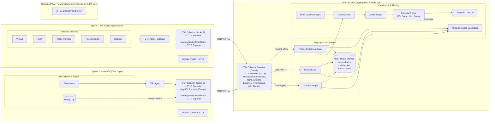

# BÁO CÁO PHÂN TÍCH NGHIÊN CỨU VÀ ĐỀ XUẤT KIẾN TRÚC TRIỂN KHAI
## Đề tài: Multi-Cloud Observability Platform & Anomaly Detection

> **Ngày lập báo cáo:** 03/11/2026  
> **Phiên bản:** 1.0 — Research Baseline & Architectural Review  
> **Người thực hiện:** Senior Cloud Infrastructure Architect, Observability Engineer & Research Assistant  
> **Tài liệu tham chiếu dự án:** `PLAN.md`, `overview.md`, `README.md`, `docs/architecture/SystemArchitecture.drawio.html`  
> **Tập tài liệu nghiên cứu:** 09 tài liệu khoa học tại thư mục `docs/research/`

---

## 1. Executive Summary (Tóm tắt điều hành)

Hệ thống quan sát đa đám mây (**Multi-Cloud Observability**) là một thách thức kỹ thuật phức tạp trong kỹ nghệ phần mềm và quản trị hạ tầng phân tán. Trong bối cảnh các tổ chức ngày càng triển khai các dịch vụ vi mô (**microservices**) phân tán trên nhiều nhà cung cấp đám mây công cộng (**Public Cloud**) và đám mây riêng (**Private Cloud / On-premises**), việc thu thập, chuẩn hóa, tương quan và phát hiện bất thường (**Anomaly Detection**) trên dòng dữ liệu đo lường từ xa (**Telemetry: Metrics, Logs, Traces**) gặp phải rào cản nghiêm trọng về chi phí truyền tải ra mạng ngoài (**WAN Egress Cost**), độ trễ mạng diện rộng (**WAN Latency/Jitter**), tính toàn vẹn bảo mật khi truyền dữ liệu qua Internet, và hiện tượng suy thoái mô hình do trôi dạt phân phối hình học đặc trưng (**Feature-Space Geometric Drift**).

Báo cáo này hoàn thành **Giai đoạn 1 (Phase 0/1 Baseline Discovery)** của dự án *Multi-Cloud Monitoring*, tiến hành:
1. **Khảo sát và phân tích toàn diện 09 tài liệu nghiên cứu khoa học** (công bố từ 2019 đến 2026 trên IEEE, ACM, Springer, Elsevier và arXiv) liên quan trực tiếp đến kiến trúc quan sát phân tán, chi phí OpenTelemetry, kỹ thuật lấy mẫu thích ứng (**Adaptive Sampling**), đánh chuẩn phát hiện bất thường trên dữ liệu thực tế quy mô lớn, và ảo hóa mạng bảo mật đa đám mây.
2. **Tổng hợp ma trận đối chiếu 9 tài liệu** trên 7 trục tiêu chí cốt lõi, rút ra 6 nhóm phát hiện phổ biến và nhận diện các khoảng trống nghiên cứu (**Research Gaps**) then chốt mà dự án có thể đóng góp.
3. **Đối chiếu có hệ thống với bản thiết kế kiến trúc hiện tại** (`docs/architecture/SystemArchitecture.drawio.html`) và kế hoạch triển khai (`PLAN.md`), phân định rõ ràng giữa các thành phần đã triển khai, các giả định thiết kế và các rủi ro tiềm ẩn.
4. **Đề xuất 03 phương án triển khai kiến trúc khả thi**, so sánh chi tiết trên 8 tiêu chí kỹ thuật và định hình danh sách các câu hỏi mở (**Open Questions**) cần thống nhất trước khi bước vào giai đoạn thực thi mã nguồn.

Kết quả phân tích khẳng định: Kiến trúc **Hub-Spoke** dựa trên **OpenTelemetry Collector** kết hợp với **Mutual TLS (mTLS)**, lưu trữ tập trung tại Hub bằng **Thanos, Loki, Tempo, MinIO**, và cơ chế phát hiện bất thường theo điểm số hàm hợp lý (**Likelihood-based Anomaly Scoring**) là một hướng tiếp cận tiên tiến, khắc phục được độ trễ ghi 1 giờ của kiến trúc lưu trữ phân tán truyền thống (chứng minh bởi IBM Research 2024), đồng thời mở ra cơ hội đóng góp học thuật thực chất về kiểm soát độ trôi hình học đặc trưng và cân bằng chi phí - chất lượng quan sát.

---

## 2. Project Context (Bối cảnh dự án)

### 2.1. Tầm nhìn và Mục tiêu cốt lõi
Dự án nhằm xây dựng một nền tảng quan sát đa đám mây có khả năng tái lập (**reproducible multi-cloud observability platform**) phục vụ cả môi trường nghiên cứu thực nghiệm và triển khai thực tế. Hệ sinh thái này giám sát ứng dụng chuẩn **TeaStore** (một hệ thống thương mại điện tử microservices mẫu), được phân vùng chạy trên các cụm tính toán đa đám mây mô phỏng cục bộ bằng **k3d (Kubernetes in Docker)**:
- **`aws-k3d` (Spoke 1 - Nhãn mô phỏng AWS):** Đảm nhiệm các dịch vụ tính toán hướng người dùng và bộ sinh tải: `WebUI`, `Auth`, `Image Provider`, `Recommender`, `Registry`.
- **`azure-k3d` (Spoke 2 - Nhãn mô phỏng Azure):** Đảm nhiệm tầng lưu trữ dữ liệu bền vững: `Persistence` service và cơ sở dữ liệu `MySQL`.
- **`hub-k3d` (Central Hub):** Cụm trung tâm tiếp nhận, làm giàu dữ liệu (**enrichment**), tổng hợp, lưu trữ dài hạn, phân tích tương quan dòng dữ liệu và phát cảnh báo.

### 2.2. Các yêu cầu kỹ thuật bắt buộc
Theo tài liệu chỉ đạo (`PLAN.md`, `overview.md`, `AGENTS.md`):
- **Tính bất biến của dữ liệu viễn trắc thô (Raw Telemetry Immutability):** Dữ liệu thô thu thập được từ các Spoke phải được giữ nguyên vẹn, ghi nhận nguồn và timestamp gốc. Dữ liệu phái sinh phải lưu vết ID phiên chạy (**Run ID**) và các bước biến đổi.
- **Bảo mật kênh truyền diện rộng (WAN Security):** Toàn bộ lưu lượng OTLP (OpenTelemetry Protocol) truyền liên cụm (Spoke-to-Hub) bắt buộc phải được mã hóa và xác thực hai chiều qua **Mutual TLS (mTLS 1.3)**.
- **Thứ tự Processor trong Collector:** Phải tuân thủ nghiêm ngặt quy tắc đường ống: `Memory Limiter` $\rightarrow$ `Filter` $\rightarrow$ `Transform` $\rightarrow$ `Batch` $\rightarrow$ `Exporter`.
- **Khả năng tái lập thực nghiệm (Reproducibility):** Mọi kịch bản thử nghiệm tải, đo lường overhead mã hóa, trễ suy giảm mạng WAN (mô phỏng trễ $10\,\text{ms}$, mất gói $0.1\%$ qua `tc/netem`) đều phải được tự động hóa qua kịch bản Ansible/manifest.
- **Khả năng mở rộng (Extensibility):** Dễ dàng cắm thêm cụm Spoke thứ ba (`gcp-k3d`) mà không phá vỡ mô hình kiến trúc.

---

## 3. Current Architecture Overview (Tổng quan kiến trúc hiện tại)

Kiến trúc hiện tại được mô hình hóa chi tiết trong tệp [SystemArchitecture.drawio.html](file:///docs/architecture/SystemArchitecture.drawio.html), thể hiện thiết kế dạng **Hub-Spoke** phân tán kết hợp với một trung tâm quan sát tập trung:



### Các luồng thành phần chính:
1. **Thu thập tại Spoke (Edge Telemetry Ingestion):**
   - Các pod ứng dụng TeaStore được đính kèm thư viện hoặc Java agent OpenTelemetry.
   - Dữ liệu viễn trắc nội bộ cụm đẩy về local OTel Collector qua gRPC/HTTP nội bộ (không mã hóa để tiết kiệm CPU nội bộ).
   - OTel Collector tại Spoke thực hiện lọc bớt độ nhiễu (**filtering**), nén và gom mẻ (**batching**), giới hạn bộ nhớ (**memory_limiter**).
2. **Kênh truyền diện rộng (Cross-Cluster WAN Transport):**
   - Bộ xuất OTLP Exporter tại các Spoke đóng gói dữ liệu và thiết lập phiên **mTLS** tới OTel Collector Gateway ở Hub.
   - Hạ tầng mạng mô phỏng độ trễ và mất gói của đường truyền Internet giữa các nhà cung cấp đám mây.
3. **Tổng hợp và Xử lý trung tâm tại Hub (Central Processing & Aggregation):**
   - OTel Collector Gateway tiếp nhận OTLP, thực hiện làm giàu thông tin (**enrichment**: gán nhãn `spoke_id`, `provider_id`, `cluster_id`), chuẩn hóa timestamp sang UTC, và phân luồng ra 3 backend chuyên biệt:
     - **Metrics:** Đẩy qua *Prometheus Remote Write* vào cụm **Thanos Receive & Query**.
     - **Logs:** Đẩy qua *OTLP/HTTP* vào **Grafana Loki**.
     - **Traces:** Đẩy qua *OTLP/gRPC* vào **Grafana Tempo**.
   - Cả ba backend đều cấu hình cơ chế đẩy dữ liệu khối (**chunk/block**) lưu trữ lâu dài vào cụm lưu trữ đối tượng tương thích S3 (**MinIO Object Storage**).
4. **Trực quan hóa và Cảnh báo (Visualization & Alerting Flow):**
   - **Grafana** tích hợp 3 nguồn dữ liệu, cung cấp góc nhìn tập trung hợp nhất (**Global Unified View**).
   - **Thanos Ruler** định kỳ đánh giá các biểu thức PromQL/SLO sinh ra từ **Pyrra**, gửi cảnh báo sang **Alertmanager**.
   - **Robusta Engine** nhận webhook từ Alertmanager, tự động trích xuất ngữ cảnh bổ sung từ API Server của k3d (như pod crash events, tail logs) và gửi cảnh báo trực tiếp về **Telegram / Discord**.

---

## 4. Individual Research Paper Analysis (Phân tích chi tiết từng tài liệu)

Dưới đây là phân tích chi tiết của toàn bộ 09 tài liệu nghiên cứu có trong thư mục `docs/research/`:

```
+------------------------------------------------------------------------------------------------------------------+
| Tài liệu 01: 01_Enabling_Multi_Cloud_Observability.pdf                                                           |
| Tác giả: Priyanka Naik, Seep Goel, Eran Raichstein, Chander Govindarajan, Praveen Jayachandran (IBM Research)   |
| Xuất bản: IEEE COMSNETS 2024 (Demos & Exhibits), pp. 279-281. DOI: 10.1109/COMSNETS59351.2024.10426976          |
+------------------------------------------------------------------------------------------------------------------+
```
- **2.1. Thông tin chung:**
  - *Vấn đề nghiên cứu:* Khả năng quan sát tổng thể và tương quan đa phương thức (**multi-modal correlation**) giữa metrics và logs trên các cụm tính toán Ray phân tán chạy trên nhiều nền tảng Public Cloud (môi trường không đồng nhất CPU/GPU).
  - *Mục tiêu:* Xây dựng kiến trúc đường ống quan sát tối ưu cho mô hình Hub-Spoke, đánh giá sự đánh đổi giữa kiến trúc tổng hợp phân tán (**Distributed Aggregator**) và tổng hợp tập trung (**Centralized Aggregator**).
- **2.2. Nội dung và phương pháp:**
  - Đề xuất và so sánh 2 kiến trúc:
    - *Distributed Aggregator:* Spoke tự xử lý, nén và ghi thẳng dữ liệu viễn trắc vào Cloud Object Storage (COS). Hub chỉ đọc từ COS khi có truy vấn người dùng.
    - *Centralized Aggregator:* Spoke chỉ chạy Collector/Processor cục bộ để lọc; dữ liệu được đẩy về một Aggregator tập trung duy nhất tại Hub (Thanos cho metrics, Loki cho logs); Aggregator tại Hub quản lý bộ nhớ đệm và ghi vào COS.
  - Thực nghiệm trên luồng công việc tiền xử lý mô hình ngôn ngữ lớn (LLM pre-processing workload) phân tán trên 2 đám mây.
- **2.3. Kết quả nghiên cứu:**
  - *Phát hiện mấu chốt:* Kiến trúc *Distributed Aggregator* gặp sự cố trễ truy vấn nghiêm trọng (**query delay lên đến 1 giờ**) khi quan sát logs từ Hub. Nguyên nhân do cơ chế chia chunk của Grafana Loki dựa trên các nhãn đa chiều (`spoke_id`, `namespace`, `pod_name`) kết hợp với tính chất không liên tục của batch jobs khiến các chunk trong bộ nhớ không đạt kích thước mục tiêu `chunk_target_size` (2MB) và phải chờ hết thời gian nhàn rỗi `chunk_idle_period` (1 giờ) mới được xả xuống COS.
  - *Kết quả kiến trúc tập trung:* Kiến trúc *Centralized Aggregator* đặt tại Hub tiếp nhận toàn bộ write path, duy trì bộ nhớ đệm nóng tại Hub, phục vụ truy vấn đọc tức thì (**zero delay**) và chịu tải đạt trên **15,000 metrics/giây** và **100 MB logs/giây**.
  - *Hạn chế:* Nghiên cứu mới dừng lại ở demo metrics và logs, chưa bao gồm distributed tracing (Tempo) và chưa tích hợp phát hiện bất thường tự động.
- **2.4. Khả năng áp dụng vào dự án:**
  - *Đóng góp cho dự án:* Xác nhận quyết định kiến trúc trong `SystemArchitecture.drawio.html` là hoàn toàn chính xác: Hub đóng vai trò **Centralized Aggregator**, không để Spoke ghi trực tiếp vào MinIO.
  - *Điểm cần điều chỉnh:* Cần cấu hình OTel Collector tại Spoke đóng vai trò lọc triệt để (**filtering**) nhằm giảm WAN egress, trong khi OTel Collector Gateway tại Hub phụ trách làm giàu nhãn (**enrichment**).

---

```
+------------------------------------------------------------------------------------------------------------------+
| Tài liệu 02: 02_Benchmarking Anomaly Detection Across Heterogeneous Cloud Telemetry Datasets (2026).pdf          |
| Tác giả: Mohammad Saiful Islam, Andriy Miranskyy (Toronto Metropolitan University, Canada)                       |
| Xuất bản: arXiv:2602.13288v1 [cs.NI], 7 Feb 2026, 19 pages.                                                     |
+------------------------------------------------------------------------------------------------------------------+
```
- **2.1. Thông tin chung:**
  - *Vấn đề nghiên cứu:* Khả năng khái quát hóa và độ ổn định của các mô hình Deep Learning trong bài toán phát hiện bất thường chuỗi thời gian trên các tập dữ liệu viễn trắc đám mây không đồng nhất, đặc biệt là hiện tượng suy thoái nghiêm trọng khi triển khai thực tế.
  - *Mục tiêu:* Đánh giá chéo quy mô lớn 4 kiến trúc mạng nơ-ron sâu đại diện (GRU, TCN, Transformer, TSMixer) và 1 mô hình phi nơ-ron baseline (Isolation Forest) trên 4 tập dữ liệu viễn trắc thực tế và chuẩn (NAB, Microsoft Cloud Monitoring, Exathlon, IBM Console - lên tới 117,000 đặc trưng).
- **2.2. Nội dung và phương pháp:**
  - Áp dụng giao thức đánh giá nghiêm ngặt **Strict Training-Only Likelihood Calibration** (chia 70% Train, 30% Test; tuyệt đối không rò rỉ nhãn hoặc dữ liệu test trong quá trình căn chỉnh ngưỡng).
  - Thuật toán Likelihood Scoring: Sử dụng 2 cửa sổ trượt: Cửa sổ dài $W$ xác định phân phối sai số tái tạo nền tảng ($\mu_t, \sigma_t$) và cửa sổ ngắn $W'$ tính sai số trung bình gần nhất $\tilde{\mu}_t$. Điểm bất thường được tính qua phân phối đuôi Gaussian $L_t = 1 - Q((\tilde{\mu}_t - \mu_t)/\sigma_t)$.
  - Tối ưu hóa Bayesian 100 lần quét trên tập huấn luyện để tìm bộ siêu tham số: kích thước cửa sổ dài, ngắn và ngưỡng quyết định.
  - Phân tích hình học đặc trưng: Đo khoảng cách Euclidean ($L_2$ Distance) của từng điểm dữ liệu tới trọng tâm tập huấn luyện $\mu_{train}$.
- **2.3. Kết quả nghiên cứu:**
  - *Phát hiện mấu chốt:* Hiệu năng phát hiện bất thường không bị chi phối đơn thuần bởi kiến trúc mô hình, mà bị chi phối cốt lõi bởi **độ ổn định hình học không gian đặc trưng (Feature-Space Geometric Stability)**.
  - Trong tập dữ liệu Exathlon (App9), sai số tái tạo tăng vọt ngoài các khoảng bất thường do dữ liệu tập test trôi dạt khỏi trọng tâm tập huấn luyện (Geometric Drift). Điều này dẫn đến điểm số chuẩn hóa NAB bị âm nặng (xuống tới -8291.74) do phạt dương tính giả (**False Positives**).
  - *So sánh mô hình:* **GRU và TCN** thể hiện sự ổn định và cân bằng tốt nhất trong các mô hình Deep Learning. Trong khi đó, **Isolation Forest** (mô hình cổ điển) lại đạt vị trí dẫn đầu ở nhiều tập dữ liệu đa chiều cao (như Exathlon) do thuật toán phân vùng ngẫu nhiên ít nhạy cảm với sự dịch chuyển toàn cục trơn tru của không gian đặc trưng so với các mô hình autoencoder dựa trên khoảng cách.
  - Các ngưỡng tĩnh (**Static Thresholds**) hoàn toàn sụp đổ khi có dịch chuyển phân phối (**Distribution Shift**).
- **2.4. Khả năng áp dụng vào dự án:**
  - *Đóng góp cho dự án:* Cung cấp nền tảng toán học và thuật toán chuẩn cho module Anomaly Detection của dự án.
  - *Khuyến nghị triển khai:* Tuyệt đối không dùng ngưỡng cố định trên sai số thô. Phải triển khai cơ chế **Dual Rolling Windows Likelihood Scoring** và tích hợp cơ chế theo dõi độ trôi trọng tâm đặc trưng ($L_2$ Distance Drift) để tự động kích hoạt tái căn chuẩn (**recalibration**). Cân nhắc sử dụng kết hợp GRU/TCN với Isolation Forest làm đường cơ sở hiệu năng.

---

```
+------------------------------------------------------------------------------------------------------------------+
| Tài liệu 03: 03_Open Source Software Ecosystem for Cloud Observability An Overview and Trends (2026).pdf         |
| Tác giả: Gabriel Silva Fontes, Vasilios Andrikopoulos, Elisa Yumi Nakagawa (USP Brazil & Univ. of Groningen)     |
| Xuất bản: 14th IEEE/ACM SESoS '26, Rio de Janeiro, Brazil, April 2026, 7 pages. DOI: 10.1145/3786163.3788453    |
+------------------------------------------------------------------------------------------------------------------+
```
- **2.1. Thông tin chung:**
  - *Vấn đề nghiên cứu:* Cấu trúc và xu hướng tích hợp của hệ sinh thái phần mềm mã nguồn mở (OSS) phục vụ quan sát đám mây, vốn đang ngày càng phân mảnh và khó định hướng.
  - *Mục tiêu:* Khảo sát 3,068 bài báo khoa học bằng trích xuất thực thể LLM (DeepSeek-V3), chọn lọc 45 công cụ OSS tiêu biểu và phân tích mức độ ghép nối mã nguồn (code occurrence matching) giữa các công cụ.
- **2.2. Nội dung và phương pháp:**
  - Khảo sát Scopus, phân loại các công cụ theo 4 vai trò chính: *Instrumentation, Collection/Processing, Storage/Backend, Visualization/Alerting/Analysis*.
  - Tải mã nguồn các dự án và quét tần suất xuất hiện tên công cụ này trong mã nguồn công cụ khác để xác định đồ thị phụ thuộc và tích hợp.
- **2.3. Kết quả nghiên cứu:**
  - **Prometheus** giữ vị trí trung tâm áp đảo toàn bộ hệ sinh thái (xuất hiện trong 18 nghiên cứu, liên kết với hầu hết các công cụ khác do định dạng metrics của Prometheus trở thành chuẩn de-facto). Tiếp theo là Grafana (15 nghiên cứu) và Elasticsearch (7 nghiên cứu).
  - Các bộ công cụ thường kết cụm chặt chẽ thành các "Stack" kinh điển: ELK Stack (Elasticsearch + Logstash + Kibana), TICK Stack (Telegraf + InfluxDB + Chronograf + Kapacitor).
  - **OpenTelemetry** nổi lên như một khung tiêu chuẩn mở thống nhất giúp phá vỡ sự khóa chặt nhà cung cấp (**vendor lock-in**) và giảm sự phụ thuộc quá mức vào một triển khai đơn lẻ như Prometheus Server.
  - Ranh giới giữa công cụ chuyên trách quan sát và hạ tầng hỗ trợ (như Apache Kafka, MinIO, Redis) đang ngày càng mờ nhạt.
- **2.4. Khả năng áp dụng vào dự án:**
  - *Đóng góp cho dự án:* Khẳng định tính chuẩn mực của bộ công cụ đang lựa chọn trong `PLAN.md`: Sử dụng **OpenTelemetry** làm tầng chuẩn hóa và thu thập, kết hợp với các backend chuyên sâu (**Prometheus/Thanos, Loki, Tempo, Grafana**) là cấu hình hiện đại, có tính tương thích và liên kết hệ sinh thái cao nhất hiện nay.

---

```
+------------------------------------------------------------------------------------------------------------------+
| Tài liệu 04: 04_Performance Overhead and Optimization.pdf                                                        |
| Tác giả: Lakshmi Prasad Rongali (Meridian Cooperative Inc, USA)                                                  |
| Xuất bản: TechRxiv Preprint, 15 September 2025, 6 pages. DOI: 10.36227/techrxiv.175790708.84315250/v1            |
+------------------------------------------------------------------------------------------------------------------+
```
- **2.1. Thông tin chung:**
  - *Vấn đề nghiên cứu:* Chi phí suy hao hiệu năng (Performance Overhead) do OpenTelemetry gây ra trên ứng dụng microservices phân tán và các chiến lược tối ưu hóa.
  - *Mục tiêu:* Đánh giá tác động của ngôn ngữ lập trình, phương pháp gắn mã đo kiểm (tự động vs thủ công) và đề xuất các giải pháp lấy mẫu thích ứng (**Adaptive Sampling**).
- **2.2. Nội dung và phương pháp:**
  - Đánh giá thực nghiệm với công cụ chuẩn MooBench trên các ứng dụng viết bằng Java, .NET và Go.
  - So sánh chi phí giữa tự động gắn mã qua tác nhân (Java Agent runtime bytecode injection) và gắn mã thủ công bằng mã nguồn OTel SDK.
  - Phân tích cơ chế điều tiết lấy mẫu thích ứng dựa trên phản hồi phụ tải hệ thống (Feedback Loops).
- **2.3. Kết quả nghiên cứu:**
  - Các ngôn ngữ có quản lý bộ nhớ và máy ảo như Java và .NET chịu suy hao độ trễ nền tảng cao hơn đáng kể so với các ngôn ngữ biên dịch cấp thấp như Go.
  - Tự động gắn mã (**Automatic Instrumentation**) gây suy hao CPU và độ trễ cao hơn gấp đôi so với gắn mã thủ công (**Manual Instrumentation**), đặc biệt trong các kịch bản có tần suất sự kiện lớn.
  - Đề xuất thuật toán **Adaptive Sampling**: Tự động điều chỉnh tỷ lệ lấy mẫu nghịch đảo với tải hệ thống (giảm tỷ lệ lấy mẫu khi tải đạt đỉnh để tránh làm nghẽn dịch vụ, nhưng tăng cường lấy mẫu đối với các sự kiện hiếm hoặc có dấu hiệu bất thường).
  - Đề xuất áp dụng phân tích thành phần chính (PCA) hoặc đồ thị để giảm chiều dữ liệu trước khi truyền tải.
- **2.4. Khả năng áp dụng vào dự án:**
  - *Đóng góp cho dự án:* Ứng dụng TeaStore chạy hoàn toàn trên nền Java (Tomcat). Do đó, việc sử dụng OTel Java Agent đòi hỏi phải được cấu hình cẩn trọng (tắt bớt các module instrumentation không cần thiết, cấu hình bộ đệm batching hợp lý) để tránh làm sụt giảm thông lượng giao dịch của TeaStore.
  - Gợi ý triển khai cơ chế lấy mẫu thích ứng tại Spoke Collector để bảo vệ CPU node.

---

```
+------------------------------------------------------------------------------------------------------------------+
| Tài liệu 05: 05_Impact of OpenTelemetry Configuration on Observability and Telemetry Storage Cost of...          |
| Tác giả: Francisco Gomes, Vinicius Gabriel, Paulo Rego, Fernando Trinta, José de Souza (Univ. of Ceará, Brazil)  |
| Xuất bản: ADVANCEs in ICT Infrastructures and Services, VNU, Paris-Saclay, Feb 2024 / HAL hal-04723959, 9 pages  |
+------------------------------------------------------------------------------------------------------------------+
```
- **2.1. Thông tin chung:**
  - *Vấn đề nghiên cứu:* Đo lường định lượng chi phí lưu trữ đám mây và suy hao tài nguyên do các cấu hình khác nhau của OpenTelemetry Collector khi giám sát ứng dụng chuẩn TeaStore.
  - *Mục tiêu:* Khảo sát 8 kịch bản kết hợp giữa tần suất lấy mẫu metrics (nhanh: 5s vs chậm: 60s), số lượng metrics (tất cả vs chỉ CPU/RAM) và có hoặc không có distributed tracing trên nền tảng AWS EKS.
- **2.2. Nội dung và phương pháp:**
  - Triển khai ứng dụng **TeaStore** trên cụm Kubernetes AWS EKS (gồm WebUI, Auth, ImageProvider, Recommender, Persistence, MySQL).
  - Cấu hình OTel Collector với 5 receivers (`otlp`, `mysql`, `hostmetrics`, `kubeletstats`, `filelog`) và các exporters (`prometheus`, `jaeger`, `zipkin`, `loki`).
  - Sinh tải bằng Locust (100 đến 200 người dùng đồng thời) trong 1 giờ.
  - Tính toán chi phí lưu trữ viễn trắc trên dịch vụ AWS S3 Standard ($0.023 / GB / tháng).
- **2.3. Kết quả nghiên cứu:**
  - **Dữ liệu Traces chiếm ưu thế áp đảo về dung lượng lưu trữ:** Trong 1 giờ chạy tải, dữ liệu tracing chiếm khoảng **160 MB**, gấp hàng chục lần toàn bộ dữ liệu metrics gộp lại.
  - Dung lượng và chi phí lưu trữ giữa các kịch bản:
    - *Kịch bản 4 (Metrics ít, 60s, không traces):* Chiếm $0.032\,\text{MB}$, chi phí tương đương $0.0005\,\text{USD}$/tháng.
    - *Kịch bản 1 (Tất cả metrics, 5s, không traces):* Chiếm $17.8\,\text{MB}$, chi phí $0.287\,\text{USD}$/tháng.
    - *Kịch bản 5 (Tất cả metrics, 5s, có traces 100%):* Chiếm **$177\,\text{MB}$**, chi phí $2.875\,\text{USD}$/tháng.
  - Bài báo nhấn mạnh: Nếu chỉ giám sát metrics mà bỏ qua traces thì chi phí thấp nhưng mất khả năng phân tích nguyên nhân gốc rễ (ví dụ không thể biết tại sao CPU tăng nếu không có trace chỉ ra truy vấn SQL nào bị nghẽn).
  - Khuyến nghị sử dụng **Probabilistic Sampling** với xác suất 0.5 (hoặc thấp hơn) để cắt giảm một nửa chi phí traces mà vẫn bảo đảm tính đại diện.
- **2.4. Khả năng áp dụng vào dự án:**
  - *Đóng góp trực tiếp cho dự án:* Đây là tài liệu có tính thực tiễn cao nhất vì **sử dụng chính xác workload TeaStore và OTel Collector**.
  - Toàn bộ cấu hình Collector mẫu (Listing 2 trong bài báo: cấu hình receiver cho MySQL, Kubelet, HostMetrics, Filelog) có thể được kế thừa trực tiếp vào cấu hình OTel Collector tại Spoke 1 và Spoke 2 của dự án.
  - Cung cấp mô hình toán học và đơn giá chuẩn ($0.023 / GB) để tính toán ngân sách lưu trữ MinIO/S3 và chi phí egress trong Phase 4 và Phase 5 của dự án.

---

```
+------------------------------------------------------------------------------------------------------------------+
| Tài liệu 06: 06_Evaluating OpenTelemetry’s Impact on Performance in Microservice Architectures.pdf               |
| Tác giả: Frode Sandberg (Umeå University & Nasdaq Technology AB, Thụy Điển)                                     |
| Xuất bản: Luận văn Thạc sĩ Khoa học Máy tính & Kỹ thuật, Xuân 2024, 45 pages.                                    |
+------------------------------------------------------------------------------------------------------------------+
```
- **2.1. Thông tin chung:**
  - *Vấn đề nghiên cứu:* Đánh giá định lượng tác động suy hao hiệu năng toàn diện (CPU, RAM, trễ p95, băng thông mạng) của OpenTelemetry trong kiến trúc microservices và hiệu quả của các kỹ thuật Batching và Sampling.
  - *Mục tiêu:* Trả lời 3 câu hỏi nghiên cứu về mức độ suy hao của OTel so với công cụ khác (Zipkin, Prometheus native), so sánh giữa Manual và Auto Tracing, và tối ưu hóa qua Batching/Sampling.
- **2.2. Nội dung và phương pháp:**
  - Thiết lập thực nghiệm với hệ thống 5 microservices Spring Boot triển khai trên Docker, chịu tải bởi Locust (200 - 400 người dùng, 150 - 300 req/s) trên hai máy vật lý độc lập (AMD Ryzen 7 5800X và Intel i7).
  - Thu thập số liệu qua script `docker stats` mỗi giây, loại bỏ 60 giây đầu khởi động ấm (**warm-up period**). Lặp lại 7 lần mỗi kịch bản để bảo đảm độ tin cậy thống kê.
- **2.3. Kết quả nghiên cứu:**
  - *Mức độ suy hao:* Tracing gây suy hao lớn nhất: Tự động đo kiểm bằng Java Agent làm tăng tải **CPU lên tới 42%**, trễ p95 tăng 24%, bộ nhớ tăng 22%.
  - *Gắn mã thủ công vs Tự động:* Gắn mã thủ công (Manual SDK) chỉ làm tăng 20% CPU (bằng một nửa so với Java Agent) vì Java Agent tự động sinh tới 36 tags trên mỗi span (so với 8 tags khi gắn thủ công) và phải can thiệp bytecode khi nạp lớp.
  - *Tác động của Batch Size:* Kích thước mẻ mặc định là 512 spans. Khi giảm batch size từ 1024 xuống 32, mức suy hao CPU tăng vọt từ 18.4% lên **49.0%** do chi phí xử lý và ngắt mạng khi gửi nhiều đợt dữ liệu nhỏ. Việc tăng batch size giúp đánh đổi một lượng rất nhỏ bộ nhớ đệm (tăng 4.9% lên 8.3%) để tiết kiệm hơn 30% CPU và giảm trễ p95.
  - *Hiệu quả của Head-based Sampling:* Khi kết hợp batching với lấy mẫu theo tỷ lệ `parentbased_traceidratio` ở mức ~3% ($2^{-5}$), suy hao CPU giảm mạnh từ 17.8% xuống chỉ còn **3.6%**, và trễ p95 giảm từ 9.4% xuống **3.4%** (gần như tiệm cận đường cơ sở không đo kiểm).
  - *Phát hiện quan trọng về truyền ngữ cảnh (Context Propagation):* Tiêu đề bối cảnh theo vết (Trace Context) vẫn bắt buộc phải truyền qua mạng HTTP headers ngay cả khi trace bị loại bỏ bởi bộ lấy mẫu, nhằm bảo đảm quyết định lấy mẫu được truyền tải nhất quán xuôi dòng (**downstream**).
- **2.4. Khả năng áp dụng vào dự án:**
  - *Áp dụng trực tiếp vào cấu hình dự án:* Thiết lập `OTEL_BATCH_SIZE: 512` (hoặc 1024) và `TRACE_SAMPLE_RATE: 0.03` (3%) trong manifest OTel Collector của Spoke để khống chế suy hao CPU dưới 5%.
  - Quy định thời gian chạy ấm (**warm-up 60 giây**) trong quy trình benchmark TeaStore của dự án để loại trừ nhiễu JIT và cache cold-start.

---

```
+------------------------------------------------------------------------------------------------------------------+
| Tài liệu 07: 07_Toward_the_Observability_of_Cloud-Native_Applications_The_Overview_of_the_State-of-the-Art.pdf   |
| Tác giả: Joanna Kosińska, Bartosz Baliś, Marek Konieczny, Maciej Malawski, Sławomir Zieliński (AGH Univ., Poland)|
| Xuất bản: IEEE Access, Vol. 11, pp. 73036-73052, June 2023. DOI: 10.1109/ACCESS.2023.3281860                    |
+------------------------------------------------------------------------------------------------------------------+
```
- **2.1. Thông tin chung:**
  - *Vấn đề nghiên cứu:* Bức tranh tổng quan và phân loại có hệ thống về khả năng quan sát trong các ứng dụng Cloud-Native (CNApp) sau giai đoạn bùng nổ của container và microservices.
  - *Mục tiêu:* Tiến hành Systematic Mapping Study (SMS) trên 56 công trình khoa học (2018 - 2022) nhằm định hình mô hình phân lớp hệ sinh thái quan sát, xác định công nghệ phổ biến và các khoảng trống tương lai.
- **2.2. Nội dung và phương pháp:**
  - Phân loại nghiên cứu theo 4 nhóm: *Concepts, Management, Supporters (công nghệ/công cụ), Contribution*.
  - Định nghĩa mô hình hệ sinh thái quan sát chuẩn 5 tầng:
    1. *Instrumentation Layer:* Microservices & Execution Environment (Docker, Kubernetes).
    2. *Telemetry Data Layer:* Metrics, Logs, Traces.
    3. *Data Collector Layer:* Receivers, Processors, Exporters (tiêu biểu là OpenTelemetry).
    4. *Data Backends Layer:* Lưu trữ dữ liệu dài hạn và phục vụ truy vấn (Prometheus, Loki, Jaeger, databases).
    5. *Analysis / Visualization Layer:* Hiểu hệ thống, RCA, phát hiện bất thường, trực quan hóa (Grafana).
- **2.3. Kết quả nghiên cứu:**
  - 48% nghiên cứu tập trung vào Metrics, 35% vào Traces và chỉ 16% vào Logs.
  - Các công nghệ CNCF Graduated (Prometheus, Kubernetes, Fluentd, Jaeger, Grafana) thống trị tuyệt đối trong các giải pháp thực nghiệm.
  - *Khoảng trống nghiên cứu được chỉ ra:* Thiếu vắng các giải pháp tích hợp trí tuệ nhân tạo (ML/AI) để đưa ra quyết định tự trị từ dữ liệu viễn trắc; thiếu các nghiên cứu đánh giá toàn diện cả 3 phương thức trong môi trường đa cụm; và các cơ chế quản lý dựa trên chính sách (**policy-driven management**) chưa được khai thác sâu.
- **2.4. Khả năng áp dụng vào dự án:**
  - Cung cấp khung lý thuyết chuẩn hóa cấu trúc 5 tầng cho báo cáo kiến trúc dự án.
  - Khẳng định tính mới của dự án khi kết hợp đầy đủ 3 trụ cột (Metrics, Logs, Traces) với module Anomaly Detection dựa trên Deep Learning (GRU/TCN) trong môi trường Multi-Cloud Kubernetes.

---

```
+------------------------------------------------------------------------------------------------------------------+
| Tài liệu 08: 08_A systematic mapping study on observability of .pdf                                              |
| Tác giả: Francisco Gomes, Paulo Rego, Fernando Trinta (Federal University of Ceará, Brazil)                      |
| Xuất bản: Computing (Springer), Vol. 107, pp. 183-207, August 2025. DOI: 10.1007/s00607-025-01540-w             |
+------------------------------------------------------------------------------------------------------------------+
```
- **2.1. Thông tin chung:**
  - *Vấn đề nghiên cứu:* Phân loại chi tiết và xây dựng hệ thống phân loại học (**Taxonomy**) toàn diện cho khả năng quan sát trong các ứng dụng dựa trên kiến trúc microservices.
  - *Mục tiêu:* Phân tích 66 nghiên cứu khoa học (2019 - 2024) để tổng hợp các mục đích, môi trường, nguồn dữ liệu, công cụ đo kiểm, tập dữ liệu thực tế và các thách thức còn tồn tại.
- **2.2. Nội dung và phương pháp:**
  - Xây dựng sơ đồ phân loại học đa chiều (Hình 2 trong bài báo):
    - *Mục đích (Purpose):* Tự động co giãn (Auto-scaling 33.3%), Giám sát toàn diện (Holistic view 16.7%), Phát hiện bất thường (Anomaly detection), Phân tích nguyên nhân gốc rễ (RCA), Tối ưu chi phí (Cost optimization).
    - *Nguồn viễn trắc (Domain):* Metrics (87.9%), Traces (74.2%), Logs (34.8%).
    - *Phương pháp thu thập:* Có tác nhân (Agent-based: 57.6%) vs Không tác nhân (Agentless).
    - *Kỹ thuật lấy mẫu Traces:* Theo tần suất (Frequency-based), Xác suất (Probabilistic), Thích ứng (Adaptive).
    - *Khảo sát ứng dụng chuẩn:* Social Network, Online Boutique, Hotel Reservation, Train-Ticket, Sock Shop, TeaStore, OpenTelemetry Demo.
- **2.3. Kết quả nghiên cứu:**
  - **Khoảng trống tích hợp ba trụ cột:** Mặc dù 74.2% nghiên cứu sử dụng Traces và 87.9% dùng Metrics, chỉ có **28.78% nghiên cứu kết hợp đồng thời cả ba loại dữ liệu Metrics, Logs và Traces**. Điều này chứng minh khả năng quan sát toàn diện thực sự vẫn chưa được khai thác phổ biến.
  - 71.2% nghiên cứu sử dụng tải tổng hợp (Synthetic Workload), cho thấy nhu cầu cấp thiết phải chuẩn hóa các kịch bản thực nghiệm với ứng dụng chuẩn.
  - *Các thách thức tương lai được nêu bật:*
    1. *Metametric insights:* Nhu cầu kết hợp và tương quan các chỉ số đa nguồn thành các chỉ báo trạng thái cấp cao.
    2. *Thiếu chuẩn hóa công cụ và tập dữ liệu:* Sự phân mảnh định dạng làm cản trở việc so sánh trực tiếp giữa các công trình.
    3. *Quan sát trong môi trường đa dạng:* Mới chỉ tập trung vào đơn đám mây (Cloud: 96.9%), thiếu vắng các kịch bản đa đám mây (Multi-Cloud) và lai ghép Edge-Cloud.
- **2.4. Khả năng áp dụng vào dự án:**
  - Định vị dự án trực tiếp vào khoảng trống lớn nhất mà bài báo chỉ ra: **Triển khai trọn vẹn cả 3 trụ cột (Metrics, Logs, Traces) trên môi trường Multi-Cloud**, sử dụng ứng dụng benchmark TeaStore với bộ sinh tải Locust có kiểm soát.
  - Bổ sung taxonomy này vào báo cáo để chuẩn hóa hệ thống thuật ngữ kỹ thuật của đề tài.

---

```
+------------------------------------------------------------------------------------------------------------------+
| Tài liệu 09: 09_Secure Multicloud.pdf                                                                            |
| Tác giả: Max Alaluna, Eric Vial, Nuno Neves, Fernando M.V. Ramos (Universidade de Lisboa, Portugal)             |
| Xuất bản: Computer Networks (Elsevier), Vol. 161, pp. 45-60, 2019. DOI: 10.1016/j.comnet.2019.06.004            |
+------------------------------------------------------------------------------------------------------------------+
```
- **2.1. Thông tin chung:**
  - *Vấn đề nghiên cứu:* Ảo hóa mạng bảo mật trên môi trường đa đám mây lai (Hybrid Multi-Cloud Network Virtualization) với các yêu cầu phân định miền tin cậy và đảm bảo tính sẵn sàng cao.
  - *Mục tiêu:* Thiết kế và hiện thực hóa hệ thống **Sirius**, cho phép nhúng mạng ảo an toàn (**Secure Virtual Network Embedding - SecVNE**) xuyên suốt giữa trung tâm dữ liệu riêng và các đám mây công cộng (AWS EC2, Google Cloud Platform).
- **2.2. Nội dung và phương pháp:**
  - Đề xuất thuật toán heuristics giải bài toán SecVNE với 2 hàm hữu dụng:
    - $U_{\text{ResSec}}(n_S)$: Ưu tiên chọn nút có tỷ lệ tài nguyên khả dụng cao nhất và mức bảo mật vừa đủ đáp ứng yêu cầu (tránh lãng phí phiên bản bảo mật đắt tiền).
    - $U_{\text{Path}}(n_S, n_V)$: Cơ chế co ngắn đường truyền (**Path Contraction**) nhằm kéo các nút lân cận lại gần nhau, giảm số chặng chuyển tiếp (**hops**) giữa các đám mây.
  - Thiết lập thực nghiệm vật lý thực tế trên 3 đám mây: Datacenter riêng tại Lisbon, AWS EC2 và GCP, kết nối qua đường hầm mã hóa OpenVPN và GRE tunnels.
- **2.3. Kết quả nghiên cứu:**
  - *Độ trễ và Băng thông mạng WAN đa đám mây:* Đo lường thực tế cho thấy đường hầm mã hóa liên đám mây (Inter-cloud WAN) làm tăng thời gian vòng (RTT) thêm khoảng **30% (từ 5 đến 10 ms)** so với kết nối trực tiếp, trong khi RTT nội bộ cùng đám mây (Intra-cloud LAN) chỉ tăng dưới $400\,\mu\text{s}$.
  - Thông lượng liên đám mây bị sụt giảm rõ rệt khi đi qua các cổng bảo mật và phần mềm chuyển mạch ảo (OVS / OpenVPN).
  - Thuật toán Path Contraction giúp giảm **26% chiều dài đường dẫn trung bình**, từ đó giảm đáng kể độ trễ truyền thông và chi phí băng thông mạng.
  - Chứng minh rằng chi phí tài nguyên trên các đám mây an toàn cao (Security Levels) thường đắt gấp 1.2 đến 5 lần so với tài nguyên thông thường.
- **2.4. Khả năng áp dụng vào dự án:**
  - Cung cấp số liệu thực nghiệm chính xác để thiết lập mô phỏng mạng WAN trong cụm k3d cục bộ: Cấu hình trễ `WAN_DELAY: 10ms` tương ứng sát với độ trễ liên đám mây thực tế đo được giữa AWS và GCP trong bài báo.
  - Cung cấp căn cứ thực nghiệm để đánh giá tác động của **mTLS 1.3** lên độ trễ truyền dữ liệu OTLP từ Spoke về Hub (đo lường độ suy hao post-encryption latency theo yêu cầu trong `PLAN.md`).

---

## 5. Comparative Research Matrix (Bảng ma trận so sánh tổng hợp)

| STT | Tài liệu nghiên cứu (Tên file & Nguồn) | Vấn đề nghiên cứu chính (Research Problem) | Phương pháp đề xuất (Proposed Approach) | Công nghệ sử dụng (Technologies) | Kết quả then chốt (Key Findings) | Hạn chế (Limitations) | Mức độ liên quan & Giá trị cho dự án |
| :--- | :--- | :--- | :--- | :--- | :--- | :--- | :--- |
| **01** | `01_Enabling_Multi_Cloud_Observability.pdf`<br>*(Naik et al., IBM Research, COMSNETS 2024)* | Trễ và nghẽn trong quan sát đa đám mây phân tán giữa các Spoke và Cloud Object Storage. | So sánh Distributed vs Centralized Aggregator; đặt Processor lọc tại Spoke, làm giàu tại Hub. | Ray clusters, Prometheus, Thanos, Vector, Loki, Cloud Object Storage (COS), Grafana. | Distributed Aggregator gây trễ truy vấn log lên tới 1 giờ do Loki chunking; Centralized Aggregator tại Hub giải quyết triệt để, đạt >15K metrics/s và 100MB logs/s. | Chỉ đánh giá Metrics & Logs; chưa có Tracing và Anomaly Detection; quy mô demo 2 clouds. | **Rất cao (Kiến trúc):** Khẳng định tính đúng đắn của việc đặt Thanos/Loki tập trung tại Hub-k3d trong dự án. |
| **02** | `02_Benchmarking Anomaly Detection Across Heterogeneous...pdf`<br>*(Islam & Miranskyy, arXiv 2026)* | Mô hình Deep Learning phát hiện bất thường bị suy thoái khi triển khai thực tế trên dữ liệu đa đám mây. | Đánh giá chéo có kiểm soát không rò rỉ nhãn (Strict Training-Only); Dual-window Likelihood scoring; phân tích độ trôi hình học ($L_2$ Drift). | GRU, TCN, Transformer, TSMixer, Isolation Forest, TensorFlow, W&B Bayesian sweeps, NAB/IBM datasets. | Hiệu năng phụ thuộc vào độ ổn định hình học đặc trưng hơn là độ phức tạp mô hình. TCN và GRU ổn định nhất. Isolation Forest là baseline chống drift cực tốt. Ngưỡng tĩnh sụp đổ khi có drift. | Tập trung vào phân tích ngoại tuyến (offline); chưa triển khai suy luận thời gian thực trực tiếp trên luồng OTLP. | **Cốt lõi (AI Engine):** Làm nền tảng trực tiếp cho thuật toán Anomaly Detection và Likelihood Calibration của dự án. |
| **03** | `03_Open Source Software Ecosystem for Cloud Observability...pdf`<br>*(Fontes et al., IEEE/ACM SESoS 2026)* | Hệ sinh thái OSS cho quan sát đám mây bị phân mảnh, khó định hướng tích hợp. | Khảo sát 3,068 bài báo bằng LLM NER; phân tích mã nguồn 45 công cụ OSS để tìm mức độ ghép nối/phụ thuộc. | DeepSeek-V3, Prometheus, Grafana, OpenTelemetry, ELK Stack, TICK Stack, Kafka, Jaeger. | Prometheus là trung tâm kết nối của toàn hệ sinh thái. OTel nổi lên như tiêu chuẩn mở phá vỡ vendor lock-in. Ranh giới giữa storage/queue và observability mờ nhạt. | Dựa trên phân tích từ khóa mã nguồn, chưa đánh giá định lượng hiệu năng vận hành thực tế. | **Cao (Hệ thống):** Chứng minh sự kết hợp OTel + Prometheus/Thanos + Loki/Tempo là lựa chọn chuẩn mực quốc tế. |
| **04** | `04_Performance Overhead and Optimization.pdf`<br>*(Rongali, TechRxiv 2025)* | Suy hao tài nguyên ứng dụng khi tích hợp OpenTelemetry trong hệ thống phân tán. | Phân tích thực nghiệm đa ngôn ngữ (Go vs Java); so sánh Auto vs Manual Instrumentation; đề xuất Adaptive Sampling. | OpenTelemetry SDK/Agent, MooBench, Java, Go, .NET, ExplorViz, PCA, Adaptive Sampling. | Java chịu suy hao cao hơn Go. Auto-instrumentation gây tốn CPU gấp đôi Manual. Adaptive Sampling và giảm chiều dữ liệu (PCA) giúp cân bằng chất lượng quan sát và phụ tải. | Bài báo dạng preprint, các thông số thực nghiệm chưa được trình bày chi tiết theo từng bảng dữ liệu lớn. | **Trung bình - Cao:** Cảnh báo cần tinh chỉnh kỹ lưỡng OTel Java Agent trên TeaStore và áp dụng sampling. |
| **05** | `05_Impact of OpenTelemetry Configuration on Observability and...pdf`<br>*(Gomes et al., ADVANCEs 2024 / HAL)* | Chi phí lưu trữ đám mây của dữ liệu viễn trắc OTel trên ứng dụng microservices. | Thực nghiệm 8 kịch bản OTel Collector trên ứng dụng TeaStore chạy trên AWS EKS, tính chi phí AWS S3. | TeaStore, AWS EKS, OTel Collector (5 receivers, 5 exporters), Prometheus, Jaeger, Zipkin, Loki, Locust, AWS S3. | Dữ liệu Traces chiếm ưu thế tuyệt đối về dung lượng (160 MB/giờ), chi phối 90% tổng chi phí. Cần lấy mẫu xác suất (0.5 hoặc thấp hơn) và lọc metrics để tối ưu chi phí lưu trữ. | Chỉ chạy trên 1 cụm AWS EKS duy nhất; chưa đánh giá chi phí truyền dữ liệu ra mạng ngoài (WAN Egress). | **Đặc biệt cao (Workload & Config):** Sử dụng cùng workload TeaStore; cung cấp file cấu hình Collector và công thức tính chi phí lưu trữ. |
| **06** | `06_Evaluating OpenTelemetry’s Impact on Performance...pdf`<br>*(Frode Sandberg, Umeå Univ. & Nasdaq 2024)* | Suy hao CPU, RAM, độ trễ và mạng của OpenTelemetry trên microservices. | Thực nghiệm đối chuẩn 5 dịch vụ Spring/Docker với Locust; đo lường chi tiết tác động của Batching và Head-based Sampling. | OpenTelemetry Java Agent & SDK, Prometheus, Zipkin, Jaeger, Docker, Locust, Python. | CPU overhead lên tới 42% khi dùng Java Agent. Batch size lớn (512-1024) giảm mạnh CPU (từ 49% xuống 18%). Lấy mẫu 3% kết hợp batching hạ CPU overhead xuống chỉ còn 3.6% và trễ xuống 3.4%. | Chỉ thử nghiệm trên 1 máy chủ đơn lẻ và các containers cục bộ, chưa đo lường trên môi trường mạng WAN có độ trễ. | **Đặc biệt cao (Thông số cấu hình):** Cung cấp cấu hình chuẩn `batch_size: 512` và `sample_rate: 0.03`, cùng quy tắc warm-up 60s cho benchmark. |
| **07** | `07_Toward_the_Observability_of_Cloud-Native_Applications...pdf`<br>*(Kosińska et al., IEEE Access 2023)* | Thiếu khung ánh xạ hệ thống về khả năng quan sát Cloud-Native và các hướng nghiên cứu tương lai. | Systematic Mapping Study (SMS) trên 56 công trình khoa học (2018-2022); xây dựng mô hình phân lớp 5 tầng. | Docker, Kubernetes, Prometheus, Fluentd, Jaeger, Grafana, OpenStack, CNCF Landscape. | Xác lập kiến trúc 5 tầng chuẩn; chỉ ra sự thống trị của các công cụ CNCF Graduated; nhận diện khoảng trống về tích hợp ML/AI và quan sát đa cụm. | Bài viết khảo sát lý thuyết, không có dữ liệu đo kiểm thực nghiệm trực tiếp. | **Cao (Lý thuyết kiến trúc):** Cung cấp cơ sở lý luận khoa học cho cấu trúc phân tầng và khẳng định tính mới của đề tài. |
| **08** | `08_A systematic mapping study on observability of .pdf`<br>*(Gomes, Rego, Trinta, Springer Computing 2025)* | Phân mảnh thuật ngữ và thiếu phân loại học chuẩn về quan sát microservices và tự động co giãn. | SMS trên 66 nghiên cứu (2019-2024); đề xuất Taxonomy đa chiều; phân tích ứng dụng benchmark và datasets. | Kubernetes, OpenTelemetry, Istio, cAdvisor, Jaeger, Prometheus, Locust, TeaStore, Online Boutique. | Chỉ 28.78% nghiên cứu kết hợp cả 3 trụ cột (Metrics, Logs, Traces). 71.2% dùng tải nhân tạo. Nhận diện các thách thức: Metametrics, Anti-patterns, Multi-environment. | Chưa đi sâu vào các giải pháp cụ thể hóa mạng kết nối liên đám mây. | **Cao (Hệ thống & Phương pháp):** Cung cấp hệ thống phân loại toàn diện; khẳng định đề tài đang giải quyết đúng khoảng trống lớn của ngành. |
| **09** | `09_Secure Multicloud.pdf`<br>*(Alaluna et al., Computer Networks Elsevier 2019)* | Bảo mật, tối ưu chi phí và định tuyến mạng ảo trên hạ tầng đa đám mây lai không đồng nhất. | Hệ thống Sirius với thuật toán SecVNE (Path Contraction Heuristics); tích hợp OpenVPN/GRE giữa On-premise, AWS và GCP. | OpenFlow, Open vSwitch (OVS), Floodlight, Docker, OpenVPN, GRE, AWS EC2, GCP, Jupiter topology. | RTT mạng liên đám mây tăng ~30% (5-10ms) do mã hóa/đường hầm. Path Contraction giảm 26% chiều dài đường truyền. Tài nguyên đám mây an toàn đắt gấp 1.2 - 5 lần. | Tập trung vào tầng mạng ảo (SDN/VNE), không xử lý tầng giám sát viễn trắc ứng dụng (Application Telemetry). | **Cao (Mô phỏng WAN & mTLS):** Cung cấp thông số thực tế để cấu hình trễ mạng 10ms trên `tc/netem` và làm căn cứ đánh giá chi phí mã hóa mTLS. |

---

## 6. Research Findings and Common Patterns (Các phát hiện nghiên cứu và mô hình phổ biến)

Qua việc tổng hợp và đối chiếu 9 công trình khoa học trên, chúng tôi rút ra 6 nhóm kết luận quan trọng:

### 6.1. Kiến trúc tổng hợp đa đám mây: Ưu thế tuyệt đối của Centralized Hub Aggregator
Nghiên cứu của IBM Research (Naik et al., 2024 - PDF 01) đã chứng minh một phát hiện mang tính quyết định: **Kiến trúc phân tán (Distributed Aggregator - nơi Spoke tự ghi dữ liệu vào Object Storage) thất bại trong việc đáp ứng tính tức thời của dữ liệu quan sát**, gây trễ truy vấn log lên đến 1 giờ do cơ chế gom khối (chunk caching) của Loki khi dữ liệu phát sinh ngắt quãng. Giải pháp tối ưu đã được kiểm chứng là:
- Dùng **Centralized Aggregator** đặt tại Hub để nhận write stream, duy trì cache nóng phục vụ đọc tức thì, sau đó mới đẩy khối nén xuống Object Storage (MinIO/S3).
- Phân chia vị trí xử lý: **Bộ xử lý lọc dữ liệu (Filter Processor)** phải đặt tại **Spoke** để giảm lưu lượng truyền qua mạng WAN và tiết kiệm chi phí egress; ngược lại, **Bộ xử lý làm giàu ngữ cảnh (Enrichment Processor)** nên đặt tại **Hub** nơi nắm giữ bức tranh toàn cục về topo hệ thống.

### 6.2. Bản chất của suy thoái mô hình phát hiện bất thường: Geometric Feature Drift
Nghiên cứu quy mô lớn năm 2026 của Islam & Miranskyy (PDF 02) đã bác bỏ quan niệm truyền thống cho rằng "mô hình nơ-ron càng phức tạp thì phát hiện bất thường càng tốt":
- Hiện tượng suy giảm điểm số NAB nghiêm trọng (điểm âm hàng ngàn) trên dữ liệu thực tế xuất phát từ **sự trôi dạt hình học trong không gian đặc trưng ($L_2$ Geometric Drift)** giữa tập huấn luyện và tập kiểm thử, chứ không phải do mô hình không nhận diện được bất thường.
- Các mô hình Autoencoder dựa trên sai số tái tạo rất nhạy cảm với sự dịch chuyển toàn cục trơn tru của dữ liệu, khiến ngưỡng tĩnh (**Static Threshold**) bị sụp đổ hoàn toàn và sinh ra hàng loạt báo động giả (**False Positives**).
- Thuật toán **Dual Rolling Window Likelihood Normalization** kết hợp với mô hình có độ trễ bộ nhớ ổn định như **TCN hoặc GRU** mang lại khả năng chống chịu tốt nhất. Đặc biệt, mô hình cổ điển **Isolation Forest** là một chốt chặn tham chiếu xuất sắc vì cấu trúc cây phân vùng ngẫu nhiên ít bị ảnh hưởng bởi độ dịch chuyển trơn tru của không gian đặc trưng.

### 6.3. Đánh đổi cấu hình OpenTelemetry: Bộ đệm lớn và Lấy mẫu đầu chuỗi
Các thực nghiệm đo kiểm chuẩn xác của Sandberg (Nasdaq 2024 - PDF 06) và Rongali (2025 - PDF 04) đưa ra các chỉ dẫn cấu hình mang tính chuẩn mực:
- **Batching:** Việc xuất dữ liệu theo mẻ nhỏ (như 32 spans) làm quá tải CPU máy chủ (overhead tăng lên 49%). Cần thiết lập `batch_size` tối thiểu từ **512 đến 1024** để giảm tần suất ngắt mạng và nén dữ liệu hiệu quả, chỉ đánh đổi một lượng không đáng kể bộ nhớ đệm (vài MB).
- **Head-based Sampling:** Traces là thành phần gây suy hao tài nguyên lớn nhất (chiếm 90% dung lượng lưu trữ theo Gomes et al., 2024 - PDF 05). Bằng cách áp dụng lấy mẫu xác suất tại nguồn (Head-based Sampling) với tỷ lệ **3% ($2^{-5}$)** kết hợp gom mẻ, suy hao CPU có thể giảm ngoạn mục từ 18% xuống chỉ còn **3.6%**, và độ trễ p95 chỉ còn tăng **3.4%**.
- **Context Propagation:** Cần lưu ý rằng ngay cả khi trace không được lấy mẫu để lưu trữ, các HTTP headers chứa Trace Context vẫn bắt buộc phải được truyền tải giữa các microservices để duy trì tính liên tục của luồng quyết định lấy mẫu.

### 6.4. Chuẩn hóa hệ sinh thái và vai trò của OpenTelemetry
Nghiên cứu của Fontes et al. (2026 - PDF 03) và Kosińska et al. (2023 - PDF 07) chỉ rõ:
- Prometheus đang là trung tâm của dữ liệu metrics, nhưng việc mở rộng hệ thống sang đa đám mây đòi hỏi một khung tiêu chuẩn độc lập với nhà cung cấp (**vendor-agnostic**).
- **OpenTelemetry** hiện là tiêu chuẩn mở duy nhất có khả năng tích hợp trơn tru cả 3 trụ cột (Metrics, Logs, Traces), cho phép hoán đổi linh hoạt các backend lưu trữ (chuyển đổi giữa Jaeger, Zipkin, Tempo hoặc Prometheus, Thanos) mà không cần viết lại mã nguồn ứng dụng hay cài đặt lại các agent độc quyền.

### 6.5. Tác động của mã hóa và mạng WAN ảo hóa
Nghiên cứu hệ thống Sirius (Alaluna et al., 2019 - PDF 09) cung cấp số liệu thực tế về hạ tầng mạng đa đám mây:
- Độ trễ mạng diện rộng (Inter-cloud WAN latency) tự nhiên kết hợp với chi phí mã hóa đường hầm (OpenVPN/IPsec/mTLS) làm tăng RTT lên khoảng **30% (tương đương 5 - 10 ms)** so với mạng cục bộ.
- Đây chính là căn cứ thực nghiệm xác đáng để thiết lập thông số giả lập WAN trong lab k3d cục bộ của dự án: trễ cơ sở $10\,\text{ms}$, mất gói $0.1\%$.

### 6.6. Sự thiếu vắng của các giải pháp "Ba trụ cột toàn diện"
Khảo sát SMS năm 2025 của Gomes et al. (PDF 08) chỉ ra một thực tế đáng kinh ngạc: **Chỉ có 28.78% các công trình nghiên cứu hiện nay tích hợp đầy đủ cả 3 tín hiệu Metrics, Logs và Traces**. Phần lớn các giải pháp chỉ dừng lại ở Tracing đơn lẻ hoặc Metrics đơn lẻ, làm mất đi khả năng tương quan chéo khi xảy ra sự cố phức tạp.

---

## 7. Research Gaps and Opportunities (Khoảng trống nghiên cứu và cơ hội)

Từ các phát hiện trên, chúng tôi xác định được **04 khoảng trống nghiên cứu rõ rệt (Research Gaps)** trong tập tài liệu được phân tích mà dự án có thể tập trung khai thác để tạo ra đóng góp học thuật thực chất:

### Gap 1: Thiếu giải pháp quan sát toàn diện 3 trụ cột tích hợp mTLS trên môi trường Multi-Cloud Kubernetes
- *Hiện trạng trong nghiên cứu:* Các nghiên cứu về OpenTelemetry (PDF 04, 05, 06) chủ yếu thực nghiệm trên một cụm đơn lẻ (Single Cluster) chạy cục bộ hoặc trên một đám mây duy nhất (AWS EKS). Ngược lại, các nghiên cứu đa đám mây (PDF 01, 09) mới chỉ quan sát Metrics/Logs hoặc xử lý ở tầng mạng SDN ảo hóa, hoàn toàn bỏ qua việc đánh giá suy hao của **mTLS 1.3** trên đường truyền OTLP liên cụm.
- *Cơ hội đóng góp của dự án:* Xây dựng và đánh chuẩn hóa một hệ thống hoàn chỉnh thu thập cả Metrics, Logs, Traces xuyên cụm k3d/Kubernetes, bảo vệ bằng mTLS qua mạng WAN mô phỏng, và cung cấp số liệu đo lường định lượng về độ trễ sau mã hóa (**Post-encryption Latency Overhead**).

### Gap 2: Thiếu cơ chế phát hiện bất thường thích ứng với hiện tượng Geometric Drift trên luồng viễn trắc OTel trực tuyến
- *Hiện trạng trong nghiên cứu:* Islam & Miranskyy (2026 - PDF 02) đã chỉ ra hiện tượng Geometric Drift phá vỡ các ngưỡng tĩnh nhưng chỉ dừng lại ở phân tích ngoại tuyến (offline benchmark) trên các tập dữ liệu tĩnh lưu sẵn (NAB, Exathlon, IBM). Chưa có nghiên cứu nào tích hợp bộ suy luận Likelihood Scoring thích ứng trực tiếp vào đường ống OTel Collector Gateway thời gian thực.
- *Cơ hội đóng góp của dự án:* Hiện thực hóa một bộ phát hiện bất thường nhẹ (**Lightweight Streaming Detector**) tại Hub, kết hợp theo dõi độ trôi $L_2$ Distance đối với các đặc trưng của TeaStore và tự động điều chỉnh ngưỡng Likelihood mà không cần can thiệp thủ công.

### Gap 3: Thiếu mô hình tương quan đa phương thức (Multi-Modal Correlation) giữa Traces và Metrics để phục vụ RCA tự động
- *Hiện trạng trong nghiên cứu:* Gomes et al. (2024 - PDF 05, 2025 - PDF 08) nhấn mạnh rằng việc thiếu tương quan giữa metrics và traces khiến người vận hành không giải thích được nguyên nhân gây nghẽn CPU. Nghiên cứu của IBM (PDF 01) cũng thừa nhận việc tương quan đa phương thức là hướng phát triển tương lai chưa hoàn thành.
- *Cơ hội đóng góp của dự án:* Thiết kế lược đồ viễn trắc chuẩn (**Canonical Telemetry Schema**) đồng nhất nhãn giữa Span Attributes (OTel) và Prometheus Metric Labels, cho phép Robusta Engine và Grafana tự động nhảy từ cảnh báo vi phạm SLO (PromQL Rules / Pyrra) sang Trace ID chính xác gây ra lỗi trong TeaStore.

### Gap 4: Thiếu mô hình định lượng chi phí Egress và lưu trữ cho các chiến lược lấy mẫu thích ứng đa đám mây
- *Hiện trạng trong nghiên cứu:* Gomes et al. (PDF 05) chỉ đo chi phí lưu trữ S3 nội bộ một vùng AWS, không tính toán chi phí dữ liệu truyền ra ngoài mạng (Internet Egress Cost) - vốn là khoản chi phí đắt đỏ nhất trong kiến trúc đa đám mây thực tế.
- *Cơ hội đóng góp của dự án:* Xây dựng mô hình toán học tính toán chi phí tổng thể (**Total Cost of Observability - TCO**) bao gồm cả Compute overhead tại Spoke, WAN Egress cost giữa các đám mây, và Storage cost tại Hub đối với các mức lấy mẫu (0%, 3%, 10%, 50%, 100%).

---

## 8. Architecture Assessment (Đối chiếu và Đánh giá kiến trúc hiện tại)

Dựa trên việc đối chiếu giữa `PLAN.md`, `docs/architecture/SystemArchitecture.drawio.html` và các căn cứ khoa học từ 9 bài báo, chúng tôi đưa ra bản đánh giá kiến trúc:

```
Phân loại trạng thái:
[VERIFIED FACT]     : Đã được tài liệu xác nhận đang triển khai / có mã nguồn cụ thể.
[PROJECT DECISION]  : Quyết định kiến trúc đã được chốt trong kế hoạch dự án.
[AGENT HYPOTHESIS]  : Suy luận kỹ thuật của Agent dựa trên đối chiếu nghiên cứu.
[UNRESOLVED / OPEN] : Chưa đủ thông tin hoặc cần thảo luận quyết định.
```

### 8.1. Các thành phần hợp lý và nên giữ nguyên
1. **Kiến trúc Hub-Spoke với Centralized Aggregator tại Hub:**
   - *Căn cứ:* Được chứng minh bởi IBM Research (PDF 01). Việc đặt Thanos, Loki, Tempo và MinIO tập trung tại `hub-k3d` giúp triệt tiêu độ trễ truy vấn log 1 giờ, tối ưu tài nguyên cho các Spoke biên. `[VERIFIED FACT & DECISION]`
2. **Sử dụng OTel Collector làm tầng trung gian chuẩn hóa:**
   - *Căn cứ:* Khảo sát hệ sinh thái (PDF 03, 07, 08). OTel Collector giúp cô lập hoàn toàn ứng dụng TeaStore khỏi sự phụ thuộc vào backend lưu trữ cụ thể. `[VERIFIED FACT]`
3. **Bảo mật kênh truyền Spoke-to-Hub bằng mTLS:**
   - *Căn cứ:* Khuyến nghị an ninh đa đám mây từ Alaluna et al. (PDF 09) và quy tắc `AGENTS.md`. Đảm bảo Zero-Trust khi dữ liệu viễn trắc vượt qua ranh giới mạng WAN giả lập. `[PROJECT DECISION]`
4. **Luồng cảnh báo tự động kết hợp Thanos Ruler, Pyrra, Robusta và Telegram:**
   - *Căn cứ:* Đáp ứng mục tiêu quản trị theo định hướng SLO và khắc phục cảnh báo rác (**Alert Fatigue**). Robusta tự động trích xuất log và sự kiện k3d gửi kèm vào Telegram là một thiết kế rất mạnh mẽ và thực tế. `[VERIFIED FACT]`

### 8.2. Các thành phần cần cải thiện và điều chỉnh
1. **Vị trí và nhiệm vụ của OTel Processors:**
   - *Hiện trạng thiết kế:* Sơ đồ kiến trúc chưa thể hiện rõ chuỗi Processors tại OTel Collector của Spoke 1 và Spoke 2.
   - *Cải thiện cần thiết:* Theo quy tắc `AGENTS.md` và bài báo PDF 01, Spoke Collector bắt buộc phải cấu hình: `memory_limiter` $\rightarrow$ `filter` (loại bỏ metrics rác nội bộ k3d không liên quan) $\rightarrow$ `batch` (gom mẻ 512–1024 spans theo PDF 06). Tại Hub Gateway mới thực hiện `transform` và `enrichment` (gán nhãn `cluster.id`, `cloud.provider`, chuẩn hóa thời gian UTC). `[AGENT HYPOTHESIS]`
2. **Chiến lược lấy mẫu Trace tại Spoke:**
   - *Hiện trạng thiết kế:* Sơ đồ hiện tại gửi toàn bộ traces sang OTel Collector.
   - *Cải thiện cần thiết:* Theo PDF 05 và PDF 06, traces 100% sẽ làm bùng nổ 90% chi phí lưu trữ và gây suy hao CPU. Cần cấu hình bộ lấy mẫu xác suất tại Spoke Collector (`probabilistic_sampler` hoặc cấu hình `parentbased_traceidratio: 0.03` tại OTel Agent) để khống chế overhead CPU dưới 5%. `[AGENT HYPOTHESIS]`
3. **Thu thập dữ liệu MySQL tại Spoke 2:**
   - *Hiện trạng thiết kế:* Sơ đồ có `MySQL Receiver` đặt trong OTel Collector tại Spoke 2 để scrape metrics từ MySQL Database.
   - *Cải thiện cần thiết:* Cần bảo đảm tài khoản MySQL dùng để scrape được cấu hình quyền hạn tối thiểu và kiểm soát tần suất scrape (15s hoặc 30s) để không gây khóa tài nguyên cơ sở dữ liệu TeaStore. `[VERIFIED FACT]`

### 8.3. Các thành phần còn thiếu so với mục tiêu dự án
1. **Module suy luận Anomaly Detection trên luồng dữ liệu:**
   - Trong sơ đồ kiến trúc `SystemArchitecture.drawio.html`, **hoàn toàn chưa xuất hiện khối AI/ML Engine hoặc Anomaly Detector**! Sơ đồ mới chỉ có luồng dữ liệu thô vào TSDB/MinIO và luồng cảnh báo qua Thanos Ruler.
   - *Yêu cầu:* Cần bổ sung thành phần **AI Anomaly Detection Engine** (như đã đề cập trong `README.md`: `ai-engine/inference/detector.py`), kết nối đọc dữ liệu từ Thanos/Tempo hoặc nhận bản sao stream từ OTel Gateway để thực hiện tính toán Likelihood Score. `[UNRESOLVED / OPEN]`
2. **Cơ chế chuẩn hóa và đồng bộ thời gian (Time Synchronization & Normalization):**
   - Dự án chưa có quy định rõ ràng về cơ chế bù trừ lệch đồng hồ (**Clock Skew / Uncertainty**) khi các Spoke đặt ở các múi giờ khác nhau. Cần quy định bộ xử lý `transform` tại Collector phải chuẩn hóa tất cả timestamp về chuẩn ISO 8601 UTC và lưu trữ thêm trường `observed_timestamp` tại Hub. `[UNRESOLVED / OPEN]`

### 8.4. Rủi ro kỹ thuật ảnh hưởng đến tính đúng đắn thực nghiệm
1. **Hiện tượng nghẽn cổ chai tại OTel Gateway ở Hub:**
   - Khi dồn toàn bộ lưu lượng viễn trắc từ 2 Spoke về 1 OTel Collector Gateway duy nhất tại Hub qua mTLS, nếu tải TeaStore tăng cao, chi phí giải mã TLS kết hợp với xử lý enrichment có thể làm trễ dòng dữ liệu, dẫn đến trễ cảnh báo.
2. **Báo động giả do Geometric Drift:**
   - Khi mô hình Deep Learning được huấn luyện trên dữ liệu tải tĩnh, nếu kịch bản Locust thay đổi mô hình truy cập (ramp-up/down), khoảng cách $L_2$ tới trọng tâm tập huấn luyện sẽ tăng vọt (như cảnh báo trong PDF 02), làm bộ phát hiện bất thường phát cảnh báo sai liên tục qua Telegram.

---

## 9. Potential Implementation Approaches (Đề xuất các phương án triển khai)

Dựa trên các bài học từ nghiên cứu khoa học, chúng tôi đề xuất **03 phương án triển khai kiến trúc** có sự khác biệt thực chất về triết lý vận hành, mức độ phân tán và vị trí phân tích dữ liệu:

---

### Phương án A: Edge-Filtered Ingestion with Centralized Batch Anomaly Detection (Kiến trúc chuẩn hoá truyền thống cải tiến)

- **Mục tiêu & Ý tưởng chính:** Tối ưu hóa tính ổn định và sự đơn giản của hệ thống. Giữ nguyên kiến trúc như sơ đồ hiện tại, tập trung tinh chỉnh Collector tại Spoke để lọc và nén mạnh mẽ, trong khi việc phát hiện bất thường được thực hiện theo cơ chế **định kỳ quét theo lô (Periodic Batch Job)** từ cơ sở dữ liệu Thanos/Loki tại Hub.
- **Kiến trúc & Luồng xử lý:**
  1. *Spoke:* OTel Collector thu thập metrics/logs/traces, lọc bỏ các trường không cần thiết, gom mẻ lớn (`batch_size: 512`), lấy mẫu trace cố định $3\%$, gửi qua OTLP/mTLS về Hub.
  2. *Hub:* OTel Gateway làm giàu nhãn và đẩy vào Thanos, Loki, Tempo, MinIO.
  3. *AI Engine:* Một cronjob/daemon định kỳ (mỗi 1 phút) chạy truy vấn PromQL lấy dữ liệu chuỗi thời gian gần nhất từ Thanos Query, đưa qua mô hình **TCN / GRU** đã huấn luyện ngoại tuyến để tính toán Likelihood Score với cửa sổ trượt $W=120, W'=10$.
  4. Nếu điểm số vượt ngưỡng, kích hoạt cảnh báo gửi tới Alertmanager.
- **Công nghệ sử dụng:** OpenTelemetry Collector Contrib, Prometheus + Thanos, Loki, Tempo, MinIO, Python (PyTorch/TensorFlow, cronjob/APScheduler), Alertmanager, Telegram.
- **Nghiên cứu bảo trợ:** Naik et al. (PDF 01) cho Centralized Hub; Sandberg (PDF 06) cho Batching/Sampling; Gomes et al. (PDF 05) cho cấu hình OTel Collector.
- **Ưu điểm:** Độ ổn định cao; không can thiệp vào luồng truyền dữ liệu thời gian thực; dễ gỡ lỗi; sử dụng trực tiếp các thành phần mã nguồn mở sẵn có.
- **Nhược điểm & Rủi ro:** Độ trễ phát hiện bất thường bị trễ từ 1 đến 2 phút (do chu kỳ quét batch); có nguy cơ bị ảnh hưởng bởi Geometric Drift nếu không tái huấn luyện định kỳ.

---

### Phương án B: Streaming Telemetry Pipeline with Inline Lightweight Anomaly Detection (Kiến trúc phân tích dòng thời gian thực)

- **Mục tiêu & Ý tưởng chính:** Cung cấp khả năng phát hiện bất thường gần thời gian thực (**Near Real-Time Anomaly Detection, độ trễ < 5 giây**) bằng cách chèn trực tiếp bộ suy luận vào đường ống OTel Collector Gateway tại Hub.
- **Kiến trúc & Luồng xử lý:**
  1. *Spoke:* Cấu hình tương tự Phương án A, nhưng tích hợp bộ trích xuất đặc trưng nhẹ ngay tại Spoke.
  2. *Hub:* OTel Collector Gateway sử dụng bộ kết nối phân nhánh (**Connector / Routing Processor**) để nhân đôi luồng dữ liệu:
     - Nhánh 1: Đẩy vào Thanos/Loki/Tempo để lưu trữ dài hạn như bình thường.
     - Nhánh 2: Đẩy trực tiếp dòng OTLP streaming qua gRPC nội bộ vào **AI Streaming Inference Service** (viết bằng Python/C++ sử dụng ONNX Runtime).
  3. *AI Engine:* Thực hiện suy luận trực tiếp trên luồng dữ liệu đến bằng mô hình **TSMixer / TCN rút gọn (quantized ONNX)** kết hợp với kiểm tra khoảng cách hình học $L_2$ Distance. Nếu phát hiện trôi dạt ($L_2$ Drift vượt ngưỡng), tự động chuyển sang chế độ dự phòng bằng **Isolation Forest** để hạn chế báo động giả.
  4. Bất thường được đẩy tức thì qua webhook sang Alertmanager / Robusta.
- **Công nghệ sử dụng:** OTel Collector Contrib (OTLP connector), ONNX Runtime, Python FastStream/gRPC, Thanos, Loki, Tempo, MinIO, Robusta, Telegram.
- **Nghiên cứu bảo trợ:** Islam & Miranskyy (PDF 02) cho cơ chế phòng ngừa Geometric Drift và phối hợp Isolation Forest; Rongali (PDF 04) cho tối ưu suy luận; Kosińska et al. (PDF 07) cho tích hợp AI vào Data Collector Layer.
- **Ưu điểm:** Độ trễ phát hiện gần như tức thì (< 5s); có khả năng thích ứng với Geometric Drift; đóng góp học thuật rất cao và có tính đột phá.
- **Nhược điểm & Rủi ro:** Độ phức tạp triển khai rất cao; tiêu tốn thêm tài nguyên CPU/RAM tại cụm Hub để chạy streaming inference; cần bảo đảm pipeline không bị nghẽn (backpressure) khi tải tăng vọt.

---

### Phương án C: Adaptive Hierarchical Observability with Feedback-Driven Edge Sampling (Kiến trúc thích ứng phân cấp phản hồi)

- **Mục tiêu & Ý tưởng chính:** Tối ưu hóa tối đa chi phí truyền mạng diện rộng (WAN Egress Cost) và tài nguyên tính toán thông qua cơ chế phản hồi hai chiều (**Bidirectional Feedback Loop**): Tự động điều chỉnh tỷ lệ lấy mẫu và mức độ chi tiết của dữ liệu tại Spoke dựa trên trạng thái bất thường được phát hiện tại Hub.
- **Kiến trúc & Luồng xử lý:**
  1. *Trạng thái bình thường:* Spoke OTel Collector hoạt động ở chế độ tiết kiệm cực đại (**Eco-Mode**): Chỉ thu thập metrics tổng quan mỗi 30s, lấy mẫu traces ở mức $0.5\%$, nén tối đa.
  2. *Hub:* Bộ giám sát tại Hub liên tục theo dõi các chỉ số SLO thông qua Pyrra và Thanos Ruler.
  3. *Cơ chế phản hồi:* Khi Hub phát hiện dấu hiệu bất thường tiềm ẩn (ví dụ: latency p95 của WebUI tăng nhẹ hoặc tỷ lệ lỗi 5xx vượt ngưỡng cảnh báo sớm), Hub Controller sẽ gửi tín hiệu điều khiển ngược về Spoke Collector (qua API hoặc dynamic configuration reload qua ConfigMap/GitOps):
     - Chuyển Spoke sang chế độ khẩn cấp (**Investigation-Mode**): Tăng tần suất scrape metrics lên 5s, nâng tỷ lệ lấy mẫu traces lên **100%** đối với các endpoint bị lỗi trong vòng 5 phút để bắt trọn vẹn context phục vụ phân tích RCA.
  4. Sau khi hệ thống ổn định trở lại, tỷ lệ lấy mẫu tự động hạ về mức cơ sở.
- **Công nghệ sử dụng:** OTel OpAMP (OpenAgent Management Protocol) hoặc Custom K8s Operator, OTel Collector Contrib, Thanos, Loki, Tempo, MinIO, Pyrra, Alertmanager, Robusta.
- **Nghiên cứu bảo trợ:** Rongali (PDF 04) về Feedback-driven Adaptive Telemetry; Gomes et al. (PDF 05) về tối ưu hóa chi phí lưu trữ; Alaluna et al. (PDF 09) về điều phối tài nguyên thích ứng.
- **Ưu điểm:** Tiết kiệm chi phí băng thông WAN và dung lượng lưu trữ MinIO lên tới 80%; bảo toàn đầy đủ dữ liệu chi tiết khi có sự cố mà không lãng phí tài nguyên trong điều kiện vận hành bình thường.
- **Nhược điểm & Rủi ro:** Kiến trúc phức tạp nhất; đòi hỏi thiết lập kênh điều khiển ngược từ Hub về Spoke (yêu cầu quản lý mạng hai chiều an toàn); có thể bỏ sót các bất thường diễn ra quá nhanh trước khi kịp kích hoạt tăng tỷ lệ lấy mẫu.

---

## 10. Implementation Approach Comparison (So sánh các phương án)

Bảng so sánh định lượng và định tính giữa 3 phương án đề xuất:

| Tiêu chí đánh giá (Criteria) | Phương án A (Batch Ingestion) | Phương án B (Inline Streaming AI) | Phương án C (Adaptive Feedback Loop) |
| :--- | :---: | :---: | :---: |
| **Tính khả thi kỹ thuật (Technical Feasibility)** | **Rất cao (5/5)**<br>Dựa hoàn toàn vào các thành phần chuẩn đã có trong repo. | **Cao (4/5)**<br>Cần phát triển thêm microservice streaming inference. | **Trung bình (3/5)**<br>Đòi hỏi kênh điều khiển ngược Hub $\rightarrow$ Spoke (OpAMP/K8s). |
| **Độ phức tạp triển khai (Complexity)** | **Thấp**<br>Dễ cấu hình qua Ansible và Helm charts tiêu chuẩn. | **Cao**<br>Phải xử lý gRPC stream, mô hình ONNX và chống nghẽn bộ đệm. | **Rất cao**<br>Cần xây dựng controller động để reload cấu hình Spoke Collector. |
| **Hiệu năng & Độ trễ phát hiện (Detection Latency)** | **Trung bình**<br>Độ trễ 1 – 2 phút do phụ thuộc vào chu kỳ quét lặp. | **Rất cao (Thời gian thực)**<br>Độ trễ < 5 giây sau khi biến cố xảy ra tại Spoke. | **Cao**<br>Độ trễ phản ứng chuyển chế độ khoảng 10 – 15 giây. |
| **Khả năng mở rộng (Scalability)** | **Tốt**<br>Dễ dàng thêm Spoke mới; Thanos/Loki mở rộng theo chiều ngang. | **Rất tốt**<br>Inference engine có thể scale độc lập bằng Kubernetes HPA. | **Tốt**<br>Giảm thiểu tải mạng WAN nên mở rộng được nhiều cụm biên hơn. |
| **Độ tin cậy & Chống chịu lỗi (Reliability)** | **Rất cao**<br>Sự cố tại module AI không ảnh hưởng đến việc lưu trữ viễn trắc. | **Cao**<br>Cần cơ chế failover: Nếu AI Engine sập, luồng lưu trữ vẫn hoạt động. | **Trung bình**<br>Nếu kênh điều khiển ngược gặp sự cố, Spoke có thể bị kẹt cấu hình. |
| **Đóng góp học thuật (Research Contribution)** | **Trung bình**<br>Tập trung vào tính kỹ thuật hệ thống và benchmark thực nghiệm. | **Rất cao**<br>Đóng góp lớn về thuật toán Likelihood + Drift-aware Anomaly Detection. | **Đặc biệt cao**<br>Đóng góp mới về cơ chế quan sát tự thích ứng (Adaptive Observability). |
| **Tính tái lập thực nghiệm (Reproducibility)** | **Tuyệt đối (5/5)**<br>Quy trình chạy batch rõ ràng, dễ đo đếm số liệu thống kê. | **Cao (4/5)**<br>Cần đóng gói container inference engine chuẩn hoá. | **Khá (3.5/5)**<br>Khó tái lập chính xác 100% thời điểm kích hoạt phản hồi. |
| **Tiêu thụ tài nguyên & Chi phí (Resource Consumption)** | **Trung bình**<br>Tốn chi phí lưu trữ MinIO nếu không lấy mẫu chặt chẽ. | **Cao tại Hub**<br>Tốn thêm CPU/RAM cho mô hình AI chạy liên tục. | **Tối ưu nhất**<br>Tiết kiệm tối đa băng thông WAN Egress và dung lượng đĩa. |

---

## 11. Open Questions and Technical Risks (Câu hỏi mở và Rủi ro kỹ thuật)

Trước khi chuyển sang giai đoạn viết mã cấu hình hạ tầng và cài đặt dịch vụ, chúng tôi xác định các câu hỏi mở then chốt và các rủi ro kỹ thuật cần sự thảo luận, định hướng của Chủ nhiệm đề tài:

### 11.1. Các câu hỏi mở cần quyết định (Decisions Needed)
1. **Lựa chọn phương án kiến trúc chủ đạo:**
   - Chúng ta sẽ chọn **Phương án A** (triển khai nhanh, ổn định làm baseline ban đầu) rồi nâng cấp dần lên **Phương án B** (Inline Streaming AI) để tối đa hóa đóng góp học thuật, hay quyết định đi thẳng vào Phương án B?
2. **Ngân sách lấy mẫu Trace (Trace Sampling Budget):**
   - Chúng ta sẽ áp dụng tỷ lệ lấy mẫu cố định **3%** (theo khuyến nghị của Sandberg 2024 để giữ CPU overhead dưới 4%) hay duy trì mức **50%** (theo Gomes et al. 2024) để có nhiều dữ liệu huấn luyện cho bài toán Anomaly Detection?
3. **Mô hình AI chủ đạo cho Anomaly Detection:**
   - Trong số các mô hình được khảo sát tại PDF 02, chúng ta sẽ ưu tiên huấn luyện **TCN (Temporal Convolutional Network)** kết hợp **Isolation Forest** làm chốt chặn hay ưu tiên **GRU**?
4. **Cơ chế chuẩn hóa thời gian liên vùng:**
   - Chúng ta có cần tích hợp thuật toán bù trễ RTT mạng WAN vào bộ xử lý `transform` của OTel Collector để hiệu chỉnh sai lệch timestamp trước khi đưa vào mô hình học máy hay không?

### 11.2. Rủi ro kỹ thuật tiềm ẩn và Biện pháp giảm thiểu
- **Rủi ro 1: Quá tải tài nguyên máy chủ cục bộ khi chạy 3 cụm k3d:**
  - *Mô tả:* Việc chạy đồng thời 3 cụm k3d, 6 microservices TeaStore, cơ sở dữ liệu MySQL, 3 bộ OTel Collector, Thanos, Loki, Tempo, MinIO, Grafana và AI Engine có thể làm cạn kiệt RAM của máy chủ lab.
  - *Giải pháp:* Áp dụng triệt để `resources.limits` trong Kubernetes manifests; sử dụng k3d với cấu hình tối giản (`--no-lb`, vô hiệu hóa Traefik mặc định của k3d nếu tự cài); thiết lập giới hạn bộ nhớ nghiêm ngặt cho OTel Collector qua `memory_limiter`.
- **Rủi ro 2: Chi phí mã hóa mTLS gây nghẽn thông lượng Spoke-to-Hub:**
  - *Mô tả:* Giao thức mTLS 1.3 qua mạng WAN giả lập có thể làm tăng trễ truyền tin của OTLP Exporter.
  - *Giải pháp:* Tăng `timeout` và kích thước bộ đệm `queue_size` trong cấu hình OTLP Exporter; sử dụng HTTP/2 keep-alive và gRPC connection pooling để tái sử dụng phiên TLS.
- **Rủi ro 3: Báo động giả tràn ngập Telegram do thay đổi kịch bản tải:**
  - *Mô tả:* Hiện tượng Geometric Drift đã được chứng minh trong PDF 02 sẽ làm nổ ra hàng trăm cảnh báo sai khi Locust đổi mức tải từ 100 lên 200 users.
  - *Giải pháp:* Bắt buộc triển khai thuật toán tính toán ngưỡng Likelihood trên 2 cửa sổ trượt (thay vì ngưỡng giá trị tuyệt đối); bổ sung cơ chế kiểm tra tính bất thường của cả cụm (Collective Anomaly) trước khi gửi tin nhắn Telegram.

---

## 12. References (Tài liệu tham khảo)

### Tài liệu nội bộ dự án:
1. `PLAN.md`: Kế hoạch tổng thể và lộ trình phát triển đề tài Multi-Cloud Monitoring.
2. `overview.md`: Mục tiêu, yêu cầu bắt buộc và định hướng công nghệ của dự án.
3. `AGENTS.md` & `.agent/rules/`: Nguyên tắc kỹ thuật, ràng buộc tính toàn vẹn dữ liệu viễn trắc và bảo mật.
4. `docs/architecture/SystemArchitecture.drawio.html`: Bản vẽ kiến trúc chi tiết hệ thống Hub-Spoke.

### Tài liệu nghiên cứu khoa học (Tập tài liệu `docs/research/`):
1. **[01_Enabling_Multi_Cloud_Observability.pdf]** P. Naik, S. Goel, E. Raichstein, C. Govindarajan, and P. Jayachandran, "Enabling Multi Cloud Observability," in *2024 16th International Conference on COMmunication Systems & NETworkS (COMSNETS)*, Demos and Exhibits, Bangalore, India, 2024, pp. 279–281. DOI: [10.1109/COMSNETS59351.2024.10426976](https://doi.org/10.1109/COMSNETS59351.2024.10426976).
2. **[02_Benchmarking Anomaly Detection Across Heterogeneous Cloud Telemetry Datasets (2026).pdf]** M. S. Islam and A. Miranskyy, "Benchmarking Anomaly Detection Across Heterogeneous Cloud Telemetry Datasets," *arXiv preprint arXiv:2602.13288v1 [cs.NI]*, Feb. 2026, 19 pages.
3. **[03_Open Source Software Ecosystem for Cloud Observability An Overview and Trends (2026).pdf]** G. S. Fontes, V. Andrikopoulos, and E. Y. Nakagawa, "Open Source Software Ecosystem for Cloud Observability: An Overview and Trends," in *Proceedings of the 14th IEEE/ACM International Workshop on Software Engineering for Systems-of-Systems and Software Ecosystems (SESoS '26)*, Rio de Janeiro, Brazil: ACM, Apr. 2026, 7 pages. DOI: [10.1145/3786163.3788453](https://doi.org/10.1145/3786163.3788453).
4. **[04_Performance Overhead and Optimization.pdf]** L. P. Rongali, "Performance Overhead and Optimization Strategies in Opentelemetry," *TechRxiv Preprint*, Sep. 15, 2025, 6 pages. DOI: [10.36227/techrxiv.175790708.84315250/v1](https://doi.org/10.36227/techrxiv.175790708.84315250/v1).
5. **[05_Impact of OpenTelemetry Configuration on Observability and.pdf]** F. A. A. Gomes, V. B. Gabriel, P. A. L. Rego, F. A. M. Trinta, and J. N. de Souza, "Impact of OpenTelemetry Configuration on Observability and Telemetry Storage Cost of Microservices-Based Applications," in *International Workshop on ADVANCEs in ICT Infrastructures and Services*, VNU, UEVE-PARIS-SACLAY, Hanoi, Vietnam: HAL open science, Feb. 2024, 9 pages, hal-04723959.
6. **[06_Evaluating OpenTelemetry’s Impact on.pdf]** F. Sandberg, "Evaluating OpenTelemetry’s Impact on Performance in Microservice Architectures," Master's thesis, Department of Computing Science, Umeå University & Nasdaq Technology AB, Sweden, Spring 2024, 45 pages.
7. **[07_Toward_the_Observability_of_Cloud-Native_Applications_The_Overview_of_the_State-of-the-Art.pdf]** J. Kosińska, B. Baliś, M. Konieczny, M. Malawski, and S. Zieliński, "Toward the Observability of Cloud-Native Applications: The Overview of the State-of-the-Art," *IEEE Access*, vol. 11, pp. 73036–73052, Jun. 2023. DOI: [10.1109/ACCESS.2023.3281860](https://doi.org/10.1109/ACCESS.2023.3281860).
8. **[08_A systematic mapping study on observability of .pdf]** F. Gomes, P. Rego, and F. Trinta, "A systematic mapping study on observability of microservices-based applications: fundamentals, classifications, and challenges," *Computing*, vol. 107, pp. 183–207, Aug. 2025, Springer. DOI: [10.1007/s00607-025-01540-w](https://doi.org/10.1007/s00607-025-01540-w).
9. **[09_Secure Multicloud.pdf]** M. Alaluna, E. Vial, N. Neves, and F. M. V. Ramos, "Secure Multi-Cloud Network Virtualization," *Computer Networks*, vol. 161, pp. 45–60, Elsevier, Oct. 2019. DOI: [10.1016/j.comnet.2019.06.004](https://doi.org/10.1016/j.comnet.2019.06.004).

