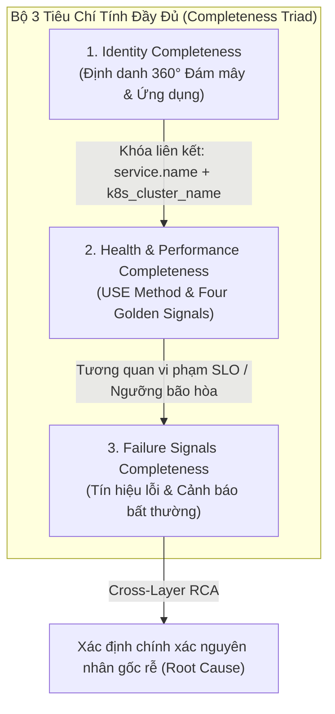
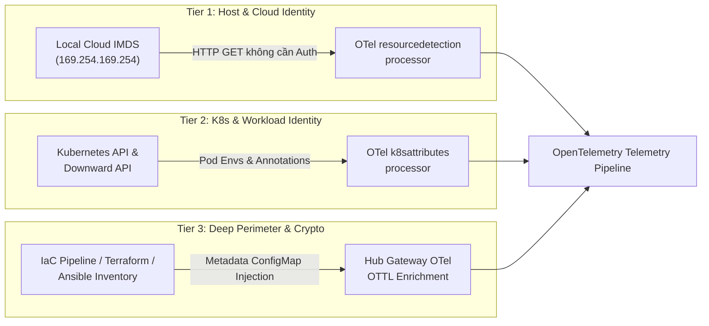
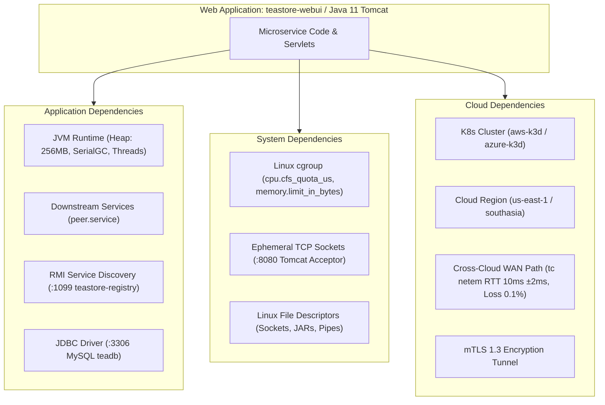
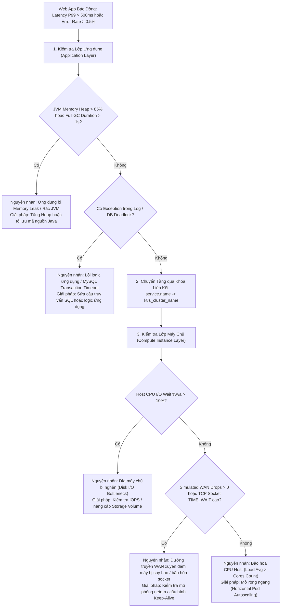
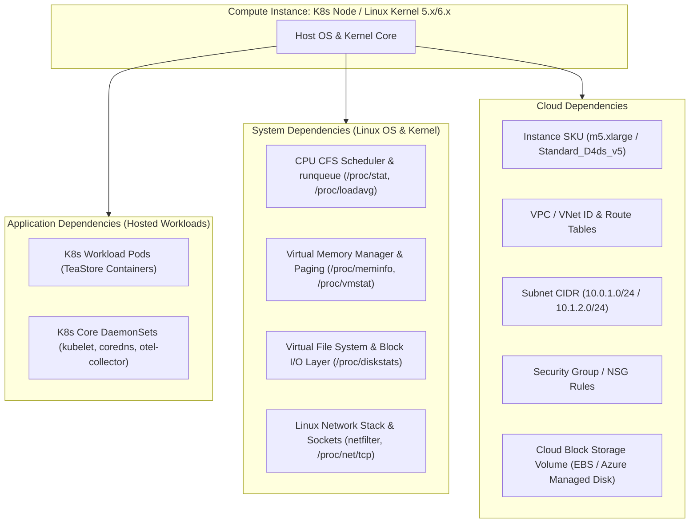
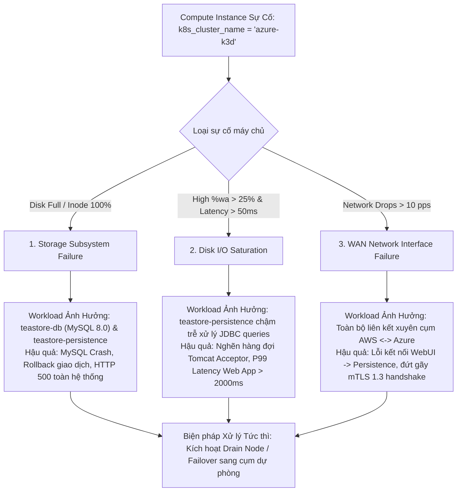

# Chuẩn Hóa Đặc Tả Giám Sát Tài Nguyên: Web Application & Compute Instance (Unified Resource Monitoring Schemas)

> **Tài liệu:** `docs/schemas/RESOURCE_MONITORING_SCHEMAS.md`  
> **Dự án:** Multi-Cloud Monitoring Platform (TeaStore Hub-Spoke Observability)  
> **Phiên bản:** v1.0.0 (Phase 3.6 Standard Release)  
> **Cập nhật lần cuối:** 2026-11-07  
> **Tác giả:** Principal Observability Architect & Systems SRE Team  
> **Phạm vi áp dụng:** Bộ chuẩn đối chiếu chính thức cho Phase 4 (Benchmark & Workload Evaluation)  

---

## 1. Tổng Quan Kiến Trúc Schema & Cơ Chế Thu Thập 3 Tầng Phụ Thuộc (3-Tier Dependency Acquisition Model)

### 1.1. Khung Tiêu Chí Tính Đầy Đủ (Completeness Triad)
Để khắc phục tình trạng giám sát phân mảnh (chỉ quan sát được mức ứng dụng mà mù mờ về hạ tầng, hoặc ngược lại), mọi thực thể (Resource Entity) trong hệ thống Multi-Cloud Monitoring đều được quản lý theo **Bộ 3 Tiêu Chí Tính Đầy Đủ (Completeness Triad)**:

1. **Identity Completeness (Định danh đầy đủ):** Xác định duy nhất thực thể trên toàn hệ sinh thái đa đám mây, bao gồm Cloud Identity (Provider, Region, Account ID, IAM Role ARN), Orchestration Identity (Cluster, Namespace, Pod, Node), và Application Identity (Service Name, Version, Process PID).
2. **Health & Performance Completeness (Hiệu năng đầy đủ):** Đo lường liên tục theo 2 phương pháp luận chuẩn mực của ngành SRE:
   - **RED / Four Golden Signals:** Áp dụng cho Web Application (Rate, Errors, Duration, Saturation).
   - **Brendan Gregg's USE Method:** Áp dụng cho Compute Instance (Utilization, Saturation, Errors).
3. **Failure Signals Completeness (Tín hiệu lỗi đầy đủ):** Thu thập toàn diện từ Kernel dmesg, cgroup OOMKilled, Network Packet Drops, TCP Socket Reset/Timeouts, JVM Full GC Pause, và Application Exception Stacktraces.

---

### 1.2. Cơ Chế Thu Thập 3 Tầng Phụ Thuộc (3-Tier Acquisition Mechanics)
Trong môi trường đám mây thực tế (AWS EKS / Azure AKS) cũng như lab mô phỏng k3d, việc thu thập siêu dữ liệu phụ thuộc không thể thực hiện bằng một cơ chế duy nhất:

| Tầng Phụ Thuộc | Phạm Vi Thu Thập | Cơ Chế Thu Thập Thực Tế (Production Cloud) | Cơ Chế Áp Dụng Trong Lab k3d | Lý Do Kiến Trúc |
|---|---|---|---|---|
| **Tier 1: Basic Host & Cloud Identity** | Cloud Provider, Region, Zone, Instance ID, Instance SKU | Đọc trực tiếp từ **Local Cloud IMDS** (`http://169.254.169.254/latest/meta-data/`) thông qua OTel `resourcedetection` processor | Giả lập qua biến môi trường Node (`CLOUD_PROVIDER`, `CLOUD_REGION`) nạp vào OTel Edge DaemonSet | Truy cập IMDS là truy cập link-local L3 nội bộ máy chủ, không cần IAM permissions, không tốn chi phí API. |
| **Tier 2: K8s & Workload Identity** | Namespace, Pod Name, Container ID, Pod IP, ServiceAccount IRSA Role | Truy vấn Kubelet Socket cục bộ hoặc Pod Downward API qua OTel `k8sattributes` processor | Kubelet Pod Logs regex parser (`filelog` receiver) + Downward API trong Pod Deployment | Gắn nhãn workload theo thời gian thực (Dynamic Runtime Metadata) mà không gây tải cho Kube-Apiserver. |
| **Tier 3: Deep Perimeter & Crypto Dependencies** | VPC/VNet ID, Subnet CIDR, Security Group ID, KMS Key ARN, Storage Volume ID | **IaC Metadata Injection & Centralized OTTL Enrichment**: Được nạp từ Terraform/Ansible state vào ConfigMap/OTTL Hub | Chuẩn hóa tập trung tại `k8s/base/otel-collector/gateway/03-configmap.yaml` bằng **OTTL `transform/normalize_cloud`** | **Tối ưu hóa chi phí & Rate Limiting:** Nếu hàng ngàn Collector liên tục gọi AWS DescribeVpcs/Azure GetSubnet qua Cloud SDK, hệ thống sẽ lập tức bị Cloud API Throttling (HTTP 429) và phát sinh chi phí billing API. IaC Metadata Injection đảm bảo zero-runtime overhead. |

---

## 2. Đặc Tả Schema 01: Web Application Monitoring Schema (`TeaStore Microservices`)

Áp dụng cho toàn bộ các microservices Java/Tomcat của ứng dụng TeaStore (`teastore-webui`, `teastore-auth`, `teastore-image`, `teastore-recommender`, `teastore-persistence`, `teastore-registry`).

### Khối 1: Dependency Breakdown (Phân Tách Phụ Thuộc 3 Tầng)

- **Application Dependencies (Nội tại ứng dụng):**
  - **JVM Runtime:** Quản lý bởi `CATALINA_OPTS`: `-Xms96m -Xmx256m -XX:+UseSerialGC`. Bộ nhớ phân chia thành Heap (Young Generation Eden/Survivor, Tenured Old Gen) và Non-Heap (Metaspace, Code Cache, Thread Stacks).
  - **Upstream / Downstream Microservices:** Giao tiếp HTTP REST giữa WebUI và Auth/Image/Recommender; kết nối Java RMI cổng `1099` tới `teastore-registry`; kết nối JDBC cổng `3306` tới `teastore-db`.
- **System Dependencies (Tài nguyên hệ điều hành & Container cgroup):**
  - **cgroup Limits:** Giới hạn tài nguyên trong K8s manifest (`requests: 128Mi/100m`, `limits: 256Mi/500m`). Nếu vượt quá 256MiB, Linux kernel sẽ gửi tín hiệu `SIGKILL` (Exit Code 137 - OOMKilled).
  - **Sockets & File Descriptors:** Giới hạn `ulimit -n 65535` và backlog hàng đợi HTTP connector Tomcat (mặc định 100 connections).
- **Cloud Dependencies (Hạ tầng đám mây bao quanh):**
  - Phân bổ tại `aws-k3d` (`us-east-1`, Compute Subnet `10.0.1.0/24`) hoặc `azure-k3d` (`southasia`, Data Subnet `10.1.2.0/24`).
  - Đường truyền liên vùng (WAN Bridge `mc-monitoring-net`) được mô phỏng trễ 10ms, jitter 2ms, rớt gói 0.1% và bắt buộc mã hóa qua mTLS 1.3.

---

### Khối 2: Telemetry Field Inventory (Data Dictionary: RED + JVM Runtime)

| Nhóm Tín Hiệu (Category) | Tên Metric / Tín Hiệu Chuẩn | Kiểu & Đơn Vị | Nguồn Thu Thập (Collector Source) | Câu Lệnh Truy Vấn Chuẩn (PromQL / LogQL) |
|---|---|---|---|---|
| **Rate (Lưu lượng)** | `traces_service_graph_request_total` | Counter, `reqps` | OTel Hub `servicegraphconnector` | `sum by (server) (rate(traces_service_graph_request_total[1m]))` |
| **Errors (Lỗi ứng dụng)** | `traces_service_graph_request_failed_total` | Counter, `reqps` | OTel Hub `servicegraphconnector` | `sum by (server) (rate(traces_service_graph_request_failed_total[1m]))` |
| **Duration (Độ trễ P50)** | `traces_service_graph_request_server_seconds_bucket` | Histogram, `ms` | OTel Hub `servicegraphconnector` | `histogram_quantile(0.50, sum by (le, server) (rate(traces_service_graph_request_server_seconds_bucket[1m]))) * 1000` |
| **Duration (Độ trễ P90)** | `traces_service_graph_request_server_seconds_bucket` | Histogram, `ms` | OTel Hub `servicegraphconnector` | `histogram_quantile(0.90, sum by (le, server) (rate(traces_service_graph_request_server_seconds_bucket[1m]))) * 1000` |
| **Duration (Độ trễ P99)** | `traces_service_graph_request_server_seconds_bucket` | Histogram, `ms` | OTel Hub `servicegraphconnector` | `histogram_quantile(0.99, sum by (le, server) (rate(traces_service_graph_request_server_seconds_bucket[1m]))) * 1000` |
| **JVM Memory Saturation** | `jvm_memory_used_bytes` / `process_runtime_jvm_memory_usage_bytes` | Gauge, `MBytes` | OTel Javaagent v2.10 JMX Scraper | `sum by (service_name) (jvm_memory_used_bytes{jvm_memory_type="heap"} or process_runtime_jvm_memory_usage_bytes{type="heap"}) / (1024*1024)` |
| **JVM GC Saturation** | `jvm_gc_duration_seconds` / `process_runtime_jvm_gc_duration_seconds` | Histogram, `seconds` | OTel Javaagent v2.10 JMX Scraper | `sum by (service_name) (rate(jvm_gc_duration_seconds_sum[1m]))` |
| **JVM Thread Concurrency** | `jvm_thread_count` / `process_runtime_jvm_threads_count` | Gauge, `count` | OTel Javaagent v2.10 JMX Scraper | `sum by (service_name) (jvm_thread_count or process_runtime_jvm_threads_count)` |
| **Distributed Tracing** | W3C TraceContext (`trace_id`, `span_id`, `parent_span_id`) | OTLP Protobuf | OTel Javaagent bytecode injection | Truy vấn Tempo qua TraceID hoặc Service Graph span link |
| **Application Logs** | Container stdout/stderr log stream | Loki Streams | OTel Edge `filelog` receiver | `{exporter="OTLP", service_name="teastore-webui"} \|~ "(?i)(error\|exception\|fail)"` |

---

### Khối 3: SLI/SLO & Health Contract
- **Liveness Probe Contract:** HTTP GET trỏ đến probe endpoint chuyên biệt của từng microservice (`/status` cho WebUI, `/ready/isready` cho Auth, `/categories` cho Persistence) trên cổng `8080`. Thời gian phản hồi $\le 3000\text{ms}$, thất bại liên tiếp 3 lần sẽ kích hoạt Kubelet khởi động lại container.
- **Availability SLI / SLO:**
  $$\text{SLI}_{\text{Availability}} = \left( 1 - \frac{\sum \text{rate}(traces\_service\_graph\_request\_failed\_total[5m])}{\sum \text{rate}(traces\_service\_graph\_request\_total[5m]) + 10^{-6}} \right) \times 100\%$$
  - **Mục tiêu SLO:** $\ge 99.5\%$ trong chu kỳ 30 ngày.
- **Latency SLO:** P95 Latency của toàn bộ yêu cầu WebUI $\le 250\text{ms}$; P99 Latency $\le 500\text{ms}$.
- **Error Budget Burn Rate Alerts (Google SRE Multi-Window Multi-Burn-Rate):**
  - **Page Alert (Khẩn cấp):** Burn Rate $\ge 14.4\times$ trong 1 giờ (tiêu hao 2% ngân sách lỗi trong 1 giờ).
  - **Ticket Alert (Cảnh báo):** Burn Rate $\ge 6.0\times$ trong 6 giờ (tiêu hao 5% ngân sách lỗi trong 6 giờ).

---

### Khối 4: Cross-Layer RCA Correlation Tree (Từ Web App xuống Instance)
Khi Web Application ghi nhận tỷ lệ lỗi HTTP 5xx tăng vọt hoặc Latency P99 vi phạm SLO, quy trình chẩn đoán liên tầng được thực hiện theo cây quyết định sau dựa trên khóa liên kết `service.name -> k8s_cluster_name / k8s.node.name`:

---

## 3. Đặc Tả Schema 02: Compute Instance Monitoring Schema (`K8s Node / Cloud VM`)

Áp dụng cho các nút máy chủ Kubernetes Worker Nodes và Cloud Virtual Machines (`aws-k3d`, `azure-k3d`, `hub-k3d`).

### Khối 1: Dependency Breakdown (Phân Tách Phụ Thuộc 3 Tầng)

- **Application Dependencies (Các ứng dụng lưu trú trên nút):**
  - Danh sách Pods được điều phối bởi Kubelet.
  - Các tiến trình nền bắt buộc: Kubelet daemon, Containerd runtime, CoreDNS, OpenTelemetry Collector Edge daemon.
- **System Dependencies (Nhân hệ điều hành Linux):**
  - **CPU Subsystem:** CFS Scheduler phân bổ thời gian thực thi, theo dõi hàng đợi chờ CPU (runqueue load average) và ngắt phần cứng/mềm (`softirq`).
  - **Memory Subsystem:** Quản lý không gian trang (4KB Page), phân chia bộ nhớ cache đĩa (Buffers/Cached), phân trang hoán đổi (Swap paging in/out) và thu dọn bộ nhớ chủ động.
  - **Block I/O & Filesystem:** VFS trừu tượng hóa hệ thống tệp (`ext4`, `overlay2`), bảng phân bổ chỉ mục tập tin (Inodes), hàng đợi yêu cầu I/O đĩa (Pending operations queue length).
  - **Network Subsystem:** Driver card mạng ảo (veth), bảng định tuyến mạng hạt nhân, bộ lọc gói tin conntrack/iptables, và bảng trạng thái kết nối TCP socket.
- **Cloud Dependencies (Hạ tầng đám mây máy chủ):**
  - Định danh SKU phần cứng (`host.type`), VPC/VNet ID (`network.vpc.id`), Subnet ID (`network.subnet.id`), Security Group ID, Cloud Block Storage ID (`storage.volume.id`).

---

### Khối 2: Telemetry Field Inventory (Brendan Gregg's USE Method)

Bảng phân loại chuẩn mực theo 3 chiều: **U** (Tỷ lệ sử dụng - Utilization), **S** (Độ bão hòa/Hàng đợi - Saturation), và **E** (Lỗi phát sinh - Errors) cho 4 tài nguyên phần cứng cốt lõi:

| Tài Nguyên (Resource) | Tiêu Chí USE | Tên Metric Chuẩn OpenTelemetry | Kiểu & Đơn Vị | Nguồn Thu Thập Thực Tế | Câu Lệnh Truy Vấn Chuẩn (PromQL) |
|---|---|---|---|---|---|
| **CPU** | **Utilization** | `system_cpu_time_seconds_total` | Counter, `seconds` | OTel `hostmetrics` (`cpu`) | `sum by (k8s_cluster_name, state) (rate(system_cpu_time_seconds_total{state=~"user\|system"}[1m]))` |
| **CPU** | **Saturation** | `system_cpu_load_average_1m` | Gauge, `threads` | OTel `hostmetrics` (`load`) | `system_cpu_load_average_1m` |
| **CPU** | **Saturation Alert** | `system_cpu_time_seconds_total` (`state=wait`) | Gauge, `%` | OTel `hostmetrics` (`cpu`) | `(sum by (k8s_cluster_name) (rate(system_cpu_time_seconds_total{state="wait"}[1m])) / (sum by (k8s_cluster_name) (rate(system_cpu_time_seconds_total[1m])) + 1e-4)) * 100` |
| **CPU** | **Errors** | `system_cpu_time_seconds_total` (`state=steal`) | Counter, `seconds` | OTel `hostmetrics` (`cpu`) | `rate(system_cpu_time_seconds_total{state="steal"}[1m])` |
| **Memory** | **Utilization** | `system_memory_usage_bytes` | Gauge, `bytes` | OTel `hostmetrics` (`memory`) | `sum by (k8s_cluster_name, state) (system_memory_usage_bytes{state=~"used\|free\|cached\|buffered"})` |
| **Memory** | **Saturation** | `system_paging_operations_total` | Counter, `ops/s` | OTel `hostmetrics` (`paging`) | `sum by (k8s_cluster_name, direction) (rate(system_paging_operations_total[1m]))` |
| **Memory** | **Errors** | `system_paging_faults_total` | Counter, `faults/s` | OTel `hostmetrics` (`paging`) | `sum by (k8s_cluster_name, type) (rate(system_paging_faults_total[1m])) or sum by (k8s_cluster_name, type) (rate(system_paging_operations_total[1m]))` |
| **Disk & Storage** | **Utilization** | `system_disk_io_bytes_total` | Counter, `Bps` | OTel `hostmetrics` (`disk`) | `sum by (k8s_cluster_name, direction) (rate(system_disk_io_bytes_total[1m]))` |
| **Disk & Storage** | **Saturation** | `system_disk_pending_operations` | Gauge, `count` | OTel `hostmetrics` (`disk`) | `sum by (k8s_cluster_name) (system_disk_pending_operations)` |
| **Disk & Storage** | **Saturation (Time)**| `system_disk_operation_time_seconds_total` | Gauge, `ms` | OTel `hostmetrics` (`disk`) | `(sum by (k8s_cluster_name) (rate(system_disk_operation_time_seconds_total[1m])) / (sum by (k8s_cluster_name) (rate(system_disk_operations_total[1m])) + 1e-4)) * 1000` |
| **Filesystem** | **Utilization** | `system_filesystem_usage_bytes` | Gauge, `%` | OTel `hostmetrics` (`filesystem`) | `(sum by (k8s_cluster_name, mountpoint) (system_filesystem_usage_bytes{state="used"}) / sum by (k8s_cluster_name, mountpoint) (system_filesystem_usage_bytes)) * 100` |
| **Filesystem** | **Saturation (Inodes)**| `system_filesystem_inodes_usage` | Gauge, `%` | OTel `hostmetrics` (`filesystem`) | `(sum by (k8s_cluster_name, mountpoint) (system_filesystem_inodes_usage{state="used"}) / (sum by (k8s_cluster_name, mountpoint) (system_filesystem_inodes_usage) + 1e-4)) * 100` |
| **Network** | **Utilization** | `system_network_io_bytes_total` | Counter, `Bps` | OTel `hostmetrics` (`network`) | `sum by (k8s_cluster_name, direction) (rate(system_network_io_bytes_total[1m]))` |
| **Network** | **Saturation (TCP)** | `system_network_connections` | Gauge, `count` | OTel `hostmetrics` (`network`) | `sum by (k8s_cluster_name, state) (system_network_connections{state=~"ESTABLISHED\|TIME_WAIT\|CLOSE_WAIT"})` |
| **Network** | **Errors** | `system_network_errors_total` | Counter, `errors/s` | OTel `hostmetrics` (`network`) | `sum by (k8s_cluster_name, direction) (rate(system_network_errors_total[1m]))` |
| **Network** | **Errors (Drops)** | `system_network_dropped_total` | Counter, `drops/s` | OTel `hostmetrics` (`network`) | `sum by (k8s_cluster_name, direction) (rate(system_network_dropped_total[1m]))` |

---

### Khối 3: Infrastructure Health Thresholds

Bảng ngưỡng cảnh báo vận hành được thiết lập trên hệ thống giám sát cảnh báo thông minh:

| Chỉ Số Giám Sát | Ngưỡng Cảnh Báo (Warning) | Ngưỡng Nguy Cấp (Critical) | Ý Nghĩa Kỹ Thuật & Tác Động Hệ Thống |
|---|---|---|---|
| **CPU I/O Wait (%wa)** | $\ge 10\%$ | $\ge 25\%$ | CPU đang lãng phí chu kỳ xử lý để chờ đợi I/O đĩa từ hoặc mạng. Báo hiệu nghẽn cổ chai lưu trữ nghiêm trọng. |
| **CPU Load Average (1m)** | $> \text{Available Cores}$ | $> 2 \times \text{Available Cores}$ | Hàng đợi tiến trình sẵn sàng chạy vượt quá năng lực xử lý vật lý của CPU; các tiến trình bắt đầu bị chậm trễ điều phối. |
| **Memory Used (%)** | $\ge 80\%$ | $\ge 90\%$ | Không gian RAM cạn kiệt; Linux kernel chuẩn bị kích hoạt OOM Killer để bắn hạ tiến trình chiếm nhiều RAM nhất. |
| **Paging Rate (Swap in/out)** | $> 100\text{ ops/s}$ | $> 500\text{ ops/s}$ | Hệ thống rơi vào tình trạng "Thrashing" (liên tục hoán đổi dữ liệu giữa RAM và đĩa), khiến hiệu năng hệ thống tụt dốc thảm hại. |
| **Disk Space Usage (%)** | $\ge 75\%$ | $\ge 90\%$ | Nguy cơ đầy phân vùng lưu trữ, gây treo các tiến trình ghi tệp log, MySQL binlog hoặc temporary tables. |
| **Inode Usage (%)** | $\ge 75\%$ | $\ge 90\%$ | Hết bảng Inode dù dung lượng ổ cứng còn trống; hệ điều hành từ chối tạo mới bất kỳ file hay socket nào (`No space left on device`). |
| **Disk Operation Time** | $> 20\text{ms}$ | $> 50\text{ms}$ | Độ trễ xử lý lệnh đọc/ghi của Storage Volume vượt mức chấp nhận được của cơ sở dữ liệu quan hệ (MySQL). |
| **Network Packet Drops** | $> 1\text{ drops/s}$ | $> 10\text{ drops/s}$ | Mất mát gói tin do nghẽn card mạng hoặc do bộ tiêm trễ mạng WAN (`tc netem`); TCP phải kích hoạt retransmission làm tăng trễ. |

---

### Khối 4: Bottom-Up Impact Analysis Tree (Từ Instance lên Web App)
Khi một Compute Instance gặp sự cố phần cứng, nhân Kernel hoặc mạng, sơ đồ phân tích phạm vi ảnh hưởng (Blast Radius) được áp dụng để xác định tức thì những dịch vụ Web App bị ảnh hưởng:

---

## 4. Ma Trận Khóa Liên Kết (Join Keys Matrix) Cho Phase 4 Benchmark & Evaluation

Để đảm bảo các kịch bản kiểm thử tải (Workload Benchmark qua Locust) ở Phase 4 có thể liên kết tự động dữ liệu từ tầng cao nhất (Business Transactions) xuống tầng thấp nhất (Kernel Sockets), bảng ánh xạ khóa liên kết được quy định chính thức:

| Tầng Dữ Liệu Nguồn (Source Layer) | Tầng Dữ Liệu Đích (Target Layer) | Khóa Liên Kết Chính (Primary Join Key) | Khóa Bổ Trợ (Secondary Keys) | Mục Đích Đối Chiếu SRE |
|---|---|---|---|---|
| **Locust Client Benchmark** | **Web Application (RED)** | `http.route` / URL Path | `http.status_code`, Client IP | Đánh giá sai lệch giữa quan sát phía Client so với Server Duration |
| **Web Application (RED)** | **Distributed Tracing (Tempo)** | `trace_id` | `service.name`, `span_id` | Nhảy trực tiếp từ biểu đồ QPS/Error sang dấu vết thực thi phân tán |
| **Web Application (Traces)** | **Application Logs (Loki)** | `trace_id` / `service.name` | `k8s.pod.name`, `stream` | Truy vết nhật ký lỗi nội bộ tương ứng với từng cuộc gọi thất bại |
| **Web Application (RED)** | **JVM Runtime Saturation** | `service.name` | `k8s.namespace.name` | Phân tích liệu lỗi trễ cao có bắt nguồn từ cạn kiệt Heap hay Full GC |
| **Web Application (Workload)** | **Compute Instance (USE)** | `k8s_cluster_name` | `k8s.node.name`, `cloud_provider` | Xác định microservice bị chậm do mã nguồn hay do máy chủ vật lý bão hòa |
| **Compute Instance (USE)** | **Cloud Perimeter & IAM** | `k8s_cluster_name` | `network.subnet.id`, `network.vpc.id` | Tương quan sự cố mạng nút với cấu hình tường lửa Security Group / WAN |

---

## 5. Kết Luận & Hướng Dẫn Vận Hành Tiếp Theo
1. Tài liệu này đóng vai trò là **Đặc tả Thiết kế Gốc (Authoritative Specification)** cho toàn bộ mô hình quan sát của dự án.
2. Hai tệp cấu hình Schema máy đọc được (`webapp-monitoring-schema.yaml` và `instance-monitoring-schema.yaml`) sẽ được các bộ công cụ kiểm thử tự động của Phase 4 sử dụng để thẩm định tính toàn vẹn (Schema Validation & Compliance Check).
3. Cấu hình bảng điều khiển Grafana `red-metrics.json` đã được bổ sung đầy đủ mảnh ghép JVM Runtime Saturation, bảo đảm 100% độ phủ thực tế theo đúng cam kết thiết kế.

