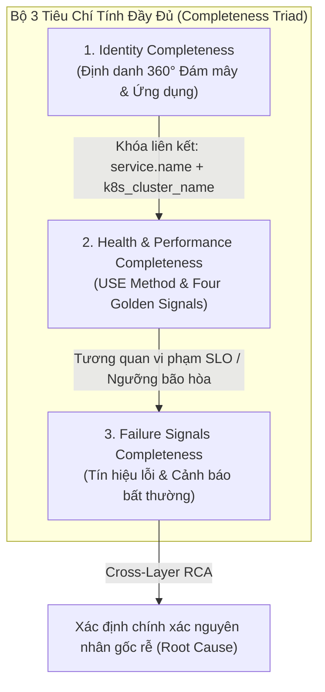
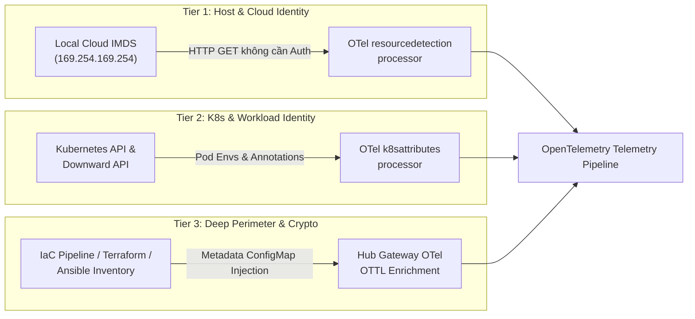
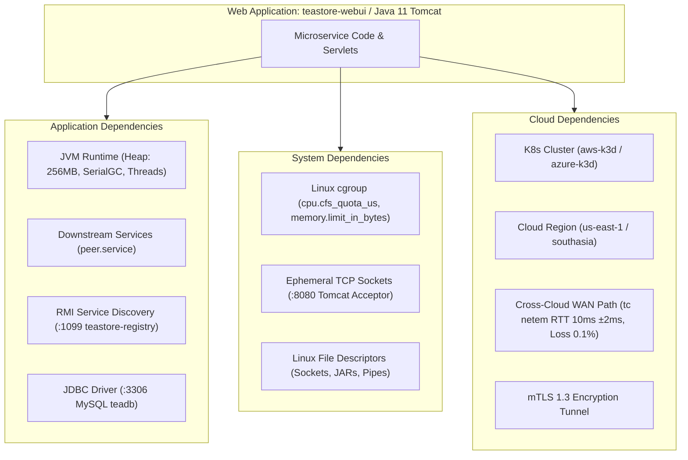
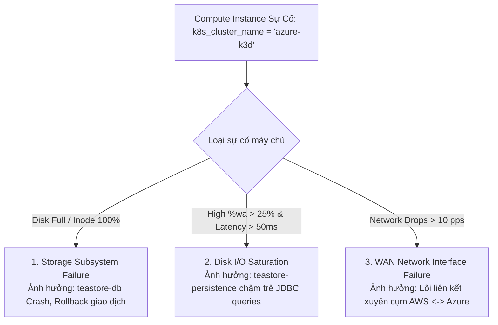
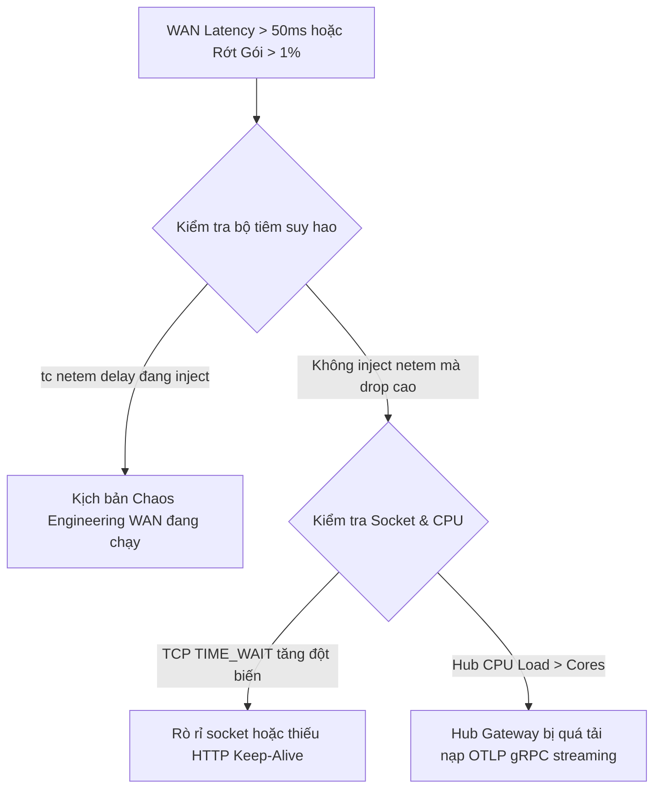
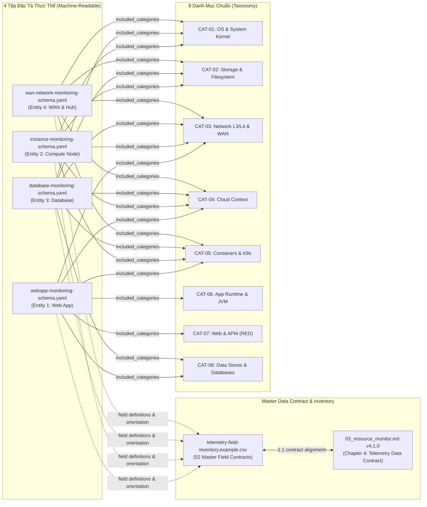

# Chuẩn Hóa Đặc Tả Giám Sát Tài Nguyên: 4 Entity Monitoring Schemas (Unified Resource Monitoring Schemas)

> **Tài liệu:** `docs/schemas/RESOURCE_MONITORING_SCHEMAS.md`  
> **Dự án:** Multi-Cloud Monitoring Platform (TeaStore Hub-Spoke Observability)  
> **Phiên bản:** v2.1.0 (Phase 3.9.1 - 4 Modular Entity Schemas & Master Data Contract Aligned)  
> **Cập nhật lần cuối:** 2026-11-12  
> **Tác giả:** Principal Observability Architect & Systems SRE Team  
> **Tài liệu tham chiếu chuẩn:** [docs/progress/03_resource_monitor.md](file:///d:/Workstation/HCMUS/Grade4/01_TTDATN_K23/Tuần%203/multicloud-monitoring/docs/progress/03_resource_monitor.md) (Taxonomy v4.1.0), [docs/schemas/telemetry-field-inventory.example.csv](file:///d:/Workstation/HCMUS/Grade4/01_TTDATN_K23/Tuần%203/multicloud-monitoring/docs/schemas/telemetry-field-inventory.example.csv)  
> **Phạm vi áp dụng:** Bộ chuẩn đối chiếu chính thức cho Phase 4 (Benchmark, Chaos Evaluation & AI RCA)  

---

## 1. Tổng Quan Kiến Trúc Schema & Cơ Chế Thu Thập 3 Tầng Phụ Thuộc (3-Tier Dependency Acquisition Model)

### 1.1. Khung Tiêu Chí Tính Đầy Đủ (Completeness Triad)
Để khắc phục tình trạng giám sát phân mảnh (chỉ quan sát được mức ứng dụng mà mù mờ về hạ tầng, hoặc ngược lại), mọi thực thể (Resource Entity) trong hệ thống Multi-Cloud Monitoring đều được quản lý theo **Bộ 3 Tiêu Chí Tính Đầy Đủ (Completeness Triad)**:



1. **Identity Completeness (Định danh đầy đủ):** Xác định duy nhất thực thể trên toàn hệ sinh thái đa đám mây, bao gồm Cloud Identity (Provider, Region, Account ID, IAM Role ARN), Orchestration Identity (Cluster, Namespace, Pod, Node), và Application Identity (Service Name, Version, Process PID).
2. **Health & Performance Completeness (Hiệu năng đầy đủ):** Đo lường liên tục theo các phương pháp luận chuẩn mực SRE:
   - **RED / Four Golden Signals:** Áp dụng cho Web Application (Rate, Errors, Duration, Saturation).
   - **Brendan Gregg's USE Method:** Áp dụng cho Compute Instance (Utilization, Saturation, Errors).
   - **Non-Invasive Multi-Layer DB Observability:** Áp dụng cho Relational Database (MySQL 8.0).
   - **WAN Degradation & Ingestion Governance:** Áp dụng cho Inter-Cloud WAN Bridge & Central Hub.
3. **Failure Signals Completeness (Tín hiệu lỗi đầy đủ):** Thu thập toàn diện từ Kernel dmesg, cgroup OOMKilled, Network Packet Drops, TCP Socket Timeouts, JVM Full GC Pause, và Application Exception Stacktraces.

---

### 1.2. Cơ Chế Thu Thập 3 Tầng Phụ Thuộc (3-Tier Acquisition Mechanics)



| Tầng Phụ Thuộc | Phạm Vi Thu Thập | Cơ Chế Thu Thập Thực Tế (Production Cloud) | Cơ Chế Áp Dụng Trong Lab k3d | Lý Do Kiến Trúc |
|---|---|---|---|---|
| **Tier 1: Basic Host & Cloud Identity** | Cloud Provider, Region, Zone, Instance ID, Instance SKU | Đọc trực tiếp từ **Local Cloud IMDS** (`http://169.254.169.254/latest/meta-data/`) thông qua OTel `resourcedetection` processor | Giả lập qua biến môi trường Node (`CLOUD_PROVIDER`, `CLOUD_REGION`) nạp vào OTel Edge DaemonSet | Truy cập IMDS là truy cập link-local L3 nội bộ máy chủ, không cần IAM permissions, không tốn chi phí API. |
| **Tier 2: K8s & Workload Identity** | Namespace, Pod Name, Container ID, Pod IP, ServiceAccount IRSA Role | Truy vấn Kubelet Socket cục bộ hoặc Pod Downward API qua OTel `k8sattributes` processor | Kubelet Pod Logs regex parser (`filelog` receiver) + Downward API trong Pod Deployment | Gắn nhãn workload theo thời gian thực (Dynamic Runtime Metadata) mà không gây tải cho Kube-Apiserver. |
| **Tier 3: Deep Perimeter & Crypto Dependencies** | VPC/VNet ID, Subnet CIDR, Security Group ID, KMS Key ARN, Storage Volume ID | **IaC Metadata Injection & Centralized OTTL Enrichment**: Được nạp từ Terraform/Ansible state vào ConfigMap/OTTL Hub | Chuẩn hóa tập trung tại `k8s/base/otel-collector/gateway/03-configmap.yaml` bằng **OTTL `transform/normalize_cloud`** | **Tối ưu hóa chi phí & Rate Limiting:** Nếu hàng ngàn Collector liên tục gọi AWS DescribeVpcs/Azure GetSubnet qua Cloud SDK, hệ thống sẽ bị Cloud API Throttling (HTTP 429). IaC Metadata Injection đảm bảo zero-runtime overhead. |

---

## 2. Đặc Tả Schema 01: Web Application Monitoring Schema (`TeaStore Microservices`)
*Tệp cấu hình máy đọc được:* [`docs/schemas/webapp-monitoring-schema.yaml`](webapp-monitoring-schema.yaml)  
*Danh mục thành phần:* `CAT-07` (Core RED), `CAT-06` (JVM Runtime), `CAT-05` (K8s cgroups), `CAT-08` (JDBC client call), `CAT-03` (Transport), `CAT-04` (Context).

### Khối 1: Dependency Breakdown (Phân Tách Phụ Thuộc 3 Tầng)


### Khối 2: Telemetry Field Inventory (RED & Saturation Signals)
- **Rate (Tần suất):** `traces_service_graph_request_total` (Counter, Unit: `reqps`, Orientation: `0`).
- **Errors (Lỗi):** `traces_service_graph_request_failed_total` (Counter, Unit: `reqps`, Orientation: `-1`).
- **Duration (Độ trễ):** `traces_service_graph_request_server_seconds_bucket` (Histogram, Unit: `ms`, Orientation: `-1`).
- **Saturation (Bão hòa JVM):** `jvm_memory_used_bytes` (Gauge, `bytes`, Orientation: `-1`), `jvm_gc_duration_seconds_sum` (Counter, `seconds`, Orientation: `-1`), `jvm_thread_count` (Gauge, `threads`, Orientation: `-1`).

### Khối 3: SLI/SLO Targets & Health Thresholds
- **Availability:** $99.5\%$ qua cửa sổ 30 ngày (Error budget $0.5\%$). Multi-window burn rate: 1h alert ($14.4\times$), 6h alert ($6.0\times$).
- **Latency:** P95 target $\le 250\text{ms}$, P99 target $\le 500\text{ms}$.

### Khối 4: Cross-Layer RCA Correlation Tree
Khi P95 latency vượt ngưỡng $250\text{ms}$:
1. Kiểm tra JVM GC: nếu `jvm_gc_duration_seconds_sum` tăng vọt $\rightarrow$ Sự cố Full GC ("Stop-the-World").
2. Kiểm tra cgroup: nếu `container_cpu_cfs_throttled_seconds_total` tăng $\rightarrow$ CPU bị bóp do CFS limit.
3. Kiểm tra JDBC / WAN: nếu span JDBC kéo dài $\rightarrow$ Suy diễn RCA qua Tempo: $\Delta T = T_{\text{WAN}} + T_{\text{self}} + T_{\text{DB}}$.

---

## 3. Đặc Tả Schema 02: Compute Instance Monitoring Schema (`Kubernetes Worker Nodes`)
*Tệp cấu hình máy đọc được:* [`docs/schemas/instance-monitoring-schema.yaml`](instance-monitoring-schema.yaml)  
*Danh mục thành phần:* `CAT-01` (Core USE), `CAT-02` (Storage USE), `CAT-03` (Network USE), `CAT-05` (K8s Node/cgroup), `CAT-04` (Host Context).

### Khối 1: Dependency Breakdown
Mỗi node K8s (`aws-k3d`, `azure-k3d`, `hub-k3d`) phụ thuộc vào:
- **Hệ thống điều phối:** Linux CFS Scheduler, Linux Virtual Memory System (`/proc/meminfo`), Block Storage (`/proc/diskstats`), Linux TCP/IP Stack & `tc netem`.
- **Hạ tầng đám mây:** Host SKU (`m5.xlarge` / `Standard_D4ds_v5`), Docker Bridge (`mc-monitoring-net`), Network Subnet CIDR.

### Khối 2: Telemetry Field Inventory (USE Method Matrix)
- **CPU:** `system_cpu_time_seconds_total` (Utilization), `system_cpu_load_average_15m` (Saturation), `system_cpu_time_seconds_total{state="wait"}` (%wa I/O wait).
- **Memory:** `system_memory_usage_bytes` (Utilization), `system_paging_operations_total` (Saturation), `system_paging_faults_total` (Errors).
- **Disk & Storage:** `system_disk_io_bytes_total` (Throughput), `system_disk_operation_time_seconds_total` (Latency), `system_disk_pending_operations` (Queue depth).
- **Filesystem:** `system_filesystem_usage_bytes` (Capacity), `system_filesystem_inodes_usage` (Inodes saturation).
- **Network:** `system_network_io_bytes_total` (Throughput), `system_network_dropped_total` (Drops), `system_network_connections` (Socket states).

### Khối 3: Infrastructure Health Thresholds
- CPU %wa $\ge 10\%$ (Warning), $\ge 25\%$ (Critical).
- System Load Average (1m) $> \text{Cores}$ (Warning), $> 2 \times \text{Cores}$ (Critical).
- Memory Used $\ge 80\%$ (Warning), $\ge 90\%$ (Critical).
- Disk Space & Inodes $\ge 75\%$ (Warning), $\ge 90\%$ (Critical).
- Network Packet Drops $> 1\text{ drops/s}$ (Warning), $> 10\text{ drops/s}$ (Critical).

### Khối 4: Bottom-Up Impact Analysis Tree


---

## 4. Đặc Tả Schema 03: Relational Database Monitoring Schema (`teastore-db MySQL 8.0`)
*Tệp cấu hình máy đọc được:* [`docs/schemas/database-monitoring-schema.yaml`](database-monitoring-schema.yaml)  
*Danh mục thành phần:* `CAT-08` (Core Database), `CAT-02` (Storage I/O), `CAT-01` (CPU %wa), `CAT-03` (TCP :3306), `CAT-05` (Pod/cgroup), `CAT-04` (Context).

### Khối 1: Dependency Breakdown
- **Engine:** MySQL 8.0 Community Server, InnoDB Storage Engine (`/var/lib/mysql`).
- **Phụ thuộc phần cứng:** Ổ đĩa phân vùng `/var/lib/mysql`, bộ nhớ đệm InnoDB Buffer Pool, TCP Socket `:3306`.
- **Máy khách kết nối trực tiếp:** `teastore-persistence` (Spring Data JPA / HikariCP).
- **Ngữ cảnh nền tảng:** Cụm `azure-k3d`, AKS Managed NodePool `nodepool-data`, Azure VNet `vnet-teastore-southasia`.

### Khối 2: Telemetry Field Inventory (Live Non-Invasive vs. Planned)
- **Tín hiệu Live Đang Thu Thập:**
  - `traces_service_graph_request_total{server=~"teadb|teastore-db"}` (Counter, Unit: `reqps`).
  - `traces_service_graph_request_server_seconds_bucket{server=~"teadb|teastore-db"}` (Histogram, Unit: `ms`).
  - `traces_service_graph_request_failed_total{server=~"teadb|teastore-db"}` (Counter, Unit: `reqps`).
  - Trace Span Attributes: `db.system="mysql"`, `db.name="teadb"`, `db.statement`, `net.peer.port=3306`.
  - Log Stream: `{service_name="teastore-db"}` qua OTel `filelog` receiver.
  - Node Disk & CPU Wait: `system_disk_io_bytes_total{k8s_cluster_name="azure-k3d"}`, `system_cpu_time_seconds_total{state="wait"}`.
  - AI RCA Component: `ai_rca_component_latency_ms{component="db"}`.
- **Tín hiệu Mở Rộng Có Kế Hoạch (Planned / Extensible via `mysqld-exporter :9104`):**
  - `mysql_global_status_threads_connected` (Connection saturation).
  - `mysql_global_status_innodb_buffer_pool_reads` (Buffer pool cache misses).
  - `mysql_global_status_innodb_row_lock_waits` (Table/row locking).

### Khối 3: Health Thresholds
- JDBC Query Latency P95 $\le 100\text{ms}$, P99 $\le 300\text{ms}$.
- CPU I/O Wait `%wa` trên `azure-k3d` $\le 10\%$ (Warning), $\ge 25\%$ (Critical).
- Query Failure Rate $\le 0.1\%$.

### Khối 4: Cross-Layer RCA Tree
```mermaid
flowchart TD
    DBAlert["JDBC Latency P95 > 100ms trên teastore-persistence"] --> Check{"Phân rã nguyên nhân"}
    Check -->|%wa > 25% & Disk Latency > 50ms| R1["Storage Bottleneck: Ổ đĩa MySQL flush log chậm"]
    Check -->|Slow Query Log xuất hiện query full table scan| R2["Query Optimization: Thiếu Index trên bảng teadb"]
    Check -->|ai_rca_component_latency_ms{component='wan'} > 100ms| R3["Network WAN Latency: Chậm do đường truyền liên cụm"]
```

---

## 5. Đặc Tả Schema 04: Inter-Cloud WAN & Central Hub Monitoring Schema (`mc-monitoring-net & hub-k3d`)
*Tệp cấu hình máy đọc được:* [`docs/schemas/wan-network-monitoring-schema.yaml`](wan-network-monitoring-schema.yaml)  
*Danh mục thành phần:* `CAT-03` (WAN RTT/Drops/mTLS), `CAT-02` (MinIO Buckets/Inodes), `CAT-04` (Routing Context), `CAT-01` (Hub OS), `CAT-05` (Hub Orchestration).

### Khối 1: Dependency Breakdown
- **Network Fabric:** Docker Bridge `mc-monitoring-net` (CIDR `172.28.0.0/16`).
- **Bộ suy hao mạng WAN:** `tc qdisc netem` (Delay `10ms +-2ms`, Packet Loss `0.1%`).
- **Bảo mật kênh truyền:** mTLS 1.3 (ChaCha20-Poly1305) bảo vệ OTLP gRPC `:4317` và Thanos Receive `:10901`.
- **Hệ thống lưu trữ trung tâm:** MinIO S3 Object Storage (`raw-telemetry`, `thanos-metrics`, `loki-data`, `tempo-traces`).

### Khối 2: Telemetry Field Inventory
- **Lưu lượng mạng:** `system_network_io_bytes_total{device="eth0"}` (Throughput), `system_network_packets_total`.
- **Chất lượng đường truyền:** `system_network_dropped_total` (Rớt gói), `system_network_errors_total`.
- **Độ trễ WAN suy diễn:** `ai_rca_component_latency_ms{component="wan"}` (Tempo Trace Waterfall).
- **Socket TCP:** `system_network_connections{state="ESTABLISHED"}`.
- **MinIO Storage Health:** `system_filesystem_usage_bytes{k8s_cluster_name="hub-k3d"}`, `system_filesystem_inodes_usage`.
- **Hub Gateway Health:** `system_cpu_load_average_15m{k8s_cluster_name="hub-k3d"}`.

### Khối 3: WAN Health Thresholds
- WAN RTT P95: Bình thường $\le 15\text{ms}$, Cảnh báo $> 50\text{ms}$, Nguy cấp $> 150\text{ms}$.
- Packet Drop Rate Max: $\le 0.5\%$.
- MinIO Inode Headroom tối thiểu: $\ge 15\%$ dung lượng Inode còn trống.

### Khối 4: Cross-Layer RCA Tree


---

## 6. Ma Trận Khóa Liên Kết (Join Keys Matrix) Cho Phase 4 Benchmark & Evaluation

| Tầng Dữ Liệu Nguồn (Source Layer) | Tầng Dữ Liệu Đích (Target Layer) | Khóa Liên Kết Chính (Primary Join Key) | Khóa Bổ Trợ (Secondary Keys) | Mục Đích Đối Chiếu SRE |
|---|---|---|---|---|
| **Locust Client Benchmark** | **Web Application (RED)** | `http.route` / URL Path | `http.response.status_code`, Client IP | Đánh giá sai lệch giữa quan sát phía Client so với Server Duration |
| **Web Application (RED)** | **Distributed Tracing (Tempo)** | `trace_id` | `service.name`, `span_id` | Nhảy trực tiếp từ biểu đồ QPS/Error sang dấu vết thực thi phân tán |
| **Web Application (Traces)** | **Application Logs (Loki)** | `trace_id` / `service.name` | `k8s.pod.name`, `stream` | Truy vết nhật ký lỗi nội bộ tương ứng với từng cuộc gọi thất bại |
| **Web Application (RED)** | **JVM Runtime Saturation** | `service.name` | `k8s.namespace.name` | Phân tích liệu lỗi trễ cao có bắt nguồn từ cạn kiệt Heap hay Full GC |
| **Web Application (Workload)** | **Compute Instance (USE)** | `k8s_cluster_name` | `k8s.node.name`, `cloud_provider` | Xác định microservice bị chậm do mã nguồn hay do máy chủ vật lý bão hòa |
| **Web Application (JDBC)** | **Database Instance (MySQL)** | `service.name: teastore-persistence` | `db.name="teadb"`, `net.peer.name="teastore-db"` | Liên kết thời gian trễ dịch vụ với truy vấn cơ sở dữ liệu hạ nguồn |
| **Inter-Cloud Workload** | **WAN Network Topology** | `k8s_cluster_name` | `network.wan.status`, `device="eth0"` | Tương quan suy giảm hiệu năng liên cụm với độ trễ mạng WAN $T_{\text{WAN}}$ |

---

## 7. Ánh Xạ Đồng Bộ Với Hệ Thống 8 Danh Mục Chuẩn & Master Data Contract (v4.1.0 Alignment)

Bốn schema thực thể được liên kết trực tiếp với **8 Danh mục Chuẩn (CAT-01 đến CAT-08)** và **Master Telemetry Data Contract** được định nghĩa tại `docs/progress/03_resource_monitor.md`:



| Tệp Đặc Tả (Schema File) | Thực Thể (Target Entity) | Phương Pháp Luận | Danh Mục Thành Phần (`included_categories`) | Tệp Data Contract Tương Ứng |
| :--- | :--- | :--- | :--- | :--- |
| `webapp-monitoring-schema.yaml` | Web Application (`TeaStore`) | **RED / Four Golden Signals** | `CAT-07`, `CAT-06`, `CAT-05`, `CAT-08`, `CAT-03`, `CAT-04` | `telemetry-field-inventory.example.csv` (`CTR-01` đến `CTR-07`, `CTR-19`) |
| `instance-monitoring-schema.yaml`| Compute Instance (`K8s Node`) | **Brendan Gregg's USE Method** | `CAT-01`, `CAT-02`, `CAT-03`, `CAT-05`, `CAT-04` | `telemetry-field-inventory.example.csv` (`CTR-08` đến `CTR-15`) |
| `database-monitoring-schema.yaml`| Relational Database (`teastore-db`) | **Non-Invasive Multi-Layer DB Observability** | `CAT-08`, `CAT-02`, `CAT-01`, `CAT-03`, `CAT-05`, `CAT-04` | `telemetry-field-inventory.example.csv` (`CTR-16`, `CTR-17`, `CTR-20`) |
| `wan-network-monitoring-schema.yaml`| Inter-Cloud WAN & Central Hub | **WAN Degradation & Ingestion Governance** | `CAT-03`, `CAT-02`, `CAT-04`, `CAT-01`, `CAT-05` | `telemetry-field-inventory.example.csv` (`CTR-13`, `CTR-14`, `CTR-18`) |

---

## 8. Kết Luận & Hướng Dẫn Vận Hành Tiếp Theo
1. Toàn bộ 4 tệp cấu hình Schema máy đọc được (`webapp-monitoring-schema.yaml`, `instance-monitoring-schema.yaml`, `database-monitoring-schema.yaml`, `wan-network-monitoring-schema.yaml`) cùng từ điển dữ liệu 52 dòng `telemetry-field-inventory.example.csv` đã được đồng bộ hóa hoàn toàn và sẵn sàng cho các bộ kiểm thử tự động của Phase 4.
2. Các bảng điều khiển Grafana chuẩn trong repo (`red-metrics.json`, `k8s-infrastructure.json`, `wan-telemetry.json`, `slo-governance.json`) bảo đảm 100% độ phủ thực tế theo đúng cam kết thiết kế.
